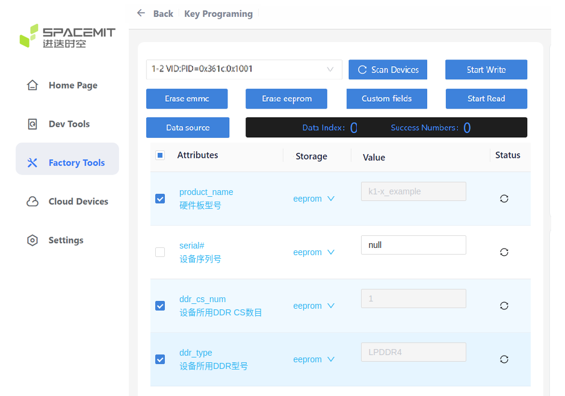
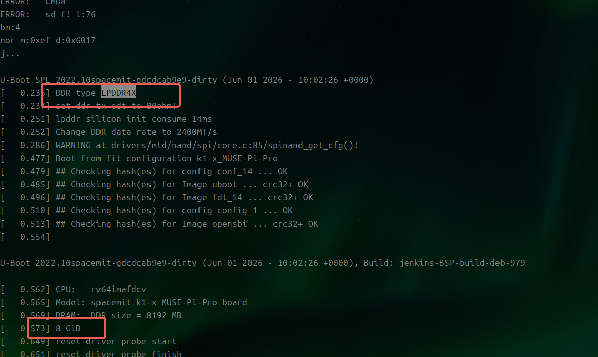

# Solution Management

This document introduces how the SDK manages solutions, including solution configuration files, how to customize solutions, and how to add new solutions.

## Solution Configuration Files

Taking the default solution K1 as an example, it usually includes the following configuration files:

```shell
buildroot-ext/board/spacemit/k1/partition_*.json
buildroot-ext/board/spacemit/k1/env_k1-x.txt
buildroot-ext/board/spacemit/k1/k1-x.bmp
buildroot-ext/board/spacemit/k1/dracut.conf
buildroot-ext/board/spacemit/k1/target_overlay
buildroot-ext/configs/spacemit_k1_defconfig
bsp-src/opensbi/platform/generic/configs/k1_defconfig
bsp-src/uboot-2022.10/configs/k1_defconfig
bsp-src/linux-6.1/arch/riscv/configs/k1_defconfig
```

**buildroot-ext/board/spacemit/k1/partition_*.json**

Partition configuration files:

- `partition_2M.json`：for 2MB flash
- `partition_universal.json`：for high capacity flash, such as eMMC, sdcard, SSD

**buildroot-ext/board/spacemit/k1/env_k1-x.txt**

The environment variables of u-boot, customizable boot parameters.

**buildroot-ext/board/spacemit/k1/bianbu.bmp**

u-boot boot logo：

- Format: BMP
- Resolution: less than or equal to screen resolution
- Bit depth: 32

**buildroot-ext/board/spacemit/k1/dracut.conf**

Dracut configuration file, Dracut is a tool for creating initramfs images.

**buildroot-ext/board/spacemit/k1/target_overlay**

This directory is an overlay for the target directory.

**buildroot-ext/configs/spacemit_k1_defconfig**

Buildroot configuration file.

**bsp-src/opensbi/platform/generic/configs/k1_defconfig**

opensbi configuration file.

**bsp-src/uboot-2022.10/configs/k1_defconfig**

u-boot configuration file.

**bsp-src/linux-6.1/arch/riscv/configs/k1_defconfig**

Kernel configuration file.

## Default Partition Configuration

Try not to modify the partition configuration before `bootfs` to avoid hard-coded boot code, which may cause boot failure after modification.

### eMMC Partition Configuration

Configured according to the `partitions` array in the partition_universal.json file, where bootinfo and fsbl are located in the boot0 partition of the eMMC.

eMMC boot0 partition configuration is as follows:

```
-----------------------------
|/bootinfo/        | fsbl   |
-----------------------------
^         ^        ^        ^
|         |        |        |
0K        80bytes  512bytes 198.5K
```

eMMC GPP partition configuration is as follows:

```
--------------------------------------------------------------------------------------------
| gpt                            | env | opensbi | uboot   |    bootfs      |    rootfs    |
--------------------------------------------------------------------------------------------
^                                ^     ^         ^         ^                ^              ^
|                                |     |         |         |                |              |
0K                               384K  448K      832K      4M               260M           Capacity
```

**Note**

- If booting from eMMC, the Boot ROM loads the FSBL from the boot0 partition rather than the GPP partition. The FSBL in the GPP partition is ignored in this case.

### sdcard Partition Configuration

Configured entirely according to the `partitions` array in the partition_universal.json file.

Partition configuration is as follows:

```
--------------------------------------------------------------------------------------------
|/bootinfo/ gpt           | fsbl | env | opensbi | uboot   |    bootfs    |    rootfs    |
--------------------------------------------------------------------------------------------
^         ^               ^      ^     ^         ^         ^              ^              ^
|         |               |      |     |         |         |              |              |
0K        80bytes         128K   384K  448K      832K      4M             260M           Capacity
```

### SPINOR + SSD Partition Configuration

In SSD solutions, SPINOR is used for booting. All partitions before `bootfs` are stored in SPINOR, and configured according to the `partitions` array in the `partition_<SPINOR size>.json` file.

SPINOR partition configuration is as follows:

```
----------------------------------------------------
|/bootinfo/         | fsbl | env | opensbi | uboot |
----------------------------------------------------
^         ^         ^      ^     ^         ^       ^
|         |         |      |     |         |       |
0K        80bytes   128K   384K  448K      640K    Capacity
```

bootfs and rootfs are stored in SSD, and configured according to the `partitions` array in the partition_universal.json file.

```
------------------------------------------------------------------------------------------
| gpt                                                      |    bootfs    |    rootfs    |
------------------------------------------------------------------------------------------
^                                                          ^              ^              ^
|                                                          |              |              |
0K                                                         4M             260M           Capacity
```

## Adding a New DTS Solution

For information on adding a device solution based on Buildroot, see [Device Management](./device_management.md).

**Note:**

- For a quick flashing and boot test, you can use the default `deb1` solution.
- After adding a device tree to an existing build, rerun `make envconfig`, then run `make uboot-rebuild && make linux-rebuild && make` to rebuild and package the image.

## Flashing and Booting a New Board

Before flashing and booting a board for the first time, consult the [supported components list](https://spacemit.com/community/document/info?lang=en&nodepath=hardware/key_stone/k1/k1_hw/k1_hw_avl.md). Unsupported components may require adaptation first. Check the following:

- Whether a new DTS solution has been added.
- Whether the DDR type is LPDDR4 or LPDDR4X. Compare the DDR part number against the supported components list; unsupported parts may require driver adaptation.
- Whether the DDR uses one or two chip selects (CS).
- Whether an EEPROM is connected and can be identified. After programming it, power-cycle the board and read it back to verify. The EEPROM stores board and DDR information used at boot. **Incorrect key information can cause flashing or boot failure.**

### Board With EEPROM

Use the [programming tool](https://www.spacemit.com/community/document/info?lang=en&nodepath=tools/user_guide/flasher_user_guide.md) to write the DDR model, DDR CS count, and device-tree board name to the EEPROM.

**Note:**

- Clear a checkbox before changing its value, then select it again. Do not select configuration items whose values are uncertain.
- If no new device tree has been added, leave `product_name` empty; `k1-x_deb1` is loaded by default. A nonexistent device-tree name prevents the DTB from being found.
- If the DDR CS count is unknown, enter 1 initially, then check whether the DDR capacity in the U-Boot serial output matches the hardware.



### Board Without EEPROM or With Unknown EEPROM Status

**EEPROM adaptation is recommended first. The following default-value changes are for reference only.**

After changing the DDR and default solution configuration, rebuild U-Boot and the image:

```shell
make uboot-rebuild && make
```

The following example configures single-CS LPDDR4 and sets the default board name to `k1-x_example`. Adapt it to the actual hardware:

```diff
user:~/workspace/bianbu-linux-pub/bsp-src/uboot-2022.10$ git diff arch/riscv/dts/k1-x_spl.dts include/
diff --git a/arch/riscv/dts/k1-x_spl.dts b/arch/riscv/dts/k1-x_spl.dts
index 42235de070..7f90add9c2 100644
--- a/arch/riscv/dts/k1-x_spl.dts
+++ b/arch/riscv/dts/k1-x_spl.dts
@@ -79,8 +79,8 @@
	ddr@c0000000 {
		/* dram data rate, should be 1200, 1600, or 2400 */
		datarate = <2400>;
-               cs-num = <2>;
-               type = "LPDDR4X";
+               cs-num = <1>;
+               type = "LPDDR4";
		tx-odt = <80>;
		u-boot,dm-spl;
	};
diff --git a/include/configs/k1-x.h b/include/configs/k1-x.h
index 1af9debcf1..2c63b90546 100644
--- a/include/configs/k1-x.h
+++ b/include/configs/k1-x.h
@@ -25,12 +25,12 @@
 #define CONFIG_GATEWAYIP       10.0.92.1
 #define CONFIG_NETMASK         255.255.255.0

-#define DEFAULT_PRODUCT_NAME   "k1-x_deb1"
+#define DEFAULT_PRODUCT_NAME   "k1-x_example"

 #define DDR_TRAINING_DATA_BASE (0xc0832000)
 #define AUDIO_BUFFER_ADDRESS   (0xC08D0000)
```

### Flashing and Boot Checks

Check the serial output to verify that the DDR type and capacity match the hardware and that the loaded device tree matches the board. The boot log below shows 8 GB of LPDDR4X and the `k1-x_MUSE-Pi-Pro` device tree.


