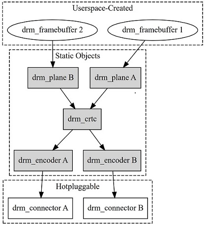

sidebar_position: 5

# SpacemiT Display Debugging Guide

This document describes the MIPI DSI and HDMI display driver use cases and debugging methods for U-Boot and the kernel on the SpacemiT K1 platform.

## Introduction

The Display module on SpacemiT platforms is built on the **DRM** framework. DRM (Direct Rendering Manager) is the graphics display subsystem in the Linux kernel. It manages display hardware, framebuffers, plane composition, display modes, and interactions among user space, the GPU, and the display controller, making it well suited to modern display hardware.

In the Linux kernel, DRM, as the display device management subsystem, is mainly responsible for the following:

- Managing display controller devices
- Allocating, mapping, and sharing graphics buffers
- Configuring resolution, refresh rate, and display timings
- Managing hardware layers and layer composition
- Controlling output interfaces such as HDMI, MIPI DSI, and eDP
- Handling vertical sync and page flip
- Supporting display hot-plug and EDID
- Providing kernel interfaces for Wayland, Xorg, Android HWC, OpenHarmony Display HDI, and direct DRM applications



Core objects in the Linux DRM/KMS display pipeline:

**framebuffer:**
drm_framebuffer represents an image buffer that can be used for display, usually created by user space.
The information it describes mainly includes:
- Image width and height
- Pixel format, for example XR24, AR24, or NV12
- Row pitch
- GEM buffer or DMA buffer
- Modifier and memory layout

**plane:**
drm_plane is a hardware layer. It reads the image from the framebuffer and feeds it into the CRTC.
Each plane can be configured with:
- Which framebuffer to use
- Source image crop region
- On-screen display position
- Scaling size
- Pixel format
- Transparency
- Layer order (zpos)
- Rotation or mirroring

**crtc:**
drm_crtc represents an independent display scanout pipeline.
Its main responsibilities are:
- Composing one or more planes
- Generating horizontal and vertical scan timings
- Setting resolution and refresh rate
- Producing the pixel clock
- Controlling vblank
- Sending the final pixel stream to the encoder

**encoder:**
drm_encoder converts the generic pixel stream output by the CRTC into the signal format required by a specific display interface.

**connector:**
drm_connector represents the connection endpoint that a display interface presents externally.
The connector is responsible for storing and detecting:
- Current connection state
- Supported display modes
- EDID
- Physical display dimensions
- Color format
- HDR, audio, and other capabilities
- Connector properties

## U-Boot Development Environment

### Source Code Structure

#### uboot-2022.10

| Category | Path |
| --- | --- |
| Board DTS | `bsp-src/uboot-2022.10/arch/riscv/dts/k1-x_***.dts` |
| SoC DTSI | `bsp-src/uboot-2022.10/arch/riscv/dts/k1-x.dtsi` |
| DPU driver | `bsp-src/uboot-2022.10/drivers/video/spacemit/spacemit_dpu.c` |
| HDMI driver | `bsp-src/uboot-2022.10/drivers/video/spacemit/spacemit_hdmi.c` |
| DSI driver | `bsp-src/uboot-2022.10/drivers/video/spacemit/spacemit_mipi.c` and `drivers/video/spacemit/dsi/drv/` |
| DSI Panel registration | `bsp-src/uboot-2022.10/drivers/video/spacemit/dsi/video/spacemit_mipi_port.c` |
| Supported DSI Panels | `bsp-src/uboot-2022.10/drivers/video/spacemit/dsi/video/lcd/lcd_***.c` |

### U-Boot HDMI Configuration

#### CONFIG Configuration

1. Run `make uboot-menuconfig`.

2. Go to **Device Drivers -> Graphics support** and enable the SpacemiT display driver and the HDMI port. The default configuration usually already enables these options.

```text
Device Drivers  --->
  Graphics support  --->
     <*> Enable SPACEMIT Video Support
     <*>    HDMI port
```

The corresponding main configuration options are:

```text
CONFIG_VIDEO=y
CONFIG_DISPLAY=y
CONFIG_VIDEO_SPACEMIT=y
CONFIG_DISPLAY_SPACEMIT_HDMI=y
```

For the exact option names used by the current SDK, see `bsp-src/uboot-2022.10/drivers/video/spacemit/Kconfig`.

#### DTS Configuration

The board DTS must enable the DPU and HDMI nodes and configure the HDMI pinctrl. The following example is based on `k1-x_deb1.dts`:

```c
// bsp-src/uboot-2022.10/arch/riscv/dts/k1-x_deb1.dts
&dpu {
	status = "okay";
};

&hdmi {
	pinctrl-names = "default";
	pinctrl-0 = <&pinctrl_hdmi_0>;
	status = "okay";
};
```

#### Common Issues

If no LOGO is displayed on the HDMI interface under U-Boot, first confirm that HDMI is enabled in the board DTS file and that the monitor is already connected before power-on.

Log when HDMI is detected as connected at boot:

```text
hdmi get hpd signal
```

Log when HDMI is not connected at boot:

```text
HDMI cannot get HPD signal
```

### U-Boot MIPI DSI Configuration

#### CONFIG Configuration

1. Run `make uboot-menuconfig`.

2. Go to **Device Drivers -> Graphics support** and enable the SpacemiT display driver and the MIPI port:

```text
Device Drivers  --->
  Graphics support  --->
     <*> Enable SPACEMIT Video Support
     <*>    MIPI Port
```

The corresponding main configuration options are:

```text
CONFIG_VIDEO=y
CONFIG_DISPLAY=y
CONFIG_VIDEO_SPACEMIT=y
CONFIG_DISPLAY_SPACEMIT_MIPI=y
```

To support multiple DSI panels in the same image and distinguish them by panel ID, also enable:

```text
CONFIG_DISPLAY_SPACEMIT_MULTIPLE_MIPI_PANELS=y
```

Then select the target Panel, for example:

```text
CONFIG_LCD_GX09INX101_MIPI=y
```

Multiple DSI panels are not supported by default. Panel configuration options are defined in:

```text
bsp-src/uboot-2022.10/drivers/video/spacemit/dsi/Kconfig
```

#### DTS Configuration

The board DTS must enable DSI power, panel power, the DPU, MIPI DSI, the panel, and the backlight. The following example is based on `k1-x_deb1.dts`:

```c
// bsp-src/uboot-2022.10/arch/riscv/dts/k1-x_deb1.dts
// In the U-Boot development environment, the two DSI power rails AVDD18_DSI (1.8 V) and AVDD12_DSI (1.2 V) are enabled by default
&dpu {
	status = "okay";
};

&mipi_dsi {
	status = "okay";
};

&panel {
	force-attached = "lcd_gx09inx101_mipi";	// DSI Panel name
	dcp-gpios = <&gpio 82 0>;		// Panel power control GPIO
	dcn-gpios = <&gpio 83 0>;		// Panel power control GPIO
	backlight = <&backlight>;
	reset-gpios = <&gpio 81 0>;		// Panel reset GPIO
	status = "okay";
};

&pwm14 {
	pinctrl-names = "default";
	pinctrl-0 = <&pinctrl_pwm14_1>;
	status = "okay";
};

&backlight {
	pwms = <&pwm14 0 2000>;
	default-brightness-level = <6>;		// Backlight brightness level
	status = "okay";
};
```

The GPIO level control, PWM channel, and period must be modified according to the actual schematic. A lit backlight only indicates that the backlight circuit works; it does not prove that the DPU, DSI Host, DPHY, or Panel was initialized successfully.

MIPI DSI node properties can be overridden from the board DTS file. For example:

```c
&mipi_dsi {
	pix-clk = <153000000>;
	bit-clk = <1000000000>;
	esc-clk = <76800000>;
	status = "okay";
};
```

If those properties are absent from the board DTS file, the current driver uses the following default values:

| Property | Default | Description |
| --- | ---: | --- |
| `pix-clk` | 88 MHz | Default DPU pixel clock |
| `bit-clk` | 614.4 MHz | Default DSI lane bit clock |
| `esc-clk` | 51.2 MHz | Default DSI escape clock |

The defaults are not necessarily suitable for every Panel. The target clock frequencies should be calculated from the panel timings, pixel format, and lane count.

```text
htotal = hactive + hfp + hbp + hsync
vtotal = vactive + vfp + vbp + vsync
pixel_clock = htotal x vtotal x fps
bit_clock = pixel_clock x bpp / lane_number x 1.1
```

The DSI driver outputs RGB888 by default, using `bpp=24`. The selected bit clock must be at least `bit_clock`.

### DSI Panel Driver Configuration

DSI Panel configuration files are located in:

```text
bsp-src/uboot-2022.10/drivers/video/spacemit/dsi/video/lcd/
```

Each DSI Panel file mainly contains the following kinds of data:

| Configuration | Purpose |
| --- | --- |
| `struct spacemit_mode_modeinfo` | Describes the DPU output resolution, display timings, pixel clock, pixel format, and physical dimensions |
| `struct spacemit_mipi_info` | Describes the DSI Host and DPHY working mode, lanes, link rate, and video/command mode parameters |
| `struct spacemit_dsi_cmd_desc` arrays | Describe the DSI Panel initialization, sleep, wake-up, Panel ID read, and power state commands |
| `struct lcd_mipi_panel_info` | Aggregates the Panel name, ID, command arrays, mode, and MIPI parameters, and registers them with the framework |

##### spacemit_mode_modeinfo Configuration

The structure is defined in:

```text
bsp-src/uboot-2022.10/drivers/video/spacemit/dsi/include/spacemit_video_tx.h
```

| Member | Unit | Description | DSI Panel porting requirement |
| --- | --- | --- | --- |
| `name` | string | Display mode name, for example `1200x1920-60` | Recommended to include resolution and refresh rate |
| `refresh` | Hz | Target refresh rate | Fill in per the Panel specification, usually 60 |
| `xres` | pixel | DPU output horizontal active pixels | Corresponds to `hactive` |
| `yres` | line | DPU output vertical active lines | Corresponds to `vactive` |
| `real_xres` | pixel | Panel actual horizontal resolution | Usually equals `xres` when there is no rotation or special mapping |
| `real_yres` | line | Panel actual vertical resolution | Usually equals `yres` when there is no rotation or special mapping |
| `left_margin` | pixel | Horizontal back porch | Corresponds to `hbp` or `hback-porch` |
| `right_margin` | pixel | Horizontal front porch | Corresponds to `hfp` or `hfront-porch` |
| `upper_margin` | line | Vertical back porch | Corresponds to `vbp` or `vback-porch` |
| `lower_margin` | line | Vertical front porch | Corresponds to `vfp` or `vfront-porch` |
| `hsync_len` | pixel | Horizontal sync pulse width | Corresponds to `hsync` or `hsync-len` |
| `vsync_len` | line | Vertical sync pulse width | Corresponds to `vsync` or `vsync-len` |
| `hsync_invert` | boolean | Horizontal sync polarity inversion | Fill in per the Panel timing polarity; do not copy from a reference panel |
| `vsync_invert` | boolean | Vertical sync polarity inversion | Fill in per the Panel timing polarity |
| `invert_pixclock` | boolean | Pixel clock sampling edge inversion | Enable only when the hardware requires the opposite sampling edge |
| `pixclock_freq` | kHz | Target pixel clock | Calculate from the total timings, in kHz; default 88*1000 kHz |
| `pix_fmt_out` | enum | DPU output pixel format | Default format is RGB888 |
| `width` | mm | Panel visible area physical width | From the datasheet, not the horizontal resolution |
| `height` | mm | Panel visible area physical height | From the datasheet, not the vertical resolution |

Pixel clock formula:

```text
htotal = xres + left_margin + right_margin + hsync_len
vtotal = yres + upper_margin + lower_margin + vsync_len
pixel_clock_hz = htotal x vtotal x refresh
pixclock_freq = pixel_clock_hz / 1000
```

##### spacemit_mipi_info Configuration

The structure is defined in:

```text
bsp-src/uboot-2022.10/drivers/video/spacemit/dsi/include/spacemit_dsi_common.h
```

| Member | Unit | Description | DSI Panel porting requirement |
| --- | --- | --- | --- |
| `height` | line | DSI input image height | Corresponds to the DSI Panel vertical active resolution |
| `width` | pixel | DSI input image width | Corresponds to the DSI Panel horizontal active resolution |
| `hfp` | pixel | Horizontal front porch | Should equal `right_margin` |
| `hbp` | pixel | Horizontal back porch | Should equal `left_margin` |
| `hsync` | pixel | Horizontal sync pulse width | Should equal `hsync_len` |
| `vfp` | line | Vertical front porch | Should equal `lower_margin` |
| `vbp` | line | Vertical back porch | Should equal `upper_margin` |
| `vsync` | line | Vertical sync pulse width | Should equal `vsync_len` |
| `fps` | Hz | DSI target frame rate | Should equal `refresh` |
| `work_mode` | enum | DSI working mode | Use `SPACEMIT_DSI_MODE_VIDEO` for video mode, and the corresponding CMD enum for command mode |
| `rgb_mode` | enum | DSI input color format | For the default RGB888 format use `DSI_INPUT_DATA_RGB_MODE_888` |
| `lane_number` | lane | Number of data lanes | Fill in per the schematic and Panel capability; commonly 1, 2, or 4 |
| `phy_bit_clock` | Hz | Bit clock per data lane | Calculated from the pixel clock, bpp, and lane count; corresponds to the `bit-clk` value in the board DTS file; default 614400000 Hz |
| `phy_esc_clock` | Hz | DPHY escape clock | Used for LP command transfer; corresponds to the `esc-clk` value in the board DTS file; default 51200000 Hz |
| `split_enable` | boolean | DSI split mode enable | Usually 0 for a single panel and single link |
| `eotp_enable` | boolean | End Of Transmission Packet enable | Set according to whether the Panel requires eotp |
| `burst_mode` | enum | Video mode transfer type | Burst panels can use `DSI_BURST_MODE_BURST`; choose other modes per the specification |

The minimum lane bit clock for the RGB888 output format can be estimated as follows:

```text
bit_clock = pixel_clock_hz x 24 / lane_number x 1.1
```

The selected `phy_bit_clock` must not be lower than the estimated clock frequency, and must be a frequency that the K1 chip platform clock tree can generate or accept within tolerance. The resolution, porch, sync, and fps values in `spacemit_mode_modeinfo` and `spacemit_mipi_info` must be consistent.

### DSI Panel Debug Example

The following uses `lcd_gx09inx101_mipi` as the reference. Follow these steps to debug a DSI Panel in the U-Boot development environment.

**1. Add the DSI panel file**

```text
bsp-src/uboot-2022.10/drivers/video/spacemit/dsi/video/lcd/lcd_gx09inx101.c
```

Main parameters of `lcd_gx09inx101_mipi`:

| Parameter | Value |
| --- | ---: |
| Resolution | 1200 x 1920 |
| Refresh rate | 30 Hz |
| Horizontal timing | hbp=40, hfp=50, hsync=10 |
| Vertical timing | vbp=16, vfp=20, vsync=4 |
| Output format | RGB888 |
| DSI working mode | Video Burst Mode |
| Lane count | 4 |
| `pixclock_freq` | 76800 kHz |
| `phy_bit_clock` | 614400000 Hz |
| `phy_esc_clock` | 51200000 Hz |
| Physical size | 142 mm x 228 mm |

Calculated from the timings above:

```text
htotal = 1200 + 40 + 50 + 10 = 1300
vtotal = 1920 + 16 + 20 + 4 = 1960
pixel_clock = 1300 x 1960 x 30 = 76440000 Hz
```

In this example, the pixel clock is set to `76800000 Hz`, a value supported by the K1 chip platform. Therefore, `.pixclock_freq = 76800` is a kHz value close to the theoretical pixel clock. For RGB888 and 4 lanes, the estimated bit clock with 10% margin is:

```text
bit_clock = 76800000 x 24 / 4 x 1.1 = 506880000 Hz
```

The selected bit clock, `614400000 Hz`, is supported by the K1 chip platform and is higher than the estimated bit clock.

Modify `spacemit_mode_modeinfo` according to the new DSI Panel datasheet:

- Update the resolution, hfp/hbp/hsync, vfp/vbp/vsync, and refresh rate.
- Calculate `.pixclock_freq` in kHz.
- Update the sync polarity and output pixel format.
- Set `.width` and `.height` to the Panel physical size in mm.

```c
struct spacemit_mode_modeinfo gx09inx101_spacemit_modelist[] = {
	{
		.name = "1200x1920-60",
		.refresh = 30,
		.xres = 1200,
		.yres = 1920,
		.real_xres = 1200,
		.real_yres = 1920,
		.left_margin = 40,
		.right_margin = 50,
		.hsync_len = 10,
		.upper_margin = 16,
		.lower_margin = 20,
		.vsync_len = 4,
		.hsync_invert = 0,
		.vsync_invert = 0,
		.invert_pixclock = 0,
		.pixclock_freq = 78 * 1000,
		.pix_fmt_out = OUTFMT_RGB888,
		.width = 142,
		.height = 228,
	},
};
```

Modify `spacemit_mipi_info` accordingly:

- `width/height`, porch, sync, and fps must match the modeinfo.
- Set the video/command mode, burst mode, RGB format, and lane count according to the interface specification.
- Calculate `phy_bit_clock` and choose a clock frequency supported by the K1 chip platform that is no lower than the minimum estimated value.
- Set `phy_esc_clock`, eotp, and TE parameters according to the K1 chip platform and DSI Panel requirements.

```c
struct spacemit_mipi_info gx09inx101_mipi_info = {
	.height = 1920,
	.width = 1200,
	.hfp = 50,
	.hbp = 40,
	.hsync = 10,
	.vfp = 20,
	.vbp = 16,
	.vsync = 4,
	.fps = 30,
	.work_mode = SPACEMIT_DSI_MODE_VIDEO,
	.rgb_mode = DSI_INPUT_DATA_RGB_MODE_888,
	.lane_number = 4,
	.phy_bit_clock = 614400000,
	.phy_esc_clock = 51200000,
	.split_enable = 0,
	.eotp_enable = 0,
	.burst_mode = DSI_BURST_MODE_BURST,
};
```

Add the Panel driver IC initialization commands and information provided by the DSI Panel vendor:

- Put the DSI Panel vendor initialization sequence into `init_cmds[]`.
- Configure `sleep_in_cmds[]` and `sleep_out_cmds[]`.
- To identify the DSI Panel automatically, configure `set_id_cmds[]`, `read_id_cmds[]`, and the Panel ID.
- To detect the power state (ESD), configure `set_power_cmds[]` and `read_power_cmds[]`.
- Verify the command type, LP/HS mode, delay (ms), payload length, and payload data.

```c
static struct spacemit_dsi_cmd_desc gx09inx101_set_id_cmds[] = {
	{SPACEMIT_DSI_SET_MAX_PKT_SIZE, SPACEMIT_DSI_LP_MODE, UNLOCK_DELAY, 1, {0x01}},
};

static struct spacemit_dsi_cmd_desc gx09inx101_read_id_cmds[] = {
	{SPACEMIT_DSI_GENERIC_READ1, SPACEMIT_DSI_LP_MODE, UNLOCK_DELAY, 1, {0xfb}},
};

static struct spacemit_dsi_cmd_desc gx09inx101_set_power_cmds[] = {
	{SPACEMIT_DSI_SET_MAX_PKT_SIZE, SPACEMIT_DSI_HS_MODE, UNLOCK_DELAY, 1, {0x1}},
};

static struct spacemit_dsi_cmd_desc gx09inx101_read_power_cmds[] = {
	{SPACEMIT_DSI_GENERIC_READ1, SPACEMIT_DSI_HS_MODE, UNLOCK_DELAY, 1, {0xA}},
};

static struct spacemit_dsi_cmd_desc gx09inx101_init_cmds[] = {
	// 8279 + INX10.1
	{SPACEMIT_DSI_DCS_LWRITE, SPACEMIT_DSI_LP_MODE, 0, 2, {0xB0,0x01}},
	{SPACEMIT_DSI_DCS_LWRITE, SPACEMIT_DSI_LP_MODE, 0, 2, {0xC3,0x4F}},
	{SPACEMIT_DSI_DCS_LWRITE, SPACEMIT_DSI_LP_MODE, 0, 2, {0xC4,0x40}},
	{SPACEMIT_DSI_DCS_LWRITE, SPACEMIT_DSI_LP_MODE, 0, 2, {0xC5,0x40}},
	{SPACEMIT_DSI_DCS_LWRITE, SPACEMIT_DSI_LP_MODE, 0, 2, {0xC6,0x40}},
	{SPACEMIT_DSI_DCS_LWRITE, SPACEMIT_DSI_LP_MODE, 0, 2, {0xC7,0x40}},
	{SPACEMIT_DSI_DCS_LWRITE, SPACEMIT_DSI_LP_MODE, 0, 2, {0xC8,0x4D}},
	{SPACEMIT_DSI_DCS_LWRITE, SPACEMIT_DSI_LP_MODE, 0, 2, {0xC9,0x52}},
	{SPACEMIT_DSI_DCS_LWRITE, SPACEMIT_DSI_LP_MODE, 0, 2, {0xCA,0x51}},
	{SPACEMIT_DSI_DCS_LWRITE, SPACEMIT_DSI_LP_MODE, 0, 2, {0xCD,0x5D}},
	{SPACEMIT_DSI_DCS_LWRITE, SPACEMIT_DSI_LP_MODE, 0, 2, {0xCE,0x5B}},
	{SPACEMIT_DSI_DCS_LWRITE, SPACEMIT_DSI_LP_MODE, 0, 2, {0xCF,0x4B}},
	{SPACEMIT_DSI_DCS_LWRITE, SPACEMIT_DSI_LP_MODE, 0, 2, {0xD0,0x49}},
	{SPACEMIT_DSI_DCS_LWRITE, SPACEMIT_DSI_LP_MODE, 0, 2, {0xD1,0x47}},
	{SPACEMIT_DSI_DCS_LWRITE, SPACEMIT_DSI_LP_MODE, 0, 2, {0xD2,0x45}},
	{SPACEMIT_DSI_DCS_LWRITE, SPACEMIT_DSI_LP_MODE, 0, 2, {0xD3,0x41}},
	{SPACEMIT_DSI_DCS_LWRITE, SPACEMIT_DSI_LP_MODE, 0, 2, {0xD7,0x50}},
	{SPACEMIT_DSI_DCS_LWRITE, SPACEMIT_DSI_LP_MODE, 0, 2, {0xD8,0x40}},
	{SPACEMIT_DSI_DCS_LWRITE, SPACEMIT_DSI_LP_MODE, 0, 2, {0xD9,0x40}},
	{SPACEMIT_DSI_DCS_LWRITE, SPACEMIT_DSI_LP_MODE, 0, 2, {0xDA,0x40}},
	{SPACEMIT_DSI_DCS_LWRITE, SPACEMIT_DSI_LP_MODE, 0, 2, {0xDB,0x40}},
	{SPACEMIT_DSI_DCS_LWRITE, SPACEMIT_DSI_LP_MODE, 0, 2, {0xDC,0x4E}},
	{SPACEMIT_DSI_DCS_LWRITE, SPACEMIT_DSI_LP_MODE, 0, 2, {0xDD,0x52}},
	{SPACEMIT_DSI_DCS_LWRITE, SPACEMIT_DSI_LP_MODE, 0, 2, {0xDE,0x51}},
	{SPACEMIT_DSI_DCS_LWRITE, SPACEMIT_DSI_LP_MODE, 0, 2, {0xE1,0x5E}},
	{SPACEMIT_DSI_DCS_LWRITE, SPACEMIT_DSI_LP_MODE, 0, 2, {0xE2,0x5C}},
	{SPACEMIT_DSI_DCS_LWRITE, SPACEMIT_DSI_LP_MODE, 0, 2, {0xE3,0x4C}},
	{SPACEMIT_DSI_DCS_LWRITE, SPACEMIT_DSI_LP_MODE, 0, 2, {0xE4,0x4A}},
	{SPACEMIT_DSI_DCS_LWRITE, SPACEMIT_DSI_LP_MODE, 0, 2, {0xE5,0x48}},
	{SPACEMIT_DSI_DCS_LWRITE, SPACEMIT_DSI_LP_MODE, 0, 2, {0xE6,0x46}},
	{SPACEMIT_DSI_DCS_LWRITE, SPACEMIT_DSI_LP_MODE, 0, 2, {0xE7,0x42}},
	// Page 0x03
	{SPACEMIT_DSI_DCS_LWRITE, SPACEMIT_DSI_LP_MODE, 0, 2, {0xB0,0x03}},
	{SPACEMIT_DSI_DCS_LWRITE, SPACEMIT_DSI_LP_MODE, 0, 2, {0xBE,0x03}},
	{SPACEMIT_DSI_DCS_LWRITE, SPACEMIT_DSI_LP_MODE, 0, 2, {0xCC,0x44}},
	{SPACEMIT_DSI_DCS_LWRITE, SPACEMIT_DSI_LP_MODE, 0, 2, {0xC8,0x07}},
	{SPACEMIT_DSI_DCS_LWRITE, SPACEMIT_DSI_LP_MODE, 0, 2, {0xC9,0x05}},
	{SPACEMIT_DSI_DCS_LWRITE, SPACEMIT_DSI_LP_MODE, 0, 2, {0xCA,0x42}},
	{SPACEMIT_DSI_DCS_LWRITE, SPACEMIT_DSI_LP_MODE, 0, 2, {0xCD,0x3E}},
	{SPACEMIT_DSI_DCS_LWRITE, SPACEMIT_DSI_LP_MODE, 0, 2, {0xCF,0x60}},
	{SPACEMIT_DSI_DCS_LWRITE, SPACEMIT_DSI_LP_MODE, 0, 2, {0xD2,0x04}},
	{SPACEMIT_DSI_DCS_LWRITE, SPACEMIT_DSI_LP_MODE, 0, 2, {0xD3,0x04}},
	{SPACEMIT_DSI_DCS_LWRITE, SPACEMIT_DSI_LP_MODE, 0, 2, {0xD4,0x01}},
	{SPACEMIT_DSI_DCS_LWRITE, SPACEMIT_DSI_LP_MODE, 0, 2, {0xD5,0x00}},
	{SPACEMIT_DSI_DCS_LWRITE, SPACEMIT_DSI_LP_MODE, 0, 2, {0xD6,0x03}},
	{SPACEMIT_DSI_DCS_LWRITE, SPACEMIT_DSI_LP_MODE, 0, 2, {0xD7,0x04}},
	{SPACEMIT_DSI_DCS_LWRITE, SPACEMIT_DSI_LP_MODE, 0, 2, {0xD9,0x01}},
	{SPACEMIT_DSI_DCS_LWRITE, SPACEMIT_DSI_LP_MODE, 0, 2, {0xDB,0x01}},
	{SPACEMIT_DSI_DCS_LWRITE, SPACEMIT_DSI_LP_MODE, 0, 2, {0xE4,0xF0}},
	{SPACEMIT_DSI_DCS_LWRITE, SPACEMIT_DSI_LP_MODE, 0, 2, {0xE5,0x0A}},
	// Page 0x00
	{SPACEMIT_DSI_DCS_LWRITE, SPACEMIT_DSI_LP_MODE, 0, 2, {0xB0,0x00}},
	{SPACEMIT_DSI_DCS_LWRITE, SPACEMIT_DSI_LP_MODE, 0, 2, {0xBD,0x50}},
	{SPACEMIT_DSI_DCS_LWRITE, SPACEMIT_DSI_LP_MODE, 0, 2, {0xC2,0x08}},
	{SPACEMIT_DSI_DCS_LWRITE, SPACEMIT_DSI_LP_MODE, 0, 2, {0xC4,0x10}},
	{SPACEMIT_DSI_DCS_LWRITE, SPACEMIT_DSI_LP_MODE, 0, 2, {0xCC,0x00}},
	// Page 0x02
	{SPACEMIT_DSI_DCS_LWRITE, SPACEMIT_DSI_LP_MODE, 0, 2, {0xB0,0x02}},
	{SPACEMIT_DSI_DCS_LWRITE, SPACEMIT_DSI_LP_MODE, 0, 2, {0xC0,0x00}},
	{SPACEMIT_DSI_DCS_LWRITE, SPACEMIT_DSI_LP_MODE, 0, 2, {0xC1,0x0A}},
	{SPACEMIT_DSI_DCS_LWRITE, SPACEMIT_DSI_LP_MODE, 0, 2, {0xC2,0x20}},
	{SPACEMIT_DSI_DCS_LWRITE, SPACEMIT_DSI_LP_MODE, 0, 2, {0xC3,0x24}},
	{SPACEMIT_DSI_DCS_LWRITE, SPACEMIT_DSI_LP_MODE, 0, 2, {0xC4,0x23}},
	{SPACEMIT_DSI_DCS_LWRITE, SPACEMIT_DSI_LP_MODE, 0, 2, {0xC5,0x29}},
	{SPACEMIT_DSI_DCS_LWRITE, SPACEMIT_DSI_LP_MODE, 0, 2, {0xC6,0x23}},
	{SPACEMIT_DSI_DCS_LWRITE, SPACEMIT_DSI_LP_MODE, 0, 2, {0xC7,0x1C}},
	{SPACEMIT_DSI_DCS_LWRITE, SPACEMIT_DSI_LP_MODE, 0, 2, {0xC8,0x19}},
	{SPACEMIT_DSI_DCS_LWRITE, SPACEMIT_DSI_LP_MODE, 0, 2, {0xC9,0x17}},
	{SPACEMIT_DSI_DCS_LWRITE, SPACEMIT_DSI_LP_MODE, 0, 2, {0xCA,0x17}},
	{SPACEMIT_DSI_DCS_LWRITE, SPACEMIT_DSI_LP_MODE, 0, 2, {0xCB,0x18}},
	{SPACEMIT_DSI_DCS_LWRITE, SPACEMIT_DSI_LP_MODE, 0, 2, {0xCC,0x1A}},
	{SPACEMIT_DSI_DCS_LWRITE, SPACEMIT_DSI_LP_MODE, 0, 2, {0xCD,0x1E}},
	{SPACEMIT_DSI_DCS_LWRITE, SPACEMIT_DSI_LP_MODE, 0, 2, {0xCE,0x20}},
	{SPACEMIT_DSI_DCS_LWRITE, SPACEMIT_DSI_LP_MODE, 0, 2, {0xCF,0x23}},
	{SPACEMIT_DSI_DCS_LWRITE, SPACEMIT_DSI_LP_MODE, 0, 2, {0xD0,0x07}},
	{SPACEMIT_DSI_DCS_LWRITE, SPACEMIT_DSI_LP_MODE, 0, 2, {0xD1,0x00}},
	{SPACEMIT_DSI_DCS_LWRITE, SPACEMIT_DSI_LP_MODE, 0, 2, {0xD2,0x00}},
	{SPACEMIT_DSI_DCS_LWRITE, SPACEMIT_DSI_LP_MODE, 0, 2, {0xD3,0x0A}},
	{SPACEMIT_DSI_DCS_LWRITE, SPACEMIT_DSI_LP_MODE, 0, 2, {0xD4,0x13}},
	{SPACEMIT_DSI_DCS_LWRITE, SPACEMIT_DSI_LP_MODE, 0, 2, {0xD5,0x1C}},
	{SPACEMIT_DSI_DCS_LWRITE, SPACEMIT_DSI_LP_MODE, 0, 2, {0xD6,0x1A}},
	{SPACEMIT_DSI_DCS_LWRITE, SPACEMIT_DSI_LP_MODE, 0, 2, {0xD7,0x13}},
	{SPACEMIT_DSI_DCS_LWRITE, SPACEMIT_DSI_LP_MODE, 0, 2, {0xD8,0x17}},
	{SPACEMIT_DSI_DCS_LWRITE, SPACEMIT_DSI_LP_MODE, 0, 2, {0xD9,0x1C}},
	{SPACEMIT_DSI_DCS_LWRITE, SPACEMIT_DSI_LP_MODE, 0, 2, {0xDA,0x19}},
	{SPACEMIT_DSI_DCS_LWRITE, SPACEMIT_DSI_LP_MODE, 0, 2, {0xDB,0x17}},
	{SPACEMIT_DSI_DCS_LWRITE, SPACEMIT_DSI_LP_MODE, 0, 2, {0xDC,0x17}},
	{SPACEMIT_DSI_DCS_LWRITE, SPACEMIT_DSI_LP_MODE, 0, 2, {0xDD,0x18}},
	{SPACEMIT_DSI_DCS_LWRITE, SPACEMIT_DSI_LP_MODE, 0, 2, {0xDE,0x1A}},
	{SPACEMIT_DSI_DCS_LWRITE, SPACEMIT_DSI_LP_MODE, 0, 2, {0xDF,0x1E}},
	{SPACEMIT_DSI_DCS_LWRITE, SPACEMIT_DSI_LP_MODE, 0, 2, {0xE0,0x20}},
	{SPACEMIT_DSI_DCS_LWRITE, SPACEMIT_DSI_LP_MODE, 0, 2, {0xE1,0x23}},
	{SPACEMIT_DSI_DCS_LWRITE, SPACEMIT_DSI_LP_MODE, 0, 2, {0xE2,0x07}},
	{SPACEMIT_DSI_DCS_LWRITE, SPACEMIT_DSI_LP_MODE, 200, 2, {0x11, 0x00}},
	{SPACEMIT_DSI_DCS_LWRITE, SPACEMIT_DSI_LP_MODE, 50, 2, {0x29, 0x00}},
};

static struct spacemit_dsi_cmd_desc gx09inx101_sleep_out_cmds[] = {
	{SPACEMIT_DSI_DCS_SWRITE,SPACEMIT_DSI_LP_MODE,200,1,{0x11}},
	{SPACEMIT_DSI_DCS_SWRITE,SPACEMIT_DSI_LP_MODE,50,1,{0x29}},
};

static struct spacemit_dsi_cmd_desc gx09inx101_sleep_in_cmds[] = {
	{SPACEMIT_DSI_DCS_SWRITE,SPACEMIT_DSI_LP_MODE,50,1,{0x28}},
	{SPACEMIT_DSI_DCS_SWRITE,SPACEMIT_DSI_LP_MODE,200,1,{0x10}},
};
```

Initialize the DSI Panel `struct lcd_mipi_panel_info` data structure:

```c
struct lcd_mipi_panel_info lcd_gx09inx101_mipi = {
	.lcd_name = "lcd_gx09inx101_mipi",
	.lcd_id = 0x8279,
	.panel_id0 = 0x1,
	.power_value = 0x14,
	.panel_type = LCD_MIPI,
	.width_mm = 142,
	.height_mm = 228,
	.set_id_cmds_num = ARRAY_SIZE(gx09inx101_set_id_cmds),
	.read_id_cmds_num = ARRAY_SIZE(gx09inx101_read_id_cmds),
	.init_cmds_num = ARRAY_SIZE(gx09inx101_init_cmds),
	.set_power_cmds_num = ARRAY_SIZE(gx09inx101_set_power_cmds),
	.read_power_cmds_num = ARRAY_SIZE(gx09inx101_read_power_cmds),
	.sleep_out_cmds_num = ARRAY_SIZE(gx09inx101_sleep_out_cmds),
	.sleep_in_cmds_num = ARRAY_SIZE(gx09inx101_sleep_in_cmds),
	.spacemit_modeinfo = gx09inx101_spacemit_modelist,
	.mipi_info = &gx09inx101_mipi_info,
	.set_id_cmds = gx09inx101_set_id_cmds,
	.read_id_cmds = gx09inx101_read_id_cmds,
	.set_power_cmds = gx09inx101_set_power_cmds,
	.read_power_cmds = gx09inx101_read_power_cmds,
	.init_cmds = gx09inx101_init_cmds,
	.sleep_out_cmds = gx09inx101_sleep_out_cmds,
	.sleep_in_cmds = gx09inx101_sleep_in_cmds,
};

int lcd_gx09inx101_mipi_init(void)
{
	int ret;

	ret = lcd_mipi_register_panel(&lcd_gx09inx101_mipi);
	return ret;
}
```

**2. Add the DSI Panel file to the Makefile**

```text
// bsp-src/uboot-2022.10/drivers/video/spacemit/dsi/Makefile
obj-y += video/lcd/lcd_gx09inx101.o
```

**3. Declare the DSI Panel initialization function**

```c
// bsp-src/uboot-2022.10/drivers/video/spacemit/dsi/include/spacemit_dsi_common.h
int lcd_gx09inx101_mipi_init(void);
```

**4. Register the DSI Panel**

```c
// bsp-src/uboot-2022.10/drivers/video/spacemit/dsi/video/spacemit_mipi_port.c
static const struct panel_config panel_configs[] = {
	/* ... */
	{"lcd_gx09inx101_mipi", LCD_MIPI, lcd_gx09inx101_mipi_init},
};
```

**5. Initialize the DSI Panel**

If the same image must support multiple DSI Panels, add a Panel configuration option to `Kconfig` as well:

```c
// bsp-src/uboot-2022.10/drivers/video/spacemit/dsi/Kconfig
config LCD_GX09INX101_MIPI
	bool "Add lcd gx09inx101 mipi panel"
	depends on DISPLAY_SPACEMIT_MULTIPLE_MIPI_PANELS
	help
	  support lcd_gx09inx101_mipi panel
```

Then call the DSI Panel initialization function in the multiple-Panel initialization branch:

```c
// bsp-src/uboot-2022.10/drivers/video/spacemit/dsi/video/spacemit_mipi_port.c
#if defined(CONFIG_LCD_GX09INX101_MIPI)
                tx_device_client.panel_type = LCD_MIPI;
                tx_device.panel_type = tx_device_client.panel_type;
                lcd_gx09inx101_mipi_init();
#endif
```

**6. Configure the DSI Panel in the board DTS file**

Configure the DPU, MIPI DSI, Panel, power, reset, and backlight in the board DTS file. To use clocks other than the DSI driver defaults, set `pix-clk`, `esc-clk`, and `bit-clk` to override the clock frequencies. The DSI Panel name must be exactly the same in the DSI Panel file, `panel_configs[]`, and the board DTS file.

```c
// bsp-src/uboot-2022.10/arch/riscv/dts/k1-x_deb1.dts

&dpu {
	status = "okay";
};

&mipi_dsi {
	pix-clk = <76800000>;			// pixel clock
	bit-clk = <614400000>;			// bit clock
	status = "okay";
};

&panel {
	force-attached = "lcd_gx09inx101_mipi";	// DSI Panel name
	dcp-gpios = <&gpio 82 0>;		// Panel power control GPIO
	dcn-gpios = <&gpio 83 0>;		// Panel power control GPIO
	backlight = <&backlight>;
	reset-gpios = <&gpio 81 0>;		// Panel reset GPIO
	status = "okay";
};

&pwm14 {
	pinctrl-names = "default";
	pinctrl-0 = <&pinctrl_pwm14_1>;
	status = "okay";
};

&backlight {
	pwms = <&pwm14 0 2000>;
	default-brightness-level = <6>;		// Backlight brightness level
	status = "okay";
};
```

#### Common Issues

If no LOGO is displayed on the DSI Panel interface under U-Boot, first confirm that DSI Panel support is enabled in the board DTS file, that the hardware DSI Panel is connected correctly, and that the power, reset, and DSI initialization timings are configured correctly.

Boot log when DSI Panel communication starts successfully:

```text
[   0.850] Found device 'mipi@d421a800', disp_uc_priv=000000007dea6b60
[   0.854] spacemit_panel_of_to_plat panel lcd_gx09inx101_mipi
[   1.058] read panel id OK: read value = 0x1, 0x0, 0x0
[   1.060] Panel is lcd_gx09inx101_mipi
[   1.318] spacemit_display_init: lcd name lcd_gx09inx101_mipi
[   1.321] fb=7f700000, size=1200x1920
```

Boot log when DSI Panel communication fails:

```text
[   0.855] Found device 'mipi@d421a800', disp_uc_priv=000000007dea6b60
[   0.859] spacemit_panel_of_to_plat panel lcd_gx09inx101_mipi
[   1.083] dsi_write_cmd: DSI send out packet maybe failed.
[   1.086] dsi_read_cmd_array: dsi didn't receive packet, irq status 0x1001
[   1.092] lcd_mipi_readid failed!
[   1.095] lcd_port (0) is not the corrected video_tx!
[   1.100] Can not found the corrected panel!
[   1.104] probe: failed to find video tx
[   1.108] spacemit_display_init: Failed to init panel
```

| Symptom | Possible cause | Check and action |
| --- | --- | --- |
| Backlight does not light up | PWM, GPIO, or backlight node not enabled | Check `pwm`, `backlight`, pinctrl, and the active level |
| Backlight is on but the screen is black | DPU/DSI not enabled, DSI Panel not initialized, clock error, lane wiring or signal problem | Check Panel registration, initialization log, and the actual clock frequency. The requested clock value is not necessarily a frequency the hardware can output; use the frequency returned by `clk_get_rate()`. Check the lane hardware connection and inspect lane signals with an oscilloscope. Before bringing up the display, try enabling the DSI Panel BIST mode to confirm that the hardware path works |
| Reading the Panel ID fails | Reset timing, power supply, LP command, or ID mismatch | Confirm power and reset with an oscilloscope, and check `read_id_cmds`, the Panel ID value, and delays |
| The default DSI panel is always loaded | DSI panel name mismatch or not registered | Check `panel_configs[]`, Kconfig, and the initialization function name |
| Artifacts or wrong colors | Wrong RGB format, lane count, timing, or initialization commands | Verify that the host output format matches the DSI Panel input format, and check lane configuration, porch values, and the DSI Panel vendor initialization commands |
| Scrolling picture or abnormal refresh rate | Pixel clock does not match the total timings, or porch parameters are wrong | Recalculate `htotal x vtotal x fps`, check the actual pxclk, and adjust the porch parameters to verify |
| High-resolution black screen or flicker | Bit clock or MIPI DSI timing problem | Calculate bitclk from bpp/lane, choose a clock frequency no lower than the estimated value, and configure `esc-clk = <76800000>;` |

## Kernel Development Environment

### Source Code Structure

#### linux-6.6

| Category | Path |
| --- | --- |
| Board DTS | `bsp-src/linux-6.6/arch/riscv/boot/dts/spacemit/k1-x_***.dts` |
| SoC DTSI | `bsp-src/linux-6.6/arch/riscv/boot/dts/spacemit/k1-x.dtsi` |
| Main DRM driver | `bsp-src/linux-6.6/drivers/gpu/drm/spacemit/spacemit_drm.c` |
| HDMI DTS node | `bsp-src/linux-6.6/arch/riscv/boot/dts/spacemit/k1-x-hdmi.dtsi` |
| HDMI driver | `bsp-src/linux-6.6/drivers/gpu/drm/spacemit/spacemit_hdmi.c` |
| DSI DTS node | `bsp-src/linux-6.6/arch/riscv/boot/dts/spacemit/k1-x-lcd.dtsi` |
| Supported DSI Panels | `bsp-src/linux-6.6/arch/riscv/boot/dts/spacemit/lcd/lcd_***.dtsi` |
| DPU driver | `bsp-src/linux-6.6/drivers/gpu/drm/spacemit/dpu/dpu_saturn.c` |
| DSI Host driver | `bsp-src/linux-6.6/drivers/gpu/drm/spacemit/dsi/spacemit_dsi_drv.c` |
| DSI DPHY driver | `bsp-src/linux-6.6/drivers/gpu/drm/spacemit/dphy/spacemit_dphy_drv.c` |
| DSI Panel driver | `bsp-src/linux-6.6/drivers/gpu/drm/spacemit/spacemit_mipi_panel.c` |

### Kernel HDMI Configuration

#### CONFIG Configuration

Run the following command to open the Linux kernel configuration menu:

```bash
make linux-menuconfig
```

Go to **Device Drivers -> Graphics support -> DRM Support for Spacemit** and enable SpacemiT DRM and HDMI:

```text
Device Drivers  --->
  Graphics support  --->
    DRM Support for Spacemit  --->
      <*> HDMI Support For Spacemit
```

The corresponding main configuration options are:

```text
CONFIG_DRM=y
CONFIG_DRM_SPACEMIT=y
CONFIG_SPACEMIT_HDMI=y
```

`CONFIG_DRM_SPACEMIT` selects common dependencies such as DRM/KMS, CMA GEM, MIPI DSI, Panel, and backlight. The exact option names and dependencies are those in the following file for the current SDK:

```text
bsp-src/linux-6.6/drivers/gpu/drm/spacemit/Kconfig
```

#### DTS Configuration

The board DTS must include the common HDMI node and enable the DPU output path and HDMI node. The following example is based on `k1-x_deb1.dts`:

```c
// linux-6.6/arch/riscv/boot/dts/spacemit/k1-x_deb1.dts
#include "k1-x-hdmi.dtsi"

&dpu_online2_hdmi {
	memory-region = <&dpu_resv>;
	status = "okay";
};

&hdmi {
	pinctrl-names = "default";
	pinctrl-0 = <&pinctrl_hdmi_0>;
	status = "okay";
};
```

For HDMI audio, enable the HDMI audio and sound card nodes as well:

```c
&hdmiaudio {
	status = "okay";
};

&sound_hdmi {
	status = "okay";
	simple-audio-card,cpu {
		sound-dai = <&hdmiaudio>;
	};
};
```

### Run Check

```bash
# View DRM, HDMI, HPD, and EDID related logs
dmesg

# Check the DRM connector status and the modes supported by the display
cat /sys/class/drm/card*-HDMI-A-*/status
cat /sys/class/drm/card*-HDMI-A-*/modes

# With libdrm-tests installed, the full KMS resources can be inspected
modetest -c

modetest -p

modetest -e
```

### Common Issues

| Symptom | Possible cause | Check and action |
| --- | --- | --- |
| No HDMI connector | Driver CONFIG not enabled, or the DRM component failed to bind | Check `CONFIG_DRM_SPACEMIT`, `CONFIG_SPACEMIT_HDMI`, and the probe/bind errors in `dmesg` |
| Connector stays disconnected | Cable, monitor, HPD pinctrl, or hardware connection problem | Check `/sys/class/drm/*HDMI*/status`, measure the HPD level, and verify HDMI pinctrl configuration |
| HPD is fine but no mode is reported | DDC failed to read the EDID | Check the EDID logs |
| Modes are reported but the screen is black | DPU output path not enabled, or clock/PHY configuration failed | Confirm `dpu_online2_hdmi` is `okay`, and check the atomic commit and HDMI PHY logs |
| HDMI shows a picture but no audio | HDMI audio or sound card node not enabled | Check `hdmiaudio`, `sound_hdmi`, the ALSA card, and audio routing |

### Kernel MIPI DSI Configuration

#### CONFIG Configuration

Run `make linux-menuconfig`, go to **Device Drivers -> Graphics support -> DRM Support for Spacemit**, and enable SpacemiT DRM and MIPI Panel support:

```text
Device Drivers  --->
  Graphics support  --->
    DRM Support for Spacemit  --->
      <*> MIPI Panel Support For Spacemit
```

The corresponding main configuration options are:

```text
CONFIG_DRM=y
CONFIG_DRM_SPACEMIT=y
CONFIG_SPACEMIT_MIPI_PANEL=y
```

#### DTS Configuration

On the Linux side, the DSI Panel parameters live in a separate DTSI file, while the board DTS selects the Panel, GPIOs, power, backlight, and display path. The following example is based on `k1-x_deb1.dts`:

```c
// bsp-src/linux-6.6/arch/riscv/boot/dts/spacemit/k1-x_deb1.dts
// In the kernel development environment, the AVDD18_DSI (1.8 V) DSI power rail is enabled by default
#include "k1-x-lcd.dtsi"
#include "lcd/lcd_gx09inx101_mipi.dtsi"

&dpu_online2_dsi {
	memory-region = <&dpu_resv>;		// DPU reserved memory
	spacemit-dpu-bitclk = <1000000000>;	// bit clock
	spacemit-dpu-escclk = <76800000>;	// escape clock
	dsi_1v2-supply = <&ldo_5>;		// Configure AVDD12_DSI (1.2 V)
	vin-supply-names = "dsi_1v2";
	status = "okay";
};

&dsi2 {
	status = "okay";

	panel2: panel2@0 {
		compatible = "spacemit,mipi-panel2";
		reg = <0>;
		gpios-reset = <81>;			// Panel reset GPIO
		gpios-dc = <82 83>;			// Panel power control GPIOs
		id = <2>;					// Configure the Panel ID
		delay-after-reset = <10>;		// Delay after Panel reset (ms)
		force-attached = "lcd_gx09inx101_mipi";	// Configure the DSI Panel name
		status = "okay";
	};
};

&lcds {
	status = "okay";				// Enable DSI Panel configuration
};

&pwm14 {							// Configure PWM
	pinctrl-names = "default";
	pinctrl-0 = <&pinctrl_pwm14_1>;
	status = "okay";
};

&pwm_bl {							// Configure backlight brightness
	pwms = <&pwm14 2000>;
	brightness-levels = <
		0   40  40  40  40  40  40  40  40  40  40  40  40  40  40  40
		40  40  40  40  40  40  40  40  40  40  40  40  40  40  40  40
		40  40  40  40  40  40  40  40  40  41  42  43  44  45  46  47
		48  49  50  51  52  53  54  55  56  57  58  59  60  61  62  63
		64  65  66  67  68  69  70  71  72  73  74  75  76  77  78  79
		80  81  82  83  84  85  86  87  88  89  90  91  92  93  94  95
		96  97  98  99  100 101 102 103 104 105 106 107 108 109 110 111
		112 113 114 115 116 117 118 119 120 121 122 123 124 125 126 127
		128 129 130 131 132 133 134 135 136 137 138 139 140 141 142 143
		144 145 146 147 148 149 150 151 152 153 154 155 156 157 158 159
		160 161 162 163 164 165 166 167 168 169 170 171 172 173 174 175
		176 177 178 179 180 181 182 183 184 185 186 187 188 189 190 191
		192 193 194 195 196 197 198 199 200 201 202 203 204 205 206 207
		208 209 210 211 212 213 214 215 216 217 218 219 220 221 222 223
		224 225 226 227 228 229 230 231 232 233 234 235 236 237 238 239
		240 241 242 243 244 245 246 247 248 249 250 251 252 253 254 255
	>;
	default-brightness-level = <100>;
	status = "okay";
};
```

The DSI power, DSI Panel power, reset, PWM, backlight brightness, and GPIO active levels must be modified according to the schematic. The `force-attached` string must match the DSI Panel name in the Panel DTSI file.

### DSI Panel Configuration Description

DSI Panel files are located in:

```text
bsp-src/linux-6.6/arch/riscv/boot/dts/spacemit/lcd/lcd_<panel>_mipi.dtsi
```

#### Main Properties

| Property | Description | Porting requirement |
| --- | --- | --- |
| `dsi-work-mode` | MIPI DSI transfer mode | Choose command/video burst mode according to the Panel specification |
| `dsi-lane-number` | Number of DSI data lanes | Must match the schematic and the DSI Panel capability; commonly 1, 2, or 4 |
| `dsi-color-format` | DSI output format | Defaults to `rgb888` and must match the DSI Panel input format |
| `width-mm`, `height-mm` | DSI Panel physical size | In mm; used for the physical size information in the DRM mode |
| `use-dcs-write` | Whether to use the DSI DCS data format | Configure when the DCS data format is used; otherwise the Generic data format is used |
| `width`, `height` | Active display resolution | Correspond to the horizontal and vertical active pixels |
| `hfp/hbp/hsync` | Horizontal front porch, back porch, and sync width | Must be consistent with `display-timings` |
| `vfp/vbp/vsync` | Vertical front porch, back porch, and sync width | Must be consistent with `display-timings` |
| `fps` | Target refresh rate | Must match the total timings and the pixel clock |
| `lane-number` | Number of DPHY lanes | Should equal `dsi-lane-number` |
| `phy-bit-clock` | Bit clock of the DPHY data lanes | In Hz; must not be lower than the minimum link bandwidth requirement |
| `phy-esc-clock` | DPHY escape clock | In Hz; used for LP command transfer |
| `eotp-enable` | eotp switch | Set according to the DSI Panel requirements |
| `esd-check-enable` | ESD status detection switch | Before enabling, a correct read status command and the expected ESD status value must be configured |
| `initial-command` | DSI Panel initialization command sequence | Sent in the order DSI data type, LP/HS mode, delay, payload length, payload data |
| `sleep-in-command`, `sleep-out-command` | Sleep and wake-up command sequences | Sent in the order DSI data type, LP/HS mode, delay, payload length, payload data |
| `read-id-command` | Panel ID read command sequence | Used to identify the DSI Panel or verify communication |
| `display-timings` | DRM display mode | Configure the pixel clock, active, porch, sync, and polarity |

The clock frequency formulas are:

```text
htotal = hactive + hfront-porch + hback-porch + hsync-len
vtotal = vactive + vfront-porch + vback-porch + vsync-len
pixel_clock = htotal x vtotal x fps
bit_clock = pixel_clock x bpp / lane_number x 1.1
```

RGB888 uses `bpp=24`. `clock-frequency` should be close to the calculated `pixel_clock`; `phy-bit-clock` must be consistent with `spacemit-dpu-bitclk` in the board DTS, and `phy-esc-clock` must be consistent with `spacemit-dpu-escclk`. Choose clock frequencies that the K1 chip platform clock tree can actually output. The frequency requested by the driver is not necessarily the frequency the hardware finally outputs; during debugging, read back the actual clock rate or measure the MIPI CLOCK waveform.
Because the MIPI D-PHY high-speed data uses DDR (Double Data Rate, sampling on both edges) transfer, one bit is transferred on each rising and falling clock edge, so the `bit_clock` frequency is twice the measured MIPI CLOCK frequency.

#### DSI Command Encoding

DSI Panel command sequences use the format "DSI data type, transfer mode, delay, length, payload":

```text
DATA_TYPE  DSI_MODE  DELAY  LENGTH  PAYLOAD...
```

The fields are described below:

| Field | Length | Description |
| --- | ---: | --- |
| `DATA_TYPE` | 1 byte | MIPI DSI packet data type, for example `0x39` for DCS long write |
| `DSI_MODE` | 1 byte | Command transfer mode, LP mode or HS mode |
| `DELAY` | 1 byte | Wait time after the current command is sent, in ms, parsed as hexadecimal |
| `LENGTH` | 1 byte | Number of payload bytes that follow, parsed as hexadecimal |
| `PAYLOAD` | `LENGTH` bytes | DCS/Generic command and parameters |

`DATA_TYPE` values commonly used for DCS and Generic request packets:

| Command type | Data Type | Binary | Payload content | Packet type |
| --- | ---: | --- | --- | --- |
| DCS Write | `0x05` | `00 0101` | 1 byte: DCS command without parameters | Short Packet |
| DCS Write | `0x15` | `01 0101` | 2 bytes: DCS command + 1 parameter | Short Packet |
| DCS Write | `0x39` | `11 1001` | DCS command + 2 or more parameters | Long Packet |
| DCS Read | `0x06` | `00 0110` | 1 byte: the DCS command to read | Short Packet |
| Generic Write | `0x13` | `01 0011` | 1 parameter | Short Packet |
| Generic Write | `0x23` | `10 0011` | 2 parameters | Short Packet |
| Generic Write | `0x29` | `10 1001` | 3 or more parameters | Long Packet |
| Generic Read | `0x14` | `01 0100` | 1 parameter | Short Packet |

For DCS Write, the first payload byte is always the DCS command and the following bytes are the command parameters. For Generic Write, the whole payload is treated as Generic parameters. For example:

```text
05 01 00 01 11       # DCS Short Write: Sleep Out, no parameters
15 01 00 02 51 FF    # DCS Short Write: Write Display Brightness, 1 parameter 0xFF
39 01 00 03 B0 01 02 # DCS Long Write: DCS command 0xB0 with 2 parameters

13 01 00 01 B0       # Generic Short Write: 1 parameter
23 01 00 02 B0 01    # Generic Short Write: 2 parameters
29 01 00 03 B0 01 02 # Generic Long Write: 3 parameters

06 01 00 01 0A       # DCS Read: read the DCS Power Mode register 0x0A
14 01 00 01 FB       # Generic Read: 1 parameter 0xFB
```

The Read command table describes the read request issued by the host. To limit the maximum number of returned bytes before reading, send `Set Maximum Return Packet Size` (Data Type `0x37`) first. The short/long response Data Types returned by the DSI Panel are parsed by the DSI Host receive path and must not be confused with the read request Data Types above.

For example:

```text
39 01 78 01 28
|  |  |  |  +-- payload: 0x28, DCS Display OFF
|  |  |  +----- payload length: 0x01, that is 1 byte
|  |  +-------- delay: 0x78, that is 120 ms
|  +----------- transfer mode: 0x01, LP mode
+-------------- data type: 0x39, DCS long write
```

Note that both the delay and the length in a DTS byte array are hexadecimal bytes:

```text
0x78 = 7 x 16 + 8 = 120 ms
```

When porting a DSI Panel vendor command sequence, check every entry for the following:

1. Whether `DATA_TYPE` matches the DCS/Generic and short/long write or read type.
2. Whether the command must use LP mode or HS mode.
3. Whether `DELAY` is encoded in hexadecimal and meets the Panel datasheet requirement.
4. Whether `LENGTH` equals the actual payload byte count, so that the driver does not parse into the next command.
5. Whether the payload command and parameters are complete and in the same order as the DSI Panel vendor command table.

Pay particular attention to the wait time between Sleep Out (`0x11`) and Display On (`0x29`).

### DSI Panel Debug Example

The following uses `lcd_gx09inx101_mipi` as the reference. Follow these steps to debug a DSI Panel in the kernel development environment.

**1. Add the DSI Panel file**

```text
bsp-src/linux-6.6/arch/riscv/boot/dts/spacemit/lcd/lcd_gx09inx101_mipi.dtsi
```

**2. Configure the pixel clock and bit clock**

Modify the resolution, porch, sync, refresh rate, sync polarity, and physical size according to the DSI Panel datasheet, based on the output RGB format and lane count.
Calculate the pixel clock and the minimum bit clock, then choose clock frequencies the K1 chip platform can output.

- **Pixel Clock**
pixel clock = (hactive + hfp + hbp + hsync) * (vactive + vfp + vbp + vsync) * fps = (1200 + 50 + 40 + 10) * (1920 + 20 + 16 + 4) * 60 = 152880000 HZ

- **Bit Clock**
bit clock = (((hactive + hfp + hbp + hsync) * (vactive + vfp + vbp + vsync) * fps * bpp) / lane number) * 1.1 = (((1200 + 50 + 40 + 10) * (1920 + 20 + 16 + 4) * 60 * 24) / 4) * 1.1 = 1009008000 HZ

In this example, the pixel clock `153000000 Hz` and bit clock `1000000000 Hz` are selected, both supported by the K1 chip platform.

- **Pixel Clock**: the system is configured with 153000000 HZ
- **Bit Clock**: the system is configured with 1000000000 HZ
- **Esc Clock**: the system is configured with 76800000 HZ

```c
// bsp-src/linux-6.6/arch/riscv/boot/dts/spacemit/lcd/lcd_gx09inx101_mipi.dtsi
lcd_gx09inx101_mipi: lcd_gx09inx101_mipi {
	dsi-work-mode = <1>;		// MIPI DSI working mode in the panel: 1 = DSI_MODE_VIDEO_BURST
	dsi-lane-number = <4>;		// Number of MIPI DSI lanes in the panel
	dsi-color-format = "rgb888";	// DSI output format
	width-mm = <142>;		// DSI Panel physical size in the panel (unit: mm)
	height-mm = <228>;		// DSI Panel physical size in the panel (unit: mm)
	use-dcs-write;			// Whether DCS command mode is used in the panel

	/*mipi info*/
	height = <1920>;
	width = <1200>;
	hfp = <50>;
	hbp = <40>;
	hsync = <10>;
	vfp = <20>;
	vbp = <16>;
	vsync = <4>;
	fps = <60>;
	work-mode = <0>;
	rgb-mode = <3>;
	lane-number = <4>;
	phy-bit-clock = <1000000000>;
	phy-esc-clock = <76800000>;
	split-enable = <0>;
	eotp-enable = <0>;
	burst-mode = <2>;
	esd-check-enable = <0>;

	......

	display-timings {
		timing0 {
			clock-frequency = <153000000>;
			hactive = <1200>;
			hfront-porch = <50>;
			hback-porch = <40>;
			hsync-len = <10>;
			vactive = <1920>;
			vfront-porch = <20>;
			vback-porch = <16>;
			vsync-len = <4>;
			vsync-active = <1>;
			hsync-active = <1>;
		};
	};
};
```

**3. Configure the DSI Panel command sequences**

Convert the DSI initialization code, sleep, wake-up, and read ID commands provided by the DSI Panel vendor into DSI command sequences.

```c
// bsp-src/linux-6.6/arch/riscv/boot/dts/spacemit/lcd/lcd_gx09inx101_mipi.dtsi

/* DATA_TYPE, DSI_MODE, DELAY, LENGTH, PAYLOAD... */
	initial-command = [
		39 01 00 02 B0 01
		39 01 00 02 C3 4F
		39 01 00 02 C4 40
		39 01 00 02 C5 40
		39 01 00 02 C6 40
		39 01 00 02 C7 40
		39 01 00 02 C8 4D
		39 01 00 02 C9 52
		39 01 00 02 CA 51
		39 01 00 02 CD 5D
		39 01 00 02 CE 5B
		39 01 00 02 CF 4B
		39 01 00 02 D0 49
		39 01 00 02 D1 47
		39 01 00 02 D2 45
		39 01 00 02 D3 41
		39 01 00 02 D7 50
		39 01 00 02 D8 40
		39 01 00 02 D9 40
		39 01 00 02 DA 40
		39 01 00 02 DB 40
		39 01 00 02 DC 4E
		39 01 00 02 DD 52
		39 01 00 02 DE 51
		39 01 00 02 E1 5E
		39 01 00 02 E2 5C
		39 01 00 02 E3 4C
		39 01 00 02 E4 4A
		39 01 00 02 E5 48
		39 01 00 02 E6 46
		39 01 00 02 E7 42
		39 01 00 02 B0 03
		39 01 00 02 BE 03
		39 01 00 02 CC 44
		39 01 00 02 C8 07
		39 01 00 02 C9 05
		39 01 00 02 CA 42
		39 01 00 02 CD 3E
		39 01 00 02 CF 60
		39 01 00 02 D2 04
		39 01 00 02 D3 04
		39 01 00 02 D4 01
		39 01 00 02 D5 00
		39 01 00 02 D6 03
		39 01 00 02 D7 04
		39 01 00 02 D9 01
		39 01 00 02 DB 01
		39 01 00 02 E4 F0
		39 01 00 02 E5 0A
		39 01 00 02 B0 00
		39 01 00 02 BD 50
		39 01 00 02 C2 08
		39 01 00 02 C4 10
		39 01 00 02 CC 00
		// 39 01 00 02 B2 41 // BIST pattern
		39 01 00 02 B0 02
		39 01 00 02 C0 00
		39 01 00 02 C1 0A
		39 01 00 02 C2 20
		39 01 00 02 C3 24
		39 01 00 02 C4 23
		39 01 00 02 C5 29
		39 01 00 02 C6 23
		39 01 00 02 C7 1C
		39 01 00 02 C8 19
		39 01 00 02 C9 17
		39 01 00 02 CA 17
		39 01 00 02 CB 18
		39 01 00 02 CC 1A
		39 01 00 02 CD 1E
		39 01 00 02 CE 20
		39 01 00 02 CF 23
		39 01 00 02 D0 07
		39 01 00 02 D1 00
		39 01 00 02 D2 00
		39 01 00 02 D3 0A
		39 01 00 02 D4 13
		39 01 00 02 D5 1C
		39 01 00 02 D6 1A
		39 01 00 02 D7 13
		39 01 00 02 D8 17
		39 01 00 02 D9 1C
		39 01 00 02 DA 19
		39 01 00 02 DB 17
		39 01 00 02 DC 17
		39 01 00 02 DD 18
		39 01 00 02 DE 1A
		39 01 00 02 DF 1E
		39 01 00 02 E0 20
		39 01 00 02 E1 23
		39 01 00 02 E2 07
		39 01 F0 01 11
		39 01 28 01 29
	];

	sleep-in-command = [
		39 01 78 01 28
		39 01 78 01 10
	];

	sleep-out-command = [
		39 01 96 01 11
		39 01 32 01 29
	];

	read-id-command = [
		37 01 00 01 05
		14 01 00 05 fb fc fd fe ff
	];
```

**4. Configure the DSI Panel in the board DTS file**

In the board DTS file, set `force-attached` to the DSI Panel name, and configure the DSI power, DSI Panel power, reset, PWM, backlight brightness, and clock frequencies according to the schematic.

```c
// bsp-src/linux-6.6/arch/riscv/boot/dts/spacemit/k1-x_deb1.dts
// In the kernel development environment, the AVDD18_DSI (1.8 V) DSI power rail is enabled by default
#include "k1-x-lcd.dtsi"
#include "lcd/lcd_gx09inx101_mipi.dtsi"

&dpu_online2_dsi {
	memory-region = <&dpu_resv>;		// DPU reserved memory
	spacemit-dpu-bitclk = <1000000000>;	// bit clock
	spacemit-dpu-escclk = <76800000>;	// escape clock
	dsi_1v2-supply = <&ldo_5>;		// Configure AVDD12_DSI (1.2 V)
	vin-supply-names = "dsi_1v2";
	status = "okay";
};

&dsi2 {
	status = "okay";

	panel2: panel2@0 {
		compatible = "spacemit,mipi-panel2";
		reg = <0>;
		gpios-reset = <81>;			// Panel reset GPIO
		gpios-dc = <82 83>;			// Panel power control GPIOs
		id = <2>;					// Configure the Panel ID
		delay-after-reset = <10>;		// Delay after Panel reset (ms)
		force-attached = "lcd_gx09inx101_mipi";	// Configure the DSI Panel name
		status = "okay";
	};
};

&lcds {
	status = "okay";				// Enable DSI Panel configuration
};

&pwm14 {							// Configure PWM
	pinctrl-names = "default";
	pinctrl-0 = <&pinctrl_pwm14_1>;
	status = "okay";
};

&pwm_bl {							// Configure backlight brightness
	pwms = <&pwm14 2000>;
	brightness-levels = <
		0   40  40  40  40  40  40  40  40  40  40  40  40  40  40  40
		40  40  40  40  40  40  40  40  40  40  40  40  40  40  40  40
		40  40  40  40  40  40  40  40  40  41  42  43  44  45  46  47
		48  49  50  51  52  53  54  55  56  57  58  59  60  61  62  63
		64  65  66  67  68  69  70  71  72  73  74  75  76  77  78  79
		80  81  82  83  84  85  86  87  88  89  90  91  92  93  94  95
		96  97  98  99  100 101 102 103 104 105 106 107 108 109 110 111
		112 113 114 115 116 117 118 119 120 121 122 123 124 125 126 127
		128 129 130 131 132 133 134 135 136 137 138 139 140 141 142 143
		144 145 146 147 148 149 150 151 152 153 154 155 156 157 158 159
		160 161 162 163 164 165 166 167 168 169 170 171 172 173 174 175
		176 177 178 179 180 181 182 183 184 185 186 187 188 189 190 191
		192 193 194 195 196 197 198 199 200 201 202 203 204 205 206 207
		208 209 210 211 212 213 214 215 216 217 218 219 220 221 222 223
		224 225 226 227 228 229 230 231 232 233 234 235 236 237 238 239
		240 241 242 243 244 245 246 247 248 249 250 251 252 253 254 255
	>;
	default-brightness-level = <100>;
	status = "okay";
};
```

The GPIO level control, PWM channel, and period must be modified according to the actual schematic. A lit backlight only indicates that the backlight circuit works; it does not prove that the DPU, DSI Host, DPHY, or Panel was initialized successfully.

#### Run Check

```bash
# View DRM, DSI Host, DPHY, and DSI Panel related logs
dmesg

# Check the DRM connector status and the modes supported by the display
cat /sys/class/drm/card*-DSI-*/status
cat /sys/class/drm/card*-DSI-*/modes

# With libdrm-tests installed, the full KMS resources can be inspected
modetest -c

modetest -p

modetest -e
```

#### Common Issues

| Symptom | Possible cause | Check and action |
| --- | --- | --- |
| Panel driver does not probe | CONFIG not enabled, node disabled, or wrong compatible/component link | Check the final DTB, `CONFIG_SPACEMIT_MIPI_PANEL`, and deferred probe logs |
| Backlight does not light up | Wrong PWM, pinctrl, backlight node, or power GPIO configuration | Measure PWM/power, and verify pinctrl configuration, period, and polarity |
| Backlight is on but the screen is black | Panel initialization failed, DPU/DSI/DPHY not started, clock frequency error, lane wiring or signal problem | Check reset and power sequencing, the DSI initialization commands, and the actual pixel clock and bit clock frequencies. Check lane hardware connections and inspect signals with an oscilloscope. Before bringing up the display, try enabling the DSI Panel BIST mode to confirm that the hardware path works |
| Artifacts or wrong colors | Wrong RGB format, lane count, lane mapping, or initialization registers | Check the DSI Panel data format, physical wiring, lane configuration, and porch values; confirm that the vendor initialization sequence is correct |
| Scrolling or shaking picture | Pixel clock does not match the total timings, or porch/sync parameters are wrong | Confirm that the DSI Panel vendor initialization sequence is correct, and adjust the porch parameters |
| High-resolution black screen or flicker | Insufficient bit clock bandwidth, unstable DPHY timing, or poor lane signal quality | Calculate bit clk from bpp/lane, choose a suitable clock frequency no lower than the estimate, configure `esc-clk = <76800000>;`, and inspect lane signal quality with an oscilloscope |
| Black screen after suspend/resume | Wrong sleep commands, power/reset restore order, or backlight timing | Check `sleep-in/out-command`, runtime PM, and resume-stage logs |

## FAQ

### 1. Configure HDMI Only

Using the k1-x_deb1 solution as an example, to enable only HDMI output, disable LCD and enable HDMI in the driver DTS.

The following shows the default configuration:

```c
// bsp-src/linux-6.6/arch/riscv/boot/dts/spacemit/k1-x_deb1.dts
&dpu_online2_dsi {
	memory-region = <&dpu_resv>;
	spacemit-dpu-bitclk = <1000000000>;
	spacemit-dpu-escclk = <76800000>;
	dsi_1v2-supply = <&ldo_5>;
	vin-supply-names = "dsi_1v2";
	status = "disabled"; // Disable MIPI DSI
};

&dsi2 {
	status = "disabled"; // Disable the DSI Panel

	panel2: panel2@0 {
		status = "ok";
		compatible = "spacemit,mipi-panel2";
		reg = <0>;
		gpios-reset = <81>;
		gpios-dc = <82 83>;
		id = <2>;
		delay-after-reset = <10>;
		force-attached = "lcd_gx09inx101_mipi";
	};
};

&lcds {
	status = "disabled"; // Disable LCD
};

&dpu_online2_hdmi {
	memory-region = <&dpu_resv>;
	status = "okay"; // Enable the HDMI DPU
};

&hdmi {
	pinctrl-names = "default";
	pinctrl-0 = <&pinctrl_hdmi_0>;
	status = "okay"; // Enable HDMI
};
```

### 2. Configure HDMI and DSI Simultaneously

To enable LCD (MIPI DSI) and HDMI at the same time, set the `status` properties of both related nodes to `"okay"` in the DTS.

The following is an example using the k1-x_deb1 solution:

```c
// bsp-src/linux-6.6/arch/riscv/boot/dts/spacemit/k1-x_deb1.dts
&dpu_online2_dsi {
	memory-region = <&dpu_resv>;
	spacemit-dpu-bitclk = <1000000000>;
	spacemit-dpu-escclk = <76800000>;
	dsi_1v2-supply = <&ldo_5>;
	vin-supply-names = "dsi_1v2";
	status = "okay"; // Enable MIPI DSI
};

&dsi2 {
	status = "okay"; // Enable the DSI Panel

	panel2: panel2@0 {
		status = "ok";
		compatible = "spacemit,mipi-panel2";
		reg = <0>;
		gpios-reset = <81>;
		gpios-dc = <82 83>;
		id = <2>;
		delay-after-reset = <10>;
		force-attached = "lcd_gx09inx101_mipi";
	};
};

&lcds {
	status = "okay"; // Enable the LCD module
};

&dpu_online2_hdmi {
	memory-region = <&dpu_resv>;
	status = "okay"; // Enable the HDMI DPU
};

&hdmi {
	pinctrl-names = "default";
	pinctrl-0 = <&pinctrl_hdmi_0>;
	status = "okay"; // Enable HDMI
};
```

### 3. Configure DSI Only

To use only the MIPI DSI LCD, enable the DSI-related nodes (`status = "okay"`) and disable the HDMI-related nodes (`status = "disabled"`).

The following is an example using the k1-x_deb1 solution:

```c
// bsp-src/linux-6.6/arch/riscv/boot/dts/spacemit/k1-x_deb1.dts
&dpu_online2_dsi {
	memory-region = <&dpu_resv>;
	spacemit-dpu-bitclk = <1000000000>;
	spacemit-dpu-escclk = <76800000>;
	dsi_1v2-supply = <&ldo_5>;
	vin-supply-names = "dsi_1v2";
	status = "okay"; // Enable MIPI DSI
};

&dsi2 {
	status = "okay"; // Enable the DSI Panel

	panel2: panel2@0 {
		status = "ok";
		compatible = "spacemit,mipi-panel2";
		reg = <0>;
		gpios-reset = <81>;
		gpios-dc = <82 83>;
		id = <2>;
		delay-after-reset = <10>;
		force-attached = "lcd_gx09inx101_mipi";
	};
};

&lcds {
	status = "okay"; // Enable the LCD module
};

&dpu_online2_hdmi {
	memory-region = <&dpu_resv>;
	status = "disabled"; // Disable the HDMI DPU
};

&hdmi {
	pinctrl-names = "default";
	pinctrl-0 = <&pinctrl_hdmi_0>;
	status = "disabled"; // Disable HDMI
};
```

### 4. DSI Panel Adaptation

To build one image that adapts to multiple DSI Panels, the Panels must share the same hardware power, reset, and MIPI DSI interface. The following uses the k1-x_MUSE-Paper2 solution as an example.

#### U-Boot Development Environment Configuration

U-Boot can compile multiple DSI Panel drivers into one image with `CONFIG_DISPLAY_SPACEMIT_MULTIPLE_MIPI_PANELS`. At startup, it reads Panel IDs in sequence and automatically selects the connected display.

##### CONFIG Configuration

Run `make uboot-menuconfig`, go to **Device Drivers -> Graphics support -> Enable driver model support for LCD/video -> MIPI Port**, and enable multiple DSI Panel support and the DSI Panels to support:

```text
CONFIG_DISPLAY_SPACEMIT_MIPI=y
CONFIG_DISPLAY_SPACEMIT_MULTIPLE_MIPI_PANELS=y

CONFIG_LCD_ICNL9951C_MIPI=y
CONFIG_LCD_ICNL9951R_MIPI=y
```

##### DTS Configuration

In the board DTS file for the U-Boot development environment, configure any one of the DSI Panels:

```c
// bsp-src/uboot-2022.10/arch/riscv/dts/k1-x_MUSE-Paper2.dts

&dpu {
	status = "okay";
};

&mipi_dsi {
	esc-clk = <76800000>;
	bit-clk = <1000000000>;
	pix-clk = <153000000>;
	status = "okay";
};

&panel {
	force-attached = "lcd_icnl9951r_mipi";
	dcp-gpios = <&gpio 34 0>;
	dcn-gpios = <&gpio 42 0>;
	avee-gpios = <&gpio 35 0>;
	avdd-gpios = <&gpio 36 0>;
	backlight = <&backlight>;
	enable-gpios = <&gpio 31 0>;
	reset-gpios = <&gpio 30 0>;
	status = "okay";
};

&backlight {
	pwms = <&pwm14 0 2000>;
	default-brightness-level = <4>;
	status = "okay";
};
```

During U-Boot startup, the system updates the kernel DTS node `/soc/dsi2@d421a800/panel2@0/force-attached` with the detected DSI Panel.

#### Kernel Development Environment Configuration

##### DTS Configuration

In the board DTS file for the kernel development environment, add the DSI Panel DTSI files and configure any one of the DSI Panels:

```c
// bsp-src/linux-6.6/arch/riscv/boot/dts/spacemit/k1-x_MUSE-Paper2.dts

#include "lcd/lcd_icnl9951r_mipi.dtsi"
#include "lcd/lcd_icnl9951c_mipi.dtsi"

&dpu_online2_dsi {
	memory-region = <&dpu_resv>;
	spacemit-dpu-bitclk = <1000000000>;
	spacemit-dpu-escclk = <76800000>;
	dsi_1v2-supply = <&ldo_5>;
	dsi_1v8-supply = <&ldo_11>;
	vin-supply-names = "dsi_1v2", "dsi_1v8";
	status = "okay";
};

&dsi2 {
	status = "okay";

	panel2: panel2@0 {
		status = "okay";
		compatible = "spacemit,mipi-panel2";
		reg = <0>;
		gpios-reset = <30>;
		gpios-dc = <34 42>;
		gpios-avdd = <35 36>;
		gpios-bl = <31>;
		id = <2>;
		delay-after-reset = <10>;
		force-attached = "lcd_icnl9951r_mipi";
	};
};

&lcds {
	status = "okay";
};

&pwm14 {
	pinctrl-names = "default";
	pinctrl-0 = <&pinctrl_pwm14_1>;
	status = "okay";
};

&pwm_bl {
	pwms = <&pwm14 10000>;
	brightness-levels = <
		0   20  20  20  21  21  21  22  22  22  23  23  23  24  24  24
		25  25  25  26  26  26  27  27  27  28  28  29  29  30  30  31
		32  33  34  35  36  37  38  39  40  41  42  43  44  45  46  47
		48  49  50  51  52  53  54  55  56  57  58  59  60  61  62  63
		64  65  66  67  68  69  70  71  72  73  74  75  76  77  78  79
		80  81  82  83  84  85  86  87  88  89  90  91  92  93  94  95
		96  97  98  99  100 101 102 103 104 105 106 107 108 109 110 111
		112 113 114 115 116 117 118 119 120 121 122 123 124 125 126 127
		128 129 130 131 132 133 134 135 136 137 138 139 140 141 142 143
		144 145 146 147 148 149 150 151 152 153 154 155 156 157 158 159
		160 161 162 163 164 165 166 167 168 169 170 171 172 173 174 175
		176 177 178 179 180 181 182 183 184 185 186 187 188 189 190 191
		192 193 194 195 196 197 198 199 200 201 202 203 204 205 206 207
		208 209 210 211 212 213 214 215 216 217 218 219 220 221 222 223
		224 225 226 227 228 229 230 231 232 233 234 235 236 237 238 239
		240 241 242 243 244 245 246 247 248 249 250 251 252 253 254 255
	>;
	default-brightness-level = <100>;
	status = "okay";
};
```

### 5. Weston Primary Screen Configuration

The Weston startup script is located at:

```c
// buildroot/package/weston/run_weston.sh
```

**Default script**

```c
#export EGL_LOG_LEVEL=debug
export MESA_LOADER_DRIVER_OVERRIDE=pvr
export XDG_RUNTIME_DIR=/root
export QT_QPA_PLATFORM_PLUGIN_PATH=/usr/lib/qt/plugins/platforms
export QT_QPA_PLATFORM=wayland
weston --log=/var/log/weston --tty=1 --idle-time=0
```

When both HDMI and LCD are configured as `okay`, Weston uses the **first DRM display device** by default, that is, the first card detected in `/sys/class/drm`.

**View the DRM devices**

```bash
cd /sys/class/drm
ls
```

- `card1`: bound to LCD by default
- `card2`: bound to HDMI by default

**Specify HDMI as the primary screen**

To make Weston display on HDMI by default, modify the `run_weston.sh` script and specify the DRM device explicitly in the startup parameters:

```c
//buildroot/package/weston/run_weston.sh
#export EGL_LOG_LEVEL=debug
export MESA_LOADER_DRIVER_OVERRIDE=pvr
export XDG_RUNTIME_DIR=/root
export QT_QPA_PLATFORM_PLUGIN_PATH=/usr/lib/qt/plugins/platforms
export QT_QPA_PLATFORM=wayland
weston --log=/var/log/weston --tty=1 --drm-device=card2 --idle-time=0
```

With the `--drm-device=card2` parameter, Weston uses HDMI directly as the primary display.

### 6. Bianbu Primary Screen Configuration

In the **Bianbu** environment, `mutter` identifies **DSI** as the primary display by default.
To change the primary display to **HDMI**, the `mutter` source must be modified and recompiled.

```c
//mutter/src/backends/meta-monitor.c
meta_monitor_is_laptop_panel (MetaMonitor *monitor)
{
  const MetaOutputInfo *output_info =
    meta_monitor_get_main_output_info (monitor);

  switch (output_info->connector_type)
    {
    case META_CONNECTOR_TYPE_eDP:
    case META_CONNECTOR_TYPE_LVDS:
    case META_CONNECTOR_TYPE_HDMIA: // Originally defaulted to META_CONNECTOR_TYPE_DSI
      return TRUE;
    default:
      return FALSE;
    }
}
```

Change description:

- Keep `META_CONNECTOR_TYPE_HDMIA` in the `TRUE` return branch, and remove or disable `META_CONNECTOR_TYPE_DSI`.

Recompile and install mutter for the change to take effect.
