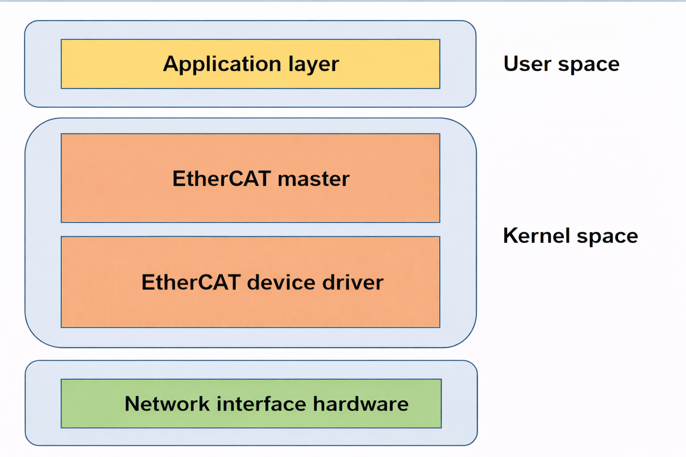

# EtherCAT

K3 EtherCAT Master Functionality and Usage Guide.

## Overview

K3 SDK integrates IGH EtherCAT 1.6.8 master protocol stack and customized real-time network card driver, providing EtherCAT master capabilities for high-performance and real-time communication. It is well-suited for high real-time application scenarios like motion control, servo drive and industrial robots.

### Feature Overview



The architecture of the EtherCAT Master is shown in the figure above and consists of four main components:

- **Application Layer:**
  This is where user applications reside, responsible for implementing industrial control logic. It interacts with the Master through provided interfaces.
- **EtherCAT Master Layer:**  
  This layer implements core functions such as protocol handling, bus topology management, slave configuration, and distributed clock synchronization.
- **EtherCAT Device Driver Layer:**  
  This layer consists of the real-time NIC driver and is responsible for transmitting and receiving EtherCAT data frames.
- **Hardware Layer:**  
  This layer includes the underlying network interfaces and related physical devices.

### Source Code Structure

The EtherCAT Master driver codes are located in the `drivers/net/ethercat` directory:

```bash
|-- device                              # EtherCAT device driver
|   |-- ecdev.h
|   |-- generic
|   |   |-- ec_generic.c                # Generic EtherCAT network card driver
|   |   `-- Makefile
|   |-- K1
|   |   |-- ec_k1x_emac.c               # K1 chip gigabit Ethernet EtherCAT device driver
|   |   |-- ec_k1x_emac.h
|   |   `-- Makefile
|   |-- K3                              # K3 chip gigabit Ethernet EtherCAT device driver 
|   |   |-- ...
|   |   |-- dwmac-spacemit-ethqos-ethercat.c
|   |   `-- ...
|   |-- Kconfig
|   `-- Makefile
|-- include
|   |-- config.h                        # Global configuration items and macro definitions
|   |-- ecrt.h                          # User program interfaces
|   |-- ectty.h
|   `-- globals.h                       # Global variables
|-- Kconfig
|-- Makefile
`-- master                              # IGH EtherCAT master implementation
    |-- cdev.c                          # Provides the EtherCAT character device initialization interface
    |-- cdev.h                 
    |-- coe_emerg_ring.c                # Interface for handling CoE emergent messages 
    |-- coe_emerg_ring.h       
    |-- datagram.c                      # Interface for constructing ECAT datagrams
    |-- datagram.h             
    |-- datagram_pair.c                 # Interface for constructing ECAT datagram pairs
    |-- datagram_pair.h        
    |-- debug.c                         # Debugging interface 
    |-- debug.h                
    |-- device.c                        # Interface for network card device abstraction and management
    |-- device.h               
    |-- domain.c                        # EtherCAT domain-related interface
    |-- domain.h               
    |-- doxygen.c
    |-- eoe_request.c
    |-- eoe_request.h          
    |-- ethernet.c                      # Core implementation of EOE functionality
    |-- ethernet.h             
    |-- flag.c
    |-- flag.h                 
    |-- fmmu_config.c                   # Interface for constructing FMMU configuration messages
    |-- fmmu_config.h          
    |-- foe.h                  
    |-- foe_request.c                   # FoE request handing interface
    |-- foe_request.h          
    |-- fsm_change.c                    # State transition state machine implementation 
    |-- fsm_change.h           
    |-- fsm_coe.c                       # CoE protocol state machine implementation
    |-- fsm_coe.h              
    |-- fsm_eoe.c                       # EoE protocol state machine implementation
    |-- fsm_eoe.h              
    |-- fsm_foe.c                       # FoE protocol state machine implementation
    |-- fsm_foe.h              
    |-- fsm_master.c                    # Master state machine implementation 
    |-- fsm_master.h           
    |-- fsm_pdo.c                       # PDO read/write state machine implementation
    |-- fsm_pdo_entry.c                 # PDO entry read/write state machine implementation 
    |-- fsm_pdo_entry.h        
    |-- fsm_pdo.h              
    |-- fsm_sii.c                       # Slave information interface read/write state machine implementation
    |-- fsm_sii.h              
    |-- fsm_slave.c                     # Slave state machine implementation
    |-- fsm_slave_config.c              # Slave configuration state machine implementation
    |-- fsm_slave_config.h     
    |-- fsm_slave.h            
    |-- fsm_slave_scan.c                # Slave scanning state machine implementation
    |-- fsm_slave_scan.h       
    |-- fsm_soe.c                       # SoE (Servo over EtherCAT) state machine implementation 
    |-- fsm_soe.h              
    |-- globals.h              
    |-- ioctl.c                         # IOCTL interface for user-space interaction 
    |-- ioctl.h               
    |-- Kconfig                
    |-- mailbox.c                       # ECAT mailbox message interface
    |-- mailbox.h              
    |-- Makefile               
    |-- master.c                        # Core logic of the EtherCAT master module
    |-- master.h               
    |-- module.c                        # Initialization and cleanup of the master module
    |-- pdo.c                           # PDO management interface
    |-- pdo_entry.c                     # PDO entry management interface
    |-- pdo_entry.h            
    |-- pdo.h                  
    |-- pdo_list.c                      # PDO list management interface
    |-- pdo_list.h             
    |-- reg_request.c                   # Interface for slave register read/write requests
    |-- reg_request.h          
    |-- rtdm.c                          # RTDM support
    |-- rtdm_details.h         
    |-- rtdm.h                 
    |-- rtdm-ioctl.c                    # RTDM IOCTL interface implementation
    |-- rtdm_xenomai_v3.c               # Interface for Xenomai v3 real-time framework 
    |-- rt_locks.h                      # Real-time lock implementation
    |-- sdo.c                           # SDO management
    |-- sdo_entry.c                     # SDO entry management
    |-- sdo_entry.h            
    |-- sdo.h                  
    |-- sdo_request.c                   # SDO request 
    ├── sdo_request.h          
    ├── slave.c                         # Slave state management logic
    |-- slave_config.c                  # Interface for slave configuration
    |-- slave_config.h         
    |-- slave.h                
    |-- soe_errors.c                    # Definition for SoE protocol error codes
    |-- soe_request.c                   # SoE request-related interface
    |-- soe_request.h          
    |-- sync.c                          # Interface for synchronization manager
    |-- sync_config.c                   # Interface for configuring the synchronization manager
    |-- sync_config.h          
    |-- sync.h                 
    |-- voe_handler.c                   # VOE (Vendor-specific over EtherCAT) request
    |-- voe_handler.h          
```

## Key Features

| Feature | Description |
| :-----| :----|
| Automatic Slave Configuration | Supports automatic scanning and configuration of connected slave devices, simplifying network setup |
| Distributed Clock Synchronization | Achieves Distributed Clock (DC) synchronization with precision of less than 1 µs |
| Multi-protocol Support | Supports protocols such as CoE, SoE, FoE, etc. |
| High Real-time Performance | Supports a 500-us DC cycle, meeting the real-time requirements of most industrial applications |
| Multi-master Support | Supports configuring multiple EtherCAT master instances |

## Configuration

It mainly includes **Kconfig configuration** and **DTS configuration**. For board types already supported by the current K3 SDK, EtherCAT works without changing the kernel configuration or modifying the DTS. Refer to this section when adapting a new board or when special configuration is required.

### Kconfig Configuration

- `ETHERCAT`: To enable EtherCAT services on the K3 platform, first configure this option to `Y`.

```c
menuconfig ETHERCAT
        bool "EtherCAT support"
        depends on NET && NETDEVICES && ETHERNET
        help
          EtherCAT is an industrial real-time fieldbus protocol that runs over
          Ethernet frames (Layer 2). Selecting this option enables the EtherCAT
          master subsystem and the corresponding network device interfaces.
```

- `EC_MASTER`: Enable the IgH EtherCAT master.
- `EC_MASTER_OF`: Enable the master configuration via the Device Tree. If disabled, the system falls back to passing master configuration through traditional module parameters.
- `EC_MASTER_RUN_ON_CPU`: Specify the CPU core on which the EtherCAT master runs.
- `EC_MASTER_DEBUG_LEVEL`: Sets the master debugging message output level.

```c
config EC_MASTER
    tristate "EtherCAT master (IgH)"
    depends on ETHERCAT
    help
      Say Y or M here to build the IgH EtherCAT master driver.
      The master is controlled via a character device interface.
      If unsure, say N.

config EC_MASTER_OF
    bool "Use Device Tree for EtherCAT master setup"
    depends on OF
    default y
    help
      Use Device Tree to provide EtherCAT master configuration,
      including master instances and bound Ethernet devices.

      This mode is intended for platform-integrated setups where
      EtherCAT master parameters are fixed by the board description,
      so runtime module parameters are not needed.

      If disabled, the original upstream module-parameter based
      configuration path is used instead.

config EC_MASTER_RUN_ON_CPU
    int "Run EtherCAT master on CPU"
    default 1
    range 0 7
    help
      Set the CPU (0-7) on which to run the EtherCAT master.
      If unsure, the default is 1.

config EC_MASTER_DEBUG_LEVEL
    int "Debug level for EtherCAT master"
    default 0
    range 0 2
    help
      Set the debug level for the EtherCAT master driver.
      0: No debug information.
      1: Error messages.
      2: Full debug information.
```

- `EC_GENERIC`: Enable generic EtherCAT device drivers.
- `EC_K3_GMAC`: Enables K3-specific EtherCAT device driver.

```c
config EC_GENERIC
        tristate "Generic EtherCAT device support"
        depends on EC_MASTER
        help
          Generic EtherCAT device support using the standard Linux networking
          stack. This is portable but may have higher latency/jitter.

config EC_K3_GMAC
        tristate "Spacemit K3 GMAC EtherCAT device support"
        depends on EC_MASTER && SOC_SPACEMIT_K3
        select PAGE_POOL
        help
          EtherCAT device support for Spacemit K3 GMAC controller.
```

> **Note:** On the K3 platform, the EtherCAT, EC_MASTER, EC_DEVICE, EC_K3_GMAC, and EC_MASTER_OF options are enabled by default.

### DTS Configuration

In the DTS, the number of masters can be configured via `master-count`, and corresponding `master` child nodes must be defined to match it. Each `master` child node can specify the primary and backup devices used to send EtherCAT frames through `main-device` and `backup-device`. Note that the `backup-device` feature is not yet implemented in the current version; the property is reserved for future use.
Taking the default configuration in `k3.dtsi` as an example, one EtherCAT master instance `master0` is defined by default, with its main device specified as `eth0`, and the current node state is `disabled`:

```c
ec_master: ethercat_master {
        compatible = "spacemit,igh-ec-master";
        master-count = <1>;
        status = "disabled";

        master0 {
                main-device = <&eth0>;
        };
};
```

To use the EtherCAT master, the simplest way is to directly enable the `ec_master` node in the board-level DTS:

```c
&ec_master {
	status = "okay";
};

```

To modify the configuration, other properties in `ec_master` can be overridden in the board-level DTS. For example, to configure two masters, `master0` and `master1`, where `master0` uses `eth1` and `master1` uses `eth0`:

```c
&ec_master {
        master-count = <2>;

        master0 {
                main-device = <&eth1>;
        };

        master1 {
                main-device = <&eth0>;
        };
};
```

## Usage

This section provides a brief introduction to using EtherCAT on K3.

### Installing the RT Kernel

Before running EtherCAT applications, an RT kernel is recommended for better real-time performance:

step1: Install the kernel package
```bash
sudo apt update
sudo apt install linux-image-6.18.3-rt
```

step2: Reboot the system
```bash
sudo reboot
```

step3: Verify the kernel version
```bash
uname -r
```

The output should contain `rt`.

### Switching the GMAC Driver

The K3 GMAC is bound to the Ethernet driver by default and can be switched to the EtherCAT real-time NIC driver at runtime. The following example uses k3 deb1, whose GMAC platform device is `cac80000.ethernet`. The switching procedure is as follows:

Step 1: Specify the EtherCAT driver
```bash
echo dwmac-spacemit-ethqos-ethercat > /sys/bus/platform/devices/cac80000.ethernet/driver_override
```

Step 2: Unbind the Ethernet driver
```bash
echo cac80000.ethernet > /sys/bus/platform/drivers/dwmac-spacemit-ethqos/unbind
```

Step 3: Bind the EtherCAT driver
```bash
echo cac80000.ethernet > /sys/bus/platform/drivers/dwmac-spacemit-ethqos-ethercat/bind
```

> **Note 1:** To switch back to the Ethernet driver, follow a similar sequence: first set `driver_override` to `dwmac-spacemit-ethqos`, then unbind the EtherCAT driver, and finally rebind the Ethernet driver.

> **Note 2:** To switch to the EtherCAT driver automatically after system boot, create a systemd service as described below:

Step1: Create the systemd service

```bash
cat > /etc/systemd/system/gmac-ethercat.service <<'EOF'
[Unit]
Description=Bind GMAC to EtherCAT driver
After=systemd-udev-settle.service
Before=NetworkManager.service systemd-networkd.service networking.service

[Service]
Type=oneshot
ExecStart=/bin/sh -c 'echo dwmac-spacemit-ethqos-ethercat > /sys/bus/platform/devices/cac80000.ethernet/driver_override; echo cac80000.ethernet > /sys/bus/platform/drivers/dwmac-spacemit-ethqos/unbind; echo cac80000.ethernet > /sys/bus/platform/drivers/dwmac-spacemit-ethqos-ethercat/bind'
RemainAfterExit=yes

[Install]
WantedBy=multi-user.target
EOF
```

Step2: Enable the service

```bash
systemctl daemon-reload
systemctl enable gmac-ethercat.service
systemctl start gmac-ethercat.service
```

## Interface

### API

Description of some commonly used APIs:

- Request a master instance.

```c
ec_master_t *ecrt_request_master(unsigned int master_id);
```

- Create a process data domain.

```c
ec_domain_t *ecrt_master_create_domain(ec_master_t *master);
```

- Activate the master.

```c
int ecrt_master_activate(ec_master_t *master);
```

- Synchronize the master's reference clock.

```c
int ecrt_master_sync_reference_clock_to(ec_master_t *master, uint64_t ref_time);
```

- Synchronize all slave clocks.

```c
void ecrt_master_sync_slave_clocks(ec_master_t *master);
```

- Configure a slave.

```c
ec_slave_config_t *ecrt_master_slave_config(ec_master_t *master, uint16_t alias, uint16_t position, uint32_t vendor_id, uint32_t product_code);

```

- Configure slave PDO mapping.

```c
int ecrt_slave_config_pdos(ec_slave_config_t *sc, uint16_t sync_index, const ec_sync_info_t *syncs);
```

- Register PDO entries to the specified data domain.

```c
int ecrt_slave_config_reg_pdo_entry(ec_slave_config_t *sc, uint16_t index, uint8_t subindex, ec_domain_t *domain, unsigned int *offset);

```

- Configure the distributed clock for the slave.

```c
int ecrt_slave_config_dc(ec_slave_config_t *sc, uint16_t assign_activate, uint32_t sync0_cycle_time, int32_t sync0_shift, uint32_t sync1_cycle_time, int32_t sync1_shift);
```

## Debugging

### sysfs

View master information via `/sys/class/EtherCAT/EtherCAT0`:

```c
/sys/class/EtherCAT/EtherCAT0
.
|-- dev
|-- power
|   |-- autosuspend_delay_ms
|   |-- control
|   |-- runtime_active_time
|   |-- runtime_status
|   `-- runtime_suspended_time
|-- subsystem -> ../../../../class/EtherCAT
`-- uevent

```

- dev: Provides the master device number information.
- power: Manages the power state of the device.
- subsystem: subsystem link. Indicates that the device belongs to the EtherCAT subsystem.
- uevent: Master device number and device name.

## Testing

EtherCAT master test procedure:

1. Connect the slave device to the master's network interface.
2. Power on and boot the system. The kernel automatically loads the EtherCAT master and real-time network-card drivers.
3. The master automatically scans for slaves and outputs logs after successful identification.
4. The master enters `PREOP` state, waiting for the user applications to run.

The startup log example is as follows:

```c
[  966.535906] EtherCAT 0: Link state of ecm0 changed to UP.
[  966.552545] EtherCAT 0: 1 slave(s) responding on main device.
[  966.558389] EtherCAT 0: Slave states on main device: INIT.
[  966.564036] EtherCAT 0: Scanning bus.
[  966.739197] EtherCAT 0: Bus scanning completed in 176 ms.
[  966.745275] EtherCAT 0: Using slave 0 as DC reference clock.
[  966.756564] EtherCAT 0: Slave states on main device: PREOP.

```

Before testing, isolate a CPU with cgroup v2 and run the test program on that CPU to reduce the impact of other scheduled tasks on real-time performance. The following example isolates CPU 2:

```bash
cd /sys/fs/cgroup

echo +cpuset > cgroup.subtree_control
mkdir -p rt-cpu2
echo 2 > rt-cpu2/cpuset.cpus
echo isolated > rt-cpu2/cpuset.cpus.partition
```

Run the test program on the isolated CPU:

```bash
bash -c '
echo $$ > /sys/fs/cgroup/rt-cpu2/cgroup.procs
exec env EC_RT_CPU=2 /path/to/test_program
'
```

Test cases can be developed based on `examples/dc_user/main.c` from the [EtherLab official examples](https://gitlab.com/etherlab.org/ethercat). The following example shows the output from a 24-hour test with one slave and a 500-us DC communication period:

```c
progress: 86393/86400
period        485042 ...   517083
exec            6709 ...   39833
latency         3843 ...   21318
progress: 86394/86400
period        485042 ...   517083
exec            6709 ...   39833
latency         3843 ...   21318
progress: 86395/86400
period        485042 ...   517083
exec            6709 ...   39833
latency         3843 ...   21318
progress: 86396/86400
period        485042 ...   517083
exec            6709 ...   39833
latency         3843 ...   21318
progress: 86397/86400
period        485042 ...   517083
exec            6709 ...   39833
latency         3843 ...   21318
progress: 86398/86400
period        485042 ...   517083
exec            6709 ...   39833
latency         3843 ...   21318
progress: 86399/86400
period        485042 ...   517083
exec            6709 ...   39833
latency         3843 ...   21318
progress: 86400/86400
period        485042 ...   517083
exec            6709 ...   39833
latency         3843 ...   21318
[84309.611731] EtherCAT 0: Releasing master
```

**Note:**

- `period`: The values represent the fluctuation range of the communication cycle over the entire test.
- `exec`: The values represent the fluctuation range of the master's periodic task execution time over the entire test.
- `latency`: The values represent the fluctuation range of the master's wake-up latency over the entire test.

## FAQ
