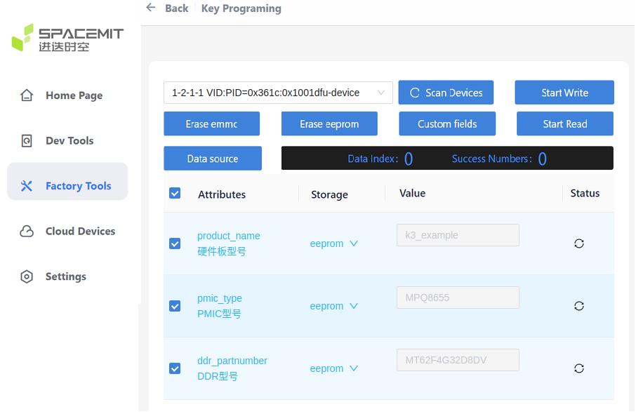

# Solution Management

This document explains how the SDK manages solutions, including the files that define a solution, how to customize a solution, and how to add a new one.

## Solution Configuration Files

Using the default K3 solution as an example, the solution typically includes the following files:

```shell
buildroot-ext/board/spacemit/k3/partition_*.json
buildroot-ext/board/spacemit/k3/env_k3.txt
buildroot-ext/board/spacemit/k3/bianbu.bmp
buildroot-ext/board/spacemit/k3/dracut.conf
buildroot-ext/board/spacemit/k3/target_overlay
buildroot-ext/configs/spacemit_k3_defconfig
bsp-src/opensbi/platform/generic/configs/k3_defconfig
bsp-src/uboot-2022.10/configs/k3_defconfig
bsp-src/linux-6.18/arch/riscv/configs/k3_bianbu_defconfig
```

**`buildroot-ext/board/spacemit/k3/partition_*.json`**

Partition layout files:

- `partition_8M.json`: for 8 MB flash
- `partition_64M.json`: for 64 MB flash
- `partition_universal.json`: for high capacity flash, such as SD cards, SSDs, and UFS devices

**`buildroot-ext/board/spacemit/k3/env_k3.txt`**

U-Boot environment variables. This file is used to customize boot parameters.

**`buildroot-ext/board/spacemit/k3/bianbu.bmp`**

U-Boot boot logo:

- Format: BMP
- Resolution: less than or equal to the display resolution
- Bit depth: 32

**`buildroot-ext/board/spacemit/k3/dracut.conf`**

Dracut configuration file. Dracut is a tool used to generate initramfs images.

**`buildroot-ext/board/spacemit/k3/target_overlay`**

As the name suggests, this directory overrides the contents of the `target` directory.

**`buildroot-ext/board/spacemit/k3/prepare_img.sh`**

Image packaging script for the K3 solution. Buildroot calls this script during the final packaging stage.

**`buildroot-ext/configs/spacemit_k3_defconfig`**

Buildroot configuration file.

**`bsp-src/opensbi/platform/generic/configs/k3_defconfig`**

OpenSBI configuration file.

**`bsp-src/uboot-2022.10/configs/k3_defconfig`**

U-Boot configuration file.

**`bsp-src/linux-6.18/arch/riscv/configs/k3_bianbu_defconfig`**

Kernel configuration file.

## Default Partition Layout

Avoid changing the partitions before `bootfs` unless absolutely necessary. Some boot components may rely on hard-coded offsets, and changes in this area can prevent the system from booting properly.

### SD Card Partition Layout

The SD card partition layout follows the `partitions` array defined in `partition_universal.json`.

The layout is as follows:

```
----------------------------------------------------------------------------------------------
|gpt    |   env   |  bootinfo  | fsbl | esos | opensbi | uboot |    bootfs    |    rootfs    |
----------------------------------------------------------------------------------------------
^       ^         ^            ^      ^      ^         ^       ^              ^              ^
|       |         |            |      |      |         |       |              |              |
0K      640K      1M          1536K   4M     7M        8M      12M            268M        Capacity
```

### SPI NOR + SSD/UFS Partition Layout

For SSD or UFS solutions, the system boots from SPI NOR flash. All partitions before `bootfs` are stored in SPI NOR and follow the `partitions` array in `partition_8M.json`.

The SPI NOR partition layout is as follows:

```
-----------------------------------------------------
|bootinfo   | fsbl | env |  esos  | opensbi | uboot |
-----------------------------------------------------
^           ^      ^     ^        ^         ^       ^
|           |      |     |        |         |       |
0K          128K   640K  704K     1728K     2112K  Capacity
```

The `bootfs` and `rootfs` partitions are stored on the SSD or UFS device and follow the `partitions` array defined in `partition_universal.json`.

```
----------------------------------------------------------------------------------------------
|gpt    |   env   |  bootinfo  | fsbl | esos | opensbi | uboot |    bootfs    |    rootfs    |
----------------------------------------------------------------------------------------------
^       ^         ^            ^      ^      ^         ^       ^              ^              ^
|       |         |            |      |      |         |       |              |              |
0K      640K      1M          1536K   4M     7M        8M      12M            268M        Capacity
```

## Customizing a Solution

This section describes how to customize U-Boot environment variables, partition settings, and the root file system.

### Modifying U-Boot Environment Variables

For the K3 solution, U-Boot environment variables are configured in `buildroot-ext/board/spacemit/k3/env_k3.txt`.

### Customizing Partition Information

For the K3 solution, partition settings can be customized by editing `buildroot-ext/board/spacemit/k3/partition_universal.json`:

```
{
  "version": "1.0",
  "format": "gpt",
  "partitions": [
    {
      "name": "env",
      "comment": "uboot env data partition, MUST not change its offset and size",
      "hidden": true,
      "offset": "640K",
      "size": "64K",
      "image": "env.bin"
    },
    {
      "name": "bootinfo",
      "comment": "contain address and size info of fsbl, MUST not change its position",
      "hidden": true,
      "offset": "1M",
      "size": "128K",
      "image": "factory/bootinfo_block.bin"
    },
    {
      "name": "fsbl",
      "comment": "its offset was designated by bootinfo",
      "hidden": true,
      "offset": "1536K",
      "size": "512K",
      "image": "factory/FSBL.bin"
    },
    {
     "name": "esos",
      "hidden": true,
      "offset": "4M",
      "size": "3M",
      "image": "esos.itb"
    },
    {
      "name": "opensbi",
      "hidden": true,
      "offset": "7M",
      "size": "1M",
      "image": "fw_dynamic.itb"
    },
    {
      "name": "uboot",
      "hidden": true,
      "offset": "8M",
      "size": "4M",
      "image": "u-boot.itb"
    },
    {
      "name": "bootfs",
      "offset": "12M",
      "size": "256M",
      "image": "bootfs.img",
      "compress": "gzip-5"
    },
    {
        "name": "rootfs",
        "offset": "268M",
        "size": "-",
        "image": "rootfs.ext4",
        "compress": "gzip-5"
    }
  ]
}

```

- **name**: Partition name. Required. Do not change existing partition names, because some components refer to them directly.

- **hidden**: Whether the partition is hidden. Hidden partitions do not appear in the partition table, so no corresponding device node is created under `/dev/`. Optional. By default, partitions are not hidden.

- **size**: Partition size. Supported units are `K`, `M`, and `G`. Optional for the last partition.

- **offset**: Offset relative to address `0`. Supported units are `K`, `M`, and `G`. Optional.

- **image**: Image file associated with the partition. Required and must not be empty.

- **compress**: Compression method used for the image.

In most cases, only the partition size or image name needs to be updated. If custom partitions are required, add them after the `uboot` partition.

Adding, removing, or hiding partitions changes the order of the corresponding nodes under `/dev/`. Keep this in mind when writing partitions with `dd`.

### Customizing the Root File System

For the K3 solution, the root file system can be customized through `buildroot-ext/board/spacemit/k3/target_overlay`.

All final Buildroot output is placed in `output/xxx/target` and then packaged into the `rootfs` partition. If configuration files or prebuilt binaries need to be added to `rootfs` without creating extra `.mk` files, the following approaches can be used:

1. Place the files directly in `output/xxx/target` and rebuild the image. This is temporary, and the changes will be lost after `make clean`.

2. Place files or directories in `target_overlay`, using the same directory structure as `output/xxx/target/`. Before packaging the `target` directory, Buildroot copies `target_overlay` into `output/xxx/target/` and overwrites any matching files.

## Adding a New Build Solution

1. Create a new solution directory under `buildroot-ext/board/spacemit/`. A common naming convention is `chip-name-board-name/`.

2. Modify `partitions_universal.json` as needed.

3. Modify the U-Boot `env.txt` file as needed.

4. Copy an existing defconfig file in `buildroot-ext/configs` and rename it to match the new solution name.

5. During `make envconfig`, select the new defconfig. Then run `make menuconfig`, update the required options, and save the configuration.

   In most cases, the following items need to be updated. Editing the defconfig file directly is recommended:

   - Point to the new kernel, U-Boot, and OpenSBI configuration files.

   - Point to the new packaging script `prepare_image.sh`.

6. Build the solution.

### Flashing and Booting a New Solution

When adding a device solution, see [Device Management](./device_management.md).

**Note:** After adding a device tree to an existing build, rerun `make envconfig`, then run `make uboot-rebuild && make linux-rebuild && make` to rebuild and package the image.

Before flashing and booting a board for the first time, check the following:

- Consult the [K3 supported components list](https://spacemit.com/community/document/info?lang=en&nodepath=hardware/key_stone/k3/k3_hw/k3_hw_avl.md). Unsupported components may require adaptation using the peripheral documentation.
- Determine whether a new DTS solution is present. A custom DTS solution requires the board name to be written as `product_name`.
- Check the DDR model against the [DDR documentation](https://www.spacemit.com/community/document/info?lang=en&nodepath=software/SDK/buildroot/k3_buildroot/device/peripheral_driver/ddr.md). Unsupported models require driver adaptation.
- Check the PMIC model against the [PMIC documentation](https://spacemit.com/community/document/info?lang=en&nodepath=software/SDK/buildroot/k3_buildroot/device/peripheral_driver/14-PMIC.md). Unsupported models require driver adaptation.
- For UFS boot, check the UFS model against the [UFS documentation](https://spacemit.com/community/document/info?lang=en&nodepath=software/SDK/buildroot/k3_buildroot/device/peripheral_driver/ufs.md). Unsupported parts require driver adaptation. The flashing serial log can be used to check whether the block device is detected.
- Check whether an EEPROM is connected and recognized. After programming it, power-cycle the board and read it back to verify. The EEPROM must be connected to I2C6 (GPIO 120/121 or 61/62) or I2C2 (GPIO 46/47). It stores board, DDR, and PMIC information used at boot. **Incorrect key information can cause flashing or boot failure.**

#### Board With EEPROM

Use the [programming tool](https://www.spacemit.com/community/document/info?lang=en&nodepath=tools/user_guide/flasher_user_guide.md) to write the DDR model, device-tree board name, and PMIC information to the EEPROM. UFS does not require a key to be written.



**Note:**

- Clear a checkbox before changing its value, then select it again. Do not select configuration items whose values are uncertain.
- If no new device tree has been added, do not select `product_name`; `k3_deb1` is loaded by default. A nonexistent device-tree name prevents the DTB from being found.

#### Board Without EEPROM or With Unknown EEPROM Status

**EEPROM adaptation is recommended first. The following default-value changes are for reference only.**

After changing the DDR and default solution configuration, rebuild U-Boot and the image:

```shell
make uboot-rebuild && make
```

The following example changes the DDR part number to the single-rank, 4 GB `MT62F1G32D2DS` and sets the default solution to `k3_example`. Adapt it to the actual hardware:

```diff
user:~/workspace/k3_buildroot_sdk_pub/bsp-src/uboot-2022.10$ git diff arch/riscv/dts/k3_spl.dts include/
diff --git a/arch/riscv/dts/k3_spl.dts b/arch/riscv/dts/k3_spl.dts
index d95d77886f..f4d79a8653 100644
--- a/arch/riscv/dts/k3_spl.dts
+++ b/arch/riscv/dts/k3_spl.dts
@@ -231,7 +231,7 @@
        ddr@cb000000 {
        u-boot,dm-spl;
        compatible = "spacemit,snps-lp45";
-                       part-number = "MT62F2G32D4DS";
+                       part-number = "MT62F1G32D2DS";
        reg = <0x00000000 0xcb000000 0x00000000 0x00400000>,
          <0x00000000 0xcc000000 0x00000000 0x00400000>;
        reg-names = "ddrc0", "ddrc1";
diff --git a/include/configs/k3.h b/include/configs/k3.h
index f106a03d7d..ab6905a9e4 100644
--- a/include/configs/k3.h
+++ b/include/configs/k3.h
@@ -102,10 +102,10 @@
 #define K3_NOR_UFS_DEVNUM_DEFAULT      (0)
 #define K3_NOR_EMMC_DEVNUM_DEFAULT     (MMC_DEV_EMMC)

-#define DEFAULT_PRODUCT_NAME           "k3_deb1"
+#define DEFAULT_PRODUCT_NAME           "k3_example"
 #define BOOTFS_NAME                    ("bootfs")
```
