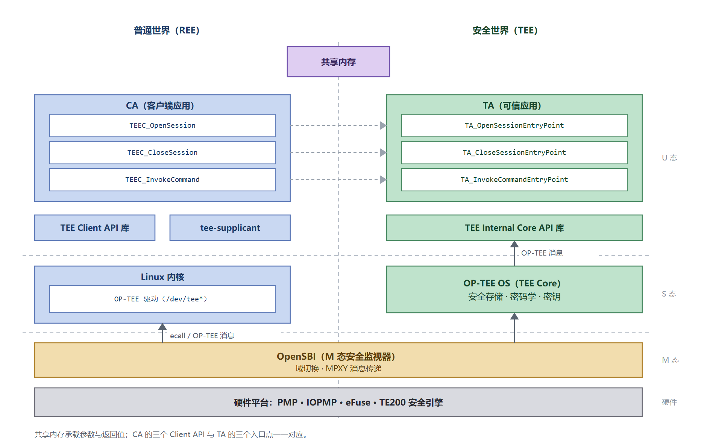

# CA Development Guide / TEE Client API Reference

## Overview

### Purpose

This guide explains how to develop CAs (Client Applications that run in the normal world and call TEE services) on K3: preparing a cross-compilation environment, writing the CA, compiling and linking, deploying, and verifying. A TEE Client API reference follows the procedure.

The TEE Client API is the standard interface defined by **GlobalPlatform (GP)**.

- **K3 implementation:** `libteec`.
- **TA-side counterpart:** the GP TEE Internal Core API; see the [TA Development Guide](ta_guide.md).
- **Relationship between the specifications:** see [GP APIs and OP-TEE](tee_architecture.md#gp-apis-and-op-tee) in the TEE Architecture and Integration Guide; links to the specifications are in that guide's [references](tee_architecture.md#references).

### Scope

This guide applies to Buildroot solutions for SpacemiT K3 series SoCs.

- **Build environment:** Cross-compilation on a development host; executables run on a RISC-V target.
- **Related documents:** [TA Development Guide](ta_guide.md) for the TA side, [TEE Examples](examples.md) for runnable examples, and the [TEE Architecture and Integration Guide](tee_architecture.md) for architecture.

### Document Structure

1. **CA-to-TEE interaction model:** Three calls correspond to three entry points.
2. **Runtime environment:** Device nodes, background service, and TA location.
3. **TEE Client API reference:** Data types, parameter types, functions, return values, and error codes.
4. **UUID and command-ID conventions** and **the relationship to secure storage**.
5. **Quick start:** A five-step overview.
6. **Steps 1-4:** Prepare the cross-compilation environment, write the CA, compile and link, and deploy and verify.
7. **Complete example**, **troubleshooting**, and **references**.

### Important Constraints

> [!CAUTION]
> The parameter types submitted by the CA (`paramTypes`) must match **exactly** what the TA reads. Mismatches are not compile-time errors; they return a parameter error at runtime and are the most common integration failure.

## CA-to-TEE Interaction Model

The three CA calls correspond one-to-one with three TA entry points:



| CA side | TA side |
|---|---|
| `TEEC_OpenSession` | `TA_OpenSessionEntryPoint` |
| `TEEC_CloseSession` | `TA_CloseSessionEntryPoint` |
| `TEEC_InvokeCommand` | `TA_InvokeCommandEntryPoint` |

Parameters and return values pass through shared memory; the UUID and command IDs must match on both sides.

## Runtime Environment

| Item | Description |
|---|---|
| Device nodes | `/dev/tee0`, `/dev/teepriv0`, and others created by the kernel TEE driver |
| Background service | `tee-supplicant`, started by an initialization script; handles file-system and RPMB RPC |
| TA location | `/lib/optee_armtz/`, named by UUID |

Confirm the environment before running a CA:

```bash
ls /dev/tee*
ps | grep tee-supplicant
```

## TEE Client API Reference

The types, functions, and error codes below come from the GlobalPlatform TEE Client API specification (1.0.1), implemented by `libteec` on K3. For the full definition, see [References](#references). CAs can also access the TEE through OpenSC's **PKCS#11** standard cryptographic interface, a separate higher-level API; see the [PKCS#11 example](examples.md#pkcs11-example) in TEE Examples.

### Data Types

| Type | Description |
|---|---|
| `TEEC_Result` | 32-bit return code; `0` (`TEEC_SUCCESS`) means success |
| `TEEC_Context` | Connection between a CA and the TEE |
| `TEEC_Session` | Session between a CA and a TA |
| `TEEC_Operation` | Parameter and state container for one command call |
| `TEEC_Parameter` | Union holding one parameter; see [Parameter Types](#parameter-types) |
| `TEEC_Value` | Two 32-bit integers, `a` and `b`, for small data |
| `TEEC_TempMemoryReference` | Temporary memory reference valid only during this operation |
| `TEEC_RegisteredMemoryReference` | Reference to a shared-memory block, with optional offset and length |
| `TEEC_SharedMemory` | Registered or allocated shared-memory block |
| `TEEC_UUID` | Unique TA identifier |

A `TEEC_Operation` carries up to four parameters (`params[0..3]`), with types described by `paramTypes`. The `started` flag and `TEEC_RequestCancellation()` support cancellation.

### Parameter Types

`paramTypes` combines four 4-bit fields, one value per parameter:

| Value | Meaning |
|---|---|
| `TEEC_NONE` | Parameter unused |
| `TEEC_VALUE_INPUT` / `OUTPUT` / `INOUT` | Parameter is a `TEEC_Value` used as input, output, or both |
| `TEEC_MEMREF_TEMP_INPUT` / `OUTPUT` / `INOUT` | Parameter is a temporary memory reference |
| `TEEC_MEMREF_WHOLE` | Reference to an entire registered shared-memory block |
| `TEEC_MEMREF_PARTIAL_INPUT` / `OUTPUT` / `INOUT` | Reference to part of a registered shared-memory block |

Shared-memory flags:

| Value | Meaning |
|---|---|
| `TEEC_MEM_INPUT` | The CA writes and the TA reads |
| `TEEC_MEM_OUTPUT` | The TA writes and the CA reads |

### Functions

```c
TEEC_Result TEEC_InitializeContext(const char *name, TEEC_Context *context);
void        TEEC_FinalizeContext(TEEC_Context *context);

TEEC_Result TEEC_OpenSession(TEEC_Context *context,
                             TEEC_Session *session,
                             const TEEC_UUID *destination,
                             uint32_t connectionMethod,
                             const void *connectionData,
                             TEEC_Operation *operation,
                             uint32_t *returnOrigin);
void        TEEC_CloseSession(TEEC_Session *session);

TEEC_Result TEEC_InvokeCommand(TEEC_Session *session,
                               uint32_t commandID,
                               TEEC_Operation *operation,
                               uint32_t *returnOrigin);

TEEC_Result TEEC_RegisterSharedMemory(TEEC_Context *context,
                                      TEEC_SharedMemory *sharedMem);
TEEC_Result TEEC_AllocateSharedMemory(TEEC_Context *context,
                                      TEEC_SharedMemory *sharedMem);
void        TEEC_ReleaseSharedMemory(TEEC_SharedMemory *sharedMemory);

void        TEEC_RequestCancellation(TEEC_Operation *operation);
```

Notes:

- Pass `NULL` as `name` to `TEEC_InitializeContext()` to use the default TEE device.
- `connectionMethod` is usually `TEEC_LOGIN_PUBLIC`; see the login table below.
- `returnOrigin` distinguishes the error source.
- `TEEC_RegisterSharedMemory()` registers caller-owned memory; `TEEC_AllocateSharedMemory()` allocates it through the library.

Login methods:

| Value | Meaning |
|---|---|
| `TEEC_LOGIN_PUBLIC` | No login identity (most common) |
| `TEEC_LOGIN_USER` | Log in as the current user |
| `TEEC_LOGIN_GROUP` | Log in as a specified group |
| `TEEC_LOGIN_APPLICATION` | Log in as the application |
| `TEEC_LOGIN_USER_APPLICATION` | User and application identity |
| `TEEC_LOGIN_GROUP_APPLICATION` | Group and application identity |

### Return Values and Error Codes

`TEEC_SUCCESS` (`0x00000000`) indicates success. Common error codes:

| Error code | Name | Common cause |
|---|---|---|
| `0xFFFF0000` | `TEEC_ERROR_GENERIC` | Generic error |
| `0xFFFF0001` | `TEEC_ERROR_ACCESS_DENIED` | Insufficient permission |
| `0xFFFF0006` | `TEEC_ERROR_BAD_PARAMETERS` | Parameter type or value mismatch; most common during integration |
| `0xFFFF0007` | `TEEC_ERROR_BAD_STATE` | Incorrect state, such as when a session has not been established |
| `0xFFFF0008` | `TEEC_ERROR_ITEM_NOT_FOUND` | Object or TA not found |
| `0xFFFF0009` | `TEEC_ERROR_NOT_IMPLEMENTED` | TA does not implement the command |
| `0xFFFF000C` | `TEEC_ERROR_OUT_OF_MEMORY` | Out of memory |
| `0xFFFF000E` | `TEEC_ERROR_COMMUNICATION` | Communication with the TEE failed |
| `0xFFFF000F` | `TEEC_ERROR_SECURITY` | Security error, such as key-derivation failure |
| `0xFFFF0010` | `TEEC_ERROR_SHORT_BUFFER` | Output buffer too small |
| `0xF0100003` | `TEEC_ERROR_STORAGE_NOT_AVAILABLE` | Secure storage unavailable, often because `tee-supplicant` is not running |
| `0xFFFF3024` | `TEEC_ERROR_TARGET_DEAD` | TA terminated |
| `0xFFFF3041` | `TEEC_ERROR_STORAGE_NO_SPACE` | Secure-storage space exhausted |

Error origin, `returnOrigin`:

| Value | Meaning |
|---|---|
| `TEEC_ORIGIN_API` | Reported by the client library |
| `TEEC_ORIGIN_COMMS` | Reported by the communication layer (driver or service) |
| `TEEC_ORIGIN_TEE` | Reported by the TEE kernel |
| `TEEC_ORIGIN_TRUSTED_APP` | Reported by the TA |

Check `returnOrigin` first: `COMMS` usually indicates an environment problem such as a stopped service or missing device node, while `TRUSTED_APP` points to TA logic or parameter validation.

## UUID and Command-ID Conventions

- Each TA has a unique `TEEC_UUID` that must match on both the CA and TA sides.
- Command IDs are TA-defined, usually starting at `0`; CA and TA must share the same semantics.
- Changing a UUID or command ID requires updating the TA and all CAs, or calls fail with `TEEC_ERROR_ITEM_NOT_FOUND` or `TEEC_ERROR_NOT_IMPLEMENTED`.
- Keep UUIDs and command IDs in a header shared by both sides to avoid manual drift.

## Relationship to Secure Storage

Secure storage data handling and protection are performed jointly by the secure and normal worlds; **the CA interface is identical regardless of backend**:

- With the default backend (normal-world file system managed by `tee-supplicant`), **storage calls fail if the background service is not running**, typically with `TEEC_ERROR_STORAGE_NOT_AVAILABLE`.

See [Secure Storage](tee_architecture.md#secure-storage) in the TEE Architecture and Integration Guide for storage layers, backend selection, and capacity semantics.

## Quick Start

CA development parallels TA development:

| Step | Action | Output |
|---|---|---|
| 1 | Prepare the cross-compilation environment: toolchain, `libteec`, and `tee_client_api.h` | A working cross-compilation environment |
| 2 | Write the CA: initialize the context, open a session, send a command, close | CA source |
| 3 | Cross-compile and link against `libteec` | Target executable |
| 4 | Run on the device and diagnose using return codes and error origins | Verification results |

## Step 1: Prepare the Cross-Compilation Environment

### Which Toolchain

Buildroot builds use `output/k3/host/bin/riscv64-unknown-linux-gnu-`, a Buildroot-generated **wrapper** around the **SpacemiT external toolchain**:

| Layer | Location | Description |
|---|---|---|
| Wrapper | `output/k3/host/bin/riscv64-unknown-linux-gnu-` | Buildroot-generated; supplies `--sysroot`, `-mabi`, and related options |
| Toolchain | `output/k3/host/opt/ext-toolchain/bin/riscv64-unknown-linux-gnu-` | GCC 15.2.0 from `spacemit-toolchain-linux-glibc-x86_64-v1.2.2.tar.xz` |

On a development host, **use the toolchain itself**: the wrapper was built in an Ubuntu 24.04 container and requires host glibc ≥ 2.38; older hosts report `version 'GLIBC_2.xx' not found`. The official tarball has lower host requirements. You may also install the same toolchain locally; see `BR2_TOOLCHAIN_EXTERNAL_URL` in `output/k3/.config`.

### Dependencies and sysroot

`libteec` and its headers are in the Buildroot sysroot:

| Item | Location |
|---|---|
| Headers | `output/k3/host/riscv64-buildroot-linux-gnu/sysroot/usr/include/`: `tee_client_api.h`, `tee_client_api_extensions.h` |
| Libraries | `usr/lib/` in the same tree: `libteec.so`, `libteec.so.2`, `libteec.so.2.0.0` |
| TA development kit | `output/k3/build/optee-os-custom/out/export-ta_rv64/` (only when building TAs too) |

The wrapper already points `--sysroot` there; when using the toolchain directly, add `--sysroot=<that directory>`. `$BR` below denotes the Buildroot output directory (`/k3` inside the build container).

Runtime paths on the device are independent of the build:

```text
/usr/lib/libteec.so.2        # Library on the target device
/usr/bin/optee_example_*     # Example CA install location
```

## Step 2: Write the CA

A complete call has five steps:

1. `TEEC_InitializeContext()` establishes the TEE connection.
2. `TEEC_OpenSession()` opens a session to the target TA by UUID.
3. `TEEC_InvokeCommand()` sends a command by ID, with parameters in shared memory or registers.
4. `TEEC_CloseSession()` ends the session.
5. `TEEC_FinalizeContext()` releases the connection.

The following skeleton illustrates the flow; for a complete, compilable version, see [Complete Example](#complete-example):

```c
#include <tee_client_api.h>

/* UUID and command IDs must match the TA side */
#define TA_UUID  { /* ... */ }
#define CMD_X    0

TEEC_Context ctx;
TEEC_Session sess;
TEEC_Operation op;
TEEC_UUID uuid = TA_UUID;
uint32_t origin = 0;
TEEC_Result res;

res = TEEC_InitializeContext(NULL, &ctx);              /* 1. Connect */
/* Check res ... */

res = TEEC_OpenSession(&ctx, &sess, &uuid,             /* 2. Open session */
                       TEEC_LOGIN_PUBLIC, NULL, NULL, &origin);
/* Check res and origin ... */

memset(&op, 0, sizeof(op));                            /* 3. Prepare parameters */
op.paramTypes = TEEC_PARAM_TYPES(TEEC_VALUE_INOUT,
                                 TEEC_NONE, TEEC_NONE, TEEC_NONE);
op.params[0].value.a = 41;

res = TEEC_InvokeCommand(&sess, CMD_X, &op, &origin);  /* 4. Send command */
/* Check res and origin ... */

TEEC_CloseSession(&sess);                              /* 5. Clean up */
TEEC_FinalizeContext(&ctx);
```

### Why Include the TA Header

The UUID and command IDs are the only contract between CA and TA: the UUID selects the TA for `TEEC_OpenSession()`, and the command ID selects the TA entry for `TEEC_InvokeCommand()`. Both are TA-defined, so **place them in the TA's `include/` header and include that header from the CA**.

The example `hello_world/ta/include/hello_world_ta.h` is a shared header containing only macros, so both the CA and TA can include it:

```c
#define TA_HELLO_WORLD_UUID \
	{ 0x8aaaf200, 0x2450, 0x11e4, \
		{ 0xab, 0xe2, 0x00, 0x02, 0xa5, 0xd5, 0xc5, 0x1b} }

/* The function IDs implemented in this TA */
#define TA_HELLO_WORLD_CMD_INC_VALUE   0
#define TA_HELLO_WORLD_CMD_DEC_VALUE   1
```

The CA uses these macros directly without duplicating the constants:

```c
#include <hello_world_ta.h>

TEEC_UUID uuid = TA_HELLO_WORLD_UUID;   /* Open session */
res = TEEC_OpenSession(&ctx, &sess, &uuid, TEEC_LOGIN_PUBLIC, NULL, NULL, &origin);

res = TEEC_InvokeCommand(&sess, TA_HELLO_WORLD_CMD_INC_VALUE, &op, &origin);  /* Send command */
```

Add `-I` pointing to that header directory when compiling (the example uses `-I../ta/include`; see [Step 3: Compile and Link](#step-3-compile-and-link)). A UUID mismatch causes an object-not-found error when opening a session. A command ID mismatch may result in a command-not-implemented error or an unexpected command result.

Two common pitfalls: **zero-initialize `TEEC_Operation` with `memset` before use** to prevent stale `started` or parameter-type fields from causing failures, and ensure that each entry in `paramTypes` matches the corresponding parameter type expected by the TA. See [Parameter Types](#parameter-types) and [Parameter Correspondence with the CA](ta_guide.md#parameter-correspondence-with-the-ca).

When a TA needs normal-world resources such as the file system or RPMB, the OP-TEE kernel issues RPCs handled by `tee-supplicant`, so **`tee-supplicant` must be running** for secure-storage calls to succeed.

## Step 3: Compile and Link

### Option 1: Makefile in the host Directory (Recommended)

Each optee_examples `host/` directory contains this upstream Makefile, which makes a good template:

```make
CC      ?= $(CROSS_COMPILE)gcc
LD      ?= $(CROSS_COMPILE)ld
AR      ?= $(CROSS_COMPILE)ar
NM      ?= $(CROSS_COMPILE)nm
OBJCOPY ?= $(CROSS_COMPILE)objcopy
OBJDUMP ?= $(CROSS_COMPILE)objdump
READELF ?= $(CROSS_COMPILE)readelf

OBJS = main.o

CFLAGS += -Wall -I../ta/include -I$(TEEC_EXPORT)/include -I./include
LDADD  += -lteec -L$(TEEC_EXPORT)/lib

BINARY = optee_example_hello_world

.PHONY: all
all: $(BINARY)

$(BINARY): $(OBJS)
	$(CC) $(LDFLAGS) -o $@ $< $(LDADD)

.PHONY: clean
clean:
	rm -f $(OBJS) $(BINARY)

%.o: %.c
	$(CC) $(CFLAGS) -c $< -o $@
```

Change `OBJS` and `BINARY` only. Three variables must be supplied:

| Variable | Meaning | Value |
|---|---|---|
| `CC` | Compiler, including sysroot | See the two commands below |
| `CROSS_COMPILE` | Toolchain prefix | In-container: `$BR/host/bin/riscv64-unknown-linux-gnu-`; on the host: the toolchain's own path prefix |
| `TEEC_EXPORT` | Directory containing `include/` and `lib/` | `$BR/host/riscv64-buildroot-linux-gnu/sysroot/usr` |

**`CC` must be passed explicitly:** the Makefile uses `CC ?= $(CROSS_COMPILE)gcc`, but `CC` is a make built-in (default `cc`) and `?=` does not override it. Passing only `CROSS_COMPILE` links with the host `cc`, producing `skipping incompatible .../libteec.so` and `cannot find -lteec`. The example root Makefile works with only `CROSS_COMPILE` because it passes `--no-builtin-variables` when invoking the host side.

On the Buildroot host, using the toolchain directly (requires `--sysroot`):

```bash
BR=$PWD/output/k3
TC=$BR/host/opt/ext-toolchain/bin/riscv64-unknown-linux-gnu-
SYSROOT=$BR/host/riscv64-buildroot-linux-gnu/sysroot

cd <project>/host
make clean
make --no-builtin-variables CC="$TC""gcc --sysroot=$SYSROOT" TEEC_EXPORT=$SYSROOT/usr
```

Inside the build container, the wrapper supplies `--sysroot`. The toolchain is not on `PATH`, so use its full path prefix:

```bash
BR=/k3
cd <project>/host
make clean
make --no-builtin-variables CROSS_COMPILE=$BR/host/bin/riscv64-unknown-linux-gnu- TEEC_EXPORT=$BR/host/riscv64-buildroot-linux-gnu/sysroot/usr
```

The result is a 64-bit RISC-V executable with `libteec.so.2` in `NEEDED`. To avoid passing `--no-builtin-variables` each time, change `CC ?=` to `CC =` in the Makefile.

### Option 2: One Command

To build without a Makefile, invoke the compiler directly. If the source uses the TA's UUID header, use `-I` to specify its directory:

```bash
# Host (toolchain itself)
"${TC}"gcc --sysroot=$SYSROOT -o myca main.c -I../ta/include -lteec

# Container (wrapper)
/k3/host/bin/riscv64-unknown-linux-gnu-gcc -o myca main.c -I../ta/include -lteec
```

Verify the build:

```bash
file myca                        # Expect ELF 64-bit LSB executable, UCB RISC-V
readelf -d myca | grep NEEDED    # Expect libteec.so.2
```

The build links the target `libteec.so` (64-bit RISC-V); at runtime the device loads `/usr/lib/libteec.so.2` from the image. Running the binary on an x86 host fails with a format error, which is expected for cross-compilation.

In Buildroot, CAs can be installed in the target file system through a custom or example package. **If the CA must appear in initramfs, explicitly add it to the initramfs allowlist**; otherwise it exists only in the root file system.

## Step 4: Deploy and Verify

1. **Place it on the device:** **Packaging with the image is recommended.** Like TAs, a CA can be added to the Buildroot optee-examples package (the top-level CMake discovers new directories), then `make optee-examples-rebuild && make`. See [Add a Test Case](examples.md#add-a-test-case) in TEE Examples. Pushing the executable to a device is acceptable for development.
2. **Confirm prerequisites:** `/dev/tee*` exists, `tee-supplicant` is running, and the target TA is under `/lib/optee_armtz/`.
3. **Run and check the return:** `TEEC_SUCCESS` (`0`) indicates success. On failure, print `returnOrigin`: `TEEC_ORIGIN_COMMS` usually indicates an environment issue, while `TEEC_ORIGIN_TRUSTED_APP` usually indicates TA logic or parameter problems.

## Complete Example

This CA pairs with the complete example in the [TA Development Guide](ta_guide.md), which increments a supplied value.

```c
#include <stdio.h>
#include <string.h>
#include <tee_client_api.h>

/* Keep consistent with the TA side */
#define TA_UUID \
	{ 0x8aaaf200, 0x2450, 0x11e4, \
	  { 0xab, 0xe2, 0x00, 0x02, 0xa5, 0xd5, 0xc5, 0x1b } }

#define CMD_INC_VALUE 0

int main(void)
{
	TEEC_Context ctx;
	TEEC_Session sess;
	TEEC_Operation op;
	TEEC_UUID uuid = TA_UUID;
	uint32_t err_origin = 0;
	TEEC_Result res;

	res = TEEC_InitializeContext(NULL, &ctx);
	if (res != TEEC_SUCCESS) {
		printf("InitializeContext failed: 0x%x\n", res);
		return 1;
	}

	res = TEEC_OpenSession(&ctx, &sess, &uuid, TEEC_LOGIN_PUBLIC,
			       NULL, NULL, &err_origin);
	if (res != TEEC_SUCCESS) {
		printf("OpenSession failed: 0x%x origin 0x%x\n", res, err_origin);
		TEEC_FinalizeContext(&ctx);
		return 1;
	}

	memset(&op, 0, sizeof(op));
	op.paramTypes = TEEC_PARAM_TYPES(TEEC_VALUE_INOUT, TEEC_NONE,
					 TEEC_NONE, TEEC_NONE);
	op.params[0].value.a = 41;

	res = TEEC_InvokeCommand(&sess, CMD_INC_VALUE, &op, &err_origin);
	if (res != TEEC_SUCCESS) {
		printf("InvokeCommand failed: 0x%x origin 0x%x\n", res, err_origin);
	} else {
		printf("value incremented to %u\n", op.params[0].value.a);
	}

	TEEC_CloseSession(&sess);
	TEEC_FinalizeContext(&ctx);

	return res == TEEC_SUCCESS ? 0 : 1;
}
```

Compile as in [Step 3: Compile and Link](#step-3-compile-and-link); success prints `value incremented to 42`.

## Troubleshooting

### Compilation Cannot Find tee_client_api.h or libteec

The header and libteec are in the cross toolchain sysroot, so no extra `-I` or `-L` is normally needed:

- **`skipping incompatible .../libteec.so` plus `cannot find -lteec`:** The host `cc` is being used. Build through the example root Makefile, which uses `--no-builtin-variables` to handle `CROSS_COMPILE`, or pass `CC` explicitly and run `make clean` first when building directly in `host/`.
- **Only `cannot find -lteec`:** `TEEC_EXPORT` is unset or wrong; it must point to the directory containing `include/` and `lib/`, such as `usr/` in the sysroot.
- **`version 'GLIBC_2.xx' not found`:** The Buildroot wrapper in `host/bin/` requires glibc ≥ 2.38. Use the toolchain in `host/opt/ext-toolchain/bin/` or enter the build container with `make k3-shell`.
- **`err.h: No such file or directory` or another missing C library header:** The bare-metal `riscv64-unknown-elf-gcc` is in use; switch to `riscv64-unknown-linux-gnu-gcc`.
- **`riscv64-unknown-linux-gnu-gcc: command not found`:** Use the absolute path or add `$BR/host/bin` to `PATH`.
- **`Relocations in generic ELF (EM: 62)` or `file in wrong format`:** Stale x86-64 object files from a previous host build are present, and `make` will not rebuild them automatically. Run `make clean` or delete the `*.o` files, then rebuild.

### The Binary Cannot Run on the Host

It is a 64-bit RISC-V executable and runs only on the target device.

### A Call Returns a Parameter Error

Compare CA `paramTypes` with the types read by the TA, and confirm that `TEEC_Operation` was zeroed before use.

### Opening a Session Returns Object-Not-Found

Confirm that the TA is installed, the UUIDs match, the TA is packaged in this build, and `tee-supplicant` is running.

### Secure-Storage Calls Fail

Confirm that `tee-supplicant` is running and the device-node permissions allow access. With RPMB, confirm that the device has been provisioned.

## References

The external specifications referenced in this guide are listed below; versions are left blank where unknown.

| Name | Version | Link |
|---|---|---|
| GlobalPlatform TEE Client API Specification (CA-side API) | 1.0.1 | <https://globalplatform.org/specs-library/tee-client-api-specification/> |
| GlobalPlatform TEE Internal Core API Specification (TA-side API) | 1.4 | <https://globalplatform.org/specs-library/tee-internal-core-api-specification/> |
| OP-TEE documentation (optee_client / libteec) | latest | <https://optee.readthedocs.io/en/latest/> |
