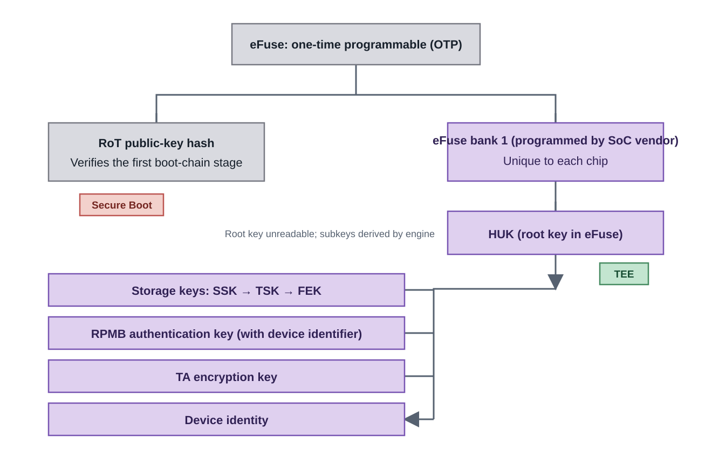
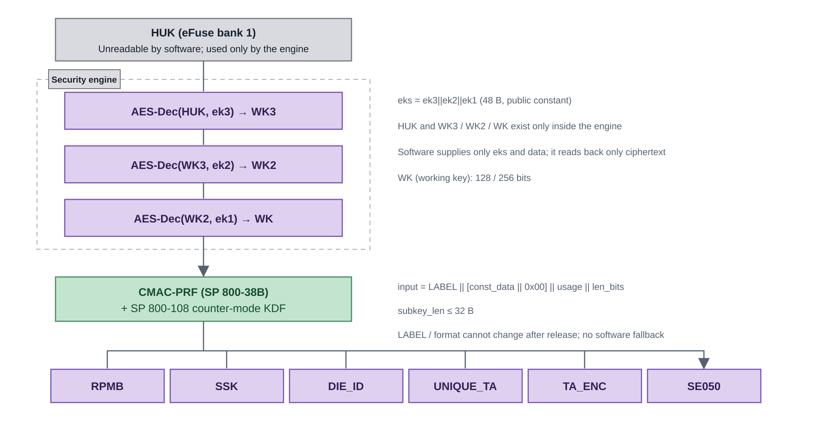
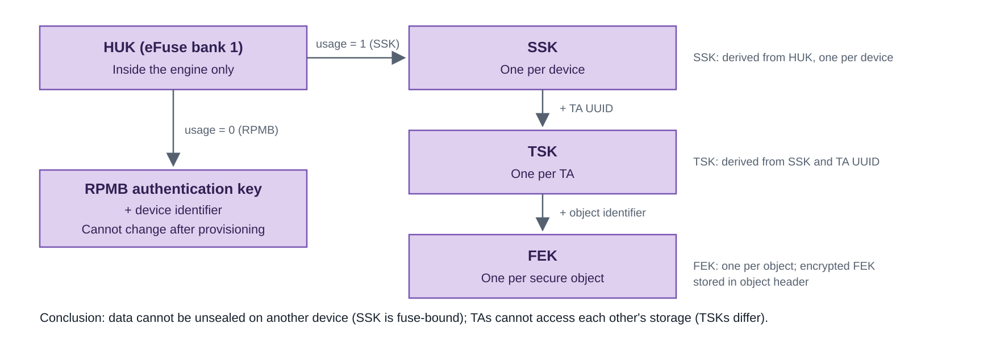
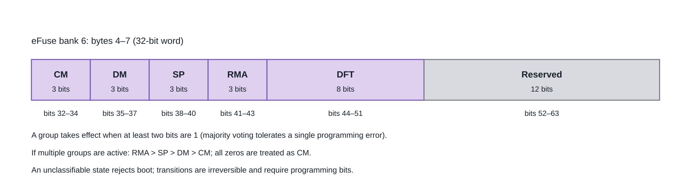
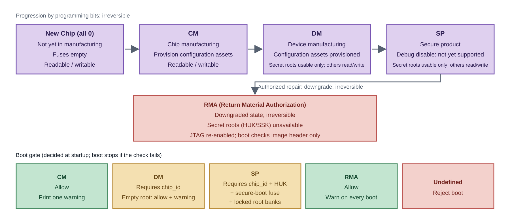

# Key Management and Security Lifecycle

## Overview

### Purpose

This document describes key management and the security lifecycle on the K3 TEE side: the key inventory and attributes, the sources and derivation paths of the platform root key and subordinate keys, the effect of lifecycle states on key availability, key provisioning and programming requirements, and the impact that must be handled when keys change.

### Scope

This document applies to Buildroot solutions for SpacemiT K3 series SoCs and covers key and lifecycle management on the TEE side. The complete production-test process is defined by production-line documentation; this document specifies only the key-related requirements.

### Responsibilities of Related Documents

| Topic | Document |
|---|---|
| Generation, provisioning, and signing of boot-chain keys (RoT, bootloader, and kernel) | [Secure Boot Development Guide](../device/secureboot.md) |
| Storage-backend organization, locations, capacity, and rollback behavior | Secure storage section of the [TEE Architecture and Integration Guide](tee_architecture.md) |
| TA signing, encryption, and execution | [TA Development Guide](ta_guide.md) and [CA Development Guide](ca_guide.md) |
| Image partitioning, packaging, and flashing | [TEE Image Build and Flashing Guide](tee_image.md) |
| Lifecycle-state definitions and support status | [Security Architecture White Paper](white_paper.md) and [Security Feature Support Matrix](support_matrix.md) |
| Production provisioning and programming of keys (eFuse and RPMB authentication keys) | [Production Key Provisioning and Programming](key_provisioning.md) |
| **Key inventory, derivation, replacement, and rotation; effect of state on keys** | **This document** |

### Important Constraints

> [!CAUTION]
> The following three conditions may occur in any development build and directly weaken security. Confirm each one before shipment:
>
> 1. **Subordinate keys derived on a device with unprogrammed fuses are not device-unique** and are identical across other devices with unprogrammed fuses.
> 2. **TAs use the SDK-provided signing key by default.** Anyone who possesses that key can sign a TA accepted by this platform.
> 3. **The default TA encryption key is a public fixed value.** Enabling the feature without replacing the key is equivalent to having no encryption.

## 1. Key Inventory and Attributes

K3 keys form two chains: one serves **boot-chain trust** (the Secure Boot side), and the other protects **runtime data** (the TEE side). Both chains originate from immutable chip information and are listed below.



### 1.1 Secure Boot Keys

This chain establishes trust in the boot chain. Key names, file inventory, and generation flow match the [Secure Boot Development Guide](../device/secureboot.md); the table records their locations and uses.

| Key | Use | Source and generation | Storage | Readable | Replaceable |
|---|---|---|---|---|---|
| `root_key` (ROTPK) | Issues the first-level certificate for FSBL; BootROM establishes trust from it | Generated during the build | Public-key hash burned into eFuse bank 4; private key kept offline | Private key is not placed on the device | Fuse is irreversible; replacing it requires replacing the chip |
| `spl_key` | Signs FSBL (SPL) itself | Generated during the build | Included with the first-level certificate | — | Replaceable with a firmware update |
| `uboot_key` | Signs `esos.itb`, `u-boot.itb`, and `fw_dynamic.itb`; also signs the TEE image. Its ITS `key-name-hint` matches the public-key node name in the SPL device tree | Generated during the build | Public key injected into the SPL device tree at compile time | — | Replaceable; regenerate the public-key DTSI and rebuild U-Boot |
| `kernel_key` | Signs `Image.itb` (kernel and device tree) | Generated during the build | Public key injected into the board-level U-Boot device tree at compile time | — | Same as above |

### 1.2 TEE Keys

This chain protects runtime data. Its root is the HUK in eFuse, and subordinate keys are derived from the HUK inside the security engine (see [Platform Root Key: HUK](#2-platform-root-key-huk)).

| Key | Use | Source and generation | Storage | Readable | Replaceable |
|---|---|---|---|---|---|
| **HUK** | Root of all TEE runtime keys; **the same root key also decrypts the FSBL encrypted image** | Programmed by the SoC manufacturer during chip production | eFuse bank 1, used only inside the security engine | Unreadable during the DM, SP, and RMA lifecycle stages | Not replaceable; the fuse is irreversible |
| TEE subordinate keys | RPMB, storage, device identity, TA unique values, TA encryption, and external secure elements | Derived from the HUK inside the security engine | Used by the secure world at runtime | Root key is unreadable; subordinate keys are used only inside the secure world | Tied to the HUK and not replaceable |
| Storage keys (SSK / TSK / FEK) | Protect secure-storage objects | Derived hierarchically from the HUK | Secure world | Same as above | Not replaceable; existing data cannot be unsealed after replacement |
| RPMB authentication key | Accesses the device RPMB partition | Derived from an HUK subordinate key and the device identifier | Written to the device RPMB area | Cannot be read after provisioning | Not replaceable; cannot be changed after writing |
| TA signing key (`TA_SIGN_KEY`) | Signs TAs; the TEE kernel verifies the signature when loading a TA | Supplied at build time; defaults to `keys/default_ta.pem` in the dev kit | Private key on the build side; public key embedded in the TEE kernel | — | Replaceable; see [Key Replacement](#5-key-replacement) |
| TA encryption key (`TA_ENC_KEY`) | Encrypts TA images; runtime `tee_otp_get_ta_enc_key()` returns the same key | Supplied at build time; defaults to a public fixed value in the source | Build side / secure world | — | Replaceable; see [Key Replacement](#5-key-replacement) |
| Device identity | Identifies the device externally | Derived from the HUK | Secure world | Exportable (not confidential) | Tied to the HUK |

## 2. Platform Root Key: HUK

The HUK (Hardware Unique Key) is the root of all TEE runtime keys.

### 2.1 Source

The HUK is a per-die root key programmed into eFuse bank 1 by the SoC manufacturer during chip production.

The eFuse is **one-time programmable (OTP) storage**: writes are irreversible and each bank has lock bits; the entire device is not inaccessible to software. Lifecycle restrictions apply to the key-related bank: during DM and SP, it cannot be read or written and can only be used by the security engine; during RMA, it is inaccessible. Other content, such as the chip ID and lifecycle fields, is still read by the secure world's read-only driver.

| Item | Description |
|---|---|
| Location | eFuse bank 1, independent for each chip |
| Programmer | SoC manufacturer during chip production |
| Readable | Lifecycle-dependent: readable in New Chip and CM; unreadable in DM and SP (usable only by the security engine); inaccessible in RMA |
| Other use | The same root key decrypts the FSBL encrypted image (see [Key Inventory and Attributes](#1-key-inventory-and-attributes)) |

The key ladder and subordinate-key derivation are completed inside the security engine. Neither the root key nor working keys enter software-visible memory. Device trust therefore comes from the non-exportable chip root key, not from a constant held by software.

### 2.2 Derivation Path

Derivation has two layers: the engine key ladder converts the root key into a working key, and software uses the working key with a PRF and KDF to derive purpose-specific subordinate keys. Software supplies only public parameters and reads back only subordinate keys.



Key operations:

- **Inside the engine (key ladder):** three levels of AES decryption use `eks` as input material to derive the working key `WK`; the root key and all intermediate values remain inside the engine.
- **On the software side (PRF and KDF):** CMAC (SP 800-38B) over `WK` is used as the pseudorandom function, and SP 800-108 counter-mode derivation is applied to `label || additional input || usage || length`, with output truncated as needed.
- **Immutable format:** once published, the label and input format cannot change. Changing any byte changes every subordinate key already derived on deployed devices; there is no software fallback, and derivation failure is fatal.

Two conclusions follow:

- **The root key never leaves the engine**, so there is no window in which plaintext fuse contents remain in memory; software receives only subordinate keys.
- **Chip uniqueness comes from the root key itself:** the same derivation parameters produce different subordinate keys on different chips and cannot be reproduced on another chip. The chip ID is not part of derivation; it is used only as a boot-gate criterion.

### 2.3 Behavior with Unprogrammed Fuses

When the fuses are empty, no usable root key exists and derived subordinate keys are not device-specific (equivalent to a zero root). Whether boot is allowed is decided by the boot gate, not independently by each derivation call:

| Lifecycle | Behavior with unprogrammed fuses |
|---|---|
| CM / DM | Boot allowed; DM requires a programmed chip ID, and an empty root key produces a boot warning |
| SP | Boot rejected: chip ID, root key, and secure-boot fuses must all be present |

Development boards commonly have empty fuses and therefore depend on the allow-boot-with-warning path. TA loading itself depends on subordinate keys; if boot were always rejected, development boards could not install TAs. **However, subordinate keys are not device-unique in this state and must not be used for shipment.** The corresponding warning is printed during boot and can be used to determine the device state.

## 3. TEE Subordinate Keys

Subordinate keys are derived by purpose (see [Derivation Path](#22-derivation-path)). Two chains require separate explanation: the secure-storage key hierarchy and the RPMB authentication key.



### 3.1 Usage Numbers and Derivation

All runtime keys are derived from the HUK through a common interface inside the security engine. Usage numbers are immutable; changing one invalidates all existing keys on the same device.

| Usage | Number | Additional input | Description |
|---|---:|---|---|
| RPMB | 0 | Device identifier (16 bytes) | Authentication key for the device RPMB partition |
| Storage-key seed (SSK) | 1 | — | Root of the secure-storage key hierarchy |
| Device identity | 2 | — | Unique device identity |
| TA unique key | 3 | TA-related data | Value bound to a TA |
| TA encryption | 4 | TA public-key modulus | TA image encryption key |
| External secure element | 5 | — | Reserved for external secure-element scenarios |

### 3.2 Storage-Key Hierarchy

The scope narrows at each of the three levels: one SSK per device, one TSK per TA (derived from the SSK and the TA UUID), and one FEK per secure object (the encrypted FEK is stored in the object header). This provides two properties:

- **Data cannot be unsealed on another device:** the SSK originates from this device's fuses.
- **Different TAs cannot see each other's storage:** the TSK is derived from the SSK and the TA UUID.

See the secure-storage section of the [TEE Architecture and Integration Guide](tee_architecture.md) for object organization, backend selection, and storage locations.

### 3.3 RPMB Authentication Key

The RPMB authentication key is derived from the RPMB subordinate key and the **device identifier**, so it is bound to the device and cannot be migrated between devices:

- **Identifier handling differs by medium:** eMMC identifiers contain fields that can change after firmware updates and must be masked before derivation; otherwise, the key no longer matches after a firmware update. UFS has no equivalent variable field.
- **The key cannot change after writing:** verify the device and board pairing before provisioning and pin the provisioning target to the specified device to avoid errors in multi-device environments.
- **Provisioning is needed only for production testing:** product builds must not enable it. Distinguish read-only collection and targeted writing with separate configurations; see [Production Key Provisioning and Programming](key_provisioning.md).

### 3.4 Device Identity

The device identity identifies this device externally and is derived from the device-identity subordinate key (`usage = 2`). It is not confidential, but **reproducibility depends on the fuses**: devices with unprogrammed fuses have the same identity.

## 4. Security Lifecycle

Lifecycle state reflects the system's trust level and determines whether **secure assets (HUK)** can be read or written and whether the device can boot.

### 4.1 Lifecycle Stages

The table below gives the full name, stage, and behavior of each abbreviation. State-dependent behavior is enforced jointly by the hardware and boot firmware. There is no software interface for state transitions: entering a state means programming the bits in the corresponding group, and programming is irreversible.

| Abbreviation | Full name | Stage | Secret root (HUK/SSK) | Non-secret configuration assets | Boot gate |
|---|---|---|---|---|---|
| New Chip (all 0) | — | Not yet in manufacturing | Fuses empty | Readable and writable | Allowed (as CM, with one warning) |
| CM | Chip Manufacturing | Chip manufacturing; configuration assets provisioned | Readable and writable | Readable and writable | Allowed, with one warning |
| DM | Device Manufacturing | Device manufacturing; assets provisioned | Use only | Readable and writable | Chip ID required; allowed with warning when root key is empty |
| SP | Secure Production | Secure product; assets locked | Use only | Readable and writable except locked banks | Chip ID, HUK, secure-boot fuses, and hardware-locked root banks required; otherwise boot is rejected |
| RMA | Return Material Authorization | Authorized repair; downgraded | Unavailable | Readable and writable | Allowed, with warning |

- The **New Chip (all 0)** state is the initial state of a new chip; all four groups of state bits are unprogrammed, meaning that it has not entered any manufacturing stage.
- **CM and DM** correspond to Manufacture and Security provisioning in the specification (the production line provisions security assets) and are stages in which security assets may still be written.
- **SP** corresponds to Secured and is the target state for production shipment: secret roots can be used but not read or written, and the boot gate is strictest.
- **RMA** corresponds to Recoverable debug. It is a downgraded repair state: JTAG is re-enabled regardless of the disable bit, boot checks only the image header, skips signature verification and anti-rollback, and the state is irreversible. Production devices must not enter RMA.

The two types of assets differ as follows: **secret roots** (HUK and SSK) are non-disclosable root keys whose readability tightens by stage (see the table above); software never reads the plaintext at any stage and they are used only inside the security engine. **Non-secret configuration assets** (chip ID, ROTPKH, CDPKH, ARCN, LCS, and policy bits) are not confidential and **are readable and writable at every stage**. Whether a write is possible depends on the bank lock bits rather than the lifecycle stage: only a locked bank cannot be written (in SP, the lock assertions lock HUK/SSK/CDPKH/ROTPKH while ARCN, LCS, and bank 0 remain writable; see [Root-Bank Lock Assertions](#44-root-bank-lock-assertions)). See the [Security Lifecycle](white_paper.md#11-security-lifecycle) chapter of the white paper for the full availability details.

### 4.2 State Fields and Decision

The state is specified by eFuse fields. There is no software state-transition interface: entering a state means programming the corresponding bits, and programming is irreversible.



**Mapping to the specification state model:** CM and DM cover Manufacture and Security provisioning (the production line provisions security assets), SP corresponds to Secured, and RMA corresponds to Recoverable debug.

### 4.3 State Progression, Asset Availability, and Boot Gate



Key points:

- **Provisioning:** only CM can write secret roots. In DM and SP, HUK/SSK cannot be read and can only be used by the security engine; non-secret assets remain readable and writable subject to bank locks.
- **Boot:** SP requires chip ID, HUK, secure-boot fuses, and hardware locks on the root banks (HUK/SSK/CDPKH/ROTPKH). Missing any item rejects boot (see [Root-Bank Lock Assertions](#44-root-bank-lock-assertions)). CM, DM, and RMA allow boot with a warning.
- **Evidence:** read the chip-ID field and treat a nonzero value as programmed; determine HUK availability by running the key ladder on probe data and comparing it with the empty-root result, **without reading the plaintext root key**; read the secure-boot fuse bit. Allow, warning, and reject decisions are printed to the serial log.
- **RMA:** HUK/SSK are unavailable, so HUK-dependent operations fail; debugging is reopened and the boot chain checks only the image header. RMA is irreversible, permanently provides less protection than SP, and must not be used for production devices.

The boot gate makes its decision once at boot, not during every derivation call, so failures are concentrated in the boot stage.

### 4.4 Root-Bank Lock Assertions

A programmed eFuse is not necessarily immutable: while a bank remains unlocked, additional bits can still be set. Replacing HUK, SSK, CDPKH, or ROTPKH in SP is equivalent to replacing the entire trust chain. For this reason, the SP boot gate does more than check that the chip ID, HUK, and secure-boot fuses are programmed. It also requires the **trust-root banks to be hardware-locked**. In SP, the roots must be both nonzero and immutable.

The lock bits are in the low 16 bits of bank 6 (`hwlock[2]`), where **bit `i` locks bank `i`**. Locking is per bank; individual bits cannot be locked. Because eFuse bits can only change from 0 to 1, "unlocked" does not mean that programmed bits can be cleared back to 0. It only means that more bits can still be programmed. The lock assertion therefore ensures that no further bits can be written to the root banks.

| Bank | Role | Required action | On violation |
|---|---|---|---|
| 1 (HUK) | Key root | **Must be locked** | panic |
| 2 (SSK) | Key root | **Must be locked** | panic |
| 3 (CDPKH) | Debug authorization anchor | **Must be locked** | panic |
| 4 (ROTPKH) | Boot trust-root hash | **Must be locked** | panic |
| 5 (ARCN) | Anti-rollback counter | **Must remain unlocked** | WARN (no panic) |
| 6 (LCS/hwlock) | State machine itself | **Must remain unlocked** | WARN |
| 0 (policy and manufacturing) | Mixed | **Do not lock** | WARN |

- **Banks 1/2/3/4 must be locked:** They are inputs to the trust chain, and leaving them writable in SP would allow the root to be replaced.
- **Bank 3 (CDPKH):** It is used only for secure debugging (JTAG unlock). It must be locked, but it does not need to contain a value; locking an empty bank 3 is valid. An empty bank 3 is more dangerous than a programmed one: because eFuse bits can only change from 0 to 1, an all-zero bank 3 can later be OR-programmed with an attacker's own debug root and used to self-authorize JTAG. A "lock only if programmed" policy would let exactly this most dangerous state through, so bank 3 must always be locked, even when empty.
- **Banks 5/6 must remain unlocked:** ARCN is a monotonic counter and secure updates require it to increment; locking it would prevent rollback protection updates. Bank 6 contains the lock bits and LCS fields. These violations produce only a warning rather than a panic because they are future-update risks, not an immediate compromise.

**Stage-specific policy:** CM and RMA skip the lock check, and boot proceeds with a warning. DM only issues a warning, because the fuses are still being programmed repeatedly during manufacturing and a hard check would stall the production line. **SP** keeps the existing chip ID, HUK, and secure-boot checks and adds a lock check: banks 1/2/3/4 must be locked and banks 5/6/0 must remain unlocked. If all conditions are met, boot proceeds; any violation causes a panic.

Two prerequisites:

1. **Programming order:** There is no requirement to lock the banks before entering SP. The eFuse programmer is an independent tool and does not go through the secure subsystem, so bank locks can still be programmed after entering SP. The hard requirement is that **when the board boots in the SP state, the root banks, including the empty CDPKH bank 3, must already be locked**; otherwise the boot gate panics. Production testing should complete the bank locks before the first SP boot.
2. **Fail closed on lock-read failure:** If the lock state cannot be read, SP rejects the boot rather than assuming that the device is secure. ROTPKH is not checked separately for emptiness: once the secure-boot fuse is programmed, BootROM must verify with ROTPKH; an all-zero ROTPKH makes verification fail before OP-TEE can run.

## 5. Key Replacement

Production provisioning and programming of eFuse and RPMB authentication keys is described in [Production Key Provisioning and Programming](key_provisioning.md). This section covers build-time key replacement.

| Key | Default location and source | Replacement method |
|---|---|---|
| TA signing key | `TA_SIGN_KEY`, default `<TA_DEV_KIT_DIR>/keys/default_ta.pem` (in this solution: `output/k3/build/optee-os-custom/out/export-ta_rv64/keys/default_ta.pem`) | Put the private key in that directory and point the configuration to it, or change `TA_SIGN_KEY`; then rebuild the TEE to embed the new public key and resign all TAs. |
| TA encryption key | Build-time `TA_ENC_KEY` when `CFG_ENCRYPT_TA` is enabled; the default is a public fixed value in the source; the runtime value comes from `tee_otp_get_ta_enc_key()` | Both sides must match. Replace `TA_ENC_KEY` at build time and retain the default device-unique runtime derivation, which uses the device root key and the TA public-key modulus, or implement a category-shared key. The latter simplifies distribution but increases the impact of disclosure. |
| Boot-chain signing keys (`root_key` / `spl_key` / `uboot_key` / `kernel_key`) | SDK key directory (`KEY_DIR`); names are defined by the [Secure Boot Development Guide](../device/secureboot.md) | Replacing files alone is insufficient: public-key moduli are hard-coded in public-key DTSIs, so regenerate them and rebuild U-Boot. The `root_key` hash is fused; old devices will not accept firmware signed by a replacement root. |
| eFuse-provisioned keys (HUK, etc.) | Programmed by the SoC manufacturer during chip production | Not replaceable; the fuse is irreversible and the chip must be replaced. |

## 6. Key Changes and Rotation

### 6.1 Rotatable and Non-Rotatable Keys

| Category | Keys | Description |
|---|---|---|
| Not rotatable | HUK, TEE subordinate keys, storage keys, RPMB authentication key | Originates from fuses or has already been written to the device; changing it requires new hardware or a new device. |
| Rotatable | TA signing key, TA encryption key | Rebuild the TEE or redistribute TAs after changing; the device must accept the firmware update. |
| Fuse-limited | Secure Boot root key and downstream signing keys | Existing devices with a programmed root fuse cannot accept firmware using a new root key. |

### 6.2 Change-Impact Checklist

After changing any key, confirm each item below to avoid making the device unusable:

| Change | Required follow-up |
|---|---|
| TA signing key | Resign all TAs, rebuild the TEE to embed the new public key, and confirm that the device accepts the new firmware. |
| TA encryption key | Rebuild and sign all TAs; confirm whether distribution is device-specific or category-shared. |
| Secure Boot root key | This is within the scope of Secure Boot. **Existing devices with programmed fuses cannot accept the new firmware.** See the Secure Boot document. |
| Bootloader/kernel signing keys | This is within the scope of Secure Boot. Update public-key injection and firmware together. |
| Fuse contents | Irreversible; complete full-chain validation on an unprogrammed device before programming. |
| RPMB key | Immutable; verify that the device and storage-component pairing is correct after provisioning and retain production records. |

### 6.3 Validation Order After Changes

1. Complete full-chain validation (signing, loading, and execution) on a sample with **unprogrammed fuses**.
2. Program the fuses on the sample and repeat the same validation.
3. Confirm that the test suites and secure-storage tests pass.
4. Confirm that secure-world logs contain **no** empty-root or lifecycle-state warnings.
5. Repeat steps 3 and 4 with the production firmware and confirm that messages match expectations.

## 7. Related Documents

| Topic | Document |
|---|---|
| Secure Boot key generation and signing | [Secure Boot Development Guide](../device/secureboot.md) |
| Storage-backend organization, location, and capacity | Secure storage section of the [TEE Architecture and Integration Guide](tee_architecture.md) |
| TA development, signing, and encryption | [TA Development Guide](ta_guide.md) |
| Lifecycle definitions and support status | [Security Architecture White Paper](white_paper.md) and [Security Feature Support Matrix](support_matrix.md) |
| Image partitioning, packaging, and flashing | [TEE Image Build and Flashing Guide](tee_image.md) |

## Appendix: Computing and Verifying Subordinate Keys on the Host

The platform provides `scripts/derive_huk_subkey.py`, alongside `derive_rpmb_key.py`, to compute purpose-specific subordinate keys offline using the derivation format in this document. It can be used to:

- Verify a device key offline before programming, for example by computing the TA encryption key or RPMB authentication key that matches the board.
- Check the input material and derivation format. The script includes a built-in self-test that can serve as a regression gate.

Basic usage:

```sh
python3 scripts/derive_huk_subkey.py --usage SSK --huk <16-byte-root-key>
python3 scripts/derive_huk_subkey.py --usage RPMB --huk <16-byte-root-key> --cid <32-hex-digit> --rpmb-emmc  # --rpmb-emmc is for eMMC only; omit for UFS
python3 scripts/derive_huk_subkey.py --usage UNIQUE_TA --huk <16-byte-root-key> --uuid cb3e5ba0-adf1-11e0-998b-0002a5d5c51b
python3 scripts/derive_huk_subkey.py --usage TA_ENC --huk <16-byte-root-key> --ta-sign-key <signing-key-PEM>
```

Parameter descriptions:

- **Root and working keys:** `--huk` supplies the engine-held root key (16 bytes; the script derives the working key through the key ladder). `--root-key` supplies the working key directly and skips the ladder.
- **Input material `eks`:** Built in, normally using `te200_ladder_root.eks` supplied with the script; it usually does not need to be specified.
- **Additional inputs per usage** (the script exits with an error if required input is missing):

| Usage | Additional input | Description |
|---|---|---|
| SSK / device identity | — | The device-identity length is chosen by the consumer (`--num-bytes`, 32 bytes by default) |
| TA unique key | `--uuid` (required) | Converted to the memory layout using the calling TA's UUID |
| RPMB | `--cid` (required); add `--rpmb-emmc` for eMMC | Card identifier (16 bytes); eMMC masks variable fields (PRV, CRC), while UFS uses the value unchanged (no `--rpmb-emmc`) |
| TA encryption | `--ta-sign-key` (default `keys/default_ta.pem`) | Uses the signing public-key modulus as additional input |

Notes:

- The per-die root key is **not readable by software**. The script accepts a root obtained elsewhere or a software test key; after input, it exists in host memory and must be protected.
- `--selftest` runs the built-in CMAC/KDF algorithm check without a device and can be used as a regression check.
- Output matches firmware only if the derivation format remains unchanged (labels and input layout are a frozen format; see [Derivation Path](#22-derivation-path)).
- **Do not use the old `derive_rpmb_key.py`**; it uses the retired software HUK path and does not match the current implementation.

## References

This document cites the following external specifications and upstream documents.

| Name | Version | Link |
|---|---|---|
| NIST SP 800-38A: Recommendation for Block Cipher Modes of Operation (ECB/CBC) | 2001 (2010 Addendum) | <https://csrc.nist.gov/pubs/sp/800/38/a/final> |
| NIST SP 800-38B: Recommendation for Block Cipher Modes of Operation: CMAC Mode for Authentication | 2005 (2016 Update) | <https://csrc.nist.gov/pubs/sp/800/38/b/upd1/final> |
| NIST SP 800-108: Recommendation for Key Derivation Using Pseudorandom Functions | Rev. 1 (2022) | <https://csrc.nist.gov/pubs/sp/800/108/r1/final> |
| RISC-V Security Model, RISC-V International (lifecycle state model) | 0.9.1 (2026-09) | <https://github.com/riscv-non-isa/riscv-security-model> |
| GlobalPlatform TEE Internal Core API Specification (secure-storage objects and TA interface) | 1.4 | <https://globalplatform.org/specs-library/tee-internal-core-api-specification/> |
| OP-TEE documentation (subordinate-key derivation interface) | latest | <https://optee.readthedocs.io/en/latest/> |
