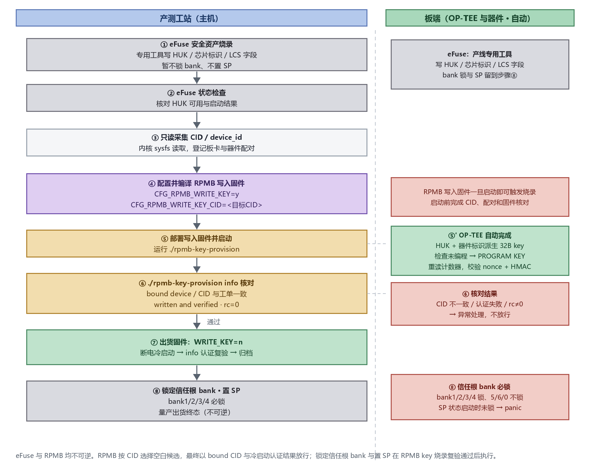

# Production Key Provisioning and Programming

## 1. Purpose and Scope

This document describes key provisioning and programming during K3 production. It has two parts: **eFuse programming** (HUK, chip ID, and lifecycle fields, completed by a dedicated programming tool on the production line; root-bank locking and entering SP are final closing steps) and **RPMB authentication-key programming** (derived from this chip's HUK and written by OP-TEE, using `rpmb-cid-list.sh` and `rpmb-key-provision`). RPMB programming can begin only after eFuse programming is complete and the HUK is available. For the key inventory, derivation, and lifecycle, see [Key Management and Security Lifecycle](key_management_lifecycle.md).

The production flow programs and checks eFuse security assets first, then programs the RPMB authentication key. After collection, the RPMB stage builds targeted-writing firmware; after successful programming, it switches to shipping firmware. **Root banks are locked and SP is entered only after RPMB key programming and shipping acceptance are complete**, as the final close-out before production shipment:

1. **eFuse programming:** The dedicated tool writes the HUK, chip ID, and lifecycle fields. At this stage, **program assets only; do not lock banks or enter SP**.
2. **eFuse check:** Confirm that the HUK is available and complete basic boot validation.
3. **CID collection:** Collect read-only identifiers as described in [section 5](#5-rpmb-step-1-register-the-target-cid--device_id) (no `CFG_RPMB_FS` required), and record the CID/device_id, medium type, and board-device pairing.
4. **Targeted RPMB programming:** Boot targeted-writing firmware (`CFG_RPMB_FS=y`, `CFG_RPMB_WRITE_KEY=y`, and the target CID). OP-TEE derives the key from this chip's HUK and the CID, then writes it once.
5. **Programming acceptance:** Use `rpmb-key-provision info` to verify the bound device, CID, and authentication state.
6. **Shipping revalidation:** Switch to shipping firmware with `CFG_RPMB_FS=y` and `CFG_RPMB_WRITE_KEY=n`, cold-boot, and authenticate again.
7. **Lock banks and enter SP:** After revalidation passes, lock the root banks (HUK/SSK/CDPKH/ROTPKH must be locked) and enter SP, reaching the final production-shipping state. The bank-lock and SP order is not fixed; see [section 2](#2-efuse-programming).

Any failed step enters exception handling and must not be released automatically. Do not enter the RPMB write-key stage if eFuse programming is incomplete or the HUK is unavailable.



> [!CAUTION]
> Treat the RPMB key as a one-time write. A wrong key cannot be recovered by reflashing, formatting, or clearing data. A write counter of 0 does not prove that a key is unprogrammed or can be rewritten. The SoC and storage device must be paired correctly; replacing either requires reassessing key and existing-data availability.

This document defines operation and acceptance requirements; it does not perform the actual programming.

## 2. eFuse Programming

eFuse programming writes the HUK, chip ID, and lifecycle fields to the fuses once. It is performed by a **dedicated eFuse programming tool** on the production line, outside the OP-TEE / `conf.mk` flow, and is irreversible. This document does not describe the tool UI or device commands, but eFuse programming is a prerequisite and release condition for RPMB key programming.

| Item | Description |
|---|---|
| Programmed content | HUK, chip ID, and LCS fields |
| Performed by | Dedicated eFuse programming tool (production line) |
| Reversibility | Irreversible; per-bank lock bits |
| Bank locking / entering SP | **Program assets only in this stage; do not lock root banks or enter SP.** Lock banks and enter SP after the RPMB key is programmed and shipping revalidation passes ([section 1, step 7](#1-purpose-and-scope)). There is no fixed "lock the banks first, then enter SP" order: the eFuse programmer does not go through the security subsystem, so banks can still be locked after entering SP. When the device boots in the SP state, however, the root banks must already be locked; otherwise the boot gate rejects the boot (see [Root-Bank Lock Assertions](key_management_lifecycle.md#44-root-bank-lock-assertions) in Key Management and Security Lifecycle). |
| Before programming | Complete basic functional validation (signing, loading, and execution) |
| After programming | Repeat the same validation on the programmed device and confirm that no empty-root warning appears |

The RPMB authentication-key programming described below can begin only after eFuse programming is complete and the HUK is available (the RPMB key is derived from the HUK).

## 3. Station Inputs and Tools

### 3.1 Input Materials

| Input | Requirement |
|---|---|
| Board SN and SoC identifier | Must link to the chip-stage HUK programming record; never record the plaintext HUK in station logs |
| Storage medium | Identify eMMC or UFS; for UFS, identify the RPMB region |
| Target CID / device_id | 16 bytes represented by 32 hexadecimal characters; station records use uppercase |
| Firmware baseline | Fixed versions of OP-TEE, Linux, derivation parameter `eks`, and KDF format |
| HUK state | The production HUK is programmed and the current lifecycle allows the security engine to use it; a zero root or a public test key is prohibited |
| Station permissions | Ability to deploy production-test firmware, read device identifiers, invoke programming tools, and collect results |

The RPMB key is **32 bytes (256 bits)** and is derived by OP-TEE. The station does not need to read the HUK or prepare a key file.

### 3.2 Tools and Sources

| Tool | Use |
|---|---|
| `rpmb-cid-list.sh` | Enumerates RPMB type and identifier on the board by reading sysfs; does not call OP-TEE |
| `rpmb-key-provision` | Calls the device PTA to initialize RPMB and obtain the bound-device and authentication state |

The station uses these two existing tools, which are supplied as plain files: the `rpmb-cid-list.sh` script and the compiled `rpmb-key-provision` CA binary. Copy them to any directory on the board; **they do not need to be installed in `/usr/bin`**. The commands in this document are run from that directory, hence the `./` prefix; adjust the path to match where you deploy them. `rpmb-key-provision` requires an OP-TEE build that supports `PTA_CMD_GET_RPMB_INFO`, and reading a UFS identifier also requires a kernel that exposes the RPMB `type` and `device_id` sysfs attributes. When adding the tools to a station, check that they are executable and that the required interfaces are present, and record their versions against the firmware baseline.

## 4. Configure the OP-TEE Build

### 4.1 Modification Location

The main entry point for RPMB switches is **`core/arch/riscv/plat-k3/conf.mk`**. If the project passes variables through Buildroot, use `BR2_TARGET_OPTEE_OS_ADDITIONAL_VARIABLES` with the same `CFG_*` variables. The production examples here use `conf.mk`; when using Buildroot variables, verify the final configuration to avoid conflicting values from multiple entry points. After changing optee-os, rebuild with `make optee-os-rebuild` (or run `make optee-os-dirclean` followed by `make optee-os`) and update the firmware. See the [TEE Image Build and Flashing Guide](tee_image.md).

For common storage settings and the two RPMB routes, see [K3 Secure Storage](secure_storage.md) [section 3.3](secure_storage.md#33-supported-media-and-enablement) and [section 3.4](secure_storage.md#34-rpmb-routing-and-multiple-device-selection). For CID collection, see [section 5](#5-rpmb-step-1-register-the-target-cid--device_id). The following lists only production writing and revalidation settings. Modify the corresponding entries in the existing `conf.mk`; do not merely append duplicate `?=` assignments and leave the original values active.

### 4.2 Collection Preparation

Collect the target identifier and record the pairing as described in [section 5](#5-rpmb-step-1-register-the-target-cid--device_id). Collection firmware keeps `CFG_RPMB_WRITE_KEY=n`. CID reading does not require `CFG_RPMB_FS`; writing and shipping revalidation both require RPMB FS.

### 4.3 Targeted Writing (Programming the Key)

```makefile
CFG_RPMB_FS ?= y
CFG_RPMB_ANNOUNCE_PROBE_CAP ?= y
CFG_RPMB_TESTKEY ?= n
CFG_RPMB_WRITE_KEY ?= y
CFG_RPMB_WRITE_KEY_CID ?= "112233445566778899AABBCCDDEEFF00"
CFG_TEE_CORE_LOG_LEVEL ?= 2
CFG_RPMB_FS_DEBUG_DATA ?= n
```

Only `CFG_RPMB_WRITE_KEY ?= y` permits key programming. `CFG_RPMB_WRITE_KEY_CID` applies only to **unprogrammed RPMB candidates**. Replace it with the actual CID collected in [section 5](#5-rpmb-step-1-register-the-target-cid--device_id), using 32 uppercase hexadecimal characters and retaining the quotation marks:

- **Empty CID:** no filtering; select and program the first candidate that reports an unprogrammed key.
- **Correct CID:** select and program only the unprogrammed candidate with the matching CID.
- **Incorrect CID:** no candidate matches; a blank RPMB is not selected and programming fails.
- **Candidate already authenticates:** use that device first and do not rewrite the key; the CID setting does not force selection of another blank RPMB.

Always verify the CID before targeted writing. If the product requires a fixed target, expose only one target RPMB per board or disable non-target storage controllers in the DTS. **Use this configuration only after the CID is confirmed and the target-selection checks in [section 4.5](#45-pre-programming-checks) pass.**

> [!CAUTION]
> The PROGRAM KEY request carries the key through the REE/Linux route to the medium. The HUK remains inside the security engine, but the RPMB key cannot stay out of the REE for the whole programming process. Use targeted-writing firmware only in a controlled production-test environment and replace it with shipping firmware afterward.

### 4.4 Shipping / Revalidation

```makefile
CFG_RPMB_FS ?= y
CFG_RPMB_TESTKEY ?= n
CFG_RPMB_WRITE_KEY ?= n
```

Shipping and revalidation require `CFG_RPMB_FS` (OP-TEE derives the key again and authenticates it), but `CFG_RPMB_WRITE_KEY` must be **explicitly set to `n`** to prohibit further writes. Starting from the targeted-writing configuration, change `CFG_RPMB_WRITE_KEY` back to `n`.

### 4.5 Pre-Programming Checks

- A production HUK is programmed and available: `plat_rpmb_key_is_ready()` permits OP-TEE to write only when the root state is `TE200_HUK_BURNED`.
- Authenticate a device that already has a key and skip it if authentication succeeds; never rewrite the key.
- Authentication failure does not mean that no key is programmed: another key, communication failure, routing error, or mismatched derivation parameters may be involved.
- On a multi-device board, `CFG_RPMB_WRITE_KEY_CID` filters only the blank candidates considered when writing a key. An empty CID selects the first blank candidate, a correct CID selects the matching candidate, and an incorrect CID writes no blank candidate. A device that already authenticates is still preferred, and this setting cannot force selection of another blank device. Identify the target with one of the following methods before programming, and treat a returned bound CID that differs from the work order as a failure.

| Target-selection method | Station and shipping requirements |
|---|---|
| Program one specified RPMB per board | Expose only the target device during the writing stage and specify its CID; do not write a key to any other RPMB. Confirm that no other device can already be authenticated by this chip. After restoring the devices the product requires, cold-boot the shipping firmware with key writing disabled and verify the bound medium and CID. |
| Disable non-target candidates in the DTS | In the DTS actually deployed on Linux, set the non-target controller nodes to `status = "disabled"`, and use that restriction in both the writing and shipping firmware. Confirm that this does not disable storage required for boot or for the product's functions. |

A device tree usually controls the entire storage controller; do not assume that an independent RPMB child node exists. For UFS multi-region restrictions, see "Default Selection and Binding for Multiple RPMBs" in section 3.4 of [K3 Secure Storage](secure_storage.md#34-rpmb-routing-and-multiple-device-selection). These methods define the candidate range; the CID setting restricts where a new key is written.

The selection rules for targeted writing are:

| Current condition | Result |
|---|---|
| A candidate RPMB already authenticates with this chip | Use the first candidate that authenticates; do not rewrite its key or switch to a blank target. |
| No candidate authenticates and `CFG_RPMB_WRITE_KEY_CID` is empty | Use the first candidate in enumeration order that reports an unprogrammed key. |
| No candidate authenticates and the configured CID matches a blank candidate | Use that matching candidate and write the key. |
| No candidate authenticates and the configured CID matches no blank candidate | Do not write a key; initialization fails. |

“Blank” means the device explicitly reports `AUTH_KEY_NOT_PROGRAMMED (0x07)`. An empty directory, a write counter of 0, or a device that has just booted does not prove that the key is unprogrammed.

## 5. RPMB Step 1: Register the Target CID / device_id

### 5.1 Collect the CID / device_id

CID collection reads Linux sysfs only and does not call OP-TEE. **It does not require `CFG_RPMB_FS` or the OP-TEE kernel route to be enabled first.** The eMMC driver provides the raw CID; UFS requires the RPMB driver to be registered and to expose the identifier attribute. Use firmware with key writing disabled (`CFG_RPMB_WRITE_KEY=n`) and run the platform-provided `rpmb-cid-list.sh` from the tool directory:

```sh
./rpmb-cid-list.sh -v
```

The tool is supplied as a file and does not need to be installed in `/usr/bin` or added to `PATH`. It prints one line per device: `device rpmbN: type=<emmc|ufs> id=<32 hex>`. The station or the system initialization flow should register the target device's `id` and record the medium type, board identifier, and UFS region at the same time. The `rpmbN` number depends on enumeration order and is not guaranteed to stay the same across boots.

- **eMMC:** `id` is the card's raw 16-byte CID, exposed by the MMC class at `/sys/class/mmc_host/mmc*/mmc*:*/cid`. It can be read once eMMC is detected normally and does not depend on the RPMB class `device_id` attribute.
- **UFS:** `id` is the BLAKE2s-128 result that the kernel computes from `<device descriptor>-R<region>`. It is already the 16-byte identifier used by OP-TEE; **do not hash it again**.

Use the original 32 hexadecimal characters for collection and pairing, and record them in uppercase. Do not manually clear the PRV/CRC bytes in an eMMC CID; OP-TEE handles them according to the medium type. Do not treat the `rpmbN` number, UFS serial number, or raw descriptor string as the UFS `id`.

If `rpmb-cid-list.sh` does not list `id=` for the target UFS device, check `/sys/class/rpmb/rpmbN/type`, `device_id`, and whether the UFS RPMB driver is registered. To inspect the identifier directly in the kernel, add the following after `blake2s()` in `drivers/ufs/core/ufs-rpmb.c` within `ufs_rpmb_probe()`:

```c
dev_info(hba->dev, "UFS RPMB region %d id=%*phN\n",
         region, UFS_RPMB_ID_LEN, dev_id);
```

Here `dev_id` is the 16-byte identifier for the region. If the function returns early because there is no RPMB W-LUN or `hba->dev_info.device_id` is missing, first check whether the device provides a standard RPMB W-LUN and descriptor field. Rebuild and deploy the kernel, boot, and inspect the target region's `id=` with `dmesg`. The preloaded and running images must use the same identifier-generation rule.

### 5.2 Register and Verify the Work Order

Register the original 32 hexadecimal characters, medium type, board identifier, and UFS region. Before programming, compare the record with the current work order, then use the identifier in the targeted-writing configuration in [section 4.3](#43-targeted-writing-programming-the-key).

## 6. RPMB Step 2: Write the Key (Targeted Programming)

### 6.1 Build Writing Firmware

Modify `plat-k3/conf.mk` as described under [Targeted Writing (section 4.3)](#43-targeted-writing-programming-the-key), replacing the value of `CFG_RPMB_WRITE_KEY_CID` with the actual CID registered in [section 5](#5-rpmb-step-1-register-the-target-cid--device_id) (32 uppercase hex digits; the quotation marks are required). Rebuild with `make optee-os-rebuild`, flash the firmware, and then check the generated `out/include/generated/conf.h` to confirm that the CID and the write switch match this work order.

Because this setting takes only one non-empty CID per build, you need a separate targeted firmware image for each target device; an image built with one fixed CID cannot be reused for every device. High-volume stations should automate building each image and linking it to its device, or develop a separate, reviewed interface for selecting the target at runtime. The code does allow an empty CID, which writes the first blank candidate, but production must not rely on this: on a board with multiple RPMB devices, a change in enumeration order could cause the key to be written to the wrong device.

### 6.2 Boot and Trigger Writing

> [!CAUTION]
> After booting firmware that permits key writing, Linux RPMB probing or another RPMB consumer may trigger programming before the station command. `rpmb-key-provision info` also initializes RPMB and may write the key on this firmware. Complete approval, pairing checks, and firmware verification before booting writing firmware.

After booting writing firmware, run this from the tool directory:

```sh
./rpmb-key-provision
```

Exit code `0` means writing and verification succeeded; any nonzero code goes to exception handling. To keep a record, write the output to a file at the same time: `./rpmb-key-provision | tee rpmb_provision.txt`.

OP-TEE processes the request as follows:

1. Enumerate devices and prepare raw identifiers by type.
2. Derive the 32-byte RPMB key from this chip's HUK; eMMC masks CID PRV/CRC automatically, while UFS uses the 16-byte identifier unchanged.
3. Read and validate the counter response; do not rewrite a device that already authenticates.
4. For candidates that explicitly report an unprogrammed key, apply the configuration: when the CID is empty, record the first blank candidate; when the CID is non-empty, record only the matching candidate; when the CID is wrong, no write target is recorded.
5. Check HUK readiness for the selected candidate, send PROGRAM KEY, reread the counter, and verify the nonce and HMAC.

Any nonzero exit code goes to exception handling. Never release a device on `probe: RPMB up` alone; the returned identity and `key state` must be checked.

## 7. RPMB Step 3: Determine Programming Success

### 7.1 Result of the Current Programming Run

```sh
./rpmb-key-provision info
```

The run passes only when the exit code is `0` and the output meets the table below. To keep a record, use `./rpmb-key-provision info | tee rpmb_verify.txt`.

Required acceptance information:

| Field | Acceptance condition |
|---|---|
| `bound device` | Matches the work order: eMMC or UFS |
| `bound CID` | After conversion to uppercase, exactly matches the original 32-hex identifier in the work order |
| `key state` | `written and verified` |
| Tool exit code | `0` |
| `write counter` | Record the current value; it need not be 0 and is not independent evidence of key matching |

`written and verified` comes from OP-TEE's authentication state. The first verification after writing checks the nonce and HMAC of the counter response, showing that the key in the device matches the key derived by this chip. A later `info` in the same run may return a verified state from cache, so the power-cycle revalidation in [step 4](#8-rpmb-step-4-shipping-revalidation-cold-boot) is still required.

When the current interface initialization fails, it often returns an error directly; do not rely on `info` exit code `2` to distinguish every unprogrammed-key case.

## 8. RPMB Step 4: Shipping Revalidation (Cold Boot)

1. As described under [Shipping / Revalidation (section 4.4)](#44-shipping--revalidation), set `CFG_RPMB_WRITE_KEY` back to `n` while keeping `CFG_RPMB_FS=y`. Rebuild with `make optee-os-rebuild` and flash the shipping firmware.
2. Power off and reboot so OP-TEE derives the key again and authenticates it, instead of reusing the writing firmware's in-memory state.
3. Run `./rpmb-key-provision info` again, compare the medium and CID as in [section 7.1](#71-result-of-the-current-programming-run), and record the authentication state and exit code.
4. Confirm that the acceptance firmware really prohibits key writing, then archive the work order and verification records.

Production environments should retain a controlled station acceptance entry point. Whether the tool ships in the final user's rootfs is a product decision.

## 9. Exception Handling and Production Records

### 9.1 Exception Handling

| Condition | Action |
|---|---|
| Invalid identifier format, type, or region | Stop; do not deploy writing firmware. Recollect and verify the topology. |
| Key already programmed and authentication succeeds | Verify board-device pairing and proceed to shipping revalidation; do not rewrite. |
| Key programmed but authentication fails | Isolate the device. Check pairing, HUK source, derivation baseline, PRV/CRC masking, and test-key history; do not attempt to rewrite. |
| Tool failure or communication interruption | Preserve the device and work-order state. Determine status using firmware with writing disabled; never treat an arbitrary error as unprogrammed. |
| Power loss during key writing | Treat state as unknown. Authenticate with the correct derived key and retry only after the device explicitly reports unprogrammed. |
| Bound CID differs from target CID | Fail even if the tool returns 0. Isolate other usable RPMBs and recheck the selection policy. |
| HUK unavailable or lifecycle forbids its use | Stop and route to the chip security-asset station; do not bypass with a public test key. |
| Shipping revalidation authentication fails | Do not release. Check deployed firmware, derivation algorithm and parameters, and whether device pairing changed. |

### 9.2 Production Records

For each device, retain at least: board SN; SoC identifier and reference to the HUK programming record; medium type; original CID/device_id; UFS region and topology; collection, production-test, and shipping firmware versions and checksums; tool version; operation time and station; writing result; authentication return code; bound CID; write counter; cold-boot revalidation result; and exception records.
