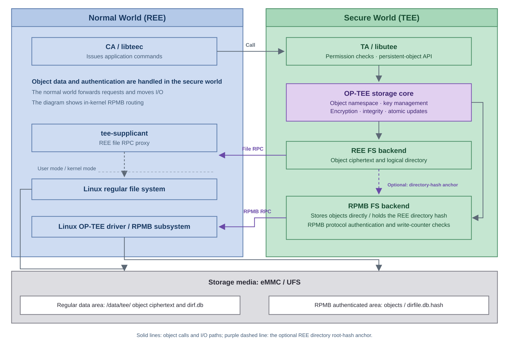
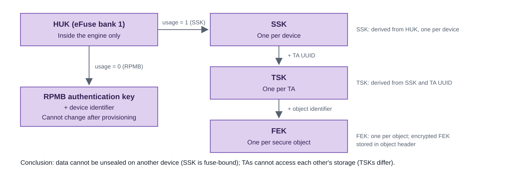

# K3 Secure Storage

## About This Guide

This guide describes the architecture, key hierarchy, and protection mechanisms of secure storage on SpacemiT K3, and explains how to use the TEE storage interfaces. For general implementation concepts, see the [OP-TEE documentation](https://optee.readthedocs.io/en/4.2.0/architecture/secure_storage.html). K3-specific configuration follows this project's implementation.

K3 supports two persistent-object backends:

- **REE FS:** Ciphertext is stored in the normal file system, suitable for larger objects. An RPMB directory anchor can detect directory rollback when enabled.
- **RPMB FS:** Ciphertext is stored directly in the RPMB area of eMMC or UFS, suitable for smaller objects requiring replay protection.

Both backends use the GlobalPlatform persistent-object API within a TA. Application code selects a backend and object ID without handling storage keys.

> **Key policy:** The HUK and RPMB device identifier are used to derive a per-device authentication key. For provisioning and programming, see [Production Key Provisioning and Programming](key_provisioning.md); for the full key hierarchy and lifecycle, see [Key Management and Security Lifecycle](key_management_lifecycle.md).

## 1. Capability Overview

The following table shows which image or component controls each capability. `CFG_*` options are built into the OP-TEE image, `CONFIG_*` options into the Linux kernel, and whether a controller is enabled is decided by the device-tree DTB. The TA chooses its backend in application code. For deployment combinations, see [section 3.1](#31-deployment-modes-and-configuration); for driver and component configuration, see [section 3.3](#33-supported-media-and-enablement).

| Capability | Support | Controlling image / component | Main configuration | Requirements |
| --- | --- | --- | --- | --- |
| REE FS objects | Supported | OP-TEE<br>rootfs<br>application TA | `CFG_REE_FS=y`<br>See [section 3.3](#33-supported-media-and-enablement) for directory configuration | tee-supplicant running<br>Storage directory writable and persistent |
| RPMB FS objects | Supported | OP-TEE<br>application TA | `CFG_RPMB_FS=y`<br>`CFG_RPMB_RESET_FAT=n` | **Program the key and revalidate authentication first** |
| REE FS rollback anchor | Supported | OP-TEE | `CFG_REE_FS_INTEGRITY_RPMB=y`<br>`CFG_RPMB_FS=y`<br>`CFG_REE_FS_ALLOW_RESET=n` | **Program the RPMB key and revalidate authentication first** |
| eMMC RPMB | Supported | Linux kernel<br>device-tree DTB | `CONFIG_RPMB=y`<br>See [section 3.3](#33-supported-media-and-enablement) for MMC configuration | Device provides RPMB<br>MMC controller enabled |
| UFS RPMB | Supported | Linux kernel<br>device-tree DTB | `CONFIG_RPMB=y`<br>See [section 3.3](#33-supported-media-and-enablement) for UFS configuration | Device provides RPMB<br>UFS controller enabled |
| Kernel RPMB routing | Supported | OP-TEE<br>Linux kernel | `CFG_RPMB_ANNOUNCE_PROBE_CAP=y`<br>See [section 3.3](#33-supported-media-and-enablement) for configuration on both sides | Route is `kernel` |
| UFS standard W-LUN | Supported | Linux kernel | Same as the UFS RPMB configuration | Nonzero-capacity regions are registered<br>Advanced RPMB is not currently registered |
| Object confidentiality and integrity | Supported | OP-TEE | Enabled with storage backend | TEE encrypts and verifies automatically |
| Isolation between TAs | Supported | OP-TEE<br>application TA | No separate switch | TA uses a stable, unique UUID |

Secure storage does not address normal-world denial of service, replacement of the trusted boot chain, or a TA exceeding its application-level permissions. When one TA serves multiple CAs, the TA must still validate the caller and application permissions.

## 2. Architecture and Component Responsibilities



*Figure 1: K3 secure-storage component layers. The secure world handles object permissions, encryption, decryption, and authentication; the normal world handles calls and I/O transport. The dashed line represents the optional REE directory hash anchor.*

| Component | Main responsibilities |
| --- | --- |
| TA | Validate application permissions, select a storage backend, and call the object API |
| OP-TEE storage core | Manage object namespaces, keys, encryption, integrity, and RPMB protocol verification |
| tee-supplicant | Read and write `/data/tee` in response to RPC requests; does not handle plaintext objects or storage keys |
| Linux OP-TEE/RPMB drivers | Provide cross-world communication, discover eMMC/UFS RPMB devices, and transport protocol frames |
| eMMC/UFS | Provide normal data storage and a separate authenticated RPMB area |

## 3. Storage Backends and Media

OP-TEE provides two persistent-object backends, REE FS and RPMB FS, which can be enabled on their own or together. Both provide encryption and TA isolation through the same object API, and the TA's storage ID decides where the data goes. Whether REE FS also gets directory rollback protection depends on the RPMB integrity-anchor configuration.

### 3.1 Deployment Modes and Configuration

| Deployment mode | Data stored in REE FS | Data stored in RPMB | Rollback protection |
| --- | --- | --- | --- |
| REE FS only | Object ciphertext, authentication metadata, and `dirf.db` | Not used | Detects tampering but not replay of an entire old state |
| RPMB FS only | No REE FS object storage | Object ciphertext and file-system metadata | Protected by the RPMB authentication protocol and write counter |
| REE FS with RPMB integrity anchor | Object ciphertext, authentication metadata, and `dirf.db` | Directory root hash in `dirfile.db.hash` and its management metadata | Verifies REE state against the RPMB directory hash to detect replay of an old state |

Set the following combinations in `core/arch/riscv/plat-k3/conf.mk` for the mode you want. Both `y` and `n` are explicit values, so edit the existing entries rather than appending duplicate `?=` assignments, which would leave the original values in effect.

| Option | REE FS only | RPMB FS only | REE FS + RPMB integrity anchor |
| --- | --- | --- | --- |
| `CFG_REE_FS` | `y` | `n` | `y` |
| `CFG_RPMB_FS` | `n` | `y` | `y` |
| `CFG_REE_FS_INTEGRITY_RPMB` | `n` | `n` | `y` |
| `CFG_REE_FS_ALLOW_RESET` | `n` | `n` | `n` |
| `CFG_RPMB_RESET_FAT` | `n` | `n` | `n` |
| Object location for `TEE_STORAGE_PRIVATE` | REE FS | RPMB FS | REE FS |

Configuration and object-location notes:

- **Capacity:** REE FS-only capacity depends on the normal file system; RPMB FS-only object capacity is limited by the RPMB area.
- **Combined mode:** Object ciphertext remains in `/data/tee/`; RPMB stores the directory root hash, not a copy of the REE objects.
- **Dependency:** `CFG_REE_FS_INTEGRITY_RPMB=y` depends on `CFG_RPMB_FS=y`. The current source defaults the former to follow the latter, so we recommend setting both explicitly during deployment as the table shows, which makes the final configuration easy to check.
- **Object backend:** With both backends enabled, `TEE_STORAGE_PRIVATE` selects REE FS by default. A TA can explicitly select `TEE_STORAGE_PRIVATE_REE` or `TEE_STORAGE_PRIVATE_RPMB`; see [section 6.2](#62-selecting-a-backend-and-object-id).
- **RPMB space:** When the application uses only REE FS objects, RPMB holds only the directory integrity anchor and its management metadata. When the application also creates RPMB objects, the two kinds of content share the RPMB space.
- **Object naming:** An object ID is not a Linux file path. The TEE manages TA UUIDs and object IDs in an internal logical directory. The RPMB area cannot be mounted as a normal Linux file system.

> [!IMPORTANT]
> For production, we recommend setting `CFG_REE_FS_ALLOW_RESET=n` and `CFG_RPMB_RESET_FAT=n`. For the full configuration comparison, see [Development and Production Modes](tee_architecture.md#development-and-production-modes) in the TEE Architecture and Integration Guide.

With the RPMB directory anchor enabled, if RPMB already holds a valid directory hash but the REE `dirf.db` is missing, the behavior is:

- `CFG_REE_FS_ALLOW_RESET=n`: Return a security error and retain the original anchor.
- `CFG_REE_FS_ALLOW_RESET=y`: Allow the hash to be cleared and an empty directory rebuilt, losing the original object-directory state and weakening rollback protection.
- REE FS-only mode has no RPMB anchor; setting this option to `n` does not add rollback protection.

`CFG_RPMB_RESET_FAT` is the matching switch on the RPMB FS side, described in the source as “Clear RPMB content at cold boot”. When set to `y`, OP-TEE skips the RPMB partition magic check on cold boot and clears and rebuilds the RPMB FS FAT directly, which is equivalent to resetting RPMB secure storage to empty: every existing RPMB object and directory anchor is lost, and persistence and rollback protection are weakened. Like `CFG_REE_FS_ALLOW_RESET`, this option is for testing only; keep it at `n` in production.

### 3.2 REE FS Directory Layout

The default REE FS root is set by `BR2_PACKAGE_OPTEE_CLIENT_TEE_FS_PATH`; K3 uses `/data/tee`. The directory has no per-TA or per-object-ID subdirectories. `dirf.db` stores the TA UUID, the object ID, and an internal file number, and OP-TEE uses that number to find the object file in the same directory. The filenames `0` and `1` in the diagram below are only examples; OP-TEE assigns the actual filenames. A typical layout is:

```text
/data/tee/
├── dirf.db       # Encrypted logical directory: maps TA UUIDs and object IDs to internal file numbers
├── 0             # Object ciphertext, encrypted metadata, and authentication tree
├── 1             # Internal file for another object
└── ...

RPMB area
└── dirfile.db.hash   # Directory root hash when REE FS RPMB integrity is enabled
```

Notes:

- An object ID is not a Linux filename. Numeric filenames are assigned internally by OP-TEE, so you cannot tell which object a file belongs to from its name.
- `/data/tee` contains ciphertext and authentication metadata. Applications should not modify it directly, copy individual files, or delete “unknown” files.
- Back up or restore the complete directory only after stopping all TEE storage access. Restoring only object files or only `dirf.db` breaks consistency.
- With an RPMB directory anchor, the normal file directory and RPMB `dirfile.db.hash` must represent the same state. Restoring an old directory is detected as rollback.
- RPMB FS has no mountable Linux directory. OP-TEE manages its objects, FAT metadata, and REE directory anchor.

### 3.3 Supported Media and Enablement

K3 supports **eMMC RPMB** and **UFS RPMB**: the BSP already includes drivers for both media, so either can be registered as an OP-TEE RPMB candidate. Enabling this requires configuring both the Linux kernel and OP-TEE. `CONFIG_*` options belong to the Linux kernel, `CFG_*` options to OP-TEE, and `BR2_*` options to Buildroot.

#### Linux Kernel Configuration

Choose the medium you want to use and enable the common options below plus the driver for that medium. If the board uses both media, enable both driver groups.

Common options:

```text
CONFIG_TEE=y
CONFIG_OPTEE=y
CONFIG_RPMB=y
```

**eMMC RPMB:** Enable MMC block devices and the K3 SDHCI controller driver. The kernel can register the eMMC RPMB partition; its device identifier is the raw eMMC CID.

```text
CONFIG_MMC=y
CONFIG_MMC_BLOCK=y
CONFIG_MMC_SDHCI=y
CONFIG_MMC_SDHCI_PLTFM=y
CONFIG_MMC_SDHCI_OF_K1=y
```

**UFS RPMB:** Enable SCSI, the UFS host, and the K3 UFS controller driver. The kernel can register nonzero-capacity regions in the UFS RPMB W-LUN. The current driver does not register Advanced RPMB mode.

```text
CONFIG_SCSI=y
CONFIG_SCSI_UFSHCD=y
CONFIG_SCSI_UFSHCD_PLATFORM=y
CONFIG_SCSI_UFS_SPACEMIT_K3=y
```

The Linux `.config` produced by the build is what counts. If it contains `# CONFIG_RPMB is not set`, the unified RPMB class is not registered and kernel RPMB routing cannot be used, even if the option was set in a defconfig.

#### OP-TEE and Buildroot Configuration

Enable OP-TEE, the TA SDK, and client components in Buildroot:

```text
BR2_TARGET_OPTEE_OS=y
BR2_TARGET_OPTEE_OS_SDK=y
BR2_PACKAGE_OPTEE_CLIENT=y
BR2_PACKAGE_OPTEE_CLIENT_TEE_FS_PATH="/data/tee"
# BR2_PACKAGE_OPTEE_CLIENT_RPMB_EMU is not set
```

K3 OP-TEE configuration is controlled mainly through `core/arch/riscv/plat-k3/conf.mk`. You can also pass the same `CFG_*` variables through Buildroot's `BR2_TARGET_OPTEE_OS_ADDITIONAL_VARIABLES`; the examples here are written for `conf.mk`, so if you pass variables through Buildroot, check the final configuration to avoid setting conflicting values for the same variable in more than one place. Both media need `CFG_RPMB_FS=y` to enable RPMB FS and `CFG_RPMB_ANNOUNCE_PROBE_CAP=y` to tell Linux that kernel RPMB routing is supported. The example below uses the REE FS plus RPMB integrity-anchor combination from [section 3.1](#31-deployment-modes-and-configuration); for the other deployment modes, adjust the entries according to the configuration matrix. Edit the matching entries in the existing `conf.mk` rather than appending duplicate `?=` assignments, which would leave the original values in effect:

```makefile
CFG_REE_FS ?= y
CFG_RPMB_FS ?= y
CFG_REE_FS_INTEGRITY_RPMB ?= y
CFG_REE_FS_ALLOW_RESET ?= n
CFG_RPMB_RESET_FAT ?= n
CFG_RPMB_ANNOUNCE_PROBE_CAP ?= y
CFG_RPMB_TESTKEY ?= n
CFG_RPMB_WRITE_KEY ?= n
```

Enable `CFG_RPMB_WRITE_KEY` temporarily only in a controlled provisioning image; keep it at `n` in the product runtime image.

In actual use, the on-board device must also provide RPMB and the corresponding controller must be enabled in the device tree.

> [!IMPORTANT]
> **Before using RPMB FS or an RPMB rollback anchor for REE FS, program the target RPMB authentication key and pass a cold-boot authentication recheck using shipping firmware.** Enabling drivers and `CFG_RPMB_FS=y` alone does not make an unprogrammed RPMB a usable secure-storage backend. Shipping firmware keeps `CFG_RPMB_WRITE_KEY=n` and does not automatically program the key. See [Production Key Provisioning and Programming](key_provisioning.md) for production and acceptance steps.

After configuration, key programming, and authentication revalidation, verify secure storage using the object read/write interfaces in [section 6](#6-tee-storage-interfaces-and-usage). Linux source locations are `include/linux/rpmb.h`, `drivers/mmc/core/block.c`, and `drivers/ufs/core/ufs-rpmb.c`. For protocol details, see [OP-TEE Secure Storage](https://optee.readthedocs.io/en/latest/architecture/secure_storage.html) and [OP-TEE RPMB on UFS](https://github.com/OP-TEE/optee_os/pull/7881).

### 3.4 RPMB Routing and Multiple-Device Selection

#### Two RPMB Routes

RPMB routing determines which normal-world component forwards requests; it does not change secure-world key derivation, authentication, or object protection.

| Route | Request path | Current media support | Dependencies |
| --- | --- | --- | --- |
| User-space (`user`) | OP-TEE -> Linux OP-TEE driver -> tee-supplicant -> MMC ioctl -> eMMC RPMB | eMMC; UFS does not currently support this route | tee-supplicant and the corresponding MMC device node |
| In-kernel (`kernel`) | OP-TEE -> Linux OP-TEE driver -> Linux RPMB subsystem -> storage driver | eMMC, UFS | Linux RPMB subsystem, storage driver, and OP-TEE probe capability |

**On K3, UFS RPMB currently supports only in-kernel routing.** eMMC supports both routing options. Using in-kernel routing for both eMMC and UFS is recommended for consistency. The routing mode is determined through capability negotiation between the two sides and cannot be switched by writing to a sysfs attribute.

Configure Linux, storage drivers, the device tree, and OP-TEE as described in [section 3.3](#33-supported-media-and-enablement), enabling `CFG_RPMB_FS=y` and `CFG_RPMB_ANNOUNCE_PROBE_CAP=y`. After deployment and boot, check:

```sh
cat /sys/class/tee/tee0/rpmb_routing_model
# Kernel route: kernel; user-space route: user
```

- With `kernel`, RPMB frames do not pass through tee-supplicant. REE FS and TA loading from normal files still require tee-supplicant.
- If `user` is reported when `kernel` is expected, check the final Linux `.config`, the OP-TEE-generated `out/include/generated/conf.h`, and the actually deployed image.

#### Default Selection and Binding for Multiple RPMBs

With in-kernel routing, OP-TEE probes candidates in Linux enumeration order and defaults to the **first RPMB authenticated with a key derived by this chip**:

- If the first enumerated candidate authenticates, it is used; otherwise probing continues.
- If multiple candidates authenticate, the first probed is used. Enumeration order and `rpmbN` numbers must not be used as fixed product bindings.
- Shipping firmware prohibits key writing; if no candidate authenticates, RPMB initialization fails.
- `TEE_STORAGE_PRIVATE_RPMB` selects the RPMB backend but cannot select a particular eMMC, UFS device, or region.

If the product needs a fixed target, use one of the following approaches:

| Fixed-target approach | Runtime selection basis | Requirements |
| --- | --- | --- |
| Provision only one target RPMB per board | Only the target can authenticate with a key derived by this chip | Other RPMBs must not have keys that this chip can authenticate; see [Production Key Provisioning and Programming](key_provisioning.md). |
| Disable non-target controllers in DTS | Linux registers RPMB candidates only from the target controller | Set the non-target controller to `status = "disabled"` in the deployed Linux DTS and confirm boot and application data are unaffected. |

DTS normally controls the whole storage controller, disabling normal data access as well; do not assume a separate RPMB child node. One UFS controller may register multiple regions. Disabling the controller removes all of them; exposing only a selected region while retaining the controller requires driver support.

For identifier collection, targeted production programming, and bound-identity revalidation, see sections 4–8 of [Production Key Provisioning and Programming](key_provisioning.md).

## 4. Storage-Key Hierarchy and Subkey Derivation

Secure storage uses the HUK in eFuse as its hardware root, with the TE200 key ladder and purpose-separated derivation. Neither the HUK nor the working key WK recovered by the ladder is exposed to software in plaintext; derived results are used only within the TEE.

| Key | Role in secure storage |
| --- | --- |
| HUK | Device-unique hardware root stored in eFuse and used by the security engine |
| Storage keys SSK / TSK | SSK is the storage hierarchy root; TSK isolates object keys by TA UUID |
| FEK | Per-object file encryption key, randomly generated and protected by the storage key |
| RPMB authentication key | Derived from this chip's HUK and the RPMB device identifier for authenticated media access |

The storage SSK is an OP-TEE secure-storage key and is distinct from the hardware SSK in eFuse bank 2. For the full derivation chain, parameters, and lifecycle constraints, see sections 2 and 3 of [Key Management and Security Lifecycle](key_management_lifecycle.md). For eFuse and RPMB provisioning, see [Production Key Provisioning and Programming](key_provisioning.md).

The following diagram shows the two derivation layers involved in secure storage:



The diagram shows hierarchy and protection relationships; it does not imply that FEKs are deterministically derived from object IDs. OP-TEE generates a random FEK for each object and wraps it with the TSK. The RPMB authentication key is derived separately using the device identifier. A CA cannot read plaintext keys; it submits object data and IDs, while the TA and OP-TEE handle backend selection and keys.

## 5. Security Features and Protection Mechanisms

| Feature | Protection mechanism | REE FS | RPMB FS | Configuration or usage requirements |
| --- | --- | --- | --- | --- |
| Object confidentiality | The FEK (file encryption key) encrypts object data | OP-TEE encrypts objects automatically | OP-TEE encrypts objects automatically | Enable the corresponding backend; the TA does not handle storage keys itself |
| Object integrity | REE FS: authenticated encryption and hash tree; RPMB FS: HMAC-SHA256 authentication | OP-TEE verifies objects and metadata | Authenticated RPMB reads and writes | Enable `CFG_REE_FS=y` or `CFG_RPMB_FS=y` |
| Rollback/replay protection | REE directory root hash stored in RPMB; authenticated RPMB write counter | RPMB anchor protects REE directory state | RPMB authentication protects update state | For REE FS, enable `CFG_REE_FS_INTEGRITY_RPMB=y` and set `CFG_REE_FS_ALLOW_RESET=n`; for RPMB FS, set `CFG_RPMB_RESET_FAT=n`; RPMB uses a confidential device key |
| Isolation between TAs | TA UUID namespace; the UUID-derived TSK (TA storage key) wraps the FEK | Objects isolated by TA namespace | Same as REE FS | TA uses a stable, unique UUID; the TA validates CA permissions itself |
| Device-key binding | The HUK-derived SSK (secure storage key); the HUK and RPMB identifier derive the RPMB authentication key | Device HUK participates in storage-key derivation | HUK and RPMB identifier participate in authentication-key derivation | `CFG_RPMB_TESTKEY=n`; complete HUK programming, provisioning, and board verification |

These are the features and enablement conditions exposed by K3. Object encryption, integrity trees, the RPMB protocol, and the key hierarchy are general OP-TEE implementations, which this document does not repeat; see [OP-TEE Secure Storage](https://optee.readthedocs.io/en/latest/architecture/secure_storage.html) for their principles.

## 6. TEE Storage Interfaces and Usage

### 6.1 Pre-Use Checks

| Check | Expected result |
| --- | --- |
| TEE devices | `/dev/tee0` and `/dev/teepriv0` are available |
| tee-supplicant | Running when REE FS or TA loading from normal files is used; for REE FS, the file system containing `/data/tee` is writable and persistent across reboot |
| RPMB registration | When using RPMB objects or a directory anchor, the target device exists under `/sys/class/rpmb/` and kernel logs show no registration error |
| RPMB route | Matches the deployment choice in [section 3.4](#34-rpmb-routing-and-multiple-device-selection); UFS must use `kernel` with W-LUN/region registration confirmed; eMMC can use `kernel` or `user` |
| Final configuration | `CFG_REE_FS`, `CFG_RPMB_FS`, and `CFG_REE_FS_INTEGRITY_RPMB` match the selected deployment mode in [section 3.1](#31-deployment-modes-and-configuration) |
| Production key | When using RPMB, the target has been provisioned with the corresponding HUK-derived key and passed cold-boot authentication revalidation with shipping firmware |

### 6.2 Selecting a Backend and Object ID

| Storage location | Storage ID used by the TA |
| --- | --- |
| Platform default backend (REE FS when both backends are enabled) | `TEE_STORAGE_PRIVATE` |
| Explicitly store in REE FS | `TEE_STORAGE_PRIVATE_REE` |
| Explicitly store in RPMB FS | `TEE_STORAGE_PRIVATE_RPMB` |

The TA defines the object ID, up to 64 bytes. Creation, reading, and deletion must use the same backend, ID contents, and length. Selecting RPMB FS does not distinguish eMMC, UFS, or region.

### 6.3 Secure-Storage Interfaces

The following lists persistent-object and storage-data interfaces only. The TA includes `<tee_internal_api.h>`; explicit REE/RPMB selection also requires `<tee_internal_api_extensions.h>`.

| Interface | Usage |
| --- | --- |
| `TEE_CreatePersistentObject` | Create and save an object with a backend, object ID, and initial data; use `TEE_DATA_FLAG_OVERWRITE` to replace existing contents completely |
| `TEE_OpenPersistentObject` | Open using the same backend and object ID; use `TEE_DATA_FLAG_ACCESS_READ` for reading and `TEE_DATA_FLAG_ACCESS_WRITE_META` for deletion |
| `TEE_ReadObjectData` | Read object data and check the result and actual byte count |
| `TEE_CloseAndDeletePersistentObject1` | Delete the object and close its handle; do not close the handle again |

### 6.4 TA Side: Persistent Objects in the Official Example

`optee_examples/secure_storage` is an official OP-TEE secure-storage example. Its sources are `ta/secure_storage_ta.c`, `ta/include/secure_storage_ta.h`, and `host/main.c`. The excerpts below include only the persistent-object statements, showing how to write three typical TA operations; obtain the complete files from the source shipped with the image or from [OP-TEE examples 4.5.0](https://github.com/linaro-swg/optee_examples/tree/4.5.0/secure_storage).

**Command IDs (`ta/include/secure_storage_ta.h`, shared by CA and TA):**

```c
#define TA_SECURE_STORAGE_CMD_READ_RAW		0
#define TA_SECURE_STORAGE_CMD_WRITE_RAW		1
#define TA_SECURE_STORAGE_CMD_DELETE		2
```

**Create an object:** Create it with `TEE_CreatePersistentObject`, then write data with `TEE_WriteObjectData` (`create_raw_object()`):

```c
res = TEE_CreatePersistentObject(TEE_STORAGE_PRIVATE,
				 obj_id, obj_id_sz, obj_data_flag,
				 TEE_HANDLE_NULL, NULL, 0, &object);
...
res = TEE_WriteObjectData(object, data, data_sz);
```

**Read an object:** Obtain its length with `TEE_GetObjectInfo1`, then read it with `TEE_ReadObjectData`. An insufficient buffer returns `TEE_ERROR_SHORT_BUFFER` (`read_raw_object()`):

```c
res = TEE_OpenPersistentObject(TEE_STORAGE_PRIVATE,
			       obj_id, obj_id_sz,
			       TEE_DATA_FLAG_ACCESS_READ |
			       TEE_DATA_FLAG_SHARE_READ,
			       &object);
...
res = TEE_GetObjectInfo1(object, &object_info);
...
res = TEE_ReadObjectData(object, data, object_info.dataSize, &read_bytes);
```

**Delete an object:** Open with `TEE_DATA_FLAG_ACCESS_WRITE_META`, then delete and close the handle with `TEE_CloseAndDeletePersistentObject1` (`delete_object()`):

```c
res = TEE_OpenPersistentObject(TEE_STORAGE_PRIVATE,
			       obj_id, obj_id_sz,
			       TEE_DATA_FLAG_ACCESS_READ |
			       TEE_DATA_FLAG_ACCESS_WRITE_META,
			       &object);
...
TEE_CloseAndDeletePersistentObject1(object);
```

The example uses `TEE_STORAGE_PRIVATE`, the platform default in [section 6.2](#62-selecting-a-backend-and-object-id). To pin the backend to RPMB FS or REE FS, replace `TEE_STORAGE_PRIVATE` with `TEE_STORAGE_PRIVATE_RPMB` or `TEE_STORAGE_PRIVATE_REE` and include `<tee_internal_api_extensions.h>` in the TA. The command format and the agreement with the CA stay the same. Products should validate caller authorization, object-ID length and allowlist, data format, and maximum data length before writing. When `object_info.dataSize > data_sz`, `read_raw_object()` returns `TEE_ERROR_SHORT_BUFFER`; the CA should reallocate according to the required length returned in `params[1].memref.size` and retry.

### 6.5 CA Side: Object Access in the Official Example

`optee_examples/secure_storage/host/main.c` provides a complete Client Application (CA). The following excerpts show how the parameters are assembled and `TEEC_InvokeCommand` is called for the three commands: WRITE, READ, and DELETE. The object ID is passed through parameter 0 (`TEEC_MEMREF_TEMP_INPUT`). For WRITE, the data is passed through parameter 1 (`TEEC_MEMREF_TEMP_INPUT`); for READ, the output buffer is passed through parameter 1 (`TEEC_MEMREF_TEMP_OUTPUT`). The command IDs are consistent with those defined in the header file shown in [section 6.4](#64-ta-side-persistent-objects-in-the-official-example). For instructions on cross-compiling, linking against `libteec`, and deploying the CA, see [Step 3: Compile and Link](ca_guide.md#step-3-compile-and-link) in the CA Development Guide.

**Write an object** (`write_secure_object()`):

```c
op.paramTypes = TEEC_PARAM_TYPES(TEEC_MEMREF_TEMP_INPUT,
				 TEEC_MEMREF_TEMP_INPUT,
				 TEEC_NONE, TEEC_NONE);
op.params[0].tmpref.buffer = id;
op.params[0].tmpref.size = id_len;
op.params[1].tmpref.buffer = data;
op.params[1].tmpref.size = data_len;
res = TEEC_InvokeCommand(&ctx->sess,
			 TA_SECURE_STORAGE_CMD_WRITE_RAW, &op, &origin);
```

**Read an object** (`read_secure_object()`):

```c
op.paramTypes = TEEC_PARAM_TYPES(TEEC_MEMREF_TEMP_INPUT,
				 TEEC_MEMREF_TEMP_OUTPUT,
				 TEEC_NONE, TEEC_NONE);
op.params[0].tmpref.buffer = id;
op.params[0].tmpref.size = id_len;
op.params[1].tmpref.buffer = data;
op.params[1].tmpref.size = data_len;
res = TEEC_InvokeCommand(&ctx->sess,
			 TA_SECURE_STORAGE_CMD_READ_RAW, &op, &origin);
```

**Delete an object** (`delete_secure_object()`):

```c
op.paramTypes = TEEC_PARAM_TYPES(TEEC_MEMREF_TEMP_INPUT,
				 TEEC_NONE, TEEC_NONE, TEEC_NONE);
op.params[0].tmpref.buffer = id;
op.params[0].tmpref.size = id_len;
res = TEEC_InvokeCommand(&ctx->sess,
			 TA_SECURE_STORAGE_CMD_DELETE, &op, &origin);
```

As with the TA side in [section 6.4](#64-ta-side-persistent-objects-in-the-official-example), the CA-side considerations are:

- **Parameter directions and positions must match the TA:** writing an object takes two inputs, ID and data; reading an object takes an ID input and a data output; deleting takes only an ID input. A mismatch between the two sides produces `TEE_ERROR_BAD_PARAMETERS` on the TA side.
- **Object IDs are application identifiers**, not Linux paths. The TA should not pass a path such as `/data/example.bin` directly to `TEE_CreatePersistentObject` as an object ID. In a product implementation, the TA should design an object-ID allowlist or application mapping rather than trusting arbitrary CA input directly.
- **Buffer and capacity:** Determine the object length or use an application-defined maximum; on `TEEC_ERROR_SHORT_BUFFER`, reallocate to the required length returned by the TA and retry. RPMB capacity is limited, so use REE FS or chunking for large objects.
- **File I/O:** The CA reads Linux file contents into memory and passes bytes to the TA as `TEEC_MEMREF_TEMP_INPUT`, and writes returned bytes to a Linux file. The TA receives bytes, not a path or normal-world file access. The CA validates file permissions, paths, and size; binary data need not be converted to strings or Base64.
- **RPMB key and backend readiness:** Before using RPMB FS, provision the target as described in [Production Key Provisioning and Programming](key_provisioning.md) and pass authentication revalidation using shipping firmware.

## Appendix: Public References

| Reference | Purpose |
| --- | --- |
| [OP-TEE 4.2.0: Secure storage](https://optee.readthedocs.io/en/4.2.0/architecture/secure_storage.html) | Trusted-storage concepts, key hierarchy, and general protection mechanisms |
| [OP-TEE GlobalPlatform API](https://optee.readthedocs.io/en/4.2.0/architecture/globalplatform_api.html) | Responsibilities of client and TA APIs |
| [OP-TEE examples 4.5.0: secure_storage](https://github.com/linaro-swg/optee_examples/tree/4.5.0/secure_storage) | Complete CA/TA example for development reference |