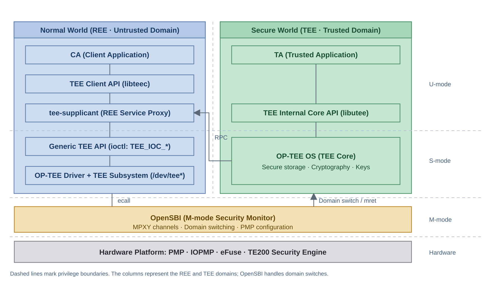
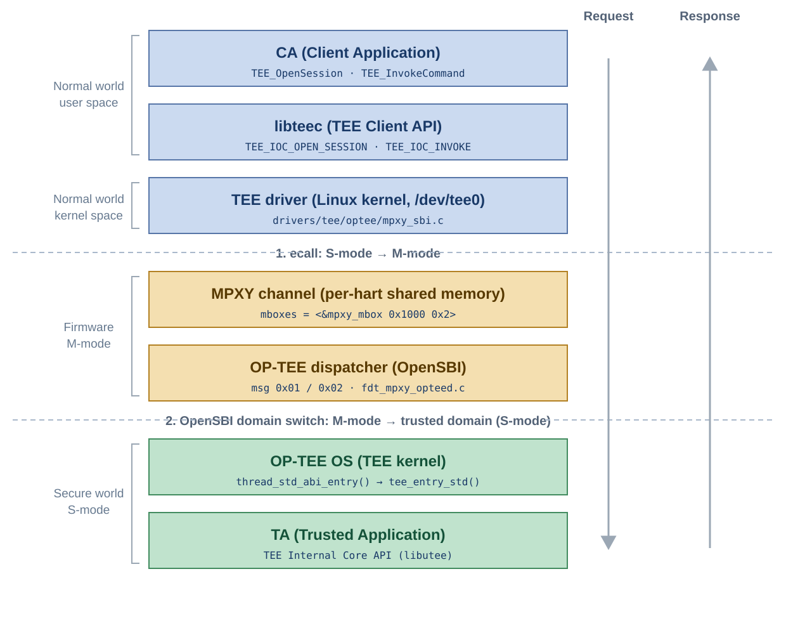
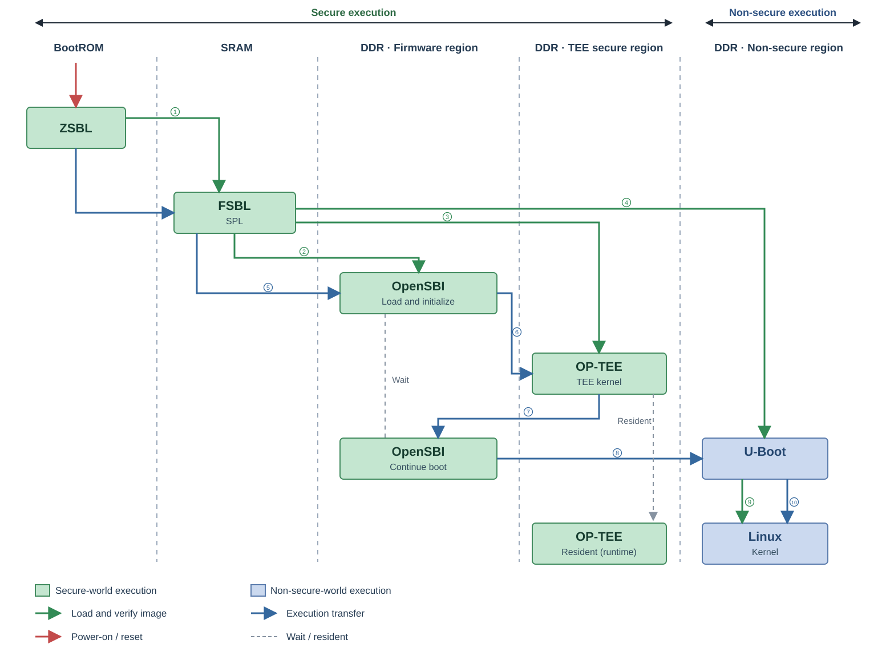
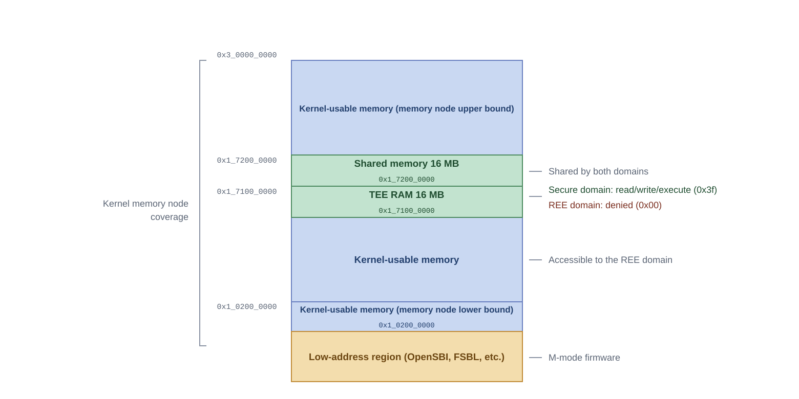
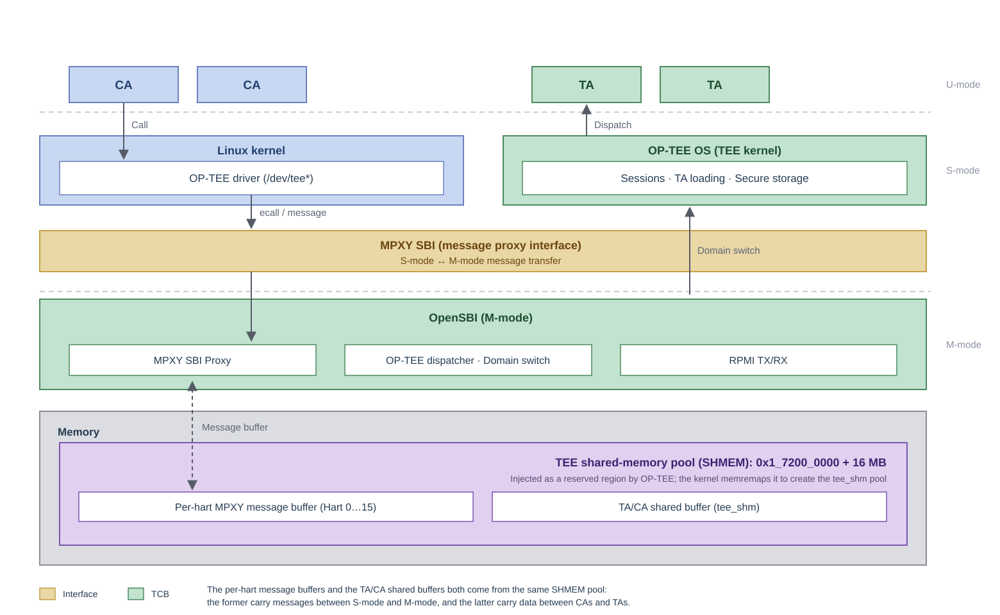
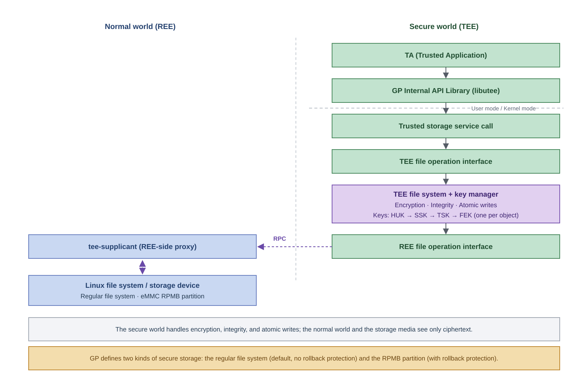

# TEE Architecture and Integration Guide

## Overview

### Purpose

This guide describes the role, components, boot process, memory layout, communication mechanisms, and BSP integration of OP-TEE on SpacemiT K3. It helps readers understand how OP-TEE is structured and integrated, and use that understanding to locate and troubleshoot problems.

### Scope

This guide applies to Buildroot solutions for SpacemiT K3 series SoCs.

This guide covers only **TEE architecture and integration**. Related topics are documented separately:

- **Secure Boot** (firmware signing and verification chain): [Secure Boot Development Guide](../device/secureboot.md).
- **Image building and flashing:** [TEE Image Build and Flashing Guide](tee_image.md).
- **CA and TA development:** the [CA Development Guide](ca_guide.md) and [TA Development Guide](ta_guide.md), respectively.
- **Feature support:** [Security Feature Support Matrix](support_matrix.md).

### Source Repositories

This guide refers to many specific source files. The following table lists the repositories involved and the short names used for them in the rest of this guide. All code paths are relative to the root of the corresponding repository.

| Abbreviation | Location | Description |
|---|---|---|
| **U-Boot** | `bsp-src/uboot-2022.10` | U-Boot and SPL source, including `arch/riscv/dts/k3-optee.dtsi`, which defines domain and TEE nodes |
| **OpenSBI** | `bsp-src/opensbi` | M-mode firmware for domain management, MPXY, and OP-TEE secure-payload dispatch |
| **OP-TEE OS** | `bsp-src/optee_os` | TEE kernel; K3 platform code is under `core/arch/riscv/plat-k3/` |
| **Linux kernel** | `bsp-src/linux-6.18` | Kernel and TEE driver (`drivers/tee/optee/`) |
| **Buildroot** | Build root | Top-level configuration (`local.mk`, `configs/`) and build rules for OP-TEE packages |
| optee_client / optee_test / optee_examples | Upstream repositories | Fetched by Buildroot during the build, outside the BSP source tree; see [Component Inventory](#component-inventory) for links |

U-Boot, OpenSBI, OP-TEE OS, and the Linux kernel are local BSP source trees under `bsp-src/`, selected using `*_OVERRIDE_SRCDIR`. Buildroot is the build root itself.

### Document Structure

1. **[TEE in the System](#tee-in-the-system):** Call path from CA to TEE.
2. **[Component Inventory](#component-inventory):** Responsibilities and source locations of the four components, and how they relate to the GlobalPlatform APIs.
3. **[Boot Sequence](#boot-sequence):** From power-on to a resident TEE, including when initialization and resident operation begin.
4. **[Memory Layout](#memory-layout):** TEE RAM, shared memory, and device-tree integration.
5. **[Communication](#communication):** SMC/ABI, MPXY channels, and RPC.
6. **[Secure Storage](#secure-storage):** Object read/write path, key hierarchy, and where data is stored.
7. **[BSP Integration](#bsp-integration-enabled-configuration):** The configuration enabled in OpenSBI, U-Boot/SPL, the kernel, and Buildroot.
8. **[Development and Production Modes](#development-and-production-modes).**

### Important Constraints

> [!CAUTION]
> The TEE load address and memory partitioning have **strict dependencies** across SPL, OpenSBI, the TEE image, the device tree, and the kernel. TEE RAM and shared memory lie within memory visible to the kernel. Any change must be synchronized across the other components; otherwise, the TEE may fail to boot or memory corruption may occur. See [Memory Layout](#memory-layout).

## TEE in the System

OP-TEE runs in RISC-V S-mode on K3. OpenSBI provides M-mode firmware and cross-domain dispatch:



Key points of the call chain:

- **CAs and TAs do not communicate directly:** libteec packages CA requests and sends them through the TEE driver to OP-TEE.
- **`tee-supplicant` handles reverse requests:** When OP-TEE needs normal-world resources, it issues an RPC, which this daemon services.
- **Privilege and domain transitions:** RISC-V has no Arm `smc` instruction. S-mode/M-mode transitions use `ecall`/`mret`, and OpenSBI handles cross-domain dispatch.

The layers along the chain:

- **TEE OS:** OP-TEE's RISC-V backend. Source: **OP-TEE OS**.
- **M-mode firmware:** OpenSBI implements domain management and MPXY. Secure-payload dispatch is handled by `lib/utils/mpxy/fdt_mpxy_opteed.c` in the **OpenSBI** source tree.
- **K3 changes:** Primarily the platform layer `core/arch/riscv/plat-k3/` and device trees.
- **Upgrade impact:** When upgrading dependency versions, usually only the platform layer and device trees need to be re-adapted, not the entire call chain.

The following diagram shows every layer a CA call passes through and the two world boundaries it crosses:



Each stage in the diagram can be traced to the following points in the source code:

- **REE entry:** `TEE_OpenSession` / `TEE_InvokeCommand` enter the Linux kernel's `drivers/tee/optee/mpxy_sbi.c` through ioctls such as `TEE_IOC_OPEN_SESSION`.
- **Device-tree binding:** Sixteen per-hart channels are bound to `mpxy_mbox` (`mboxes = <&mpxy_mbox 0x1000 0x2>`), defined in U-Boot `arch/riscv/dts/k3-optee.dtsi`.
- **M-mode receives the message:** OpenSBI's OP-TEE dispatcher (`lib/utils/mpxy/fdt_mpxy_opteed.c`) switches to the trusted domain.
- **Secure-side entry:** `thread_std_abi_entry()` calls `tee_entry_std()` (**OP-TEE OS**), and OP-TEE then dispatches the request to the TA.

## Component Inventory

| Component | Layer | Responsibilities | Source |
|---|---|---|---|
| TEE OS | Secure world | TEE kernel framework (processes, memory, and drivers), TEE Internal Core API implementation (`libutee`), user-space ELF loader (`ldelf`), and extensible cryptographic library | Local **OP-TEE OS** source; enabled by `BR2_TARGET_OPTEE_OS`, selected by `OPTEE_OS_OVERRIDE_SRCDIR`; platform code in `core/arch/riscv/plat-k3/` |
| TEE Client | Normal-world user space | TEE Client API implementation (`libteec`) and service daemon (`tee-supplicant`) | Upstream [optee_client](https://github.com/OP-TEE/optee_client), enabled by `BR2_PACKAGE_OPTEE_CLIENT` and fetched at build time |
| TEE Test | Normal-world user space | `xtest` test suite | Upstream [optee_test](https://github.com/OP-TEE/optee_test), enabled by `BR2_PACKAGE_OPTEE_TEST=y` and fetched at build time |
| Official examples | Normal-world user space | Seven example TAs and CAs | Upstream [optee_examples](https://github.com/OP-TEE/optee_examples), enabled by `BR2_PACKAGE_OPTEE_EXAMPLES=y` and fetched at build time |
| Linux TEE driver | Normal-world kernel | REE-side TEE framework and driver connecting CAs, tee-supplicant, and the TEE | Upstream kernel `drivers/tee/optee/`; K3 uses the local BSP **Linux kernel** source tree |

The TEE Client, TEE Test, and official example sources are not in the BSP source tree. Buildroot fetches them from the upstream repositories into the build directories, so the build host must be able to access those repositories.

Together, the four components form the complete call and service stack:

- **TEE OS** provides isolation and security services and forms part of the trusted computing base.
- **TEE Client** provides libteec as the CA programming interface and tee-supplicant as the secure world's only proxy for normal-world resources.
- **TEE Test** verifies that the whole chain works end to end.
- **Linux TEE driver** is the normal-world kernel entry point and exposes `/dev/tee*` and `/dev/teepriv*` to user space.

### GP APIs and OP-TEE

Both interfaces that OP-TEE exposes come from TEE specifications defined by **GlobalPlatform (GP)**, not from private APIs:

| Interface | Specification | User | K3 implementation |
|---|---|---|---|
| TEE Client API | GlobalPlatform TEE Client API Specification | Normal-world CA | libteec (`optee_client`) |
| TEE Internal Core API | GlobalPlatform TEE Internal Core API Specification | Secure-world TA | libutee (`optee_os`) |

The two specifications define the CA-side and TA-side programming interfaces, including data types, functions, parameters, and error codes. The Internal Core API also defines TA capabilities such as storage, cryptography, and time. CAs and TAs written to these APIs are therefore decoupled from any specific TEE implementation.

For the APIs and call paths used on each side on K3, see the diagram in [TEE in the System](#tee-in-the-system). Links to both specifications are in [References](#references). For CA and TA development, see the [CA Development Guide / TEE Client API Reference](ca_guide.md) and the [TA Development Guide](ta_guide.md).

## Boot Sequence

The complete path of the secure image from power-on until the TEE becomes resident:



Green arrows in the diagram indicate **loading and signature verification**. The current version has not integrated staged signature verification; see the [Security Feature Support Matrix](support_matrix.md) for actual behavior.

Where each stage executes: ZSBL in the on-chip BootROM, FSBL in on-chip SRAM, OpenSBI and U-Boot in the firmware region at the low end of DDR, OP-TEE in the TEE secure region of DDR, and Linux in the non-secure region. For the exact addresses, see the load addresses in the table below.

When initialization happens and when the TEE becomes resident:

- **SPL stage:** Only loads images and does not initialize any TEE logic. At this point the TEE image is already in place in memory.
- **OpenSBI stage:** Sets up the domain model and PMP, then enters the trusted domain and **executes OP-TEE for the first time**. After platform initialization, the TEE does not exit. It stays **resident** and waits for calls from the normal world.
- **What resident means:** The TEE is never swapped out. Its memory (TEE RAM) and code remain valid for the entire runtime, and every later CA call enters the already-resident TEE instead of reloading it. If the normal world ever overwrites TEE RAM, the result is random crashes at runtime rather than a boot failure. This is why the memory layout must be strictly enforced. For the kernel-side exclusion mechanism, see [Memory Layout](#memory-layout).

Firmware load order and target addresses:

| Order | Image | Loader | Target load address |
|---|---|---|---|
| 1 | `FSBL.bin` (SPL) | BROM | `0xc080_1000` |
| 2 | `esos.itb` | SPL | — |
| 3 | `optee.itb` | SPL | `0x1_7100_0000` |
| 4 | `u-boot.itb` | SPL | `0x1_0200_0000` |
| 5 | OpenSBI (`fw_dynamic.itb`) | U-Boot | `0x1_0000_0000` |

**If the TEE image is missing:**

- **MMC and MTD paths:** Secure builds make the TEE image mandatory. If the image is missing or fails to load, SPL aborts the boot and does not fall back to the non-secure path.
- **UFS and unknown boot devices:** These paths do not load OP-TEE and keep the same permissive behavior as non-secure builds.

When validating a secure image, take the boot medium into account.

The following lines appear on the serial console in order:

```text
I/TC: OP-TEE version: 4.5.0 ...       # OP-TEE banner on first execution in the trusted domain
[  OK  ] Started OP-TEE driver        # Kernel detects OP-TEE
```

## Memory Layout



The diagram shows the ownership and protection of each region. It shows only relative positions and sizes and is not drawn to address scale.

### TEE RAM and Shared Memory

| Region | Address | Size | Purpose |
|---|---|---|---|
| TEE RAM (TDDRAM) | `0x1_7100_0000` | 16 MB | TEE kernel, TAs, TEE heap, and stacks; **resident** |
| Shared memory (SHMEM) | `0x1_7200_0000` | 16 MB | Data exchange between REE and TEE; allocated by REE and registered with TEE |

### Shared Memory Is Reserved, Not Dynamic

The platform explicitly selects **reserved shared memory**:

| Option | Value | Meaning |
|---|---|---|
| `CFG_CORE_RESERVED_SHM` | `y` | Use a fixed reserved shared-memory region |
| `CFG_CORE_DYN_SHM` | `n` | Dynamic shared memory is **disabled** |
| `CFG_SHMEM_START` / `CFG_SHMEM_SIZE` | `0x1_7200_0000` / `0x100_0000` | Reserved shared-memory base and size |

The two approaches differ as follows, including what each requires from the device tree:

| | Reserved (current) | Dynamic |
|---|---|---|
| Memory source | A fixed region set by platform configuration | Registered by the kernel at runtime; any normal memory can be used |
| Device tree | **No** `reserved-memory` entry is needed for shared memory | Usually needs a `memory-region` that points to a reserved region |
| How the kernel learns about it | OP-TEE announces the shared-memory configuration through the ABI, and the kernel maps it accordingly | Managed by the kernel through the device tree and runtime registration |
| Flexibility | Fixed; cannot grow dynamically | Flexible; allocated on demand as load grows |

On this platform, therefore, **the static device tree does not describe shared memory**. Instead, OP-TEE injects the reserved regions into the device tree at boot (see [OP-TEE Injects Reserved Regions into the Device Tree](#op-tee-injects-reserved-regions-into-the-device-tree)). Copying the approach used on other platforms, where OP-TEE shared memory is configured with `memory-region` in the device tree, duplicates or conflicts with the actual mechanism.

### OP-TEE Injects Reserved Regions into the Device Tree

TEE RAM and shared memory lie within the range covered by the kernel memory node, but **the static device tree does not need to declare them in advance**. At startup, OP-TEE inserts two `reserved-memory` child nodes into the device tree. The kernel marks them `nomap` and non-reusable, so it never allocates from these two ranges.

Injection points:

| Node | Injection location | Configuration |
|---|---|---|
| `optee_core` | `core/arch/riscv/kernel/boot.c` | `CFG_TDDRAM_START` / `CFG_TDDRAM_SIZE` |
| `optee_shm` | `core/kernel/boot.c` | `CFG_SHMEM_START` / `CFG_SHMEM_SIZE` (reserved SHM only) |

`core/kernel/dt.c` creates the child nodes under `/reserved-memory`. The same code also injects a `/firmware/optee` node (`compatible = "linaro,optee-tz"`, `method = "smc"`). If the device tree already contains this node, injection is skipped and the existing node is not overwritten.

After boot, confirm the injection in the kernel log:

```text
[    0.000000] OF: reserved mem: 0x0000000172000000..0x0000000172ffffff (16384 KiB) nomap non-reusable optee_shm@1,72000000
[    0.000000] OF: reserved mem: 0x0000000171000000..0x0000000171ffffff (16384 KiB) nomap non-reusable optee_core@1,71000000
```

The two lines correspond to shared memory and TEE RAM respectively. `nomap non-reusable` means the kernel neither maps nor reuses these two ranges. **When troubleshooting memory corruption, first confirm that both lines are present.**

> [!CAUTION]
> An injection failure causes an immediate **panic**, so the device-tree blob must have enough free space: the platform's DTB size limit (`CFG_DTB_MAX_SIZE`) must be large enough for the added nodes. If you lower this limit or pack the device tree tightly, the system may panic as soon as it boots.
>
> Also, OP-TEE generates both `optee_core` and `optee_shm` from the platform configuration. **Do not add them by hand to the static device tree.** A duplicate declaration describes the same range twice and easily leads to misdiagnosis.

### Hardware Protection of TEE RAM

Beyond the kernel-side reserved-region declaration, TEE RAM is also protected by the **OpenSBI domain model plus hardware-enforced PMP**. The **U-Boot** device tree `arch/riscv/dts/k3-optee.dtsi` defines the related nodes:

```dts
chosen {
	opensbi-domains {
		compatible = "opensbi,domain,config";

		tmem: tmem {
			compatible = "opensbi,domain,memregion";
			base = <0x01 0x71000000>;   /* TEE RAM base */
			order = <0x18>;             /* 2^24 = 16 MB */
		};

		allmem: allmem {
			compatible = "opensbi,domain,memregion";
			base = <0x01 0x00>;
			order = <0x40>;             /* Entire address space */
		};

		tdomain: trusted-domain {
			regions = <&allmem 0x3f>;
			next-addr = <0x01 0x71000000>;   /* Enter TEE */
			next-mode = <0x01>;              /* S-mode */
		};

		udomain: untrusted-domain {
			regions = <&tmem 0x00>, <&allmem 0x3f>;   /* No tmem access */
			next-addr = <0x01 0x02000000>;            /* Enter U-Boot */
			next-mode = <0x01>;
		};
	};
};
```

Notes:

- `tmem` corresponds to the TEE RAM range.
- `udomain` (the domain that runs U-Boot and Linux) has permission `0x00` on `tmem`, meaning **no access at all**. PMP denies the access in hardware.
- `tdomain` has full memory permissions and enters the TEE in S-mode at the TEE RAM base.
- `allmem` with `order = 0x40` covers the entire 64-bit address space.

Summary of domain ownership:

| Domain | Memory and permissions | Software | Entry address |
|---|---|---|---|
| `tdomain` (trusted) | `allmem`: `0x3f` (full access) | OP-TEE | `0x1_7100_0000` |
| `udomain` (untrusted) | `tmem`: `0x00` (deny), `allmem`: `0x3f` | U-Boot and kernel | `0x1_0200_0000` |

Both domains use all 16 harts, and the boot hart of `udomain` is `cpu_0`. Cross-domain communication goes through the `sbi-mpxy-opteed` node on channels `0x1000`-`0x100f`, one per hart (see [Communication](#communication)).

The two protection layers have different roles. **PMP provides hardware denial**: an unauthorized access raises an exception immediately instead of silently corrupting memory. **The `reserved-memory` regions injected by OP-TEE provide software exclusion**: the kernel never allocates those addresses. Both are required. With PMP alone, kernel misuse causes frequent exceptions. With the reserved-region declaration alone, there is no hardware backstop.

> [!NOTE]
> The denial of `udomain` access to TEE RAM is guaranteed **in hardware**, while kernel-side exclusion is done by the reserved regions that OP-TEE injects (see [OP-TEE Injects Reserved Regions into the Device Tree](#op-tee-injects-reserved-regions-into-the-device-tree)). Together they ensure that the normal world never uses TEE RAM or shared memory.
>
> If the two `OF: reserved mem` lines are missing, injection did not take effect. The kernel then treats both ranges as ordinary memory, and the result is random crashes at runtime rather than a boot failure, which are very hard to trace.

### Address Consistency

The following four locations must stay consistent. If you change one, you must update the others:

| Anchor | Location |
|---|---|
| TEE image load and entry addresses | FIT description file in the **OP-TEE OS** platform directory, `core/arch/riscv/plat-k3/optee.its` (`load` / `entry` fields) |
| TEE RAM and shared-memory bases | **OP-TEE OS** platform configuration `core/arch/riscv/plat-k3/conf.mk` (`CFG_TDDRAM_START` / `CFG_SHMEM_START`) |
| TEE RAM reserved region and domain entry | **U-Boot** device tree `arch/riscv/dts/k3-optee.dtsi` (the `tmem` node and the `next-addr` of `tdomain`) |
| TEE kernel link address | OP-TEE linker script, generated from `CFG_TDDRAM_START` (in the same `conf.mk`) |

## Communication

### SMC / ABI Calls

Arm uses the `smc` instruction for communication between the REE and the TEE. RISC-V has no such instruction and uses `ecall` for the S-mode -> M-mode -> S-mode transition instead, but **keeps the same ABI calling convention**: the Function ID in the parameter registers identifies the requested service.

The ABI is defined in `core/arch/riscv/include/tee/optee_abi.h`. There are two types of call:

| Type | Interrupt behavior | Typical use |
|---|---|---|
| Fast call | Interrupts are masked during execution, so the call is effectively atomic | Getting the OS UUID and OS version, getting the shared-memory configuration, capability exchange, and secondary-core startup |
| Yield call | Interrupts are not masked, so normal-world interrupts can preempt the call | TEE Client API commands issued by CAs, and responses to RPCs issued by the TEE |

### MPXY and RPMI Conduit

Arm relies on the `smc` instruction for cross-world communication. RISC-V replaces it with the **SBI MPXY (Message Proxy) extension**, which is still based on `ecall`. MPXY lets S-mode software send and receive messages, and M-mode forwards the messages between the normal world and the secure world.



Green in the diagram marks the trusted computing base (TCB). Besides the secure-world kernel **OP-TEE OS**, M-mode **OpenSBI** (domain isolation, cross-domain dispatch, and PMP configuration) is also part of the TCB. Brown marks the cross-domain interface (MPXY SBI).

Roles and sources of the three kinds of shared memory:

| Name | Purpose | Source |
|---|---|---|
| TEE shared-memory pool (SHMEM) | Pool for exchanging data between the REE and the TEE | Static OP-TEE shared region (`CFG_SHMEM_START`; on K3, `0x1_7200_0000` + 16 MB). Injected as the `optee_shm` reserved region at boot and reported to the kernel through `OPTEE_SMC_GET_SHM_CONFIG` |
| Per-hart MPXY message buffer | Carries messages between S-mode and M-mode; one channel per hart | The kernel allocates a `tee_shm` from the pool above and passes its physical address to OpenSBI in the RPMI mailbox message header |
| TA/CA shared memory | Passes parameters and data between a CA and a TA | The CA allocates or registers it through libteec. The kernel allocates a `tee_shm` from the same pool and registers it with OP-TEE. The TA accesses it through memrefs |

MPXY consists of:

- **Per-hart shared memory:** Carries messages between S-mode and M-mode, with one channel per hart.
- **Multiple protocols (channels):** MPXY provides only the transport framework. The actual message formats are defined by the individual protocols (RPMI, OPTEED, and so on), which are distinguished by `channel_id`.

K3 channel allocation (the `sbi-mpxy-opteed` node in the **U-Boot** device tree `arch/riscv/dts/k3-optee.dtsi`):

```dts
sbi-mpxy-opteed {
	opensbi-domain-instance = <0x02>;              /* Points to tdomain */
	riscv,sbi-mpxy-channel-id = <0x1000 0x1001 ... 0x100f>;   /* 16 per-hart channels */
	compatible = "riscv,sbi-mpxy-opteed";
};
```

That is, **16 channels `0x1000`-`0x100f`, mapped one-to-one to the 16 harts**. The protocol number within a channel identifies where a message goes.

Kernel-side binding (the `firmware/optee` node):

```dts
firmware {
	optee {
		compatible = "linaro,optee-tz";
		method = "smc";                                   /* ABI name retained */
		mboxes = <&mpxy_mbox 0x1000 0x2>, <&mpxy_mbox 0x1001 0x2>, ...
				  <&mpxy_mbox 0x100f 0x2>;                /* 16 harts, protocol 0x2 */
	};
};
```

Each `mboxes` entry consists of an MPXY channel number and a protocol number. Channel numbers `0x1000`-`0x100f` correspond to the harts, and protocol number `0x2` is the TEE protocol. Note that `method` is still `"smc"`. This is a retained ABI name and **does not mean that the Arm `smc` instruction is used**.

### Message Types

OP-TEE defines two message types on top of MPXY. `message_id` identifies the type:

| Message | Direction | Meaning |
|---|---|---|
| `OPTEED_MSG_COMMUNICATE` | REE -> TEE | The normal world initiates a call |
| `OPTEED_MSG_COMPLETE` | TEE -> REE | The secure world returns the result |

The message payload carries the ABI parameter-register values unchanged:

```c
struct mpxy_opteed_msg {
	unsigned long a0, a1, a2, a3, a4, a5, a6, a7;
};
```

After S-mode software enters M-mode through MPXY, OpenSBI therefore uses `message_id` to decide whether the message goes to the TEE or the REE.

### RPC

An RPC is a request from the secure world to the normal world. It also travels over the SMC/MPXY mechanism and goes to one of two destinations:

| Destination | Requests |
|---|---|
| tee-supplicant | TA loading, shared-memory allocation and release, RPMB access, file-system operations, and so on |
| Linux TEE driver | Notifications (telling the normal world that the secure world is waiting, or that the wait has completed) and reading the normal-world clock |

`tee-supplicant` talks to the kernel through `/dev/teepriv*`. It keeps issuing receive ioctls, through which the kernel hands it the RPC messages sent by the TEE. After handling a message, it issues a send ioctl, and the kernel collects the response.

The main use of RPC is secure storage: when a TA reads or writes persistent objects, the secure world asks the normal world to perform file operations. See [Secure Storage](#secure-storage).

## Secure Storage

Secure storage provides persistent objects for TAs. OP-TEE follows the GlobalPlatform definition: TAs read and write objects through the same TEE Internal Core API storage interfaces, and the data is stored in one of two backends. The secure world guarantees confidentiality, integrity, and atomic writes for both. The backends differ in rollback protection and in what is required to enable them:

| Backend | Data location | Confidentiality | Integrity | Atomic writes | Rollback protection | K3 status |
|---|---|---|---|---|---|---|
| Normal-world file system (REE FS) | Normal-world files (ciphertext) | ✓ | ✓ | ✓ | ✗ | Supported (default) |
| RPMB partition | eMMC / UFS RPMB partition | ✓ | ✓ | ✓ | ✓ | Not enabled |

Secure-storage layers and cross-world data transfer:



Responsibilities of each component:

| Component | Location | Responsibility |
|---|---|---|
| Trusted storage service | Secure world (TEE Internal Core API) | Object read/write interfaces for TAs |
| TEE file system and key manager | Secure world | Encryption, integrity verification, and atomic writes; manages the file key of each object |
| REE file operation interface | Secure world | Converts file read/write requests into RPCs |
| tee-supplicant | Normal-world user space | Reads and writes files on behalf of the secure world |
| Normal-world file system / storage device | Normal world | Stores ciphertext only |

Two key points:

- **Key source:** File keys are derived level by level from the HUK (`SSK -> TSK -> FEK`), one per secure object. Derivation happens inside the security engine, and the root key never enters software-visible memory. Stored data is therefore bound to the device and cannot be decrypted on another device, and the stored data of different TAs is invisible to one another.
- **Differences between the backends:** REE FS is the default. Data files are stored in the normal world under `/data/tee/` (as ciphertext) with confidentiality and integrity only, so an attacker can delete or roll back files without being detected. If rollback protection is required, use the RPMB backend instead. This requires the device to have been provisioned with an RPMB key (derived from the HUK combined with the device CID and then written to the device). The RPMB backend is currently not enabled. For paths and enablement prerequisites, see [Build Artifacts and Their Locations](tee_image.md#build-artifacts-and-their-locations) in the TEE Image Build and Flashing Guide, and the [Security Feature Support Matrix](support_matrix.md).

For the RPC transfer path, see [RPC](#rpc) under Communication.

## BSP Integration: Enabled Configuration

No source changes are needed; each part is enabled through configuration options. The following sections list, by component, the options to enable and the matching device-tree nodes.

### OpenSBI (M-Mode Firmware)

| Option | Purpose |
|---|---|
| `CONFIG_FDT_MPXY` | SBI Message Proxy (MPXY) framework |
| `CONFIG_FDT_MPXY_OPTEED` | OP-TEE secure-payload dispatch (domain management and opteed messages) |
| `CONFIG_FDT_MPXY_RPMI_*` | RPMI service groups (clock, voltage, power domain, RTC, and buttons) |

The matching device-tree nodes are in the **U-Boot** device tree `arch/riscv/dts/k3-optee.dtsi` (already present): `opensbi-domains` (the `tmem`, `tdomain`, and `udomain` domains and memory partitioning), `sbi-mpxy-opteed` (per-hart channels), and `firmware/optee` (kernel-side entry point).

### U-Boot / SPL

| Option | Purpose |
|---|---|
| `CONFIG_SPACEMIT_SECURE_BOARD` | Builds the board firmware in its secure form: SPL loads the dedicated OP-TEE partition before U-Boot and uses the secure partition layout. Selecting it automatically enables `CONFIG_RISCV_OPTEE_SUPPORT` |
| `CONFIG_RISCV_OPTEE_SUPPORT` | Builds the OP-TEE and domain nodes (`k3-optee.dtsi`) into the device tree and copies these nodes into the kernel device tree at boot |

How the two switches combine: non-secure builds use `k3_defconfig` (no OP-TEE logic). Secure builds are done by the secure-firmware package in a separate image build directory (`output/k3/build/secure-firmware-1.0/uboot-sec/`), using `k3_defconfig` with `configs/k3_sec.config` (which enables `SPACEMIT_SECURE_BOARD`) layered on top. The non-secure U-Boot build directory stays read-only throughout, so the secure build does not affect the firmware of the normal image.

### Kernel

| Option | Purpose |
|---|---|
| `CONFIG_TEE` | Kernel TEE framework |
| `CONFIG_OPTEE` | OP-TEE driver exposing `/dev/tee*` and `/dev/teepriv*` |

The MPXY mailbox and protocol drivers (`riscv,sbi-mpxy-mbox` and its consumers) are also required. Without them, the `mboxes` property of `firmware/optee` cannot be resolved.

### Buildroot

| Option | Purpose |
|---|---|
| `BR2_TARGET_OPTEE_OS` (`PLATFORM="k3"`, `CORE_IMAGES="tee.bin"`) | Builds OP-TEE OS into the output; produces `tee.bin` and `optee.itb` |
| `BR2_PACKAGE_OPTEE_CLIENT` | libteec and tee-supplicant (selected automatically as a dependency of OPTEE_TEST) |
| `BR2_PACKAGE_OPTEE_TEST` | xtest suite |
| `BR2_PACKAGE_OPTEE_EXAMPLES` | Seven example TAs/CAs |
| `BR2_TARGET_UBOOT_NEEDS_OPTEE_TEE` / `..._TEE_BIN` | Passes the OP-TEE image to U-Boot for packaging |
| `OPTEE_OS_OVERRIDE_SRCDIR` (`local.mk`) | Points the TEE build at the local BSP source tree **OP-TEE OS** |

TEE user-space components and TAs are not standard executables, so they must be added explicitly to the installation allowlist when generating the initramfs. For the artifact layout and partition tables, see the [TEE Image Build and Flashing Guide](tee_image.md).

### Platform Drivers in the TEE

| Driver | Purpose | Default state |
|---|---|---|
| Hardware random number generator | Replaces the software random backend | Enabled |
| Security engine (asymmetric) | RSA, ECDSA, SM2DSA | Enabled |
| Security engine (symmetric) | AES, SM4, and multiple block modes | Enabled |
| Security engine (hash) | SHA, SM3 | Not enabled (software implementation used) |
| eFuse read | Reads the chip ID and lifecycle fields (read-only) | Enabled |
| HUK derivation (security-engine key ladder) | Derives each level of subkey from the eFuse root key inside the engine | Enabled |
| IOPMP | Peripheral access isolation | Enabled (IOPMP4 is always off because it is redundant; the other 8 instances are enabled) |
| RTC PTA | Exposes the platform RTC to the normal world | Enabled |

The eFuse driver **implements only the read path**. By design, the secure world does not program fuses; programming is done on the production line with a dedicated eFuse programming tool. The read path first triggers an array reload and polls the ready bit, then caches all banks, so repeated reads add no further hardware timing overhead.

## Development and Production Modes

The following switches have different requirements in development and in production. Check each one before building production firmware:

| Switch | Configuration | Development/debug | Production | Effect |
|---|---|---|---|---|
| HUK derivation (security-engine key ladder) | `CFG_TE200_HUK_DERIVE` | On | On | When off, no subkeys are derived, and secure storage and TA loading are unavailable |
| Security-engine HUK self-test | `CFG_TE200_HUK_SELFTEST` | On as needed | Off | Prints CMAC/KDF and root-key status at boot. A self-test failure only logs a warning and does not block boot. Turn it off in production to shorten boot time |
| Allow REE FS reset | `CFG_REE_FS_ALLOW_RESET` | As needed | Off | When off, a missing secure-storage directory file is reported as a security error (fail closed). When on, a reset is allowed, which discards existing secure objects and clears the hash stored in RPMB |
| Reset RPMB FS | `CFG_RPMB_RESET_FAT` | As needed | Off | When on, every cold boot clears the RPMB contents and rebuilds the FAT, losing the RPMB objects and the directory anchor. When off, existing RPMB storage is kept |
| Secure-storage backend | `CFG_RPMB_FS` | As needed (you can start with RPMB emulation: `BR2_PACKAGE_OPTEE_CLIENT_RPMB_EMU`) | On | When off, secure-storage objects are stored in the normal-world file system (`/data/tee/`) without rollback protection |
| RPMB key provisioning | `CFG_RPMB_WRITE_KEY` (authorized CID: `CFG_RPMB_WRITE_KEY_CID`) | On in production-test builds | Off | When on, the TEE can write out the RPMB key, which risks key disclosure |
| RPMB test key | `CFG_RPMB_TESTKEY` | Temporary use allowed | Off | Hard-coded key; provides no security |
| TEE core log level | `CFG_TEE_CORE_LOG_LEVEL` (TA side: `CFG_TEE_TA_LOG_LEVEL`) | Most verbose (4, source default) | Lower recommended | Verbose logs expose internal state and increase image size |

> [!CAUTION]
> A device with unprogrammed fuses can still boot in the CM/DM stages, but the subkeys derived at that point are not unique to the device. The SP stage requires the chip ID, HUK, and Secure Boot fuses to be programmed; otherwise boot is rejected. Production devices must be revalidated after their fuses are programmed.

## Related Documents

| Topic | Document |
|---|---|
| Secure Boot chain of trust and firmware signing | [Secure Boot Development Guide](../device/secureboot.md) |
| TEE image build, flashing, and verification | [TEE Image Build and Flashing Guide](tee_image.md) |
| Secure firmware partition tables | [Partition Layout](tee_image.md#partition-layout) in the TEE Image Build and Flashing Guide |
| CA development and TEE Client API | [CA Development Guide / TEE Client API Reference](ca_guide.md) |
| Examples and test suites | [TEE Examples](examples.md) |
| Feature support | [Security Feature Support Matrix](support_matrix.md) |
| Flashing and partition-layout basics | [Boot Development Guide](../device/boot.md) |

## References

The external documents and upstream repositories referenced in this guide:

| Name | Version | Link |
|---|---|---|
| OP-TEE documentation | latest | <https://optee.readthedocs.io/en/latest/> |
| optee_client (fetched at build time) | 4.5.0 | <https://github.com/OP-TEE/optee_client> |
| optee_test (fetched at build time) | 4.5.0 | <https://github.com/OP-TEE/optee_test> |
| optee_examples (fetched at build time) | 4.5.0 | <https://github.com/OP-TEE/optee_examples> |
| RISC-V SBI Specification (including the MPXY message proxy extension) | 2.0 | <https://github.com/riscv-non-isa/riscv-sbi-doc> |
| GlobalPlatform TEE Client API Specification | 1.0.1 | <https://globalplatform.org/specs-library/tee-client-api-specification/> |
| GlobalPlatform TEE Internal Core API Specification | 1.4 | <https://globalplatform.org/specs-library/tee-internal-core-api-specification/> |