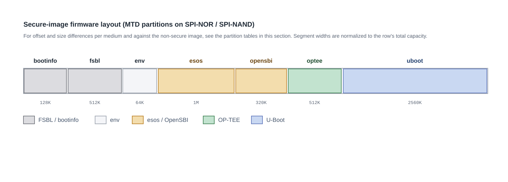

# TEE Image Build and Flashing Guide

## Overview

### Purpose

This guide describes the components, build process, partition layout, boot sequence, and verification of TEE (OP-TEE) secure images in the SpacemiT K3 Buildroot solution. It helps developers build and flash a secure image and confirm that it works.

### Scope

This guide applies to Buildroot solutions for SpacemiT K3 series SoCs. For TEE architecture and integration principles, see the [TEE Architecture and Integration Guide](tee_architecture.md). For the support status of each security feature, see the [Security Feature Support Matrix](support_matrix.md).

### Document Structure

1. **[Images](#images):** Differences between secure and normal images.
2. **[Enablement and Full Build](#enablement-and-full-build):** Default configuration, and a single command that produces both image sets.
3. **[Building Secure Firmware Separately](#building-secure-firmware-separately):** Step-by-step builds and clean rebuilds.
4. **[Output Directory](#output-directory):** Where the secure artifacts are stored.
5. **[Build Artifacts and Their Locations](#build-artifacts-and-their-locations):** Where each artifact ends up and what determines it.
6. **[Partition Layout](#partition-layout):** Secure partition tables for each storage medium.
7. **[Boot Sequence](#boot-sequence) and [Verification](#operation-and-verification).**
8. **[Known Limitations](#known-limitations).**
9. **[Signing the TEE Image](#signing-the-tee-image):** The `KEY_DIR` packaging chain and how to confirm a signature succeeded.
10. **[Troubleshooting](#troubleshooting).**

### Important Constraints

> [!CAUTION]
> Secure and normal images must be **flashed as complete sets**. The secure partition table, U-Boot, and FSBL are incompatible with their normal counterparts, and mixing them causes boot failure. Switching back to the normal image also requires flashing the complete normal image package.

## Images

When TEE support is enabled, the build additionally produces a set of secure images whose file names carry a `-sec` suffix. They coexist with the normal images:

| Image | Contents | Purpose |
|---|---|---|
| `Buildroot-k3-<timestamp>.zip` | Normal firmware without OP-TEE | Regular boot and debugging |
| `Buildroot-k3-<timestamp>-sec.zip` | Normal firmware plus OP-TEE and the secure U-Boot / FSBL / env, with a dedicated TEE partition | Booting the secure environment |
| `Buildroot-k3-<timestamp>-sdcard.img` | Normal SD-card boot image | SD-card boot |
| `Buildroot-k3-<timestamp>-sec-sdcard.img` | Secure SD-card boot image, with a TEE partition | SD-card boot (secure) |

Flash them the same way as normal images: flash `-sec.zip` with the Titan tool, and write `-sec-sdcard.img` to a card with `dd` or Balena Etcher.

The secure and non-secure ZIPs contain matching file sets. The secure ZIP adds only the TEE image and the secure packaging configuration. Its `factory/FSBL.bin`, `u-boot.itb`, and `env.bin` are the secure variants (with TEE loading logic and secure environment variables). Both sets contain `ec.bin`, bootfs, rootfs, and the partition table.

## Enablement and Full Build

The default configuration `configs/spacemit_k3_defconfig` already enables all TEE-related options:

- `BR2_TARGET_OPTEE_OS=y` (version 4.5.0)
- `BR2_PACKAGE_OPTEE_EXAMPLES=y` and `BR2_PACKAGE_OPTEE_TEST=y`
- `BR2_PACKAGE_SECURE_FIRMWARE=y`
- RPMB emulation disabled (`BR2_PACKAGE_OPTEE_CLIENT_RPMB_EMU` is not enabled)

A full build generates both image sets automatically, with no extra switch:

```bash
make envconfig      # Select spacemit_k3_defconfig
make                # Build both normal and secure image sets
ls output/k3/images/ | grep -E 'zip|img'
```

The source repositories that the secure firmware depends on are fetched by the repo manifest: OP-TEE OS, U-Boot (with the secure board configuration), and OpenSBI (with the OP-TEE dispatcher enabled).

## Building Secure Firmware Separately

OP-TEE OS and secure-firmware packaging are both standard build targets; the commands are passed through to the top-level Makefile.

### OP-TEE OS

```bash
make optee-os                     # Build OP-TEE OS and generate tee.bin
make optee-os-rebuild             # Rebuild after changes to optee-os
make optee-os-dirclean            # Clean the build directory
```

To rebuild after changing optee-os, you must run `make optee-os-rebuild`, or run `make optee-os-dirclean` followed by `make optee-os`.

### Secure Firmware Set

```bash
make secure-firmware              # Package TEE and build secure U-Boot in a separate image build directory; output to images/sec/
make secure-firmware-rebuild      # Force a rebuild after source changes
make secure-firmware-dirclean     # Clean
```

### Dependency Configuration Changes

```bash
make opensbi-reconfigure          # Regenerate after OpenSBI configuration changes
```

To rebuild and repackage after changing optee-os or U-Boot:

```bash
make optee-os-rebuild             # Required after changing optee-os; alternatively run dirclean followed by make optee-os
make secure-firmware-rebuild
make                              # Repackage both ZIPs
```

### Clean and Rebuild Firmware

To clean and rebuild only the firmware chain, keeping the kernel and root-file-system artifacts:

```bash
# 1. Remove firmware files from the output directory, retaining the kernel, root file system, and device trees
# 2. Clean firmware package build directories
make uboot-dirclean esos-dirclean opensbi-dirclean optee-os-dirclean \
     optee-client-dirclean optee-test-dirclean optee-examples-dirclean \
     secure-firmware-dirclean

# 3. Rebuild; valid kernel and root-file-system builds are skipped automatically
make
```

## Output Directory

```text
output/k3/images/
├── Buildroot-k3-<ts>.zip / -sdcard.img          # Normal images, without TEE
├── Buildroot-k3-<ts>-sec.zip / -sec-sdcard.img  # Secure images
└── sec/                                         # Secure firmware set
    ├── tee.bin                                  # OP-TEE kernel
    ├── optee.itb                                # Dedicated TEE partition image (FIT)
    ├── u-boot.itb                               # Secure U-Boot
    ├── FSBL.bin                                 # Secure SPL
    ├── env.bin                                  # Environment for the secure partition layout
    ├── u-boot-nodtb.bin / u-boot-spl.bin        # Secure U-Boot intermediate artifacts
    └── uboot/                                   # Secure device trees, including domain-gating nodes
```

All secure artifacts are kept in `images/sec/`, and packaging does not touch the output root directory or the staging directory of the normal image. Secure U-Boot is built in a separate image build directory (`output/k3/build/secure-firmware-1.0/uboot-sec/`). Each build first syncs a copy of the non-secure U-Boot build directory and then layers `k3_sec.config` on top. The non-secure build directory stays read-only throughout, so the secure build does not contaminate the firmware of the normal image and needs no backup or restore steps.

## Build Artifacts and Their Locations

The secure build produces three kinds of artifacts: TEE firmware images, normal-world libraries and a daemon, and TAs and test programs. Their locations in the system and what determines them are listed below (the location column also gives the runtime command-line options that can override them):

| Artifact | What it is | Location in the system | Determined by |
|---|---|---|---|
| `tee.bin` | OP-TEE kernel (TEE Core) image | Not stored in the file system; packaged into `optee.itb` and written to the optee partition | `BR2_TARGET_OPTEE_OS_CORE_IMAGES="tee.bin"` selects the core image to build |
| `optee.itb` | Dedicated TEE partition image (FIT container holding `tee.bin`) | The device's optee partition (an MTD partition or an eMMC / SD partition; see [Partition Layout](#partition-layout)) | The FIT description file `core/arch/riscv/plat-k3/optee.its` sets the load and entry addresses; the partition table (genimage configuration and `MTDPARTS_DEFAULT`) sets the partition offset and size |
| `libteec.so.2` | CA-side client library | `/usr/lib/` in the target root file system | `BR2_PACKAGE_OPTEE_CLIENT` (selected automatically as a dependency of `BR2_PACKAGE_OPTEE_TEST`) |
| `tee_client_api.h` | Header file for building CAs | Target `/usr/include/`. For cross-compilation, it is provided by the toolchain sysroot (`output/k3/host/riscv64-buildroot-linux-gnu/sysroot/usr/include/`), or can be taken from the optee_client build directory `output/k3/build/optee-client-4.5.0/libteec/include/` | Same as above |
| `tee-supplicant` | Normal-world daemon (proxies file, RPMB, and other RPCs) | `/usr/sbin/tee-supplicant`, started by `/etc/init.d/S30tee-supplicant` | Same as above |
| `<uuid>.ta` | TA file | `/lib/optee_armtz/` (mode 444) | The directory is the supplicant's build-time `TEEC_LOAD_PATH` (default `/lib`) combined with the `optee_armtz` subdirectory name; override at runtime with `--ta-path` / `--ta-dir`. Installation is done by the install hook of the optee-examples package; see the [deployment section](ta_guide.md#52-deploy) of the TA Development Guide |
| Secure-storage objects | Data files of TA persistent objects (ciphertext) | `/data/tee/` | The supplicant's build-time `TEE_FS_PARENT_PATH` (default `/data/tee`); override at runtime with `--fs-parent-path` |
| `xtest` and other test programs | Test suite | `/usr/bin/` | `BR2_PACKAGE_OPTEE_TEST` |

Two additional notes:

- **Only TAs are "data structures" rather than executables.** The normal-world `tee-supplicant` reads a TA from the TA directory by UUID and passes it to the TEE, so the TA directory must also exist in the runtime file system.
- Secure-storage data files are stored under `/data/tee/` by default (visible to the normal world, but the content is ciphertext). With the RPMB backend, the data is stored in the device's RPMB partition instead; see the [Secure Storage](tee_architecture.md#secure-storage) section of the TEE Architecture and Integration Guide.

## Partition Layout

The secure partition table adds a dedicated TEE partition to the normal partition table, and the OpenSBI and U-Boot partition boundaries shift accordingly:

| Change | Non-secure image | Secure image |
|---|---|---|
| TEE firmware | None | New dedicated `optee` partition (except on the USB flashing path; see below) |
| OpenSBI partition | 384K (MTD) | Shrinks to 320K, freeing 64K |
| U-Boot start offset | 2112K (MTD) | Moves back to 2560K |

On GPT media, `optee` takes a dedicated 4M partition, and the following `bootfs` and `rootfs` move back by 4M. MTD media have no room for 4M, so `optee` is reduced to 512K and fits into the space freed from the OpenSBI partition.



In the diagram, the bar length of each row is normalized independently to the total capacity of that row's medium, and the gaps between segments are space not used by any partition. The "USB flashing" row has no dedicated `optee` partition; `optee.itb` is stored as a file inside `bootfs`.

> [!IMPORTANT]
> **Boot-medium capacity requirements**
>
> Current requirements of the secure image on the boot medium:
>
> - **Capacity:** **At least 8M** is required.
> - **4M SPI-NOR:** The `uboot` partition has only 1536K left after offset 2560K, while the secure `u-boot.itb` is about 2383K, so it **does not fit at present**. 8M and larger work, and 8M SPI-NOR parts exist.
> - **Usable media:** SPI-NOR of 8M or more, SPI-NAND, or eMMC / SD / UFS.
>
> See [Known Limitations](#known-limitations).

Partition table files for each medium:

| Medium | Partition table | TEE partition |
|---|---|---|
| eMMC / SD | `partition_universal.json` | 4 MB starting at 12 MB; bootfs moves to 16 MB |
| SPI NOR 4M | `partition_4M.json` | 512K starting at 2048K |
| SPI NOR 64M | `partition_64M.json` | 512K starting at 2048K |
| USB | `partition_flash.json` | No dedicated TEE partition; the TEE image is in the bootfs file list |

### SPI-NOR 4M and SPI-NAND 64M (MTD)

| Partition | Offset | 4M size | 64M size | Image | Notes |
|---|---|---|---|---|---|
| `bootinfo` | 0 | 128K | 128K | `factory/bootinfo_spinor.bin` / `bootinfo_spinand.bin` | Records the FSBL location; **the location cannot change** |
| `fsbl` | 128K | 512K | 512K | `factory/FSBL.bin` | Offset is specified by `bootinfo` |
| `env` | 640K | 64K | 64K | `env.bin` | U-Boot environment; **offset and size cannot change** |
| `esos` | 704K | 1M | 1M | `esos.itb` | |
| `opensbi` | 1728K | 320K | 320K | `fw_dynamic.itb` | 384K in the non-secure image |
| `optee` | 2048K | 512K | 512K | `optee.itb` | **New in the secure image** |
| `uboot` | 2560K | Remaining 1536K | 2560K | `u-boot.itb` | Last partition on 4M |
| `bootfs` | 5M | — | 59M | `bootfs.img` | 64M only |

How the numbers work out: OpenSBI shrinks from 384K to 320K, freeing 64K. `optee` occupies 512K starting at 2048K and ends at 2560K. U-Boot therefore moves from 2112K to 2560K, and its available space drops from 1984K to 1536K.

The corresponding kernel command-line partition table (`CONFIG_MTDPARTS_DEFAULT` in `configs/k3_sec.config`):

```text
d420c000.spi:128K@0(bootinfo),512K@128K(fsbl),64K@640K(env),1M@704K(esos),320K@1728K(opensbi),512K@2048K(optee),-@2560K(uboot)
```

### eMMC / SD / UFS (GPT)

| Partition | Offset | Size | Image |
|---|---|---|---|
| `env` | 640K | 64K | `env.bin` |
| `bootinfo` | 1M | 128K | `factory/bootinfo_block.bin` |
| `fsbl` | 1536K | 512K | `factory/FSBL.bin` |
| `esos` | 4M | 3M | `esos.itb` |
| `opensbi` | 7M | 1M | `fw_dynamic.itb` |
| `uboot` | 8M | 4M | `u-boot.itb` |
| `optee` | 12M | 4M | `optee.itb` |
| `bootfs` | 16M | 256M | `bootfs.img` |
| `rootfs` | 272M | Remaining space | `rootfs.ext4` |

GPT media look up partitions by name, and their offsets are not aligned with MTD. `optee` follows `uboot` and occupies a dedicated 4M partition.

### USB Flashing

USB flashing (`partition_flash.json`) differs as follows:

- **The GPT firmware partition offsets are kept**, but there is no dedicated `optee` partition.
- `bootfs` starts at 12M, and `optee.itb` is written as a file into the FAT32 file system of `bootfs`, together with `u-boot.itb`, `esos.itb`, and other files.
- On this path, SPL reads the TEE image from the boot file system according to `optee_itb_path` (default `optee.itb`).

### Comparison with Non-Secure Images

| Item | Non-secure (MTD) | Secure (MTD) | Non-secure (GPT) | Secure (GPT) |
|---|---|---|---|---|
| OpenSBI size | 384K | 320K | 1M | 1M |
| `optee` partition | None | 512K @ 2048K | None | 4M @ 12M |
| U-Boot offset | 2112K | 2560K | 8M | 8M |
| U-Boot space (4M) | 1984K | 1536K | — | — |
| `bootfs` offset (64M / GPT) | 5M / 12M | 5M / 16M | 12M | 16M |
| `rootfs` offset (GPT) | 268M | 272M | 268M | 272M |

The partition tables, U-Boot, FSBL, and environment variables of the secure and non-secure images depend on one another. They must be flashed as a complete set and must not be mixed.

## Boot Sequence

The secure image boots as follows: SPL first loads the TEE image into memory, then loads OpenSBI (with OP-TEE dispatch support). OpenSBI starts OP-TEE during its startup, and execution finally proceeds to U-Boot and the kernel.

Expected serial log:

```text
# Banner after OpenSBI starts OP-TEE
I/TC: OP-TEE version: 4.5.0 ...

# Kernel detects OP-TEE
[  OK  ] Started OP-TEE driver
```

On the MMC and MTD paths, SPL treats the TEE image as mandatory and aborts the boot if it is missing. UFS and unknown devices remain permissive. This prevents a secure image from silently downgrading and booting into a non-secure state.

## Operation and Verification

### Run on the Board

```bash
# tee-supplicant starts automatically through an initialization script
ps | grep tee-supplicant

# Run OP-TEE self-tests
xtest

# Run an official example
optee_example_hello_world

# Inspect TEE devices
ls /dev/tee*
```

### Build-Side Verification

```bash
# Check that the OP-TEE dispatcher is included in OpenSBI
nm output/k3/images/fw_dynamic.elf | grep opteed

# Inspect the secure ZIP file set
unzip -l output/k3/images/Buildroot-k3-<ts>-sec.zip

# Check that the TEE image fits its partition
ls -l output/k3/images/sec/optee.itb
```

### Verify Partitions and Reserved Memory

```bash
# MTD partition table should include optee and match MTDPARTS in k3_sec.config
cat /proc/mtd

# Check that the kernel received the OP-TEE reserved regions (optee_core and optee_shm)
dmesg | grep -i "reserved mem"
```

## Known Limitations

| Limitation | Description |
|---|---|
| Boot medium must be at least 8M | On a 4M SPI-NOR, the `uboot` partition has only 1536K left, which cannot hold the secure `u-boot.itb` (about 2383K). Adjust the partitions or reduce the image size; 8M and larger work. |
| TEE image size limit | The TEE partition is 4 MB on eMMC and 512 KB on SPI NOR, and `optee.itb` must not exceed the corresponding limit (currently about 503K; the size changes when features such as RPMB are enabled, so recheck after changing the build configuration). |
| TEE image signature not verified by default | The default packaging description provides only CRC32 integrity checking and has no signature node. The platform supports passing `KEY_DIR` at build time to switch to the signed packaging description and produce a signed FIT, but the current build flow does not pass this variable. When signing is needed, run it manually or have an upper-level flow pass it. Trust in the default artifact comes from "SPL loads it from a protected partition + runtime PMP isolation"; signature assurance for the boot chain is provided by `FSBL` and `u-boot.itb`. See [Signing the TEE Image](#signing-the-tee-image). |
| Secure and non-secure images cannot be mixed | The partition table, U-Boot, FSBL, and environment variables depend on one another and must be flashed as a complete set. On GPT media, the `bootfs` / `rootfs` offsets of the secure image are 4M later than those of the non-secure image, so reusing a hand-made partition table causes an offset mismatch. |

## Signing the TEE Image

The default build does not sign the TEE image (see [Known Limitations](#known-limitations)). To sign it, pass the key directory `KEY_DIR` at build time (in the Buildroot solution, it is passed to the optee-os build through `OPTEE_OS_MAKE_OPTS`, together with `ITB_OUT_DIR` if needed).

There are three behaviors, depending on what is passed:

| Input | Behavior |
|---|---|
| No `KEY_DIR` | The platform does not build a signed FIT and packages an **unsigned** `optee.itb` from `optee.its` (same as the unsigned flow) |
| `KEY_DIR` provided | Triggers `SIGN` and packages a **signed** `optee_sign.itb` from `optee_sign.its` |
| `ITB_OUT_DIR` also provided | Adds a COPY step that places the signed artifact in the specified directory under the name `optee.itb` |

How the keys relate to signature verification:

- Signing uses **`uboot_key_prv`**. The `key-name-hint` in the FIT description has the same name as the public-key node in the SPL device tree, and SPL selects the public-key modulus by node name during verification. If the two do not match, verification fails.
- `KEY_DIR` must contain `uboot_key_prv.key` (private key) and `uboot_key_prv.crt`. The SDK ships two usable directories: `uboot-2022.10/board/spacemit/k3/configs/key/` and `opensbi/platform/generic/spacemit/key/`.
- Pass `KEY_DIR` for each build and do not write it into the build configuration, so that key material never enters the source tree or configuration files.

To tell whether signing took effect, check the artifact fields with `mkimage -l`, not the exit code:

| Field | Unsigned | Signed |
|---|---|---|
| `Hash algo` | crc32 | sha256 |
| `Sign algo` | Line absent | `sha256,rsa2048:uboot_key_prv` |
| `Sign value` | Line absent | 128 hex digits, with no `unavailable` |

> [!CAUTION]
> When the key is missing, `mkimage` still returns exit code 0 and only leaves `Sign value: unavailable` in the artifact. To determine whether signing took effect, you must check the artifact fields with `mkimage -l`; do not rely on the exit code.

## Troubleshooting

### Build Reports `sec/env.bin is NOT secure` (or `u-boot-nodtb.bin`)

Before publishing artifacts, secure-firmware checks that the secure firmware really carries the secure partition layout (`extra_optee_partition`, generated only when `CONFIG_SPACEMIT_SECURE_BOARD=y`). If the check fails, the build aborts, so that non-secure firmware is never packaged as secure firmware. This error means that `configs/k3_sec.config` did not take effect: confirm that the file exists in the U-Boot source tree and that `merge_config.sh` ran without errors, then run `make secure-firmware-rebuild`.

### Secure ZIP Flashing Fails Immediately Without New Serial Output

First check whether `ec.bin` is missing from the ZIP. The flashing tool writes FSBL, U-Boot, and `ec.bin` in order according to the manifest in the package, and stops if any of them is missing. Compare the file set with the normal ZIP using `unzip -l`: the sets should match, and the secure ZIP should add only the TEE image and the secure packaging configuration. A missing `ec.bin` is a typical symptom of a packaging regression.

### TEE Image Exceeds Partition Capacity

Confirm that `optee.itb` does not exceed the partition limit: 4 MB on eMMC and 512 KB on SPI NOR. An oversized image fails to be written. If the image is close to the limit, check whether OP-TEE was built with debug options, because a debug build makes the image much larger.

### No OP-TEE Banner After Flashing

Check these three points in order: whether SPL reports a successful load, whether the OpenSBI firmware contains the dispatcher symbol, and whether the device tree contains the domain-gating nodes. If any one of them is missing, the device may take the non-secure boot path without an obvious error.

For the TEE firmware load order, the address anchors, and how software and hardware work together in the memory layout, see the [Boot Sequence](tee_architecture.md#boot-sequence) and [Memory Layout](tee_architecture.md#memory-layout) sections of the TEE Architecture and Integration Guide.