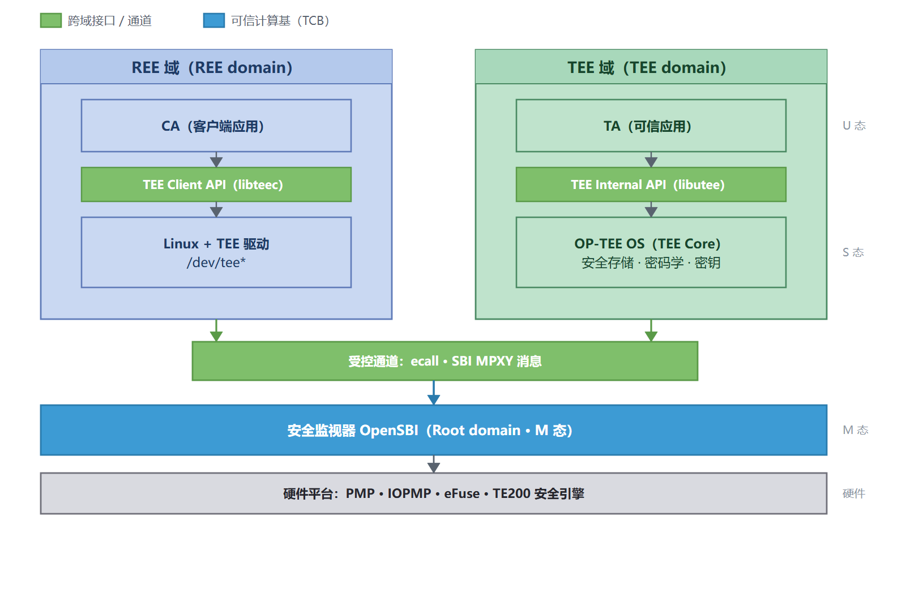
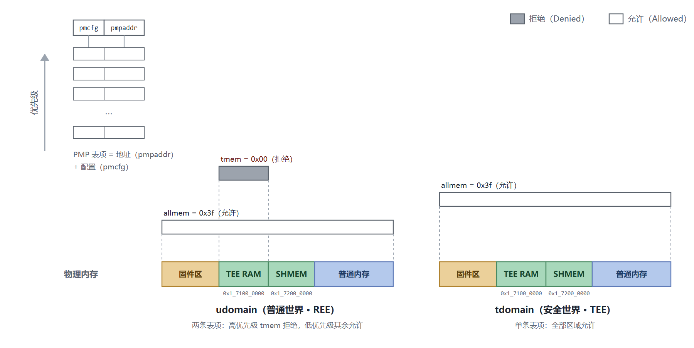
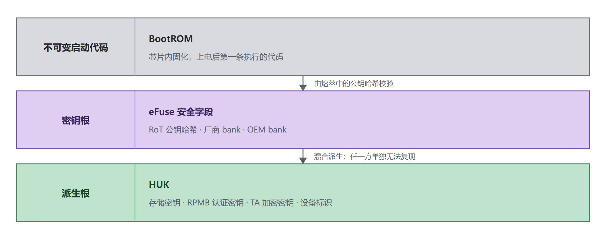
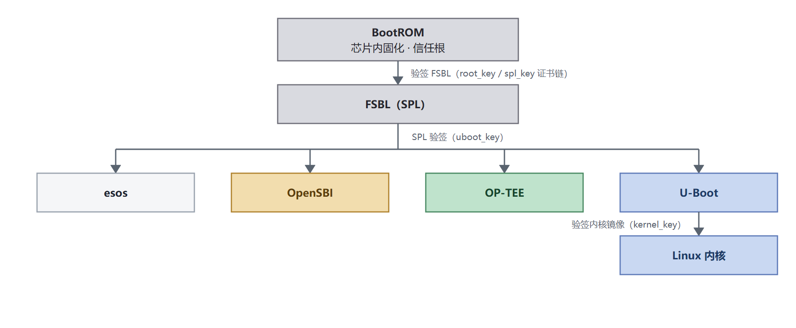
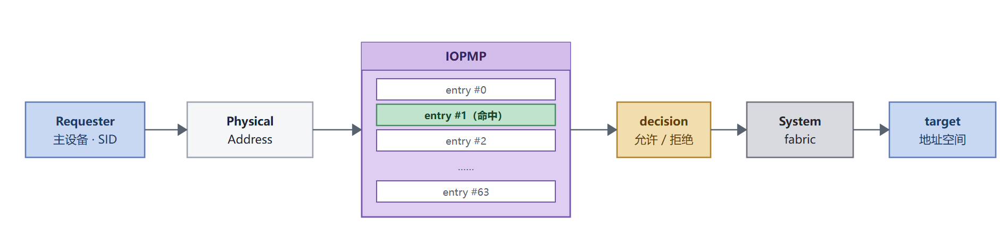

# Security Architecture White Paper

| Item | Details |
|---|---|
| Applicable SoC | SpacemiT K3 |
| Applicable solution | Buildroot (secure image) |
| TEE version | `k3-v1.0` |
| Document version | v1.0 (2026-09-15) |

Capability assessments and minimum feature versions in this document apply to the version above. This document and the [Security Feature Support Matrix](support_matrix.md) will be updated as versions change.

## Overview

### Purpose

This white paper describes the overall architecture of the SpacemiT K3 security solution: security objectives and threat model, isolation and root-of-trust design, the current state and boundaries of security capabilities, and component responsibilities. It supports solution selection, architecture review, and external technical communication; it does not provide operational procedures.

For individual feature statuses and minimum versions, see the [Security Feature Support Matrix](support_matrix.md). For TEE structure and integration, see the [TEE Architecture and Integration Guide](tee_architecture.md). For the Secure Boot chain of trust, see the [Secure Boot Development Guide](../device/secureboot.md).

### Scope

This document applies to Buildroot solutions for SpacemiT K3 series SoCs.

Some specification topics are outside this solution's scope: control-flow integrity (shadow stacks and marked jump targets), software memory tagging, architectural metadata storage, capability-based architecture (CHERI), confidential computing (CoVE), and post-quantum cryptography (PQC) readiness. K3 does not adopt these capabilities currently; their support status is recorded in the [Security Feature Support Matrix](support_matrix.md).

### Document Structure

1. [**Background**](#1-background): Why security is needed and the layers of the K3 solution
2. [**Threat Model**](#2-threat-model): Threats covered and excluded
3. [**TEE Reference Model**](#3-tee-reference-model): Execution domains and deployment
4. [**Isolation Model**](#4-isolation-model): Privilege-level and physical-memory access controls
5. [**Root of Trust**](#5-root-of-trust): The starting point of trust
6. [**Trusted Boot**](#6-trusted-boot): Establishing the chain of trust
7. [**Attestation**](#7-attestation)
8. [**Sealing**](#8-sealing)
9. [**Device Access Control**](#9-device-access-control)
10. [**Secure Debugging**](#10-secure-debugging)
11. [**Security Lifecycle**](#11-security-lifecycle)
12. [**System Updates**](#12-system-updates)
13. [**System Integration**](#13-system-integration)
14. [**Software Architecture**](#14-software-architecture)

### Terminology

| Abbreviation | Full name | Description |
|---|---|---|
| TEE | Trusted Execution Environment | Trusted execution environment |
| REE | Rich Execution Environment | Normal execution environment |
| TA | Trusted Application | Trusted application running in the TEE |
| CA | Client Application | Normal-world client application that calls a TA |
| RoT | Root of Trust | Root of trust |
| HUK | Hardware Unique Key | Hardware-unique key |
| PMP | Physical Memory Protection | RISC-V physical memory protection |
| IOPMP | I/O Physical Memory Protection | Physical memory protection for peripherals |
| SR entry | Security Requirement | **Normative** security requirement identifier in RISC-V International's RISC-V Security Model, such as `SR_PMP_002`. The model and use cases are non-normative; the requirements themselves are normative. |
| SID / RRID | Source ID / Requester ID | Bus-master identity; IOPMP selects a memory domain by SID and evaluates access per entry |
| TCB | Trusted Computing Base | Trusted computing base |
| MPXY | Message Proxy | SBI message-proxy extension for cross-domain message transport |
| RPMI | RISC-V Platform Management Interface | Platform-management message format above MPXY, organizing requests and responses by service group |
| GP | GlobalPlatform | Industry body defining TEE standards and certification |

### Important Notes

> [!NOTE]
> Capability status terminology follows the [Security Feature Support Matrix](support_matrix.md):
>
> - **Supported:** Implemented and verified, ready for product use.
> - **Partially supported:** Available with restrictions and subject to the stated prerequisites.
> - **Disabled:** Code is ready but not enabled in the current build; configuration and rebuilding can enable it.
> - **Not currently supported:** Not implemented, or disabled by default without a defined enablement path.
> - **Out of scope:** Explicitly not provided or dependent on conditions outside this solution, such as capabilities unavailable on devices with unprogrammed fuses.

### Scope and Responsibilities

| Scope | Owner |
|---|---|
| SoC hardware capabilities, including isolation primitives, fuses, debug policy, and lifecycle | Chip |
| Boot chain and Secure Boot, including verification, signing, and fuse programming | Secure Boot |
| TEE runtime, secure storage, key derivation, and key usage | TEE |
| Firmware and image build, packaging, and flashing | Buildroot |

Changes crossing these boundaries require assessment on both sides, especially address anchors, fuse fields, and partition layouts.

## 1. Background

Connected computing platforms increasingly run applications involving data security and privacy, including biometric payments, digital rights management (DRM), enterprise services, and web services. Without security protections, external attacks and malware can expose or steal sensitive data.

Platform security requires multiple mechanisms: firmware can be replaced, keys extracted, peripherals and DMA can bypass the CPU to access memory, and debug interfaces can provide a bypass. K3 combines layers that cover different attack surfaces:

- **Root of trust and Secure Boot:** Start from immutable on-chip BootROM and eFuse and verify signatures through boot stages to authorize firmware.
- **Key hierarchy:** Derive keys from the hardware unique key (HUK) within the security engine; the root key does not enter software-visible memory.
- **Execution isolation:** Use RISC-V privilege levels, MMU address translation, PMP, and IOPMP to enforce boundaries between domains of different trust levels.
- **Trusted Execution Environment:** Run the TEE OS and trusted applications in an isolated secure domain for services such as secure storage and cryptography.
- **Secure debugging and lifecycle management:** Control debug access and capabilities available in each lifecycle state.

The TEE protects sensitive processing at runtime but depends on the root of trust, Secure Boot, and isolation. It is one part of the K3 security solution, not the whole solution.

K3 builds its TEE on OP-TEE's RISC-V support:

- **TEE OS:** Reuses process and memory management, system calls, thread model, and GlobalPlatform interfaces; K3 hardware is integrated through the platform layer.
- **M-mode interface:** Uses standardized interfaces: OpenSBI domains partition harts and memory into secure and REE domains; SBI MPXY transports cross-domain messages, with RPMI and OPTEED defining message formats.
- **Normal-world access:** The Linux TEE driver accesses the TEE through the same MPXY channels.
- **Result:** TA programming follows GlobalPlatform specifications, allowing reuse on other RISC-V platforms with the same OP-TEE backend; K3-specific differences center on hardware security integration.

K3 adds SoC security resources to this stack: the TE200 security engine; eFuse and HUK-derived keys including RPMB, SSK, DIE_ID, UNIQUE_TA, and TA_ENC; IOPMP for peripheral-master access; platform cryptographic drivers; and secure image and partition layouts.

## 2. Threat Model

### 2.1 Threats Addressed

Threats are categorized from lower to higher attacker capability:

| Category | Description | Typical methods |
|---|---|---|
| Software attack | Attacker and victim are processes on the same system | Malware, unauthorized calls, interface abuse, timing side channels |
| Non-invasive physical attack | Physical access without breaking the package | Debug-interface access, passive bus and signal monitoring, voltage/clock fault injection |
| Invasive physical attack | Attacker has laboratory-grade equipment | Decapsulation, microprobes, laser fault injection, power and electromagnetic analysis |
| Remote attack | Attacker lacks physical and logical access | Protocol attacks, radiation or power variations |

The TEE combines hardware and software isolation to protect security resources. The solution primarily protects against **software attacks and some non-invasive physical attacks**. Invasive attacks and fine-grained side-channel attacks are outside its current scope and require additional hardware tamper protection.

### 2.2 Attack Surfaces and Controls

| Category | Attack | Control | Status |
|---|---|---|---|
| Unrestricted access | Unauthorized direct access to active resources | Privilege isolation, PMP, IOPMP | Supported |
| Transient execution | Speculative-execution data disclosure | Depends on microarchitectural mitigation | Out of scope |
| Interface abuse | Abuse of interfaces crossing privilege or isolation boundaries | Isolation and TA parameter validation | Supported |
| Timing side channels | Infer secrets through timing or event-counting behavior | Isolation boundaries and execution-time design constraints | Partially supported |
| Control-flow interception | Manipulate call stacks and jump targets | Toolchain and runtime hardening | Partially supported; some hardening is disabled, see the [Security Feature Support Matrix](support_matrix.md) |
| Memory safety | Out-of-bounds and use-after-free | Language and runtime constraints | Partially supported |
| Physical leakage analysis | Observe power consumption, radiation, or temperature | Requires hardware tamper-resistant design | Out of scope |
| Physical memory attacks | Direct physical reads and writes, including Rowhammer | Requires memory encryption and integrity protection | Out of scope |
| Boot attacks | Fault-injection bypass of Secure Boot or cold-boot remnants | Secure Boot and fail-safe software techniques | Partially supported |
| Supply-chain compromise | Compromise signing and configuration processes | Authentication processes and key protection | Partially supported |

## 3. TEE Reference Model

### 3.1 Three Execution Domains

The TEE model divides software execution into physically isolated domains:

| Execution domain | Contents | K3 implementation |
|---|---|---|
| Root domain | RoT firmware and security monitor | OpenSBI (M-mode) |
| TEE domain | TEE OS and trusted applications (TAs) | OP-TEE (S-mode, trusted domain) |
| REE domain | User-facing OS and applications | U-Boot / Linux / CA (untrusted domain) |

The three domains on K3, including their contents, cross-domain interfaces, and trusted computing base:

The REE operating system interacts with the TEE OS through the root-domain security monitor, which handles cross-domain context switching, isolation, and event management. On K3, OpenSBI's domain model performs this role.

### 3.2 TEE Security Services

TEE services include secure storage, cryptography, attestation, user identity management, digital rights management, and payment services. K3 currently provides the platform foundations for secure storage, cryptography, and attestation; TAs can implement the remaining services at the application layer.

### 3.3 Deployment Model

| Model | Characteristics | K3 choice |
|---|---|---|
| Static-partition TEE | One TEE serves the REE; TAs are normally installed at boot; configuration and resource allocation are largely static, improving determinism | **Used** |
| Virtualized TEE | A secure partition manager isolates multiple TEE guests and enables more dynamic resource allocation | Not used; requires hypervisor extensions |

Static partitioning provides deterministic behavior and a smaller trusted computing base. It avoids hypervisor extensions and fits embedded and edge-device use cases.

The following table lists the relevant normative security requirements and their implementation status in `k3-v1.0`:

| Requirement | Summary | k3-v1.0 |
|---|---|---|
| SR_SUD_005 | Higher-trust supervisor-domain resources must be inaccessible to lower-trust domains | Supported by PMP and IOPMP; see [section 4](#4-isolation-model) and [section 9](#9-device-access-control) |
| SR_SUD_004 | Memory protection tables protect a supervisor domain's resources from other domains | Supported by the three-domain model; see [section 3.1](#31-three-execution-domains) |
| SR_PMP_005 | SPMP isolates U-mode workloads from each other | Not currently supported; SPMP is not used |
| SR_ATP_003 | Address translation and protection isolate workload resources | Supported: MMU page tables isolate TA address spaces, and TA-derived keys isolate secure-storage data; see [section 4](#4-isolation-model) |
| SR_IOP_001 | IOPMP enforces device access control | Supported (nine instances deployed); see [section 9](#9-device-access-control) |

## 4. Isolation Model

### 4.1 Privilege-Level Isolation

RISC-V separates execution and access permissions into M, S, and U modes:

| Mode | Capabilities | K3 implementation |
|---|---|---|
| M-mode | Highest privilege; interrupt and exception handling, physical memory protection, and privileged access control | OpenSBI |
| S-mode | Supervisor privilege with memory management | OP-TEE (secure), U-Boot and Linux (normal) |
| U-mode | Unprivileged instructions only | User-space programs and TAs |

Exceptions trap to M-mode by default and are forwarded by M-mode firmware. K3 separates secure from normal S-mode execution through OpenSBI domains. **RISC-V hardware has no concept of secure and normal worlds; the switch between worlds is a domain context switch performed by OpenSBI.** See [K3 Domains and World Switching](#132-k3-domains-and-world-switching).

### 4.2 Memory Access Control

Memory access control takes two independent paths: **address translation** constrains virtual-to-physical mappings and access permissions to isolate **peer workloads**; **physical memory protection** constrains access to physical addresses to isolate **privilege levels and external masters**. The two paths are complementary.

| Mechanism | Applies to | K3 status |
|---|---|---|
| MMU (address translation and protection) | Workload address spaces configured by S-mode page tables | **Supported**; inside the TEE it isolates TAs from the TEE OS and from each other |
| PMA (physical memory attributes) | Inherent hardware access attributes, such as read-only and device regions | Inherent in hardware |
| PMP | Hart access to physical memory; configurable only in M-mode | **Supported** for execution-domain isolation |
| IOPMP | Non-CPU master accesses, including DMA and peripherals | **Supported**, nine checker instances with platform policy |

**MMU address translation and protection** is the mechanism used to isolate TAs; **SPMP is not used**:

- **Between a TA and the TEE OS:** TAs run in U-mode, and the TEE OS page tables limit the address ranges they can reach, so a TA cannot touch the TEE OS address space.
- **Between TAs:** Each TA has its own address space and TAs do not share memory by default; data can only pass through services provided by the TEE OS.
- **The storage half:** Even where memory is visible, TAs cannot read each other's data in secure storage — each TA has its own key, derived per-TA from the TEE key hierarchy. Isolation between TAs therefore **relies on both address spaces and cryptography**.

**PMP on the hart side** is the basis of domain isolation:

- **Configuration privilege:** Only M-mode can configure PMP.
- **What it does:** It contains a set of address and configuration registers that allow or deny read, write, and execute access for lower-privilege modes, and also constrain access to MMIO.
- **Domain switching:** M-mode firmware saves the current domain's configuration and loads the next domain's; memory shared between domains must be written into each domain's configuration table.

For K3's domain partitioning and shared-memory layout, see [K3 Domains and World Switching](#132-k3-domains-and-world-switching).

Each domain has its own set of PMP entries. Entries are ordered by priority, and a higher-priority entry overrides a lower-priority one. The actual configuration for the two K3 domains is as follows — the REE domain (`udomain`) uses one high-priority deny entry to exclude TEE RAM and lets a lower-priority entry allow everything else; the secure domain (`tdomain`) has a single full-access entry:

**IOPMP on the peripheral side** provides physical-memory access control for requests from non-CPU masters and is the core component of device isolation in this solution. On K3, secure-world platform drivers configure each instance early in boot; see [section 9](#9-device-access-control) for the deployment scope, decision criteria, and protection coverage.

### 4.3 Isolation Guarantees

The solution rests on four isolation guarantees:

1. The root domain can access any domain's resources, but it should avoid unintended access to other domains' resources, which would be a privilege escalation.
2. Other domains must not access root-domain resources.
3. TEE-domain resources must not be accessible from the REE domain.
4. Under the default sharing rules, REE-domain resources are readable, writable, and executable from the REE domain and readable and writable from the TEE domain.

The TEE OS guarantees isolation between TAs. Each TA has its own address space, and **TAs do not share memory by default**. This layer is implemented by **MMU page tables**; the solution does not use SPMP. Even where memory is visible, a TA still cannot read another TA's secure-storage data, because each TA has its own key, derived per-TA from the TEE key hierarchy. **Isolation between TAs therefore depends on both address spaces and cryptography.** The normal and secure worlds interact through shared memory to move data efficiently. All cross-domain communication goes over secure channels managed by the TEE OS or the security monitor.

The following table lists the relevant normative security requirements and their implementation status in `k3-v1.0`:

| Requirement | Summary | k3-v1.0 |
|---|---|---|
| SR_ATP_002 | With the Sv extensions, first-level page tables must protect S-mode domains from U-mode access | Supported: TAs run in U-mode, and TEE OS page tables limit the address ranges they can reach |
| SR_ATP_003 | Address translation and protection must isolate the resources of each workload | Supported: TAs are isolated from each other by address space and do not share memory, and secure-storage data is separately isolated by per-TA derived keys |
| SR_PMP_001 | Only M-mode may directly access PMP configuration | Supported: OpenSBI configures PMP per domain |
| SR_PMP_002 | PMP isolates M-mode from lower privilege levels | Supported |
| SR_ISO_002 | Devices must not access isolated-component memory without permission | Supported by IOPMP; see [section 9](#9-device-access-control) |

## 5. Root of Trust

The root of trust underpins every security operation. It holds the cryptographic keys that those operations depend on, including the ones used during secure boot. A hardware root of trust is the most secure way to implement one. The trusted functions it enables are secure boot, measurement, secure storage, reporting, and verification.

### 5.1 K3 Root of Trust

| Layer | Implementation | Description |
|---|---|---|
| Immutable boot code | On-chip BootROM | Read-only and immutable; the first code executed at power-on |
| Key root | Security fields in eFuse | Includes the RoT public-key hash and OEM key material |
| Derivation root | Derived by the security engine from eFuse keys | HUK and its subordinate keys |

Key design points:

- **The HUK comes from eFuse and software never reads it:** The SoC manufacturer programs the root key into eFuse. The secure world uses the security engine's key ladder to derive a working key inside the engine, then uses that working key with CMAC and KDF to derive subordinate keys at each level. Neither the root key nor the working key ever leaves the engine. At the hardware level, the ability to read key material tightens as the device advances through its lifecycle; see [Security Lifecycle](#11-security-lifecycle).
- **Chip uniqueness comes from the per-die root key:** The derivation result is determined solely by the root key in that die's eFuse, so it cannot be reproduced on a replacement chip. With no root key programmed, the result is not tied to the device, which is why it is permitted only in the Chip Manufacturing (CM) and Device Manufacturing (DM) stages; in the Secure Production (SP) stage, boot is refused (see [Security Lifecycle](#11-security-lifecycle)).

For comparison, security systems may support multiple trust chains with independent roots, such as TPM for boot and SIM for user identity. K3 currently uses the on-chip BootROM and eFuse as its sole root of trust.

The following table shows how each requirement maps to `k3-v1.0`:

| Requirement | Summary | k3-v1.0 |
|---|---|---|
| SR_ROT_001 | The system must implement a hardware root of trust | Supported: the root of trust consists of the immutable on-chip BootROM and the eFuse key material, both hardware-based and tamper-proof starting points |
| SR_ROT_002 | The system must implement a firmware root of trust | Supported: the first code executed after power-on is the on-chip BootROM — read-only, immutable firmware that forms the firmware root of trust on the hart |

The specification splits roots of trust into two classes: a firmware root of trust on the hart (FW RoT), and a dedicated trusted subsystem independent of the hart (HW RoT). On K3, the root of trust consists of the immutable on-chip BootROM and the eFuse key material, so it falls into the former class.

### 5.2 Key Hierarchy

See the [Security Feature Support Matrix](support_matrix.md) for capability statuses.

## 6. Trusted Boot

Trusted boot ensures that the system loads only authorized software. There are two common ways to establish it:

| Approach | Principle | K3 status |
|---|---|---|
| Secure Boot | Based on a hardware root; each boot stage is verified with signatures, one stage at a time | Partially supported: the complete verification chain is not integrated in the current version; for the design and the flashing process, see the [Secure Boot Development Guide](../device/secureboot.md) |
| Measured boot | Based on a hardware root; measures the integrity of critical firmware and records the results | Partially supported: the ability to generate and store measurement values is limited |

### 6.1 Secure Boot Chain of Trust

In the target configuration, BootROM verifies FSBL; FSBL (SPL) then verifies the four images esos, OpenSBI, OP-TEE, and U-Boot; and U-Boot verifies the Linux kernel. OP-TEE sits at the same verification level as the rest of the firmware in the boot chain:

Enablement is controlled in two places. **BootROM reads the secure-boot bit in eFuse**, which determines whether Secure Boot is enabled; once enabled, it verifies FSBL (decrypting encrypted images first). **Verification of U-Boot and other subsequent images is enabled by SPL configuration.**

The current version (v1.0) has not integrated staged signature verification; the diagram shows the target configuration.

The security requirements for Secure Boot come from the RISC-V Platform Security Model specification (see "SR entry" in the [terminology](#terminology) section for how the identifiers are defined). Their mapping to this solution is as follows:

| Requirement | Summary | k3-v1.0 |
|---|---|---|
| SR_MSM_004 | Local verification must be rooted in immutable boot code | Supported: the system begins execution in the on-chip BootROM |
| SR_MSM_003 | Use only authorization from trusted authorities | Supported: signatures are generated with independently held private keys, and public-key hashes are written to fuses |
| SR_AUT_001 | In the Secured state, only authorized software may be loaded | Partially supported: the verification scheme and key infrastructure are ready, but the current version has not integrated staged verification |

The solution also imposes an engineering requirement of its own: **secure images must form a complete, matched set** — partition tables, bootloaders, and environment variables are bound to one another, which prevents a secure image from booting in a silently downgraded state.

### 6.2 Current Boundaries

Two points must be made explicit:

1. **TEE images are unsigned by default.** The default image description includes only CRC32 integrity checking and has no signature node. The platform supports passing a key directory (`KEY_DIR`) at build time to switch to the signed image description and produce a signed FIT, but the current build flow does not pass this variable. When a signature is required, run the step manually or have the variable passed in by an upstream build flow. The trustworthiness of an unsigned artifact depends on the preceding load path.
2. **Whether the eFuse has been programmed is not determined by software.** Enablement is split between the secure-boot bit in BootROM and SPL configuration. There is no unified runtime interface to query whether Secure Boot is currently enabled, so the actual state must be confirmed from production-line records.

## 7. Attestation

Attestation lets a remote relying party confirm that the device and the software and hardware it depends on are in the expected state before supplying sensitive assets. Requirements include a replay-resistant challenge/response mechanism, the ability to generate boot-state and runtime-state reports, a digital signature scheme that guarantees report integrity and authenticity, and support for importing custom root certificates.

Layered attestation lets part of the process be delegated to lower-privilege components: platform attestation signed by the root domain covers the trusted subsystems, and the TEE domain can build its own attestation results on top of that.

**K3 support:**

- **Available:** The root-of-trust and key-derivation infrastructure that attestation requires (hardware root of trust, HUK derivation, and keys held in the secure world).
- **Not currently supported:** Remote attestation services, including platform attestation reports and fTPM. For status in later releases, see the [Security Feature Support Matrix](support_matrix.md).

## 8. Sealing

Sealing protects sensitive assets on the system: a sealing key is derived from a hardware root key and used to seal highly sensitive data, such as file-encryption keys.

The normative sealing requirements and their mapping to this solution are as follows:

| Requirement | Summary | k3-v1.0 |
|---|---|---|
| SR_SLG_001 | Sealed assets should be unsealed only in the Secured state | Supported: unsealing is performed in the secure world |
| SR_SLG_002 | Locally sealed assets must be unsealable only on the original physical instance | Supported: keys derive from the HUK, which is itself derived from this device's fuse contents, so they cannot be reproduced on a different device |
| SR_SLG_003 | Locally sealed assets bound to boot measurements may be unsealed only when the measurements are unchanged or the system has received an authorized update | Not currently supported: boot measurements are not integrated, so the sealing keys are not bound to measurement values |

In implementation terms, two further solution-level characteristics apply. First, the root key that sealing requires is derived from a hardware root key and cannot be read or written directly by software (the HUK is derived from fuse contents). Second, in the storage-key hierarchy, each TA has its own key and each secure file has its own key.

On K3, secure storage is the supported form of sealing; see [section 14](#14-software-architecture) and the [TEE Architecture and Integration Guide](tee_architecture.md).

## 9. Device Access Control

For devices that are statically assigned — partitioned to either the REE domain or the secure domain — access control is enforced by IOPMP, and the policy can be controlled by boot configuration or by the root of trust. K3 likewise uses IOPMP under its static-partition model, constraining both peripheral and DMA access.

The IOPMP decision process for every master access runs as follows. An access initiated by a requester carries its identity identifier (SID — on K3 always a static SID, that is, AxUSER) and a physical address. IOPMP first uses the SID to hit a memory domain (MD), then evaluates read and write permission segment by segment against the entries in that domain. The result is delivered through the system interconnect to the target address space:

### 9.1 K3 IOPMP Deployment

K3 deploys nine IOPMP checker instances. Each instance checks the accesses of one group of masters to one class of target address space; all of them except IOPMP4 are configured and enabled by the secure world during boot:

| Instance | Base | Upstream masters | Controlled address space | Enabled |
|---|---|---|---|---|
| IOPMP1 (M2F) | `0xF080_0000` | RCPU | AP Device IO Space | Yes |
| IOPMP2 (F2M) | `0xF085_0000` | secure DMA, non-sec DMA, USB3, security engine, SD, USB OTG, UFS, eSPI (AP), PCIe, CPU | Audio Space | Yes |
| IOPMP3 (DMA) | `0xF087_0000` | secure DMA and non-sec DMA share one SID and are treated as one device | Entire address space | Yes |
| IOPMP4 (RISCV) | `0xF086_0000` | — | — | Always disabled |
| IOPMP5 (HSDMA) | `0xF088_0000` | HSDMA | DRAM | Yes |
| IOPMP6 (INT0) | `0xF081_0000` | DBG_AW, DBG_AR (GDB write/read), GPU, VPU, ETR, REE_W, REE_R | DRAM | Yes |
| IOPMP7 (INT1) | `0xF082_0000` | secure DMA, non-sec DMA, USB3, security engine, SD, USB OTG, UFS, eSPI (AP), GMAC0, GMAC1, AUD (RCPU, including all RCPU-domain masters), UCIE, GMAC2 | DRAM | Yes |
| IOPMP8 (INT2) | `0xF083_0000` | PCIe | DRAM | Yes |
| IOPMP9 (INT3) | `0xF084_0000` | ISP, LCD0, LCD1 | DRAM | Yes |

Each instance hits a memory domain (MD) by SID and then evaluates entry by entry within that domain; the entry count determines how many address segments a single instance can distinguish.

IOPMP4 is always disabled as functionally redundant and has no policy loaded: accesses initiated by the cores themselves are already constrained by PMP, so no repeated check by this instance is needed.

### 9.2 Decision Criteria and Coverage

Decision criteria and controlled scope:

- **Index:** IOPMP uses master identity (SID) as the index for deciding whether an access is legal.
- **Controlled subjects:** RCPU (shown as AUD in the table), CPU, security engine, USB3, SD, USB OTG, UFS, eSPI, PCIe, GPU, VPU, ETR, ISP, LCD, GMAC, UCIE, HSDMA, the various DMA engines, and the debug access channels (DBG_AW/DBG_AR).
- **SID form:** All instances use static SIDs (that is, AxUSER).

Protection on the memory side:

- **Non-secure masters:** The DDR ranges they can reach are explicitly limited; TEE RAM and shared memory (`0x1_7100_0000`–`0x1_72ff_ffff`) are excluded from the accessible ranges.
- **M-mode firmware region:** The 1 MB region beginning at `0x1_0000_0000`, which holds M-mode firmware (OpenSBI), is **inaccessible to all peripherals and DMA masters** (the corresponding memory domain has no-permission entries), so peripherals and DMA cannot read or write M-mode code and data. The only policy exception that permits this region is the memory domain holding the **debug access channels** (DBG_AW/DBG_AR), which exists for debugging M-mode firmware.
- **Secure masters:** Secure peripherals such as the TE200 secure cryptographic engine are permitted to access TEE RAM and shared memory (the M-mode firmware region is outside the range they can reach).
- **PCIe and UCIe:** Address windows are described separately according to NAPOT/BOUND rules.
- **Default actions:** Every instance is configured with a default action, as the fallback when no explicit rule matches.

Peripheral isolation matters because, even if the normal-world kernel is compromised, an attacker would still find it difficult to use DMA to read or write secure-world memory directly.

The following table lists the relevant normative security requirements and their implementation status in `k3-v1.0`:

| Requirement | Summary | k3-v1.0 |
|---|---|---|
| SR_IOP_001 | Systems supporting PMP must enforce device access control with IOPMP | Supported (nine instances deployed) |
| SR_IOP_004 | IOPMP must prevent lower-privilege devices accessing M-mode resources | Supported: the M-mode firmware region is inaccessible to all peripherals and DMA masters; TEE RAM and shared memory are likewise excluded |

## 10. Secure Debugging

External debugging is a shortcut around the isolation mechanisms, so it must be controlled.

**K3 support:** Currently partially supported. Mechanisms already in place:

- **The debug interface can be permanently disabled:** eFuse bank 0 bit 14 is the `JTAG DISABLE` bit; once programmed it cannot be reversed.
- **Debug access is constrained by hardware policy:** GDB debug accesses are initiated over two channels, DBG_AW (write) and DBG_AR (read), and all of them are checked by IOPMP6. The range of memory that may be accessed is explicitly limited by the IOPMP policy that the secure world configures during boot; secure regions such as TEE RAM can be closed to debug access. (The M-mode firmware region is likewise outside the range reachable by peripherals and DMA; see [section 9.2](#92-decision-criteria-and-coverage).) The current policy is oriented toward development and should be tightened for production.

The following table lists the relevant normative security requirements and their implementation status in `k3-v1.0`:

| Requirement | Summary | k3-v1.0 |
|---|---|---|
| SR_INV_001 | Invasive subsystems must be controlled or regulated by the root of trust | Partially supported: the debug interface can be permanently disabled by fuse, and debug masters are constrained by policy through IOPMP6 |
| SR_DBG_001–008, SR_INV_002 / SR_INV_003 | Enabling and regulating debug: adjudicated by the root of trust, enabled separately by M-mode/non-M-mode and by domain, and revealing debug must be reflected in attestation evidence | Not currently supported |

## 11. Security Lifecycle

The security lifecycle reflects the system's trustworthiness over its lifetime and determines the state of hardware configuration assets. Each state defines the security properties that apply in it: access to internal resources, update capability, and how hardware handles errors all depend on the lifecycle state.

| State | Meaning |
|---|---|
| Manufacture | Not yet locked; no hardware configuration assets |
| Security provisioning | The process of configuring hardware configuration assets (may be outsourced or carried out in stages) |
| Secured | Hardware configuration assets locked and immutable; only authorized software allowed; debugging disabled |
| Recoverable debug | Testing and debugging reopened provided the root of trust remains uncompromised |
| Terminated | Device permanently disabled |

**K3 implementation:** State is designated by eFuse fields — the four CM / DM / SP / RMA bit groups in bank 6. The state advances by programming bits, which is irreversible, and there is no software transition interface; the associated behavior is implemented jointly by hardware and boot firmware. In the specification model, CM and DM cover Manufacture and Security provisioning, SP maps to Secured, and RMA maps to Recoverable debug. RMA is a degraded repair state (debugging reopens and the boot chain no longer verifies signatures), and production devices should not enter it. For the behavior in each stage, the state field layout, and the availability of security assets (HUK / SSK), see [Key Management and Security Lifecycle](key_management_lifecycle.md).

**Software boot gate:** Late in startup, OP-TEE reads the LCS and the relevant fuses once, decides on that basis whether to continue booting, and panics if the check fails. The SP stage requires the chip ID, HUK, and secure-boot fuses all to be present, and requires the root banks (HUK/SSK/CDPKH/ROTPKH) to be hardware-locked; DM requires the chip ID to have been programmed; CM, DM, and RMA allow boot and print a warning. The complete gate criteria and the lock rules for each bank are in [Key Management and Security Lifecycle](key_management_lifecycle.md).

The following table lists the relevant normative security requirements and their implementation status in `k3-v1.0`:

| Requirement | Summary | k3-v1.0 |
|---|---|---|
| SR_LFC_001 | A security system must manage its security lifecycle | Partially supported: software adjudicates at boot only, based on the state, whether booting is allowed; there is no state machine and no interface for querying or transitioning state, and entering a state can only be done by programming fuses |
| SR_LFC_002 | Hardware configuration assets must be accessible only in the Secured state | Partially supported: the accessibility of security assets varies with state (see [Key Management and Security Lifecycle](key_management_lifecycle.md)); the remaining configuration assets must be checked asset by asset |

## 12. System Updates

Updates must fix defects and deliver features without becoming a downgrade or injection path. The specification requires mutable components to be updatable, updates to be measured and verified before boot, monotonic and failure-resistant updates, and trusted sources for update and authorization messages.

**K3 support:** Complete partition images can be replaced, allowing firmware and system components to be updated. **Measurement and signature verification before boot are not yet integrated** (consistent with the boundaries described in [section 6](#6-trusted-boot)), and how to enable the anti-rollback counter remains undecided.

The following table lists the relevant normative security requirements and their implementation status in `k3-v1.0`:

| Requirement | Summary | k3-v1.0 |
|---|---|---|
| SR_UPD_001 | Mutable components must be updatable | Supported: partition images can be replaced independently |
| SR_UPD_002 | Updates must be measured and verified before boot | Partially supported: signature and key infrastructure is ready, but the current version does not integrate staged verification (see [section 6](#6-trusted-boot)) |
| SR_UPD_005 | Updates must be monotonic (no rollback to an earlier version) | Disabled: anti-rollback counter fields are defined but not enabled |
| SR_UPD_007 | Updates and authorization messages must come only from trusted sources | Partially supported: signing private keys are independently protected and public-key hashes are fused |
| SR_AUT_002 | Only authorized software loads in a secure configuration | Not currently supported, consistent with [section 6](#6-trusted-boot) |

## 13. System Integration

### 13.1 Isolation Component Responsibilities

RISC-V isolation is based on address-space access control, primarily PMP and IOPMP:

| Component | Applies to | Capacity |
|---|---|---|
| PMP | RISC-V hart accesses | One rule table per hart, configured by OpenSBI per domain |
| IOPMP | Peripheral and DMA accesses | Nine checker instances indexed by master SID |

Rule entries are limited, so **address-space partitioning between domains must not be excessively fragmented**. Otherwise, there may not be enough entries to cover the regions. This is a hard integration constraint: divide the address space into larger regions rather than many small ones.

### 13.2 K3 Domains and World Switching

RISC-V hardware has no notion of secure and normal worlds; **the switch between them is a domain context switch performed by OpenSBI**:

- An OpenSBI domain contains memory regions and harts.
- Boot starts in the root domain; the device tree may declare trusted and untrusted domains with their own memory regions and entry addresses.
- At a domain switch, OpenSBI sets the target entry address and relevant CSR and PMP registers, restores its context, and enters S-mode using `mret`.

K3 uses the following domain configuration:

- **Trusted domain:** Has full memory permissions and enters the TEE at its memory base in S-mode.
- **Untrusted domain:** Runs U-Boot and Linux, **has no access to TEE memory**, and enters from an address in normal memory.
- **Domain-to-hart assignments and accessible memory regions:** Declared in the device tree. See the memory-layout section of the [TEE Architecture and Integration Guide](tee_architecture.md#memory-layout) for the nodes.

### 13.3 Memory Reservation

TEE RAM and shared memory lie within memory visible to Linux and must be excluded from allocation. At boot, **TEE injects reserved-region nodes into the device tree**, and the kernel marks them non-mappable and non-reusable. This keeps reservations aligned with platform TEE configuration without maintaining addresses twice.

PMP supplies the complementary hardware protection: even if the kernel accesses these addresses, hardware rejects it. Both software exclusion and hardware enforcement are necessary.

## 14. Software Architecture

### 14.1 Components and Responsibilities

| Component | Layer | Responsibility |
|---|---|---|
| OP-TEE OS | Secure world | TEE kernel framework, Internal Core API implementation, user-space ELF loader, and extensible cryptographic library |
| OP-TEE Client | Normal-world user space | TEE Client API implementation and a daemon providing services to the TEE |
| OP-TEE Test | Normal-world user space | Test suite |
| Linux TEE driver | Normal-world kernel | REE-side TEE framework and driver |

OP-TEE's interfaces and isolation design are as follows:

- **Interfaces:** Implements the TEE Internal Core API and TEE Client API.
- **Underlying isolation:** Originally designed around Arm TrustZone, but architecturally compatible with other isolation technologies suitable for a TEE. On K3, these are RISC-V privilege levels and PMP.
- **Design goals:** Isolation and a small footprint.

### 14.2 Secure-World and Normal-World Interaction

- **Calls:** The client library packages CA requests and sends them through the kernel driver to the TEE. When the TEE needs normal-world resources, it issues a remote procedure call, which the daemon handles on its behalf.
- **World switching:** RISC-V uses `ecall` between S-mode and M-mode instead of Arm's `smc`; OpenSBI performs cross-domain dispatch while preserving the same ABI conventions.
- **Message transport:** SBI MPXY provides the transport framework over per-hart channels; upper-layer protocols define the actual message formats.

See the communication section of the [TEE Architecture and Integration Guide](tee_architecture.md#communication) for the mechanisms, channel assignments, and device-tree configuration.

### 14.3 Secure Storage

Secure storage must provide confidentiality, integrity, and atomic updates. K3 supports two backends:

| Backend | Rollback protection | K3 status |
|---|---|---|
| Normal-world file system | **No** | Supported, default |
| Storage device RPMB partition | Yes | Disabled |

With the default backend, TA object data resides in the normal-world file system managed by the daemon. Keys derived from the root in the secure world protect confidentiality and integrity, **but deletion or rollback of files cannot be detected**. If rollback protection is required, switch to the RPMB backend after provisioning the device with an RPMB key.

Production builds must disable the test reset switches `CFG_REE_FS_ALLOW_RESET=n` and `CFG_RPMB_RESET_FAT=n`. The former permits deletion of the REE FS directory to recreate empty storage; the latter clears RPMB contents on each cold boot. Both weaken persistence and rollback protection.

## References

The external specifications referenced in this document are listed below; versions are left blank where unknown.

| Name | Version | Link |
|---|---|---|
| RISC-V Security Model, RISC-V International | 0.9.1 (2026-09) | <https://github.com/riscv-non-isa/riscv-security-model> |
| The RISC-V Instruction Set Manual, Volume II: Privileged Architecture (PMP) | 1.2 | <https://github.com/riscv/riscv-isa-manual> |
| RISC-V IOPMP Architecture Specification | 0.9.2-RC2 | <https://github.com/riscv-non-isa/riscv-iopmp> |
| RISC-V SBI Specification (including MPXY) | 2.0 | <https://github.com/riscv-non-isa/riscv-sbi-doc> |
| GlobalPlatform TEE Internal Core API Specification | 1.4 | <https://globalplatform.org/specs-library/tee-internal-core-api-specification/> |
| GlobalPlatform TEE Client API Specification | 1.0.1 | <https://globalplatform.org/specs-library/tee-client-api-specification/> |