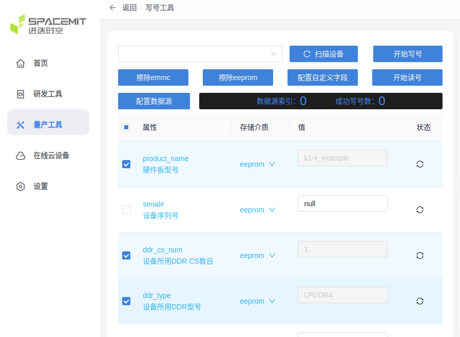
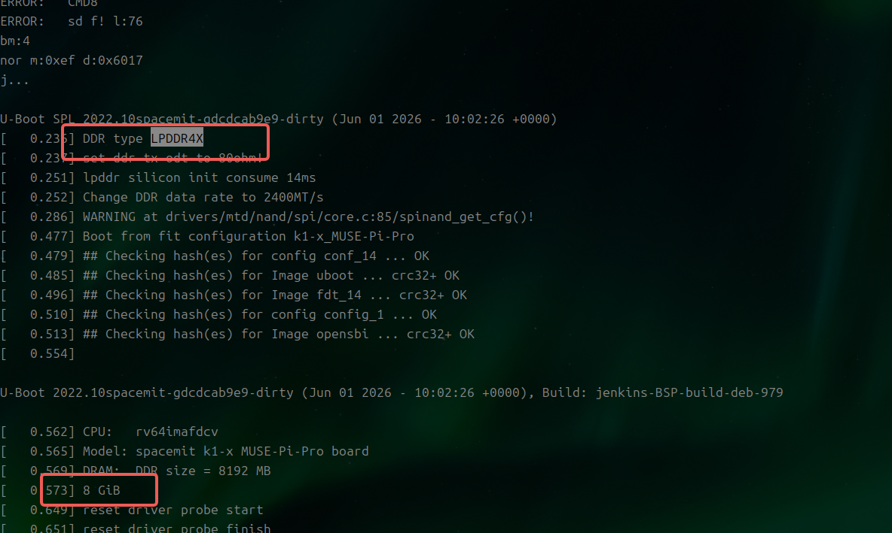

# 方案管理

本文档介绍SDK如何管理方案（solution），包括方案的配置文件，如何定制方案和如何添加新方案等。

## 方案的配置文件

以默认方案K1为例，通常包含以下配置文件：

```shell
buildroot-ext/board/spacemit/k1/partition_*.json
buildroot-ext/board/spacemit/k1/env_k1-x.txt
buildroot-ext/board/spacemit/k1/k1-x.bmp
buildroot-ext/board/spacemit/k1/dracut.conf
buildroot-ext/board/spacemit/k1/target_overlay
buildroot-ext/configs/spacemit_k1_defconfig
bsp-src/opensbi/platform/generic/configs/k1_defconfig
bsp-src/uboot-2022.10/configs/k1_defconfig
bsp-src/linux-6.1/arch/riscv/configs/k1_defconfig
```

**buildroot-ext/board/spacemit/k1/partition_*.json**

分区配置文件：

- `partition_2M.json`：for 2MB flash
- `partition_universal.json`：for high capacity flash，例如eMMC、sdcard、SSD

**buildroot-ext/board/spacemit/k1/env_k1-x.txt**

u-boot环境变量，可定制启动参数。

**buildroot-ext/board/spacemit/k1/bianbu.bmp**

u-boot启动logo：

- 格式：BMP
- 分辨率：小于或等于屏幕分辨率
- 位深度：32

**buildroot-ext/board/spacemit/k1/dracut.conf**

Dracut的配置文件，Dracut是一个制作initramfs镜像的工具。

**buildroot-ext/board/spacemit/k1/target_overlay**

故名思意，该目录是对target目录的overlay。

**buildroot-ext/configs/spacemit_k1_defconfig**

Buildroot的配置文件。

**bsp-src/opensbi/platform/generic/configs/k1_defconfig**

opensbi的配置文件。

**bsp-src/uboot-2022.10/configs/k1_defconfig**

u-boot的配置文件。

**bsp-src/linux-6.1/arch/riscv/configs/k1_defconfig**

kernel的配置文件。

## 默认分区配置

尽量不要修改`bootfs`前面的分区配置，避免引导代码中有hard code，修改之后无法正常引导。

### eMMC分区配置

按partition_universal.json文件`partitions`数组配置，其中bootinfo和fsbl位于eMMC的boot0分区。

eMMC boot0分区配置如下：

```
-----------------------------
|/bootinfo/        | fsbl   |
-----------------------------
^         ^        ^        ^
|         |        |        |
0K        80bytes  512bytes 198.5K
```

eMMC GPP分区配置如下：

```
--------------------------------------------------------------------------------------------
| gpt                            | env | opensbi | uboot   |    bootfs      |    rootfs    |
--------------------------------------------------------------------------------------------
^                                ^     ^         ^         ^                ^              ^
|                                |     |         |         |                |              |
0K                               384K  448K      832K      4M               260M           Capacity
```

**注意**

- 如果从eMMC启动，Boot ROM从eMMC的boot0分区加载fsbl，而非GPP分区，此时GPP分区是fsbl无效的

### sdcard分区配置

完全按partition_universal.json文件`partitions`数组配置。

分区配置如下：

```
--------------------------------------------------------------------------------------------
|/bootinfo/ gpt           | fsbl | env | opensbi | uboot   |    bootfs    |    rootfs    |
--------------------------------------------------------------------------------------------
^         ^               ^      ^     ^         ^         ^              ^              ^
|         |               |      |     |         |         |              |              |
0K        80bytes         128K   384K  448K      832K      4M             260M           Capacity
```

### SPINOR + SSD分区配置

SSD方案，需要用SPINOR引导，bootfs之前的分区都存储在SPINOR，按`partition_<SPINOR size>.json`文件`partitions`数组配置。

SPINOR分区配置如下：

```
----------------------------------------------------
|/bootinfo/         | fsbl | env | opensbi | uboot |
----------------------------------------------------
^         ^         ^      ^     ^         ^       ^
|         |         |      |     |         |       |
0K        80bytes   128K   384K  448K      640K    Capacity
```

bootfs和rootfs存储在SSD，按partition_universal.json文件`partitions`数组配置。

```
------------------------------------------------------------------------------------------
| gpt                                                      |    bootfs    |    rootfs    |
------------------------------------------------------------------------------------------
^                                                          ^              ^              ^
|                                                          |              |              |
0K                                                         4M             260M           Capacity
```


## 添加新 DTS 方案

基于 Buildroot 新增设备方案，可参考<https://www.spacemit.com/community/document/info?lang=zh&nodepath=software/SDK/buildroot/k1_buildroot/device/device_management.md>。

**注意**：

- 快速验证刷机启动时，可以直接基于默认的 `deb1` 方案。
- 非首次编译时，新增设备树后需要重新执行 `make envconfig`，再执行 `make uboot-rebuild && make linux-rebuild && make` 重新编译并打包。


## 新方案板子刷机启动

板子首次刷机启动前，先确认以下信息：

- DDR 型号为 LPDDR4 或 LPDDR4X。
- DDR 是单 CS 还是双 CS。
- 是否有新增 DTS 方案。
- 板子上是否接入了 EEPROM。


### 板子有接入 EEPROM

参考写号工具文档<https://www.spacemit.com/community/document/info?lang=zh&nodepath=tools/user_guide/flasher_user_guide.md>，将 DDR、CS 和设备树等信息写入 EEPROM。

**注意**：

- 需要先取消勾选才能修改，修改完后再勾选。对于不确定的配置项，不要勾选。
- 如果没有新增设备树，则不要填写 `product_name`，默认会加载 `k1-x_deb1`；填写不存在的设备树名称会导致找不到 DTB。
- 如果暂时不确定 DDR CS 数量，可以先填写 1，然后检查串口 U-Boot 打印的 DDR 容量是否与实际容量相符。



### 板子没有或者不确定是否有 EEPROM

修改 DDR 和默认方案配置后，重新编译 U-Boot 和镜像：

```shell
make uboot-rebuild && make
```

以下示例将 DDR 配置为单 CS、LPDDR4，并将默认方案设为 `k1-x_example`：

```diff
user:~/workspace/bianbu-linux-pub/bsp-src/uboot-2022.10$ git diff arch/riscv/dts/k1-x_spl.dts include/
diff --git a/arch/riscv/dts/k1-x_spl.dts b/arch/riscv/dts/k1-x_spl.dts
index 42235de070..7f90add9c2 100644
--- a/arch/riscv/dts/k1-x_spl.dts
+++ b/arch/riscv/dts/k1-x_spl.dts
@@ -79,8 +79,8 @@
        ddr@c0000000 {
                /* dram data rate, should be 1200, 1600, or 2400 */
                datarate = <2400>;
-               cs-num = <2>;
-               type = "LPDDR4X";
+               cs-num = <1>;
+               type = "LPDDR4";
                tx-odt = <80>;
                u-boot,dm-spl;
        };
diff --git a/include/configs/k1-x.h b/include/configs/k1-x.h
index 1af9debcf1..2c63b90546 100644
--- a/include/configs/k1-x.h
+++ b/include/configs/k1-x.h
@@ -25,12 +25,12 @@
 #define CONFIG_GATEWAYIP       10.0.92.1
 #define CONFIG_NETMASK         255.255.255.0

-#define DEFAULT_PRODUCT_NAME   "k1-x_deb1"
+#define DEFAULT_PRODUCT_NAME   "k1-x_example"

 #define DDR_TRAINING_DATA_BASE (0xc0832000)
 #define AUDIO_BUFFER_ADDRESS   (0xC08D0000)
```

### 刷机启动检查

通过串口打印，检查 DDR 类型和容量是否与实际硬件一致，并确认加载的设备树与板型匹配。下图的启动日志显示 DDR 类型为 LPDDR4X、容量为 8 GB，并加载了 `k1-x_MUSE-Pi-Pro` 的设备树。


