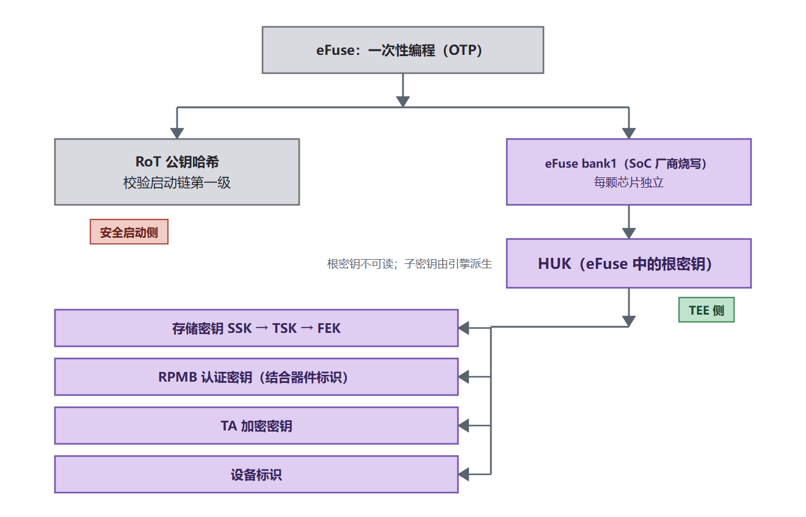
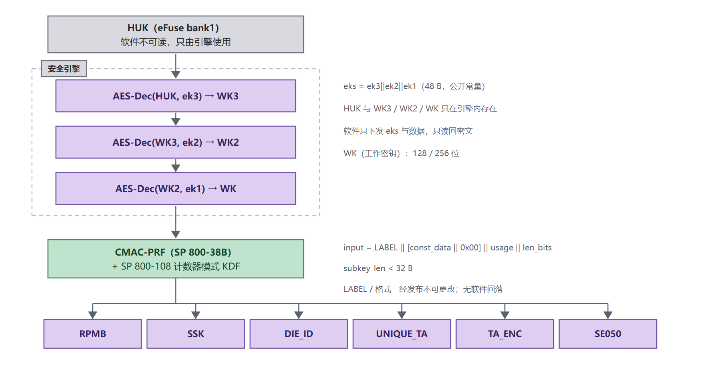
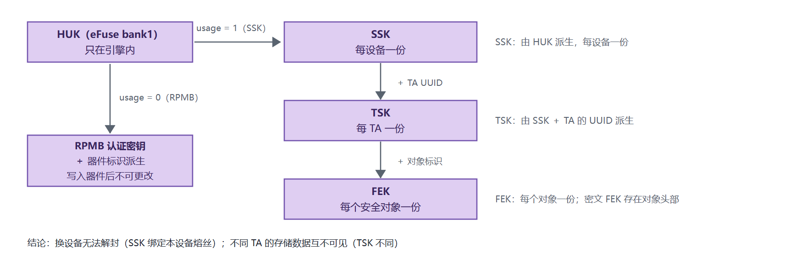
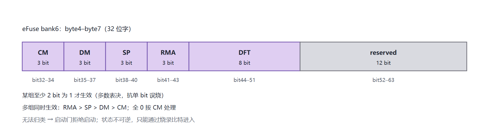
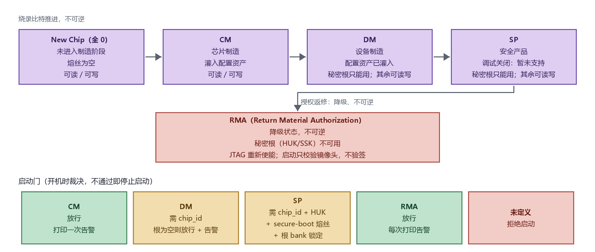

# 密钥管理与安全生命周期

## 概述

### 编写目的

本文说明 K3 平台 TEE 侧的密钥管理与安全生命周期：密钥清单与属性、平台根密钥与各级子密钥的来源与派生、生命周期状态对密钥可用性的影响、密钥的注入与烧录要求，以及密钥变更时需要同步处理的影响面。

### 适用范围

本文适用于 SpacemiT K3 系列 SoC 的 Buildroot 方案，覆盖 TEE 侧的密钥与生命周期管理。产测流程的完整落地由产线文档承担，本文只给出与密钥有关的要求。

### 与其它文档的分工

| 主题 | 归属 |
|---|---|
| 启动链密钥（RoT、引导程序、内核）的生成、注入与签名流程 | [安全启动开发指南](../device/secureboot.md) |
| 存储后端的数据组织、落地位置、容量与回滚行为 | [TEE 架构与集成指南](tee_architecture.md) 的安全存储章节 |
| TA 的签名、加密与运行 | [TA 开发指南](ta_guide.md) 与 [CA 开发指南](ca_guide.md) |
| 镜像的分区、打包与烧录 | [TEE 镜像构建与烧录说明](tee_image.md) |
| 生命周期状态的规范对应与支持状态 | [安全方案架构白皮书](white_paper.md) 与[安全特性支持矩阵](support_matrix.md) |
| 密钥的生产注入与烧录（eFuse、RPMB 认证密钥） | [量产密钥注入与烧录](key_provisioning.md) |
| **密钥清单、派生关系、替换与轮换；状态对密钥的影响** | **本文** |

### 重要约束

> [!CAUTION]
> 以下三项在任何开发构建中都可能出现，且都会直接削弱安全性。出货前必须逐项确认：
>
> 1. **未烧录熔丝的设备派生出的子密钥不具备设备唯一性**，与其他未烧录设备相同。
> 2. **TA 默认使用 SDK 提供的签名密钥**，任何持有该密钥的人都能签出被本平台接受的 TA。
> 3. **TA 加密的默认密钥是公开的固定值**，若在未替换密钥的情况下启用该功能，等同于没有加密。

## 1. 密钥清单与属性

K3 的密钥分为两条链：一条服务于**启动链的可信性**（安全启动侧），一条服务于**运行时数据的保护**（TEE 侧）。两条链都源于芯片内的不可变信息，下面分两小节列出。



### 1.1 安全启动侧密钥

这一链保证启动链可信，各级密钥的名称、文件清单与生成流程与[安全启动开发指南](../device/secureboot.md)一致，下表只登记其位置与用途。

| 密钥 | 用途 | 来源与生成位置 | 存放位置 | 可否读出 | 可否替换 |
|---|---|---|---|---|---|
| `root_key`（ROTPK） | 签发 FSBL 的一级证书，BootROM 据此建立信任 | 构建期生成 | 公钥哈希烧入熔丝（bank4）；私钥离线保管 | 私钥不落到设备 | 熔丝不可逆，替换须换片 |
| `spl_key` | 签 FSBL（SPL）本身 | 构建期生成 | 随一级证书携带 | — | 可替换，随固件更新 |
| `uboot_key` | 签 `esos.itb`、`u-boot.itb`、`fw_dynamic.itb`；TEE 镜像签名也用它（ITS 的 `key-name-hint` 与 SPL 设备树的公钥节点同名） | 构建期生成 | 公钥在编译期注入 SPL 的设备树 | — | 可替换，须同步重新生成公钥 dtsi 并重编 U-Boot |
| `kernel_key` | 签 `Image.itb`（内核与设备树） | 构建期生成 | 公钥在编译期注入 U-Boot 的板级设备树 | — | 同上 |

### 1.2 TEE 侧密钥

这一链保护运行时数据，根源是 eFuse 中的 HUK，各级子密钥由 HUK 在安全引擎内派生（见「平台根密钥：HUK」）。

| 密钥 | 用途 | 来源与生成位置 | 存放位置 | 可否读出 | 可否替换 |
|---|---|---|---|---|---|
| **HUK** | TEE 侧所有运行时密钥的根源；**同一根密钥也用于加密镜像（FSBL）的解密** | SoC 厂商在芯片阶段烧写 | eFuse bank1，只在安全引擎内部使用 | 随生命周期：DM、SP 与 RMA 阶段不可读 | 不可替换，熔丝不可逆 |
| TEE 子密钥 | RPMB、存储、设备标识、TA 唯一值、TA 加密、外部安全元件等用途 | 由 HUK 在安全引擎内派生 | 运行期由安全世界使用 | 根密钥不可读；子密钥只在安全世界内使用 | 随 HUK，不可替换 |
| 存储密钥（SSK / TSK / FEK） | 保护安全存储对象 | 由 HUK 逐级派生 | 安全世界 | 同上 | 不可替换：更换后既有数据无法解封 |
| RPMB 认证密钥 | 访问器件 RPMB 分区 | 由 HUK 的子密钥结合器件标识派生 | 写入器件的 RPMB 区域 | 写入后不可读出 | 不可替换：写入后不可更改 |
| TA 签名密钥（`TA_SIGN_KEY`） | 签 TA；TEE 内核加载 TA 时验签 | 构建期提供，默认为 dev kit 中的 `keys/default_ta.pem` | 私钥在构建侧；公钥嵌入 TEE 内核 | — | 可替换：见「密钥的替换方式」 |
| TA 加密密钥（`TA_ENC_KEY`） | 加密 TA 镜像；运行期由 `tee_otp_get_ta_enc_key()` 返回同一把 | 构建期提供，默认是源码中公开的固定值 | 构建侧 / 安全世界 | — | 可替换：见「密钥的替换方式」 |
| 设备标识 | 对外标识本设备 | 由 HUK 派生 | 安全世界 | 可导出（非机密） | 随 HUK |

## 2. 平台根密钥：HUK

HUK（Hardware Unique Key）是 TEE 侧所有运行时密钥的根源。

### 2.1 来源

HUK 是烧写在 eFuse（bank1）中的 per-die 根密钥，由 SoC 厂商在芯片阶段写入。

eFuse 本身是**一次性可编程（OTP）存储**：写入不可逆，并带有 per-bank 锁定位，并非整体对软件不可访问。受生命周期约束的是**密钥相关的 bank**——DM 与 SP 阶段不可读、不可写，只能由安全引擎使用；RMA 阶段不可访问。芯片标识、生命周期字段等其余内容仍由安全世界的只读驱动读取。

| 项 | 说明 |
|---|---|
| 位置 | eFuse bank1，每颗芯片独立 |
| 烧写方 | SoC 厂商（芯片阶段） |
| 可否读出 | 随生命周期变化：New Chip 与 CM 阶段可读；DM 与 SP 阶段不可读（只能由安全引擎使用）；RMA 阶段不可访问 |
| 其他用途 | 同一根密钥也用于加密镜像（FSBL）的解密（见「密钥清单与属性」） |

密钥阶梯与子密钥派生都在安全引擎内部完成，根密钥与工作密钥都不进入软件可见的内存。因此「设备可信」来自芯片内不可导出的根密钥，而不是软件掌握的常量。

### 2.2 派生路径

派生分两层：引擎内的密钥阶梯把根密钥变成工作密钥，软件再用工作密钥做 PRF 与 KDF 得到各用途子密钥。软件自始至终只下发公开参数、只读回子密钥。



关键操作：

- **引擎内（密钥阶梯）**：用输入材料 `eks` 对根密钥做三级 AES 解密，得到工作密钥 `WK`；根密钥与各级中间量都不离开引擎。
- **软件侧（PRF 与 KDF）**：用 `WK` 拼出 CMAC（SP 800-38B）作为伪随机函数，按 SP 800-108 计数器模式派生；输入为「标签 ‖ 附加输入 ‖ 用途编号 ‖ 长度」，输出按需要截断。
- **不可更改**：标签与输入格式一经发布不可更改，改动其中任何一个字节，已发布设备上已派生的子密钥会全部变化；没有软件回落，派生失败即失败。

两点结论：

- **根密钥不出引擎**，因此不存在把明文熔丝内容留在内存里的窗口；软件能拿到的只有子密钥。
- **芯片唯一性来自根密钥本身**：同一套派生参数在不同芯片上得到不同子密钥，换片无法复现；芯片标识不参与派生，只用作启动门判据。

### 2.3 熔丝未烧录时的行为

熔丝为空时没有可用的根密钥，派生出的子密钥与设备无关（等同零根）。是否允许启动由启动门裁决，而不是由派生接口逐次判断：

| 生命周期 | 未烧录时的行为 |
|---|---|
| CM / DM | 允许启动；DM 要求芯片标识已烧录，根密钥为空时在启动阶段打印告警 |
| SP | 拒绝启动：芯片标识、根密钥与安全启动熔丝必须齐备 |

开发板上熔丝通常为空，因此开发阶段依赖「允许启动 + 告警」这条路径——TA 的加载本身依赖子密钥，若一律拒绝，开发板连 TA 都装不进去。但**此时子密钥不具备设备唯一性，不可用于出货**。启动阶段会打印对应告警，可作为判断设备状态的依据。

## 3. TEE 侧子密钥

子密钥按用途派生（见 §2.2）。其中两条链需要单独说明：安全存储的密钥层级，以及 RPMB 认证密钥。



### 3.1 用途编号与派生

所有运行时密钥都由 HUK 经统一接口按用途派生（派生在安全引擎内完成），用途编号一经分配不可更改（改动会导致同一设备的既有密钥全部失效）：

| 用途 | 编号 | 附加输入 | 说明 |
|---|---|---|---|
| RPMB | 0 | 器件标识（16 字节） | 访问器件 RPMB 分区的认证密钥 |
| 存储密钥种子（SSK） | 1 | — | 安全存储密钥层级的根 |
| 设备标识 | 2 | — | 设备唯一标识 |
| TA 唯一密钥 | 3 | TA 相关数据 | 与 TA 绑定的唯一值 |
| TA 加密 | 4 | TA 的公钥模数 | TA 镜像的加密密钥 |
| 外部安全元件 | 5 | — | 预留给外部安全元件场景 |

### 3.2 存储密钥层级

三级密钥的作用域逐级收窄：SSK 每设备一份、TSK 每 TA 一份（由 SSK 与 TA 的 UUID 派生）、FEK 每个安全对象一份（密文 FEK 随对象一起保存在对象头部）。这带来两个性质：

- **换设备无法解封**：SSK 源于本设备的熔丝；
- **不同 TA 的存储数据互不可见**：TSK 由 SSK 与 TA 的 UUID 派生。

存储对象的组织、后端选择与落地位置见 [TEE 架构与集成指南](tee_architecture.md) 的安全存储章节。

### 3.3 RPMB 认证密钥

RPMB 认证密钥由 RPMB 子密钥结合**器件标识**派生，因此与器件绑定、无法在设备之间搬迁。要点：

- **不同介质的标识处理不同**：eMMC 的标识含会因固件更新而改变的字段，派生前需屏蔽，否则固件更新后密钥失配；UFS 的标识没有等价的可变字段。
- **写入器件后不可更改**：灌注前必须确认器件与设备配对正确，并且需要能把灌注目标钉在指定器件上，避免多器件场景下写错。
- **灌注能力只在产测阶段需要**：产品构建中禁止开启，工程上按只读采集与定向写入两套配置区分，见[量产密钥注入与烧录](key_provisioning.md)。

### 3.4 设备标识

设备标识用于向外部标识本设备，由设备标识子密钥（usage = 2）派生。它本身不是机密，但**可复现性依赖熔丝**：未烧录熔丝的设备会有相同的标识。

## 4. 安全生命周期

生命周期状态反映系统的可信程度，并决定**安全资产（HUK）** 能否被读写、以及设备能否启动。

### 4.1 生命周期各阶段

下表给出每个简写的全称、中文阶段与各项行为。状态相关行为由硬件与启动固件共同落实；状态转换没有软件接口，进入某个状态就是在对应分组里烧录比特，且烧录不可逆。

| 简写 | 全称 | 阶段定位 | 秘密根（HUK/SSK） | 非秘密配置资产 | 启动门 |
|---|---|---|---|---|---|
| New Chip（全 0） | — | 未进入制造 | 熔丝为空 | 可读、可写 | 放行（按 CM，打印一次告警） |
| CM | Chip Manufacturing | 芯片制造，灌入配置资产 | 可读、可写 | 可读、可写 | 放行，打印一次告警 |
| DM | Device Manufacturing | 设备制造，配置资产已灌入 | 只能用 | 可读、可写 | 要求芯片标识已烧录，根密钥为空时放行并告警 |
| SP | Secure Production | 安全产品，配置资产已锁定 | 只能用 | 可读、可写（已锁 bank 除外） | 要求芯片标识、HUK 与安全启动熔丝齐备，且信任根 bank 已硬件锁定，缺任一项即拒绝启动 |
| RMA | Return Material Authorization | 授权返修，降级 | 不可用 | 可读、可写 | 放行并打印告警 |

- **New Chip（全 0）** 是出厂新片的初始状态，四组状态比特都未烧录，等价于尚未进入任何制造阶段。
- **CM 与 DM** 对应规范中的 Manufacture 与 Security provisioning（产线灌入安全资产），是可继续写入的阶段。
- **SP** 对应规范中的 Secured，是量产出货的目标状态：秘密根只能用不能读写，启动门最严格。
- **RMA** 对应规范中的 Recoverable debug，是降级返修状态：JTAG 无视禁用位重新使能，启动只校验镜像头、不验签、跳过防回滚；不可逆，量产设备不应进入。

两类资产的区别：**秘密根**（HUK、SSK）是不可泄的根密钥，可读性随阶段收紧（见表），任何阶段软件都读不到明文、只在安全引擎内使用；**非秘密配置资产**（芯片标识、ROTPKH、CDPKH、ARCN、LCS 与策略位）不是机密，**任何阶段都可读、可写**——写入由各 bank 锁定位决定、与所处阶段无关，只有被锁定的 bank 不能写（SP 阶段按锁断言锁定 HUK/SSK/CDPKH/ROTPKH，ARCN、LCS、bank0 等仍可写，见「信任根 bank 锁断言」）。逐阶段的安全资产可用性细节见白皮书「安全生命周期」一章。

### 4.2 状态字段与判定

状态由 eFuse 的字段指定。状态转换没有软件接口：进入某个状态就是在对应分组里烧录比特，且烧录不可逆。



与规范状态模型的对应关系：CM 与 DM 覆盖 Manufacture 与 Security provisioning（产线灌入安全资产），SP 对应 Secured，RMA 对应 Recoverable debug。

### 4.3 状态推进、安全资产可用性与启动门



关键点：

- **灌入**：只有 CM 阶段可以写入秘密根；DM 与 SP 下秘密根（HUK/SSK）不可读、只能由安全引擎使用，非秘密配置资产仍可读写（按 bank 锁定）。
- **启动**：SP 阶段要求芯片标识、HUK 与安全启动熔丝齐备，且信任根 bank（HUK/SSK/CDPKH/ROTPKH）已硬件锁定，缺任一项即拒绝启动（见「信任根 bank 锁断言」）；CM、DM 与 RMA 放行并打印告警。
- **判据的取证方式**：芯片标识读 eFuse 标识字段，非全零即视为已烧录；HUK 是否可用由密钥阶梯对探针数据运算并与空根结果比对，**不读取根密钥明文**；安全启动熔丝读对应熔丝位。放行、告警与拒绝都输出到串口日志。
- **RMA**：秘密根（HUK/SSK）不可用，依赖 HUK 的运算必然失败；同时调试接口重新开放、启动链只校验镜像头。该状态不可逆，进入后保护等级永久低于 SP，量产设备不应进入 RMA。

启动门在开机时裁决一次，不在每次密钥派生时逐次判断，因此故障点集中在启动阶段。

### 4.4 信任根 bank 锁断言

eFuse「烧了」不等于「不可改」：一个 bank 未锁时仍可被追加置位，SP 阶段换掉 HUK/SSK/CDPKH/ROTPKH 就等价于换掉整条信任链。因此 SP 启动门在「chip ID + HUK + secure-boot 已烧」之上，还要求**信任根 bank 已被硬件锁死**——SP 要的是「非零且不可变」。

锁位集中在 bank6 的低 16 bit（`hwlock[2]`），**bit i 锁 bank i**，per-bank 粒度、无 per-bit 锁。eFuse 只能 0→1，「未锁」≠「可改回 0」，只等于「还能再烧一些位」，所以锁断言的收益是「禁止对根 bank 追加任何写入」。

| bank | 角色 | 处置 | 违反时 |
|---|---|---|---|
| 1（HUK） | 密钥根 | **必锁** | panic |
| 2（SSK） | 密钥根 | **必锁** | panic |
| 3（CDPKH） | 调试授权锚 | **必锁** | panic |
| 4（ROTPKH） | 启动信任根哈希 | **必锁** | panic |
| 5（ARCN） | 防回滚计数 | **必不锁** | WARN（不 panic） |
| 6（LCS/hwlock） | 状态机自身 | **必不锁** | WARN |
| 0（策略+工艺） | 混装 | **不锁** | WARN |

- **1/2/3/4 必锁**：它们是信任链的输入，SP 阶段还能写 = 能换根。
- **3（CDPKH）说明**：它只用于安全调试（JTAG 解锁），要求 lock(3)=1 但不要求 bank3 有值——锁一个空 bank3 完全合法。空的 bank3 比烧满的更危险（eFuse 只能 0→1，全 0 的 bank3 可被事后 OR 进任意值、装攻击者自己的调试根自签开 JTAG），「已烧才锁」恰好放行了最危险的状态，所以对 bank3 一律锁、空 bank 也要锁。
- **5/6 必不锁**：ARCN 是单调计数器，安全更新还要 +1，锁了就防不了回滚；bank6 装的就是锁位与 LCS 本身。违反只 WARN 不 panic——这是隐患（将来升不了版本），不是立即失守。

**分阶段策略**：CM 与 RMA 不查锁（放行 + 告警）；DM 仅 WARN（制造阶段还在反复烧写，强判会卡死产线）；**SP** 在既有 chip ID / HUK / secure-boot 判据之外，要求 1/2/3/4 必锁、5/6/0 不锁，满足放行、违反 panic。

**两条前置**：

1. **烧录时机**：不要求「先锁 bank、后置 SP」的固定顺序——eFuse 烧录器是独立工具、不经过安全子系统，置 SP 之后仍可继续烧 bank lock。硬要求是**板子以 SP 状态启动时，信任根 bank（含空 bank3 的 CDPKH）必须已锁**，否则启动门 panic；产测应保证在首次以 SP 状态开机前完成 bank lock。
2. **读锁失败即 fail-closed**：读不到锁状态时 SP 下拒绝，不默认「安全」。ROTPKH 不单独判空——secure-boot 熔丝一烧，BootROM 就必须用 ROTPKH 验签，ROTPKH 全 0 则验签必失败、根本到不了 OP-TEE。

## 5. 密钥的替换方式

密钥的生产注入与烧录（eFuse、RPMB 认证密钥）见[量产密钥注入与烧录](key_provisioning.md)。本节说明构建期各密钥的替换方式。

| 密钥 | 默认位置与来源 | 替换方式 |
|---|---|---|
| TA 签名密钥 | `TA_SIGN_KEY`，默认 `<TA_DEV_KIT_DIR>/keys/default_ta.pem`（本方案中为 `output/k3/build/optee-os-custom/out/export-ta_rv64/keys/default_ta.pem`） | 将自有私钥放到该目录并指向它（或直接修改 `TA_SIGN_KEY`），然后重建 TEE（公钥嵌入 TEE 内核）并重签全部 TA |
| TA 加密密钥 | 构建期 `TA_ENC_KEY`（`CFG_ENCRYPT_TA` 打开时使用，默认是源码中公开的固定值）；运行期由 `tee_otp_get_ta_enc_key()` 返回 | 两侧必须一致：构建期把 `TA_ENC_KEY` 换成自有密钥；运行期保持默认的「按设备唯一」派生（由设备根密钥与 TA 公钥模数派生），或自行实现该接口改为「按类别共用」（同批设备共用一把，便于分发但泄露影响面更大） |
| 引导链签名密钥（`root_key` / `spl_key` / `uboot_key` / `kernel_key`） | SDK 密钥目录（`KEY_DIR`），文件清单与命名见[安全启动开发指南](../device/secureboot.md) | 只替换密钥文件不够：公钥 dtsi 中硬编码了公钥模数，必须同步重新生成 dtsi 并重编 U-Boot；`root_key` 的公钥哈希已烧入熔丝，替换后旧设备无法接受新固件 |
| eFuse 中灌入的密钥（HUK 等） | SoC 厂商在芯片阶段烧写 | 不可替换：熔丝不可逆，只能换片 |

## 6. 密钥变更与轮换

### 6.1 可轮换与不可轮换

| 类别 | 密钥 | 说明 |
|---|---|---|
| 不可轮换 | HUK、TEE 子密钥、存储密钥、RPMB 认证密钥 | 源于熔丝或已写入器件，更换须更换硬件或器件 |
| 可轮换 | TA 签名密钥、TA 加密密钥 | 更换后需重建 TEE 或重新分发 TA，设备须能接受固件更新 |
| 受熔丝限制 | 安全启动根密钥及其下游签名密钥 | 已烧录熔丝的旧设备无法接受使用新根密钥的固件 |

### 6.2 变更影响面检查表

更换任何一项密钥后，按下列清单逐项确认，避免遗漏导致设备不可用：

| 变更项 | 需同步处理 |
|---|---|
| TA 签名密钥 | 重新签所有 TA；重建 TEE 以嵌入新公钥；确认设备能接受新固件 |
| TA 加密密钥 | 重新构建并签所有 TA；确认分发策略（按设备或按类别） |
| 安全启动根密钥 | 属于安全启动范围；**更换后已烧录熔丝的旧设备无法接受新固件**，详见安全启动文档 |
| 引导程序 / 内核签名密钥 | 属于安全启动范围；需同步更新对应公钥注入与固件 |
| 熔丝内容 | 不可逆；烧录前必须完成全链路未烧录状态下的验证 |
| RPMB 密钥 | 不可更改；灌注后确认设备与器件配对正确，并保留产线记录 |

### 6.3 变更后的验证顺序

1. 在**未烧录熔丝**的样机上完成全链路验证（签名、加载、运行）。
2. 在样机上烧录熔丝，重复同一套验证。
3. 确认测试套件与安全存储用例通过。
4. 检查安全世界日志中**没有**根密钥为空或状态相关的告警。
5. 在量产固件上重复第 3、4 步，确认提示信息与预期一致。

## 7. 与其它文档的关系

| 主题 | 文档 |
|---|---|
| 安全启动的密钥生成与签名流程 | [安全启动开发指南](../device/secureboot.md) |
| 存储后端的组织、落地位置与容量语义 | [TEE 架构与集成指南](tee_architecture.md) 的安全存储章节 |
| TA 的开发、签名与加密的使用 | [TA 开发指南](ta_guide.md) |
| 生命周期状态的规范对应与支持状态 | [安全方案架构白皮书](white_paper.md) 与[安全特性支持矩阵](support_matrix.md) |
| 镜像分区、打包与烧录 | [TEE 镜像构建与烧录说明](tee_image.md) |

## 附录：在主机上计算与核对子密钥

平台提供主机脚本 `scripts/derive_huk_subkey.py`（与 `derive_rpmb_key.py` 并列），按本文的派生格式在主机上离线计算各用途的子密钥，可用于：

- 在烧录前离线核对器件的密钥（例如算出与板端一致的 TA 加密密钥或 RPMB 认证密钥）；
- 校验输入材料与派生格式（脚本内置自检，可作回归门）。

基本用法：

```sh
python3 scripts/derive_huk_subkey.py --usage SSK --huk <16 字节根密钥>
python3 scripts/derive_huk_subkey.py --usage RPMB --huk <16 字节根密钥> --cid <32 位 hex> --rpmb-emmc   # --rpmb-emmc 仅 eMMC 需要，UFS 不加
python3 scripts/derive_huk_subkey.py --usage UNIQUE_TA --huk <16 字节根密钥> --uuid cb3e5ba0-adf1-11e0-998b-0002a5d5c51b
python3 scripts/derive_huk_subkey.py --usage TA_ENC --huk <16 字节根密钥> --ta-sign-key <签名密钥 PEM>
```

参数说明：

- **根与工作密钥**：`--huk` 传入引擎保存的根密钥（16 字节，脚本按密钥阶梯算出工作密钥）；`--root-key` 直接传入工作密钥（跳过阶梯）。
- **输入材料 `eks`**：脚本已内置（默认随脚本提供平台的 `te200_ladder_root.eks`），一般不用指定。
- **各用途的附加输入**（缺则报错退出）：

| 用途 | 附加输入 | 说明 |
|---|---|---|
| SSK / 设备标识 | — | 设备标识的长度按消费者取（`--num-bytes`，默认 32 字节） |
| TA 唯一密钥 | `--uuid`（必需） | 按调用方 TA 的 UUID 转成内存布局 |
| RPMB | `--cid`（必需）；eMMC 另加 `--rpmb-emmc` | 卡标识（16 字节）；eMMC 会掩掉可变字段（PRV、CRC），UFS 按原值使用（不加 `--rpmb-emmc`） |
| TA 加密 | `--ta-sign-key`（默认 `keys/default_ta.pem`） | 取签名公钥模数作为附加输入 |

注意事项：

- 根密钥是 per-die 的、**软件读不到**：脚本只接受「已被别处读出的根」或软钥（测试密钥）。传入后根密钥会出现在主机内存中，注意保管。
- `--selftest` 运行内置算法自检（CMAC 与 KDF 布局），不依赖设备，可作回归检查。
- 输出与固件一致的**前提是派生格式未变**（标签与输入布局属冻结格式，见 §2.2）。
- **不要用旧的 `derive_rpmb_key.py`**：它走的是已退役的软件 HUK 路径，与当前实现算出的结果不一致。

## 参考资料

本文引用的外部规范与上游文档如下。

| 名称 | 版本 | 链接 |
|---|---|---|
| NIST SP 800-38A：Recommendation for Block Cipher Modes of Operation（ECB / CBC） | 2001（含 2010 Addendum） | <https://csrc.nist.gov/pubs/sp/800/38/a/final> |
| NIST SP 800-38B：Recommendation for Block Cipher Modes of Operation: the CMAC Mode for Authentication | 2005（含 2016 Update） | <https://csrc.nist.gov/pubs/sp/800/38/b/upd1/final> |
| NIST SP 800-108：Recommendation for Key Derivation Using Pseudorandom Functions | Rev.1（2022） | <https://csrc.nist.gov/pubs/sp/800/108/r1/final> |
| RISC-V Security Model，RISC-V International（生命周期状态模型） | 0.9.1（2026-09） | <https://github.com/riscv-non-isa/riscv-security-model> |
| GlobalPlatform TEE Internal Core API Specification（安全存储对象与 TA 接口） | 1.4 | <https://globalplatform.org/specs-library/tee-internal-core-api-specification/> |
| OP-TEE 官方文档（子密钥派生接口） | latest | <https://optee.readthedocs.io/en/latest/> |
