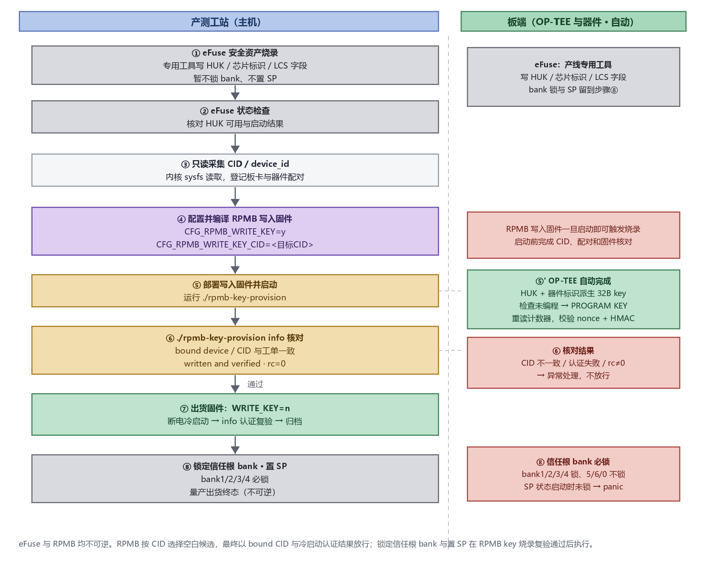

# 量产密钥注入与烧录

## 1. 目标与范围

本文说明 K3 平台量产阶段的密钥注入与烧录，分两部分：**eFuse 烧录**（HUK、芯片标识、生命周期字段，由专用烧写工具在产线完成；信任根 bank 锁与置 SP 作为收尾的终态步骤），以及 **RPMB 认证密钥烧录**（由 OP-TEE 用本芯片 HUK 派生并写入，用 `rpmb-cid-list.sh` 与 `rpmb-key-provision` 两个工具）。eFuse 烧录完成、HUK 可用后，才能进行 RPMB 烧录。密钥的清单、派生与生命周期见[密钥管理与安全生命周期](key_management_lifecycle.md)。

量产流程先完成 eFuse 安全资产烧录和检查，再进行 RPMB 认证密钥烧录。RPMB 阶段在采集完成后构建定向写入固件，烧录成功后再切换为出货固件；**锁信任根 bank 与置 SP 放在 RPMB key 烧录并通过出货复验之后**，作为量产出货的终态收尾：

1. **eFuse 烧录**：由专用工具写入 HUK、芯片标识、生命周期字段；本阶段**只烧资产、不锁 bank、不置 SP**。
2. **eFuse 检查**：确认 HUK 可用，并完成基础启动验证。
3. **CID 采集**：按本文第 5 章进行只读采集（**无需开 `CFG_RPMB_FS`**），登记 CID / device_id、介质类型和板卡-器件配对。
4. **RPMB 定向写入**：定向写入固件（`CFG_RPMB_FS=y`、`CFG_RPMB_WRITE_KEY=y` + 目标 CID）启动，OP-TEE 用本芯片 HUK 结合 CID 派生 key 并一次性写入。
5. **写入验收**：用 `rpmb-key-provision info` 核对绑定设备、CID 与认证状态，判断烧录成功。
6. **出货复验**：切回 `CFG_RPMB_FS=y`、`CFG_RPMB_WRITE_KEY=n` 的出货固件，断电重启后再次认证复验。
7. **锁 bank 并置 SP**：复验通过后，锁定信任根 bank（HUK/SSK/CDPKH/ROTPKH 必锁）并置 SP，进入量产出货终态（bank 锁与置 SP 先后顺序不限，见 §2）。

任一环节不通过即转入异常处理，不自动放行。eFuse 未完成或 HUK 不可用时，不得进入 RPMB 写 key 阶段。



> [!CAUTION]
> RPMB key 按一次性写入管理。写错 key 后不能通过刷机、格式化或清零数据恢复；不能依据 write counter 为 0 判定 key 未烧录或可以重写。SoC 与存储器件必须正确配对，更换任一方都需要重新评估密钥与既有数据的可用性。

本文仅定义操作与验收要求，不执行实际烧录。

## 2. eFuse 烧录

eFuse 烧录把 HUK、芯片标识、生命周期字段一次性写入熔丝，由**专用的 eFuse 烧写工具**在产线完成，不经过 OP-TEE / `conf.mk` 流程，写入不可逆。本文不展开专用工具的操作界面和设备指令，但将 eFuse 烧录作为 RPMB key 写入之前的必需步骤和放行条件。

| 项 | 说明 |
|---|---|
| 烧录内容 | HUK、芯片标识、LCS 字段 |
| 执行方 | 专用 eFuse 烧写工具（产线） |
| 可逆性 | 不可逆，per-bank 锁定位 |
| 锁 bank / 置 SP | **本阶段只烧资产、不锁信任根 bank、不置 SP**；bank 锁与置 SP 在 RPMB key 烧录并通过出货复验后执行（见 §1 步骤 7）。不要求「先锁 bank、后置 SP」的固定顺序——eFuse 烧录器不经过安全子系统，置 SP 后仍可继续锁 bank；但 SP 状态启动时信任根 bank 必须已锁，否则启动门拒绝启动（见[密钥管理与安全生命周期](key_management_lifecycle.md)「信任根 bank 锁断言」） |
| 烧录前 | 完成基础功能验证（签名、加载、运行） |
| 烧录后 | 在已烧录设备上重复同一套验证，确认未出现根密钥为空的告警 |

eFuse 烧录完成、HUK 可用后，才能进行下面的 RPMB 认证密钥烧录（RPMB key 由 HUK 派生）。

## 3. 工站输入与工具

### 3.1 输入材料

| 输入 | 要求 |
|---|---|
| 板卡 SN、SoC 标识 | 能与芯片阶段的 HUK 烧录记录关联；不在工站日志中记录 HUK 明文 |
| 存储介质 | 明确 eMMC 或 UFS；UFS 需确定 RPMB region |
| 目标 CID / device_id | 16 字节，用 32 个十六进制字符表示，工站统一转为大写 |
| 固件基线 | 固定 OP-TEE、Linux、派生参数 `eks` 与 KDF 格式的版本 |
| HUK 状态 | 正式 HUK 已烧录且当前生命周期允许安全引擎使用；禁止使用零根或公开测试 key |
| 工站权限 | 可部署产测固件、读取设备标识、调用烧录工具和采集结果 |

RPMB key 长度为 **32 字节（256 bit）**，由 OP-TEE 派生。工站不需要读取 HUK 或准备 key 文件。

### 3.2 工具与来源

| 工具 | 用途 |
|---|---|
| `rpmb-cid-list.sh` | 在板端枚举 RPMB 类型与标识，读取 sysfs，不调用 OP-TEE |
| `rpmb-key-provision` | 调用 device PTA，触发 RPMB 初始化并获取绑定设备与认证状态 |

工站使用用户现有的这两个工具。两个工具以文件形式提供：`rpmb-cid-list.sh` 脚本和编译生成的 `rpmb-key-provision` CA 二进制，部署到板端由你指定的目录，**不要求装在 `/usr/bin`**。下文命令统一用 `./` 前缀表示在该目录下运行，实际路径按部署位置调整。`rpmb-key-provision` 需配套支持 `PTA_CMD_GET_RPMB_INFO` 的 OP-TEE；读取 UFS 标识还需内核提供 RPMB `type` / `device_id` sysfs 属性。工站导入时检查工具可执行、接口存在，并将版本与固件基线关联。

## 4. 配置 OP-TEE 编译

### 4.1 修改位置

RPMB 相关开关的主入口是 **`core/arch/riscv/plat-k3/conf.mk`**。如果工程通过 Buildroot 统一传参，也可以使用 `BR2_TARGET_OPTEE_OS_ADDITIONAL_VARIABLES` 传入同名 `CFG_*` 变量；本文的量产示例按 `conf.mk` 编写，使用 Buildroot 传参时应核对最终配置，避免同一变量在多个入口设置冲突值。改了 optee-os 后用 `make optee-os-rebuild` 重编（或先 `make optee-os-dirclean` 再 `make optee-os`）并更新固件，详见 [TEE 镜像构建与烧录说明](tee_image.md)。

通用存储配置与两种 RPMB 路由见[安全存储](secure_storage.md) §3.3–§3.4；CID 采集见本文第 5 章。以下只列量产阶段的写入与复验配置；在现有 `conf.mk` 中修改对应项，避免仅追加重复的 `?=` 设置而保留原值。

### 4.2 采集准备

按本文第 5 章获取目标标识并登记配对，采集固件保持 `CFG_RPMB_WRITE_KEY=n`。CID 读取无需开启 `CFG_RPMB_FS`；写入和出货复验均需开启 RPMB FS。

### 4.3 定向写入（烧录 key）

```makefile
CFG_RPMB_FS ?= y
CFG_RPMB_ANNOUNCE_PROBE_CAP ?= y
CFG_RPMB_TESTKEY ?= n
CFG_RPMB_WRITE_KEY ?= y
CFG_RPMB_WRITE_KEY_CID ?= "112233445566778899AABBCCDDEEFF00"
CFG_TEE_CORE_LOG_LEVEL ?= 2
CFG_RPMB_FS_DEBUG_DATA ?= n
```

`CFG_RPMB_WRITE_KEY ?= y` 才允许写 key。`CFG_RPMB_WRITE_KEY_CID` 的行为只作用于**尚未编程的 RPMB 候选**，值换成本文第 5 章读到的实际 CID（大写 32 hex，双引号不能少）：

- **CID 为空**：不做筛选，按枚举顺序选择第一个报告 key 未编程的 RPMB 候选并写入。
- **CID 正确**：只选择 CID 与配置值相同的未编程候选并写入。
- **CID 错误**：没有候选能匹配，空白 RPMB 不会被选中，写入失败。
- **候选已能认证**：先使用该已认证设备，不重复写 key；CID 配置不会把运行选择强制改到另一颗空白 RPMB。

因此，定向写入时必须先核对 CID。若产品要求固定目标，建议每板只暴露一个目标 RPMB，或在 DTS 中关闭非目标存储控制器。**只在确认 CID 无误并完成 §4.5 的目标选择检查后才用这套配置**。

> [!CAUTION]
> PROGRAM KEY 请求携带 key，经 REE / Linux 路由到介质；HUK 留在安全引擎内，但烧录过程不能让 RPMB key 全程不经过 REE。定向写入固件只在受控产测环境使用，用完即换出货固件。

### 4.4 出货 / 复验

```makefile
CFG_RPMB_FS ?= y
CFG_RPMB_TESTKEY ?= n
CFG_RPMB_WRITE_KEY ?= n
```

出货与复验要开 `CFG_RPMB_FS`（OP-TEE 重新派生并认证），但 `CFG_RPMB_WRITE_KEY` **显式置 `n`**、禁止再写。也就是在定向写入配置基础上把 `CFG_RPMB_WRITE_KEY` 改回 `n`。

### 4.5 烧录前检查

- 正式 HUK 已烧录且可用：`plat_rpmb_key_is_ready()` 仅在根状态为 `TE200_HUK_BURNED` 时允许 OP-TEE 写 key。
- 已写过 key 的器件先认证复验，通过即跳过，不重复写。
- 认证失败不等于未写：可能已写其它 key、通信故障、路由错误或派生参数不一致。
- 多器件板卡：`CFG_RPMB_WRITE_KEY_CID` 只过滤写 key 时的空白候选；CID 为空时选择第一个空白候选，CID 正确时选择匹配候选，CID 错误时不会写入空白候选。已能通过认证的器件仍优先使用，不能靠该配置强制转向另一颗空白器件。烧录前按下列方案明确目标；返回的绑定 CID 与工单不符即失败。

| 目标选择方案 | 工站与出货要求 |
| --- | --- |
| 每板仅向一个指定 RPMB 烧 key | 写入阶段仅暴露目标设备并指定其 CID，其他 RPMB 不写 key；确认不存在另一颗已能由本芯片认证的设备。恢复产品所需设备后，以禁止写 key 的出货固件冷启动，核对绑定介质与 CID |
| DTS 禁用非目标候选 | 在 Linux 实际部署的 DTS 中，将非目标控制器节点设为 `status = "disabled"`；写入与出货固件均使用该限制。确认不会禁用启动或业务必需的存储设备 |

设备树通常控制整个存储控制器，不能假定存在独立 RPMB 子节点；UFS 多 region 的限制见[安全存储](secure_storage.md) §3.4 的“多 RPMB 的默认选择与绑定”。以上方案明确候选范围，CID 配置负责限制新 key 的写入目标。

定向写入的选择规则如下：

| 当前条件 | 处理结果 |
| --- | --- |
| 候选中存在可由本芯片认证的 RPMB | 使用第一个可认证候选，不重复写 key，也不转向空白目标 |
| 没有可认证候选，`CFG_RPMB_WRITE_KEY_CID` 为空 | 使用枚举顺序中第一个报告 key 未编程的候选 |
| 没有可认证候选，配置 CID 与某个空白候选匹配 | 使用该匹配候选并写入 key |
| 没有可认证候选，配置 CID 与所有空白候选不匹配 | 不写 key，初始化失败 |

“空白”指设备明确报告 `AUTH_KEY_NOT_PROGRAMMED (0x07)`。目录为空、写计数器为 0 或设备刚启动均不能证明密钥为空白。

## 5. RPMB 步骤一：登记目标 CID / device_id

### 5.1 采集 CID / device_id

CID 采集只读取 Linux sysfs，不调用 OP-TEE，**无需开启 `CFG_RPMB_FS`，也无需先启用 OP-TEE 的 kernel 路由**。eMMC 由 mmc 驱动提供原始 CID；UFS 需要 RPMB 驱动注册并提供标识属性。采集时使用禁止写 key 的固件（`CFG_RPMB_WRITE_KEY=n`）。在工具目录运行随平台提供的 `rpmb-cid-list.sh`：

```sh
./rpmb-cid-list.sh -v
```

工具以文件形式提供，不要求安装到 `/usr/bin` 或加入 `PATH`。它逐行输出 `device rpmbN: type=<emmc|ufs> id=<32 hex>`。工站或系统初始化流程应登记目标器件的 `id`，并同时记录介质类型、板卡标识和 UFS region；`rpmbN` 编号由枚举决定，不保证每次启动相同。

- **eMMC**：`id` 是卡的原始 16 字节 CID，由 mmc class 的 `/sys/class/mmc_host/mmc*/mmc*:*/cid` 暴露。eMMC 正常识别后即可读取，不依赖 RPMB class 的 `device_id` 属性。
- **UFS**：`id` 是内核对 `<设备描述符>-R<region>` 计算的 BLAKE2s-128 结果，已经是 OP-TEE 使用的 16 字节标识，**不要再哈希**。

采集和配对检查使用原样 32 个十六进制字符，记录时统一为大写。eMMC CID 的 PRV / CRC 字节不手动清零，派生密钥时由 OP-TEE 按介质类型处理。不要把 `rpmbN` 编号、UFS 序列号或描述符原串当作 UFS 的 `id`。

若 `rpmb-cid-list.sh` 没有列出目标 UFS 的 `id=`，检查 `/sys/class/rpmb/rpmbN/type` 和 `device_id` 是否存在，以及 UFS RPMB 驱动是否注册。需要在内核直接查看标识时，可在 `drivers/ufs/core/ufs-rpmb.c` 的 `ufs_rpmb_probe()` 中，在 `blake2s()` 后增加：

```c
dev_info(hba->dev, "UFS RPMB region %d id=%*phN\n",
         region, UFS_RPMB_ID_LEN, dev_id);
```

其中 `dev_id` 是该 region 的 16 字节标识；若函数在入口因没有 RPMB W-LUN 或缺少 `hba->dev_info.device_id` 提前返回，先按器件是否提供标准 RPMB W-LUN 和描述符字段排查。重新构建、部署内核并启动后，通过 `dmesg` 查看目标 region 的 `id=`。预置与运行镜像须保持相同的标识生成规则。

### 5.2 登记与工单核对

登记目标器件的原样 32 个十六进制字符、介质类型、板卡标识和 UFS region。烧录前核对登记结果与本次工单一致，再将该标识用于 §4.3 的定向写入配置。

## 6. RPMB 步骤二：写入 key（定向烧录）

### 6.1 配置并编译写入固件

按「定向写入」（§4.3）修改 `plat-k3/conf.mk`，把 `CFG_RPMB_WRITE_KEY_CID` 的值换成本文第 5 章登记的实际 CID（大写 32 hex，双引号不能少）。改完用 `make optee-os-rebuild` 重编并烧录固件，再检查生成的 `out/include/generated/conf.h`，确认 CID 与写入开关与本次工单一致。

该配置一次只接受一个非空 CID。因此需按每个目标器件生成定向固件，不能把一个固定 CID 的镜像复用于所有器件；大批量工站应自动化构建与镜像关联，或另行开发经审核的运行期定向接口。虽然源码允许将 CID 留空并写入第一个空白候选，但量产不采用这种方式，避免多 RPMB 板卡因枚举顺序变化写错器件。

### 6.2 启动并触发写入

> [!CAUTION]
> 启动允许写 key 的固件后，Linux 的 RPMB 探测或其它 RPMB 使用者可能先于工站命令触发烧录。`rpmb-key-provision info` 同样会初始化 RPMB，因此在该固件上也可能写 key。批准烧录、配对检查与固件校验必须在启动写入固件之前完成。

启动写入固件后，在工具目录运行：

```sh
./rpmb-key-provision
```

退出码 `0` 表示写入并校验成功；非零一律转异常处理。需要留存记录时把输出同时写入文件：`./rpmb-key-provision | tee rpmb_provision.txt`。

OP-TEE 的处理链为：

1. 枚举器件，按类型准备原始标识。
2. 使用本芯片 HUK 派生 32 字节 RPMB key；eMMC 自动屏蔽 CID 的 PRV / CRC，UFS 使用 16 字节标识原值。
3. 发起计数器读取并校验响应；已能通过认证的器件不再写 key。
4. 对设备明确报告 key 未编程的候选，按配置处理：CID 为空时记录第一个空白候选，CID 非空时只记录匹配候选；CID 错误时不会记录写入目标。
5. 对选中的候选检查 HUK 就绪条件，再发送 PROGRAM KEY；写入成功后重新读取计数器，校验 nonce 与 HMAC。

非零退出码一律转异常处理。不得仅凭 `probe: RPMB up` 放行，必须检查返回身份与 `key state`。

## 7. RPMB 步骤三：判断烧录成功

### 7.1 当次烧录结果

```sh
./rpmb-key-provision info
```

退出码 `0` 且输出满足下表才算通过；需要留存记录时用 `./rpmb-key-provision info | tee rpmb_verify.txt`。

必需的验收信息：

| 字段 | 放行条件 |
|---|---|
| `bound device` | 与工单一致：eMMC 或 UFS |
| `bound CID` | 转为大写后，与工单记录的原样 32 hex 标识完全一致 |
| `key state` | `written and verified` |
| 工具退出码 | `0` |
| `write counter` | 记录当前值；不要求为 0，也不作为密钥匹配的独立证据 |

`written and verified` 来自 OP-TEE 的认证状态；写入后的首次校验检查计数器响应的 nonce 与 HMAC，说明设备中的 key 与本芯片派生 key 一致。同一次运行中的后续 `info` 可能返回已验证的缓存状态，因此还必须完成步骤四的断电复验。

当前接口初始化失败时往往直接返回错误，不能依赖 `info` 的退出码 `2` 区分所有“未烧 key”情形。

## 8. RPMB 步骤四：出货复验（断电冷启动）

1. 按「出货 / 复验」（§4.4）把 `CFG_RPMB_WRITE_KEY` 改回 `n`（保持 `CFG_RPMB_FS=y`），用 `make optee-os-rebuild` 重编并烧录出货固件。
2. 断电重启，确保 OP-TEE 重新派生 key 并认证，不沿用写入固件的内存状态。
3. 再执行 `./rpmb-key-provision info`，按 §7.1 比较介质与 CID，并记录认证状态与退出码。
4. 确认验收固件确实禁止写 key，随后归档工单与验证记录。

生产环境应保留工站受控的验收入口；工具是否随最终用户 rootfs 发货由产品决定。

## 9. 异常处理与生产记录

### 9.1 异常处理

| 情形 | 处理 |
|---|---|
| 标识格式非法、类型或 region 不符 | 停止，不部署允许写 key 的固件；重新采集并核对拓扑 |
| key 已编程且认证通过 | 核对板卡与器件配对，进入出货复验；不重复写 key |
| key 已编程但认证不通过 | 隔离器件；核查配对、HUK 来源、派生基线、PRV / CRC 屏蔽与测试 key 历史；不尝试改写 key |
| 工具失败或通信中断 | 保留设备及工单状态，先在禁止写 key 的固件上查明状态；不能把任意错误当作未编程 |
| 写 key 期间掉电 | 按状态不确定处理；用正确派生 key 进行认证，确认设备明确未编程后才允许受控重试 |
| 返回绑定 CID 不等于目标 CID | 判定失败，即使工具返回 0；隔离其它可用 RPMB，重新检查选择策略 |
| HUK 未就绪或生命周期不允许使用 | 停止，转芯片安全资产工站；不使用公开测试 key 绕过 |
| 出货复验认证失败 | 不放行；核查实际部署的固件、派生算法与参数是否一致，以及设备配对是否改变 |

### 9.2 生产记录

每台设备至少保存：板卡 SN、SoC 标识及 HUK 烧录记录引用、介质类型、原始 CID / device_id、UFS region 与拓扑、采集/产测/出货固件版本和校验值、工具版本、操作时间与工站、写入结果、认证返回码、绑定 CID、write counter、冷启动复验结果与异常处理记录。

