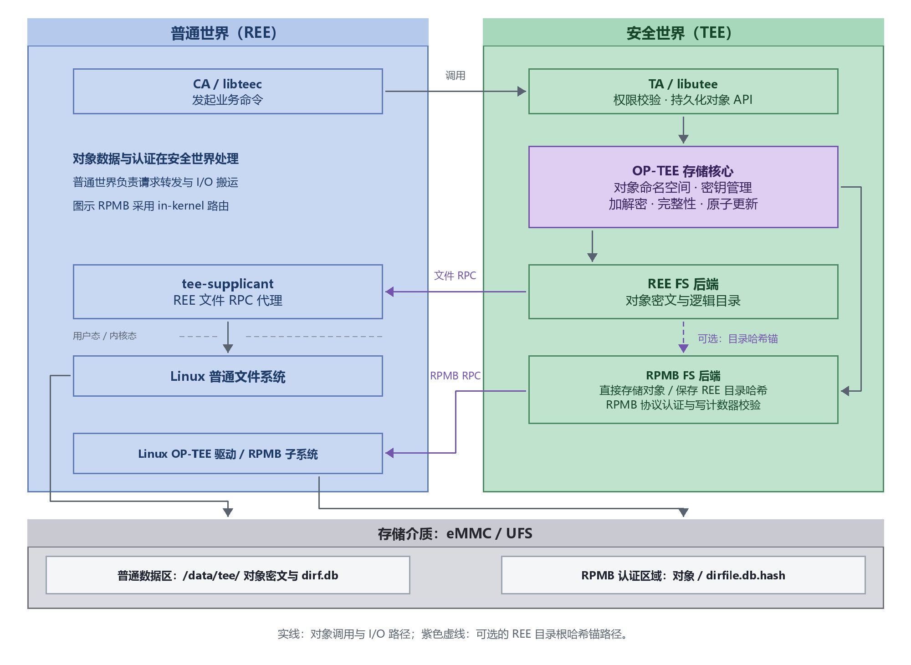

# K3 安全存储

## 关于本文

本文介绍 SpacemiT K3 平台安全存储的整体架构、密钥层次与保护机制，以及 TEE 存储接口的使用指南。通用实现原理参考 [OP-TEE 官方文档](https://optee.readthedocs.io/en/4.2.0/architecture/secure_storage.html)，平台配置以本工程实现为准。

K3 支持两种持久化对象后端：

- **REE FS**：密文保存在普通文件系统，适合容量较大的对象；开启 RPMB 目录锚后可检测目录回滚。
- **RPMB FS**：密文直接保存在 eMMC 或 UFS 的 RPMB 区域，适合容量较小、对防重放有要求的对象。

两种后端均通过 TA 内的 GlobalPlatform 持久化对象 API 使用。业务代码只需选择后端和对象 ID，不接触存储密钥。

> **密钥策略**：HUK 与 RPMB 设备标识参与每设备认证密钥派生；密钥注入与烧录步骤见[量产密钥注入与烧录](key_provisioning.md)，完整的密钥层次与生命周期见[密钥管理与安全生命周期](key_management_lifecycle.md)。

## 1. 能力概览

下表按控制镜像 / 组件列出配置归属。`CFG_*` 配置编入 OP-TEE 镜像，`CONFIG_*` 配置编入 Linux 内核，控制器的启用状态由设备树 DTB 决定；TA 的后端选择由业务代码指定。部署组合见 §3.1，驱动与组件配置见 §3.3。

| 能力 | 支持情况 | 控制镜像 / 组件 | 主要配置 | 使用条件 |
| --- | --- | --- | --- | --- |
| REE FS 对象 | 支持 | OP-TEE<br>rootfs<br>业务 TA | `CFG_REE_FS=y`<br>目录配置见 §3.3 | tee-supplicant 运行<br>存储目录可写、持久化 |
| RPMB FS 对象 | 支持 | OP-TEE<br>业务 TA | `CFG_RPMB_FS=y`<br>`CFG_RPMB_RESET_FAT=n` | **先烧写密钥并认证复验** |
| REE FS 防回滚锚 | 支持 | OP-TEE | `CFG_REE_FS_INTEGRITY_RPMB=y`<br>`CFG_RPMB_FS=y`<br>`CFG_REE_FS_ALLOW_RESET=n` | **先烧写 RPMB 密钥<br>并认证复验** |
| eMMC RPMB | 支持 | Linux 内核<br>设备树 DTB | `CONFIG_RPMB=y`<br>MMC 驱动配置见 §3.3 | 器件提供 RPMB<br>启用 MMC 控制器 |
| UFS RPMB | 支持 | Linux 内核<br>设备树 DTB | `CONFIG_RPMB=y`<br>UFS 驱动配置见 §3.3 | 器件提供 RPMB<br>启用 UFS 控制器 |
| 内核 RPMB 路由 | 支持 | OP-TEE<br>Linux 内核 | `CFG_RPMB_ANNOUNCE_PROBE_CAP=y`<br>两侧配套配置见 §3.3 | 路由为 `kernel` |
| UFS 标准 W-LUN | 支持 | Linux 内核 | 同 UFS RPMB 配置 | 非零容量 region<br>暂不注册 Advanced RPMB |
| 对象保密性与完整性 | 支持 | OP-TEE | 随存储后端启用 | TEE 自动加密、校验 |
| TA 间对象隔离 | 支持 | OP-TEE<br>业务 TA | 无独立开关 | TA 使用固定、唯一 UUID |

安全存储不解决普通世界拒绝服务、可信启动链替换、TA 业务越权等问题。同一 TA 服务多个 CA 时，仍须由 TA 校验调用者及业务权限。

## 2. 架构与组件分工



*图 1：K3 安全存储的组件分层。安全世界负责对象权限、加解密及认证；普通世界负责调用和 I/O 搬运。虚线表示可选的 REE 目录哈希锚。*

| 组件 | 主要职责 |
| --- | --- |
| TA | 校验业务权限，选择存储后端并调用对象 API |
| OP-TEE 存储核心 | 管理对象命名空间、密钥、加解密、完整性和 RPMB 协议校验 |
| tee-supplicant | 按 RPC 请求读写 `/data/tee`；不处理对象明文和存储密钥 |
| Linux OP-TEE/RPMB 驱动 | 跨世界通信，发现 eMMC/UFS RPMB 设备并搬运协议帧 |
| eMMC/UFS | 提供普通数据区以及独立的 RPMB 认证区域 |

## 3. 存储后端与介质

OP-TEE 提供 REE FS 与 RPMB FS 两种持久化对象后端，可以单独启用，也可以组合使用。两者通过同一套对象 API 提供加密和 TA 隔离，数据位置由 TA 的 storage ID 决定；REE FS 是否具有目录防回滚保护，则由 RPMB 完整性锚配置决定。

### 3.1 部署模式与配置组合

| 部署模式 | REE FS 保存内容 | RPMB 保存内容 | 防回滚能力 |
| --- | --- | --- | --- |
| 仅 REE FS | 对象密文、认证元数据与 `dirf.db` | 不使用 | 可检测篡改；不能检测完整旧状态的回放 |
| 仅 RPMB FS | 不使用 REE FS 对象存储 | 对象密文与文件系统元数据 | 由 RPMB 认证协议与写计数器保护 |
| REE FS + RPMB 完整性锚 | 对象密文、认证元数据与 `dirf.db` | `dirfile.db.hash` 中的目录根哈希及其管理元数据 | 以 RPMB 中的目录哈希校验 REE 状态，检测旧状态回放 |

在 `core/arch/riscv/plat-k3/conf.mk` 中按目标模式设置以下组合。`y` / `n` 均为明确的配置值；应修改已有项，避免重复追加 `?=` 而保留原值。

| 配置项 | 仅 REE FS | 仅 RPMB FS | REE FS + RPMB 完整性锚 |
| --- | --- | --- | --- |
| `CFG_REE_FS` | `y` | `n` | `y` |
| `CFG_RPMB_FS` | `n` | `y` | `y` |
| `CFG_REE_FS_INTEGRITY_RPMB` | `n` | `n` | `y` |
| `CFG_REE_FS_ALLOW_RESET` | `n` | `n` | `n` |
| `CFG_RPMB_RESET_FAT` | `n` | `n` | `n` |
| `TEE_STORAGE_PRIVATE` 的对象位置 | REE FS | RPMB FS | REE FS |

配置与对象位置说明：

- **容量**：仅 REE FS 的容量由普通文件系统决定；仅 RPMB FS 的对象容量受 RPMB 区域限制。
- **组合模式**：对象密文留在 `/data/tee/`，RPMB 保存目录根哈希，不保存这些 REE 对象的数据副本。
- **配置依赖**：`CFG_REE_FS_INTEGRITY_RPMB=y` 依赖 `CFG_RPMB_FS=y`。当前源码默认令前者跟随后者，部署时建议按表显式设置，便于核对最终配置。
- **对象后端**：两种后端同时启用时，`TEE_STORAGE_PRIVATE` 默认选择 REE FS；TA 可用 `TEE_STORAGE_PRIVATE_REE` 或 `TEE_STORAGE_PRIVATE_RPMB` 显式选择后端，详见 §6.2。
- **RPMB 空间**：业务只使用 REE FS 对象时，RPMB 仅承担目录完整性锚及其管理元数据；业务同时创建 RPMB 对象时，两类内容共用 RPMB 空间。
- **对象命名**：对象 ID 不等于 Linux 文件路径，TA UUID 与对象 ID 由 TEE 内部逻辑目录管理。RPMB 区域不能在 Linux 中按普通文件系统挂载。

> [!IMPORTANT]
> 量产推荐设置 `CFG_REE_FS_ALLOW_RESET=n`、`CFG_RPMB_RESET_FAT=n`。完整配置对照见 [TEE 架构的“开发模式与量产模式”](tee_architecture.md#开发模式与量产模式)。

启用 RPMB 目录锚后，如果 RPMB 已有有效目录哈希而 REE 的 `dirf.db` 丢失，处理方式如下：

- `CFG_REE_FS_ALLOW_RESET=n`：返回安全错误并保留原锚。
- `CFG_REE_FS_ALLOW_RESET=y`：允许清除哈希并重建空目录，会丢失原有对象目录状态、削弱防回滚保护。
- 仅 REE FS 模式没有 RPMB 锚，设置为 `n` 也不会新增抗回滚能力。

`CFG_RPMB_RESET_FAT` 是 RPMB FS 侧的对应开关（源码注释「Clear RPMB content at cold boot」）。置 `y` 时，OP-TEE 冷启动会跳过 RPMB 分区的 magic 校验、直接清空并重建 RPMB FS 的 FAT，等价于把 RPMB 安全存储重置为空——已有 RPMB 对象与目录锚全部丢失，削弱持久性与防回滚保护。它同样只用于测试，量产保持 `n`。

### 3.2 REE FS 目录组织

默认 REE FS 根目录由 `BR2_PACKAGE_OPTEE_CLIENT_TEE_FS_PATH` 指定，K3 使用 `/data/tee`。该目录不按 TA 或对象 ID 建子目录。`dirf.db` 保存 TA UUID、对象 ID、内部文件编号。OP-TEE 根据编号找到同目录中的对象文件。下图的 `0`、`1` 只是示例文件名，实际文件名由 OP-TEE 分配。典型布局如下：

```text
/data/tee/
├── dirf.db       # 加密的逻辑目录：关联 TA UUID、对象 ID 与内部文件号
├── 0             # 对象密文、加密元数据及认证树
├── 1             # 另一个对象的内部文件
└── ...

RPMB 区域
└── dirfile.db.hash   # 启用 REE FS RPMB 完整性时保存目录根哈希
```

需要注意：

- 对象 ID 不是 Linux 文件名；数字文件名由 OP-TEE 内部分配，不能据此判断对象归属。
- `/data/tee` 中保存的是密文和认证元数据，不应由业务程序直接修改、复制单个文件或清理“未知文件”。
- 备份和恢复必须在停止所有 TEE 存储访问后操作完整目录；只恢复对象文件或只恢复 `dirf.db` 会破坏一致性。
- 启用 RPMB 目录锚后，普通文件目录与 RPMB 中的 `dirfile.db.hash` 必须属于同一状态。恢复旧目录会被识别为回滚。
- RPMB FS 没有可挂载的 Linux 目录，其对象、FAT 元数据及 REE 目录锚均由 OP-TEE 管理。

### 3.3 支持介质与开启方式

K3 支持 **eMMC RPMB** 和 **UFS RPMB**：BSP 已包含两种介质的驱动，可将它们注册为 OP-TEE 的 RPMB 候选。启用此能力需要配置 Linux 内核和 OP-TEE 两部分。`CONFIG_*` 是 Linux 内核选项，`CFG_*` 是 OP-TEE 选项，`BR2_*` 是 Buildroot 选项。

#### Linux 内核配置

选择要使用的介质，在内核配置中开启下面的公共选项和对应介质的驱动；如果板上同时使用两种介质，两组介质配置都要开启。

两种介质共用的内核配置：

```text
CONFIG_TEE=y
CONFIG_OPTEE=y
CONFIG_RPMB=y
```

**eMMC RPMB**：开启 MMC 块设备和 K3 SDHCI 控制器驱动。内核可注册 eMMC 的 RPMB 分区；其设备标识是 eMMC 原始 CID。

```text
CONFIG_MMC=y
CONFIG_MMC_BLOCK=y
CONFIG_MMC_SDHCI=y
CONFIG_MMC_SDHCI_PLTFM=y
CONFIG_MMC_SDHCI_OF_K1=y
```

**UFS RPMB**：开启 SCSI、UFS 主机和 K3 UFS 控制器驱动。内核可注册 UFS RPMB W-LUN 中容量非零的 region；当前驱动不注册 Advanced RPMB 模式。

```text
CONFIG_SCSI=y
CONFIG_SCSI_UFSHCD=y
CONFIG_SCSI_UFSHCD_PLATFORM=y
CONFIG_SCSI_UFS_SPACEMIT_K3=y
```

内核配置以构建生成的 Linux `.config` 为准：若其中是 `# CONFIG_RPMB is not set`，即使 defconfig 写过该选项，也不会注册统一 RPMB 类，无法使用内核 RPMB 路由。

#### OP-TEE 与 Buildroot 配置

在 Buildroot 中开启 OP-TEE、TA SDK 和客户端组件：

```text
BR2_TARGET_OPTEE_OS=y
BR2_TARGET_OPTEE_OS_SDK=y
BR2_PACKAGE_OPTEE_CLIENT=y
BR2_PACKAGE_OPTEE_CLIENT_TEE_FS_PATH="/data/tee"
# BR2_PACKAGE_OPTEE_CLIENT_RPMB_EMU is not set
```

K3 的 OP-TEE 配置以 `core/arch/riscv/plat-k3/conf.mk` 为主入口。也可以通过 Buildroot 的 `BR2_TARGET_OPTEE_OS_ADDITIONAL_VARIABLES` 传入同名 `CFG_*` 变量；本文示例按 `conf.mk` 编写，使用 Buildroot 传参时应核对最终配置，避免同一变量在多个入口设置冲突值。两种介质均需 `CFG_RPMB_FS=y` 开启 RPMB FS，`CFG_RPMB_ANNOUNCE_PROBE_CAP=y` 向 Linux 声明支持内核 RPMB 路由。以下示例采用 §3.1 的 REE FS + RPMB 完整性锚组合；其他部署模式按配置矩阵调整对应项。在现有 `conf.mk` 中修改对应项，避免重复追加 `?=` 而保留原值：

```makefile
CFG_REE_FS ?= y
CFG_RPMB_FS ?= y
CFG_REE_FS_INTEGRITY_RPMB ?= y
CFG_REE_FS_ALLOW_RESET ?= n
CFG_RPMB_RESET_FAT ?= n
CFG_RPMB_ANNOUNCE_PROBE_CAP ?= y
CFG_RPMB_TESTKEY ?= n
CFG_RPMB_WRITE_KEY ?= n
```

`CFG_RPMB_WRITE_KEY` 只在受控预置镜像中临时开启，产品运行镜像保持 `n`。

实际使用还需板上器件提供 RPMB，并在设备树中启用相应控制器。

> [!IMPORTANT]
> **使用 RPMB FS 或 REE FS 的 RPMB 防回滚锚之前，必须先完成目标 RPMB 的认证密钥烧写，并通过出货固件的冷启动认证复验。** 仅开启驱动和 `CFG_RPMB_FS=y` 不能使空白 RPMB 成为可用的安全存储后端；出货固件保持 `CFG_RPMB_WRITE_KEY=n`，不会自动补烧密钥。量产烧写及验收步骤见[量产密钥注入与烧录](key_provisioning.md)。

完成配置、密钥烧写和认证复验后，再通过第 6 章的对象读写接口验证安全存储功能。Linux 源码位置为 `include/linux/rpmb.h`、`drivers/mmc/core/block.c` 和 `drivers/ufs/core/ufs-rpmb.c`；协议原理参见 [OP-TEE Secure Storage](https://optee.readthedocs.io/en/latest/architecture/secure_storage.html) 和 [OP-TEE RPMB on UFS](https://github.com/OP-TEE/optee_os/pull/7881)。

### 3.4 RPMB 路由与多设备选择

#### 两种 RPMB 路由

RPMB 路由决定普通世界由哪个组件转发 RPMB 请求，不改变安全世界的密钥派生、认证和对象保护方式。

| 路由 | 请求路径 | 当前介质支持 | 依赖 |
| --- | --- | --- | --- |
| 用户态路由（`user`） | OP-TEE → Linux OP-TEE 驱动 → tee-supplicant → MMC ioctl → eMMC RPMB | eMMC；当前 UFS 不支持此路径 | tee-supplicant 与对应 MMC 设备节点 |
| 内核路由（in-kernel，`kernel`） | OP-TEE → Linux OP-TEE 驱动 → Linux RPMB 子系统 → 存储驱动 | eMMC、UFS | Linux RPMB 子系统、存储驱动与 OP-TEE 探测能力 |

**K3 当前的 UFS RPMB 仅支持 in-kernel 路由**；eMMC 可走两种路径，推荐与 UFS 统一采用内核路由。路由由两侧能力协商确定，不能通过写 sysfs 属性切换。

按 §3.3 配置 Linux、存储驱动和设备树，并在 OP-TEE 中开启 `CFG_RPMB_FS=y`、`CFG_RPMB_ANNOUNCE_PROBE_CAP=y`。部署并启动后检查：

```sh
cat /sys/class/tee/tee0/rpmb_routing_model
# 内核路由输出：kernel；用户态路由输出：user
```

- 输出为 `kernel` 时，RPMB 帧传输不经过 tee-supplicant；REE FS 和普通文件形式的 TA 加载仍需要 tee-supplicant。
- 预期使用内核路由却输出 `user` 时，核对最终 Linux `.config`、OP-TEE 生成的 `out/include/generated/conf.h` 及实际部署镜像。

#### 多 RPMB 的默认选择与绑定

在 in-kernel 路由下，OP-TEE 按 Linux 提供的枚举顺序探测候选，默认使用**第一个通过本芯片派生密钥认证的 RPMB**：

- 第一个枚举项能够认证时，直接使用它；不能认证时继续探测后续候选。
- 多个候选均能认证时，使用其中最先探测到的一个。枚举顺序及 `rpmbN` 编号不应作为产品的固定绑定依据。
- 出货固件禁止写 key，全部候选均不能认证时，RPMB 初始化失败。
- TA 的 `TEE_STORAGE_PRIVATE_RPMB` 选择 RPMB 后端，不能指定某颗 eMMC、UFS 或某个 region。

产品需要固定目标时，可采用以下方案：

| 方案 | 运行时选择依据 | 配套要求 |
| --- | --- | --- |
| 每板仅预置一个目标 RPMB | 仅目标能够通过本芯片派生密钥认证 | 其他 RPMB 不得已有可由本芯片认证的密钥；预置流程见[量产密钥注入与烧录](key_provisioning.md) |
| DTS 禁用非目标控制器 | Linux 仅注册目标控制器提供的 RPMB 候选 | 在实际部署的 Linux DTS 中将非目标控制器设为 `status = "disabled"`，并确认不影响启动或业务数据 |

DTS 通常控制整个存储控制器，会同时关闭其普通数据访问，不能假定存在独立的 RPMB 子节点。同一 UFS 控制器可能注册多个 region；禁用控制器会同时移除这些 region，若需保留控制器而只暴露指定 region，须有对应驱动支持。

设备标识采集、量产定向烧录和绑定身份复验统一见[量产密钥注入与烧录](key_provisioning.md)第 4～8 章。

## 4. 存储密钥层次与子密钥派生

安全存储以 eFuse 中的 HUK 为硬件根，使用 TE200 密钥梯和用途隔离派生。HUK 及密钥梯恢复的工作密钥 WK 不以明文交给软件，派生结果仅在 TEE 内部使用。

| 密钥 | 在安全存储中的作用 |
| --- | --- |
| HUK | 设备唯一硬件根，保存在 eFuse 中，由安全引擎使用 |
| 存储密钥 SSK / TSK | SSK 为存储密钥层次的根，TSK 按 TA UUID 隔离对象密钥 |
| FEK | 每对象的文件加密密钥，独立随机生成，由存储密钥保护 |
| RPMB 认证密钥 | 由本芯片 HUK 与 RPMB 设备标识派生，用于介质认证读写 |

这里的存储 SSK 是 OP-TEE 的安全存储密钥，与 eFuse bank2 的硬件 SSK 分属不同层次。完整的派生链、参数和生命周期约束见[密钥管理与安全生命周期](key_management_lifecycle.md)第 2、3 章；eFuse 与 RPMB 的注入步骤见[量产密钥注入与烧录](key_provisioning.md)。

安全存储涉及的两层派生关系见下图：


图示为层次和保护关系，不表示 FEK 由对象标识确定性派生：FEK 由 OP-TEE 为每个对象随机生成，再由 TSK 封装；RPMB 认证密钥结合器件标识另行派生。CA 不能读取这些密钥明文，只提交对象数据和对象标识，后端选择与密钥处理由 TA/OP-TEE 完成。

## 5. 安全特性与保护机制

| 安全特性 | 保护机制 | REE FS | RPMB FS | 相关配置或使用要求 |
| --- | --- | --- | --- | --- |
| 对象保密性 | FEK（文件加密密钥）加密对象数据 | OP-TEE 自动加密对象 | OP-TEE 自动加密对象 | 启用对应后端；TA 不自行处理存储密钥 |
| 对象完整性 | REE FS：认证加密与哈希树；RPMB FS：HMAC-SHA256 认证 | OP-TEE 校验对象及元数据 | RPMB 认证读写 | 启用 `CFG_REE_FS=y` 或 `CFG_RPMB_FS=y` |
| 防回滚/防重放 | REE 目录根哈希写入 RPMB；RPMB 认证写计数器 | RPMB 锚保护 REE 目录状态 | RPMB 认证机制保护更新状态 | REE FS 开启 `CFG_REE_FS_INTEGRITY_RPMB=y`、设置 `CFG_REE_FS_ALLOW_RESET=n`；RPMB FS 设置 `CFG_RPMB_RESET_FAT=n`；RPMB 使用保密的设备密钥 |
| TA 间隔离 | TA UUID 命名空间；按 UUID 派生 TSK（TA 存储密钥）封装 FEK | 对象按 TA 命名空间隔离 | 同左 | TA 使用固定、唯一 UUID；CA 权限由 TA 自行校验 |
| 设备密钥绑定 | HUK 派生 SSK（安全存储密钥）；HUK 与 RPMB 标识派生 RPMB 认证密钥 | 设备 HUK 参与存储密钥派生 | HUK 与 RPMB 标识参与认证密钥派生 | `CFG_RPMB_TESTKEY=n`；完成 HUK 烧录、预置和板端验证 |

以上是 K3 对外提供的特性和启用条件。对象加密、完整性树、RPMB 协议及密钥层次属于 OP-TEE 通用实现，本文不重复展开；原理见 [OP-TEE Secure Storage](https://optee.readthedocs.io/en/latest/architecture/secure_storage.html)。

## 6. TEE 存储接口与使用指南

### 6.1 使用前检查

| 检查项 | 期望结果 |
| --- | --- |
| TEE 设备 | `/dev/tee0`、`/dev/teepriv0` 可用 |
| tee-supplicant | 使用 REE FS 或普通文件形式的 TA 加载时，服务正常运行；使用 REE FS 时，`/data/tee` 所在文件系统可写且跨重启持久化 |
| RPMB 注册 | 使用 RPMB 对象或目录锚时，`/sys/class/rpmb/` 存在目标设备，内核日志无注册错误 |
| RPMB 路由 | 与 §3.4 的部署选择一致；UFS 必须为 `kernel`，并确认 W-LUN/region 注册；eMMC 可为 `kernel` 或 `user` |
| 最终配置 | 所选部署模式的 `CFG_REE_FS`、`CFG_RPMB_FS`、`CFG_REE_FS_INTEGRITY_RPMB` 值与 §3.1 一致 |
| 量产密钥 | 使用 RPMB 时，目标已使用对应 HUK 派生密钥完成预置，并通过出货固件冷启动认证复验 |

### 6.2 选择后端和对象 ID

| 存储位置 | TA 使用的 storage ID |
| --- | --- |
| 平台默认后端（同时启用两种后端时为 REE FS） | `TEE_STORAGE_PRIVATE` |
| 明确保存到 REE FS | `TEE_STORAGE_PRIVATE_REE` |
| 明确保存到 RPMB FS | `TEE_STORAGE_PRIVATE_RPMB` |

对象 ID 由 TA 自定义，最长 64 字节；创建、读取和删除必须使用相同的后端、ID 内容和长度。选择 RPMB FS 不区分 eMMC、UFS 或 region。

### 6.3 安全存储接口

以下仅列持久化对象和存储数据访问接口。TA 包含 `<tee_internal_api.h>`；显式指定 REE/RPMB 后端时，还需包含 `<tee_internal_api_extensions.h>`。

| 接口 | 使用方法 |
| --- | --- |
| `TEE_CreatePersistentObject` | 传入后端、对象 ID 和初始数据，创建并保存对象；加 `TEE_DATA_FLAG_OVERWRITE` 可整份替换已有内容 |
| `TEE_OpenPersistentObject` | 用相同后端和对象 ID 打开对象，读取用 `TEE_DATA_FLAG_ACCESS_READ`，删除用 `TEE_DATA_FLAG_ACCESS_WRITE_META` |
| `TEE_ReadObjectData` | 从对象读取数据，检查返回结果和实际读取长度 |
| `TEE_CloseAndDeletePersistentObject1` | 删除对象并关闭句柄，之后不要再次关闭该句柄 |

### 6.4 TA 侧：官方示例的持久化对象调用

`optee_examples/secure_storage` 是 OP-TEE 官方提供的安全存储示例，源文件为 `ta/secure_storage_ta.c`、`ta/include/secure_storage_ta.h`、`host/main.c`。以下只摘取其中与持久化对象相关的语句，说明 TA 侧三种典型操作怎么写；完整文件请从随镜像源码或 [OP-TEE examples 4.5.0](https://github.com/linaro-swg/optee_examples/tree/4.5.0/secure_storage) 取得。

**命令 ID 约定（`ta/include/secure_storage_ta.h`，CA 与 TA 共用）**：

```c
#define TA_SECURE_STORAGE_CMD_READ_RAW		0
#define TA_SECURE_STORAGE_CMD_WRITE_RAW		1
#define TA_SECURE_STORAGE_CMD_DELETE		2
```

**创建对象**：先 `TEE_CreatePersistentObject` 创建对象，再用 `TEE_WriteObjectData` 写入数据（`create_raw_object()`）：

```c
res = TEE_CreatePersistentObject(TEE_STORAGE_PRIVATE,
				 obj_id, obj_id_sz, obj_data_flag,
				 TEE_HANDLE_NULL, NULL, 0, &object);
...
res = TEE_WriteObjectData(object, data, data_sz);
```

**读取对象**：先 `TEE_GetObjectInfo1` 取对象长度，再 `TEE_ReadObjectData` 读出；缓冲区不足时返回 `TEE_ERROR_SHORT_BUFFER`（`read_raw_object()`）：

```c
res = TEE_OpenPersistentObject(TEE_STORAGE_PRIVATE,
			       obj_id, obj_id_sz,
			       TEE_DATA_FLAG_ACCESS_READ |
			       TEE_DATA_FLAG_SHARE_READ,
			       &object);
...
res = TEE_GetObjectInfo1(object, &object_info);
...
res = TEE_ReadObjectData(object, data, object_info.dataSize, &read_bytes);
```

**删除对象**：以 `TEE_DATA_FLAG_ACCESS_WRITE_META` 打开后，`TEE_CloseAndDeletePersistentObject1` 删除并关闭句柄（`delete_object()`）：

```c
res = TEE_OpenPersistentObject(TEE_STORAGE_PRIVATE,
			       obj_id, obj_id_sz,
			       TEE_DATA_FLAG_ACCESS_READ |
			       TEE_DATA_FLAG_ACCESS_WRITE_META,
			       &object);
...
TEE_CloseAndDeletePersistentObject1(object);
```

官方示例使用 `TEE_STORAGE_PRIVATE`（§6.2 的平台默认后端）。要固定到 RPMB FS 或 REE FS，把上述 `TEE_STORAGE_PRIVATE` 换成 `TEE_STORAGE_PRIVATE_RPMB` / `TEE_STORAGE_PRIVATE_REE`，并在 TA 中包含 `<tee_internal_api_extensions.h>`；命令格式与 CA 侧约定不变。实际产品仍应在写入口之前完成调用者授权、对象 ID 长度与白名单、数据格式与最大长度校验；`read_raw_object()` 在 `object_info.dataSize > data_sz` 时返回 `TEE_ERROR_SHORT_BUFFER`，CA 应按 `params[1].memref.size` 返回的所需长度重新分配后重试。

### 6.5 CA 侧：官方示例的对象读写调用

`optee_examples/secure_storage/host/main.c` 提供了完整的 CA。下面摘取它对 WRITE / READ / DELETE 三条命令的参数组装与 `TEEC_InvokeCommand` 语句；对象 ID 通过第 0 个 `TEEC_MEMREF_TEMP_INPUT` 传入，写数据走第 1 个 `TEEC_MEMREF_TEMP_INPUT`，读数据走第 1 个 `TEEC_MEMREF_TEMP_OUTPUT`，命令 ID 与 §6.4 的头文件一致。CA 的交叉编译、`libteec` 链接与部署见 [CA 开发指南](ca_guide.md)“步骤 3：编译与链接”。

**写入对象**（`write_secure_object()`）：

```c
op.paramTypes = TEEC_PARAM_TYPES(TEEC_MEMREF_TEMP_INPUT,
				 TEEC_MEMREF_TEMP_INPUT,
				 TEEC_NONE, TEEC_NONE);
op.params[0].tmpref.buffer = id;
op.params[0].tmpref.size = id_len;
op.params[1].tmpref.buffer = data;
op.params[1].tmpref.size = data_len;
res = TEEC_InvokeCommand(&ctx->sess,
			 TA_SECURE_STORAGE_CMD_WRITE_RAW, &op, &origin);
```

**读取对象**（`read_secure_object()`）：

```c
op.paramTypes = TEEC_PARAM_TYPES(TEEC_MEMREF_TEMP_INPUT,
				 TEEC_MEMREF_TEMP_OUTPUT,
				 TEEC_NONE, TEEC_NONE);
op.params[0].tmpref.buffer = id;
op.params[0].tmpref.size = id_len;
op.params[1].tmpref.buffer = data;
op.params[1].tmpref.size = data_len;
res = TEEC_InvokeCommand(&ctx->sess,
			 TA_SECURE_STORAGE_CMD_READ_RAW, &op, &origin);
```

**删除对象**（`delete_secure_object()`）：

```c
op.paramTypes = TEEC_PARAM_TYPES(TEEC_MEMREF_TEMP_INPUT,
				 TEEC_NONE, TEEC_NONE, TEEC_NONE);
op.params[0].tmpref.buffer = id;
op.params[0].tmpref.size = id_len;
res = TEEC_InvokeCommand(&ctx->sess,
			 TA_SECURE_STORAGE_CMD_DELETE, &op, &origin);
```

与 §6.4 一样，CA 侧要点：

- **参数方向与位置必须与 TA 一致**：写对象是「ID + 数据」两个输入，读对象是「ID 输入 + 数据输出」，删除只有 ID 输入；两侧不一致会在 TA 侧得到 `TEE_ERROR_BAD_PARAMETERS`。
- **对象 ID 是业务标识**：不是 Linux 路径，TA 不应把 `/data/example.bin` 之类的路径直接当作对象 ID 传入 `TEE_CreatePersistentObject`；产品实现应由 TA 设计对象 ID 白名单或业务映射，不能直接信任任意 CA 输入。
- **缓冲区与容量**：读对象前先取对象长度或按业务定义固定上限，收到 `TEEC_ERROR_SHORT_BUFFER` 时按 TA 返回的所需长度重新分配后重试。RPMB 容量有限，大对象建议走 REE FS 或分块处理。
- **文件输入输出**：把 Linux 文件作为数据输入时，由 CA 在普通世界把文件内容读入内存后作为 `TEEC_MEMREF_TEMP_INPUT` 传给 TA；读回后同样由 CA 写成 Linux 文件。TA 拿到的是文件字节、不是路径，也不因此获得普通世界文件访问能力。CA 负责文件权限、路径与大小校验；文件可以是二进制数据，不需要转成字符串或 Base64。
- **RPMB 密钥与后端就绪**：使用 RPMB FS 前，目标 RPMB 必须已按[量产密钥注入与烧录](key_provisioning.md)完成密钥烧写，并通过出货固件认证复验。


## 附录：公开参考资料

| 资料 | 用途 |
| --- | --- |
| [OP-TEE 4.2.0：Secure storage](https://optee.readthedocs.io/en/4.2.0/architecture/secure_storage.html) | 可信存储概念、密钥层次与通用保护机制 |
| [OP-TEE GlobalPlatform API](https://optee.readthedocs.io/en/4.2.0/architecture/globalplatform_api.html) | 客户端与 TA API 的分工 |
| [OP-TEE examples 4.5.0：secure_storage](https://github.com/linaro-swg/optee_examples/tree/4.5.0/secure_storage) | 完整 CA/TA 示例，供开发时参考 |
